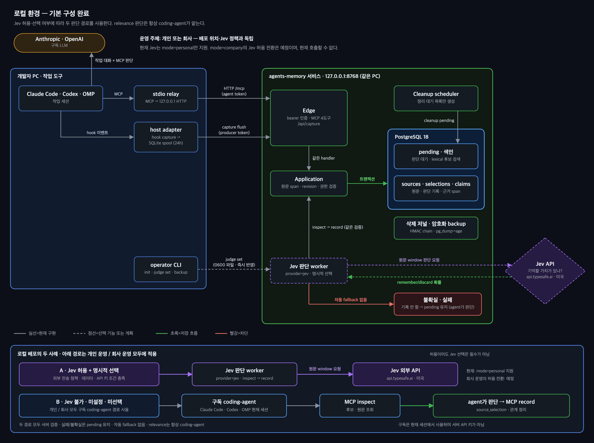
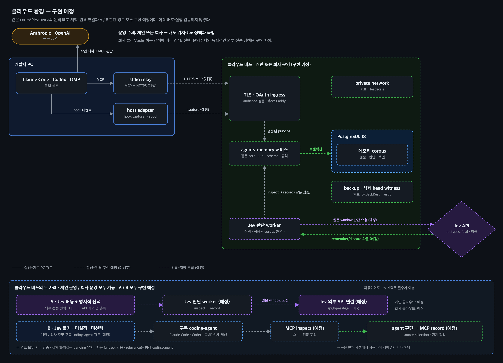

# agents-memory

**로컬 환경은 기본 구성 완료, 클라우드 환경은 구현 예정**이다. 배포 위치(로컬/클라우드), 운영 주체(개인/회사), Jev 외부 API 허용 정책은 서로 다른 축이다. 로컬 구성 완료는 회사 운영의 Jev 허용 경로까지 구현됐다는 뜻도, 1–2주 제한 trial 통과나 일반 출시 완료라는 뜻도 아니다. 다음 클라우드 구현과 운영 주체 독립적 외부 전송 정책 전환은 기존 통합 [이슈 #5](https://github.com/chonamdoo/agents-memory/issues/5)에서 관리한다. 이번 변경은 문서·그림·계획만 정리하며 코드·배포·권한·egress 설정을 바꾸지 않는다. 실행 증거는 [검증 기록](docs/verification.ko.md)의 해당 run과 범위에만 적용한다.

Python 3.12 기반의 독립적인 로컬 메모리 서비스. Agent Flow는 선택 사항이다. Claude Code, Codex, OMP, 일반 MCP client와 CLI가 같은 인증·project binding·메모리 core를 사용한다.

- 정본: PostgreSQL 18. lexical/entity index는 작은 후보 목록만 찾으며 기억 채택·관계·관련성을 결정하지 않는다.
- 판단: 기본은 지금 쓰는 Claude Code·Codex·OMP 등 구독 coding agent가 MCP로 원문 선택(`source_selection`)·관계를 판단한다. Jev 외부 전송이 허용되고 operator가 명시 선택한 경우에는 TypeSafe Jev worker가 판단한다. 불가·미설정·미선택이면 `agent` 경로를 사용하며 실패 시 자동 fallback은 없다. relevance는 항상 coding agent가 판단하고, 두 경로 모두 서버가 원문 UTF-8 span·revision·권한·삭제·snapshot을 검증한다. 로컬 모델 gateway·자동 다운로드는 없다. 현행 runtime mode의 Jev 제약은 아래 지원 상태와 구분해 설명한다.
- 파이프라인: capture → source inspect → `source_selection` → `claim_judgment` → 후보 조회 → 전체 후보 relevance 판단 → bounded context → correction/retraction → 다음 호출.
- MCP: 공식 Python SDK `mcp==2.3.0`. `2026-07-28` stateless 호출과 기존 `2025-11-25` client가 같은 handler를 사용한다. stdio는 인증된 loopback HTTP 중계이며 별도 DB/메모리 engine이 아니다.
- 연결 시 instructions·corpus·규칙 본문은 비어 있다. 도구는 `memory_context`, `memory_inspect`, `memory_record`, `memory_feedback` 네 개다. 선택 결과가 없으면 context 본문도 빈 문자열이다.

[설계](docs/architecture.ko.md) · [요구·불변식](docs/requirements.ko.md) · [구현 API 계약](docs/implementation-plan.ko.md)

## 구조

### 배포 위치 × 운영 주체 × Jev 정책

로컬과 클라우드는 모두 개인 또는 회사가 운영할 수 있다. 개인 로컬에서도 데이터·정책 때문에 Jev가 불가할 수 있고, 승인된 회사 클라우드에서는 Jev를 허용할 수 있다. **허용은 자동 선택이 아니다.** 각 corpus의 저장·외부 전송 허가와 키 조건을 충족하고 Jev를 명시 선택해야 `jev`를 쓴다. 허용돼도 선택하지 않거나 설정하지 않으면 `agent`를 쓴다.

| 배포 위치 | 운영 주체 | Jev 정책 | 판단 provider·경로 | 현재 지원 / 남은 구현 |
|---|---|---|---|---|
| 로컬 | 개인 | 허용 | 명시 선택 시 `jev`, 미설정·미선택 시 `agent` | 기본 구성 완료. 현행 `mode=personal`에서 두 경로 실행 검증 존재 |
| 로컬 | 개인 | 불가 | `agent`: 구독 coding-agent의 MCP 판단 | 기본 구성 완료. Jev 없이 inspect → 판단·record |
| 로컬 | 회사 | 허용 | 목표: 명시 선택 시 `jev`, 미설정·미선택 시 `agent` | `agent` 경로 지원. 현행 `mode=company`는 Jev 거절; 운영 주체 독립적 정책 전환 미구현 |
| 로컬 | 회사 | 불가 | `agent`: 구독 coding-agent의 MCP 판단 | 기본 구성 완료. 현행 `mode=company`에서도 Jev 없이 판단 |
| 클라우드 | 개인 | 허용 | 목표: 명시 선택 시 `jev`, 미설정·미선택 시 `agent` | 원격 서비스·연결·두 판단 경로 모두 구현 예정, 미배포·미검증 |
| 클라우드 | 개인 | 불가 | 목표: `agent`의 원격 MCP 판단 | 구현 예정, 미배포·미검증 |
| 클라우드 | 회사 | 허용 | 목표: 명시 선택 시 `jev`, 미설정·미선택 시 `agent` | 원격 서비스·연결·두 판단 경로 및 운영 주체 독립적 정책 전환 구현 예정, 미배포·미검증 |
| 클라우드 | 회사 | 불가 | 목표: `agent`의 원격 MCP 판단 | 구현 예정, 미배포·미검증 |

`agent`는 memory 서버가 구독을 API 키처럼 쓰는 방식이 아니다. Claude Code·Codex·OMP의 현재 세션이 `memory_inspect`로 원문·기억을 읽고 `source_selection`·관계를 판단해 `memory_record`로 제출한다. `jev`는 서비스의 worker가 같은 검증 경로로 기록한다. 두 경로 모두 relevance는 현재 coding agent가 판단한다. 불확실·실패는 pending이며 다른 provider를 자동 호출하지 않는다.

**현행 구현 제약:** 지금 코드는 `mode=personal`에서만 Jev를 허용하고 `mode=company`는 설정·실행 모두에서 거절한다. 이는 현재 구현 제약이지 “회사는 Jev 불가”라는 환경 정의가 아니다. 회사 운영+Jev 허용은 목표 구성이며 아직 사용할 수 없다. 운영 주체와 독립적인 egress 정책으로의 전환은 다음 구현 범위이고, 새 CLI flag나 기존 권한 변경이 이번 문서 작업에 포함된 것은 아니다.


### 로컬 환경 (기본 구성 완료)



coding agent는 stdio relay로 MCP를 호출하고, host adapter는 hook capture를 SQLite spool에 넣은 뒤 `/api/capture`로 보낸다. 서비스는 `127.0.0.1`에만 bind하며 PostgreSQL 18이 정본이다. Jev 불가·미설정·미선택인 로컬 환경에서도 구독 coding agent가 `memory_inspect` → 원문 선택·관계 판단 → `memory_record`로 기억을 관리한다. Jev 허용·명시선택 시 worker가 pending 원문 window와 관계를 판단해 같은 서버 검증으로 기록한다(현행 지원은 `mode=personal`만). relevance는 양쪽 모두 coding agent의 몫이며, 불확실·실패는 pending으로 남고 자동 fallback은 없다.

### 클라우드 환경 (구현 예정)



클라우드는 개인 또는 회사가 같은 core·API·schema를 원격에 배포하고 개발자 PC에서 안전하게 연결하는 다음 구현 작업이다. Jev 허용·명시선택이면 원격 worker가 원문 선택·관계를 판단하고, 불가·미설정·미선택이면 PC의 구독 coding agent가 원격 MCP `memory_inspect` → 판단 → `memory_record`로 처리하도록 구현한다. relevance는 항상 coding agent가 판단하며, **개인·회사 클라우드 모두 두 판단 경로가 구현 예정**이다. 원격 MCP·capture·relay transport, TLS·OAuth audience/principal·권한, private network·PostgreSQL, secret 관리, backup/restore·삭제 head witness, stop/drain·재연결, 운영 주체 독립적 명시 외부 전송 정책과 위 8개 사례 검증을 [이슈 #5](https://github.com/chonamdoo/agents-memory/issues/5)에서 관리한다. 실제 Claude/Codex 원격 실행 검증도 남아 있다. Caddy·Headscale·pgBackRest·restic은 후보이며 확정하거나 구축하지 않았다. 그림의 원본은 `docs/images/*.svg`이며 각 파일 첫 줄의 명령으로 PNG를 다시 만든다.

## 설치와 로컬 authority

```sh
uv sync --locked
uv run agents-memory --help
```

PG는 전용 database/schema로 준비한다. migrator/owner와 non-DDL app role을 나누고, owner의 기본 ACL로 app의 table SELECT/INSERT/UPDATE/DELETE 및 sequence USAGE/SELECT를 허용한다. `vector` extension을 설치한다. `public` schema CREATE 권한을 app에 주지 않는다. app 시작은 migration을 실행하지 않는다.

DSN 파일은 0600, 상위 private directory는 0700으로 준비한다. `?schema=memory`와 같이 선택 schema를 명시한다. token·DSN·원문·모델·backup은 repository에 넣지 않는다.

```sh
uv run agents-memory --config "$CONFIG" init \
  --deployment-id "$DEPLOYMENT_UUID" --realm "$REALM" --mode personal \
  --dsn-file "$APP_DSN_FILE" --migrator-dsn-file "$OWNER_DSN_FILE" \
  --state-dir "$STATE_DIR" --journal-dir "$INDEPENDENT_JOURNAL_DIR" \
  --owner-id "$OWNER_ID" --port 8768

uv run agents-memory --config "$CONFIG" project add \
  --label "$PROJECT_LABEL" --locator "$PROJECT_ROOT" --key "$REGISTRATION_KEY"

uv run agents-memory --config "$CONFIG" credential issue \
  --role agent --binding "$BINDING_ID" --output "$AGENT_TOKEN_FILE"
uv run agents-memory --config "$CONFIG" credential issue \
  --role producer --binding "$BINDING_ID" --output "$PRODUCER_TOKEN_FILE"
```

등록 응답의 opaque binding ID를 사용한다. CWD·branch·MCP session ID·요청 body의 owner/realm은 권한 증명이 아니다. 하나의 credential에 여러 project grant가 있으면 호출에 binding을 명시한다.

프로젝트 경로가 바뀌어도 memory·grant·승인 target을 새 binding으로 복제하지 않는다. operator가 현재 binding의 revision과 기존 locator를 확인한 뒤 같은 identity를 명시적으로 이전한다.

```sh
uv run agents-memory --config "$CONFIG" --token-file "$OPERATOR_TOKEN_FILE" project relocate \
  --binding "$BINDING_ID" --expected-revision "$CURRENT_REVISION" \
  --expected-locator "$OLD_PROJECT_ROOT" --locator "$NEW_PROJECT_ROOT" \
  --key "$RELOCATION_KEY"
```

새 locator는 존재하는 canonical directory여야 한다. 이전 경로는 이미 삭제됐어도 exact expected locator로 검증한다. 첫 실행은 locator·revision만 변경하고 owner·label·grant·roster·memory·frozen target은 유지한다. 같은 key/인자의 replay는 같은 결과이며, 이후 다시 이전된 binding의 과거 replay는 committed conflict로 반환한다. 경로/CWD 변경 자체는 권한이나 승인이 아니다.

배포 위치와 별개로 회사·고객·개인 corpus의 보안 경계는 유지한다. 서로 다른 deployment, database/schema, journal, state directory, token, port와 host 설정으로 격리한다. 다른 deployment로의 자동 동기화·무승인 이전 경로는 없으며, 승인된 회사 클라우드는 회사 배포다. 각 corpus의 명시적 저장·외부 전송 허가를 준수해야 하며 “회사”라는 이름만으로 클라우드 저장이나 Jev 허용 여부를 정하지 않는다. 기존 runtime 설정 `mode=personal|company`와 두 mode의 `capability: "agent_judged"` 식별자는 유지한다. 회사 coding-agent의 모델 처리 허가와 memory 저장·Jev 외부 전송 허가는 별개이며, 구독을 background API 허가로 간주하지 않는다. strict no-egress는 허가된 coding-agent 실행 경로와 OS/network 정책을 따로 구성해야 한다. 현행 `mode=company`는 Jev 설정·실행을 모두 거절하므로 허용된 회사 Jev 목표 구성을 지금 사용할 수는 없다. 같은 UID의 unrestricted agent와 private HOME만으로 악성 agent 차단이나 인간 승인을 증명하지 못한다.

`init`은 private recovery intent와 원래 operator credential을 먼저 영속화한다. bootstrap 이후 완료 receipt를 쓰지 못한 경우 같은 인자·owner·원래 token으로 `init --resume`한다. 기존 배포를 새 owner/token으로 묵시적으로 인수하지 않으며 완료 replay도 정상 변경한 설정을 초기값으로 되돌리지 않는다.

### 판단 provider: agent 또는 Jev

captured 원문을 기억할지 누가 판단할지 고른다. relevance(`memory_context` 두 번째 호출)는 provider와 무관하게 항상 그 기억을 쓰는 coding agent가 판단한다.

| provider | 판단 주체 | 외부 전송 | 현행 허용 runtime mode |
|---|---|---|---|
| `agent` (기본) | 지금 쓰는 Claude Code·Codex·OMP가 MCP `memory_inspect` → `memory_record`로 판단 | coding agent 자신의 모델 경로뿐 | `personal`·`company` |
| `jev` | 서비스 안 Jev 판단 worker가 pending 원문 window를 TypeSafe Jev로 판단 | 판단할 원문 window·기존 기억 문장이 `https://api.typesafe.ai/v1/systemone`(미국)로 전송 | `personal`만 |

`init`에서 `--judge`를 생략하면 `mode=personal` 터미널에서는 대화형으로 묻고, 비대화형·`mode=company`는 `agent`로 설정한다. 이미 설정된 배포의 `init` replay는 판단 설정을 바꾸지 않는다. 이후에는 operator CLI로 언제든 바꾼다. 실행 중인 서비스는 다음 Jev 요청 전에 파일을 다시 읽으므로 재시작 없이 반영되고, `agent`로 바꾸면 그다음 요청부터 전송을 멈춘다.

```sh
uv run agents-memory --config "$CONFIG" init ... --judge jev --jev-key-file "$JEV_KEY_FILE"
uv run agents-memory --config "$CONFIG" judge set jev --key-file "$JEV_KEY_FILE"   # 또는 --prompt-key
uv run agents-memory --config "$CONFIG" judge set agent --forget-key
uv run agents-memory --config "$CONFIG" judge status
```

- 키는 `--key-file`로 한 번 읽거나 터미널에서 화면 표시 없이 입력한다. argv·환경변수·MCP로는 받지 않는다. 서비스는 `STATE_DIR/judge/jev.key`(0600) 사본만 쓰고, 응답·상태에는 deployment별 HMAC fingerprint만 나온다. 원래 키 파일이 group/other에 읽히면 경고한다.
- 키는 저장 전에 합성 질문 1개로 검증한다. 기억 원문은 보내지 않는다. 모델은 기본 `jev-1.13.0`으로 고정한다.
- `judge set jev`는 Jev worker 전용 agent credential을 새로 발급해 현재 모든 project에 grant하고 이전 worker credential을 폐기한다. 이후 `project add`한 project도 자동으로 grant된다. restore는 credential을 회전하므로 restore 뒤에는 `judge set jev`를 다시 실행한다.
- MCP에서는 `memory_inspect(ref="judge")`로 provider·egress·worker 상태만 읽는다. 키·fingerprint·credential은 나오지 않으며 MCP로 provider를 바꿀 수 없다.
- Jev worker는 span마다 "장기 기억으로 남길 가치"를 묻고 p ≥ 0.8인 span만 원문 그대로 claim으로 기록한다(`subject="project"`, `predicate`=kind, `object`=원문 span). 모든 span이 p ≤ 0.2이면 discard한다. 그 사이이거나, tool·document 원문에 AI 지시 주입이 의심되거나, 관련 이전 거절과 같은 내용이면 기록하지 않고 pending으로 남겨 coding agent가 판단하게 한다. 정리(cleanup) 관계는 서버 검증을 통과할 수 있는 쌍만 묻고 p ≥ 0.8만 기록하며 0.5–0.8은 agent에게 남긴다.
- 기록은 agent와 같은 `inspect → record` 검증·single-winner·거절 비교를 거치고 worker credential로 남는다. reason에는 `Jev(<model>)`와 확률·임계값이 기록된다. 다른 provider로의 자동 fallback은 없다.
- 키 거절(401/403)이면 provider 설정이 바뀔 때까지 멈추고, 429·529·5xx·timeout은 짧게 재시도한 뒤 다음 주기로 미룬다. 요청·응답 본문은 로그·상태에 남기지 않는다.
- TypeSafe 문서 기준 데이터는 미국에서 처리되고 입력으로 학습하지 않으며, zero data retention은 enterprise 계약에서만 제공된다. 고객 계약은 telemetry(로그·hash·통계)의 장기 보관을 허용한다. `mode=personal`에서 이 조건을 받아들일 수 있는 corpus에만 켠다.

### 기존 배포의 명시적 전환

서비스를 정상 중지한 뒤 current operator와 명시 migrator DSN으로 실행한다. 이 문서는 live upgrade를 실행했다는 기록이 아니다.

```sh
uv run agents-memory --config "$CONFIG" --token-file "$OPERATOR_TOKEN_FILE" migrate \
  --confirm-deployment "$DEPLOYMENT_ID" --upgrade-config
```

동일 local DB/schema·current operator·exclusive authority lock을 DDL 전에 검사한다. live service·restore fence·미완료 init을 무시하지 않는다. 원래 private config bytes는 `state_dir/config-upgrade-<sha256>.json`에 보존하고 변경·audit 불일치는 거절한다. `serve`/`Store.open()`은 자동 migration·config 전환을 하지 않으며 구형 config는 `CONFIG_UPGRADE_REQUIRED`다.

migration의 coroutine 취소·timeout은 동기 DDL thread 종료가 아니다. 실제 thread가 끝날 때까지 exclusive lock을 유지하고, 중단 결과는 `MIGRATION_UNVERIFIED/unknown`으로 남긴다. 권한 효과 전에 기존 `restore-barrier.json` 위치에 migration-kind fence를 발행하며 검증 전 일반 authority 접근은 계속 차단한다. 같은 current operator·배포·설정·config 경로·원본/목표 bytes·retirement 확인으로 위 명령을 다시 실행해야 한다. 이미 목표 config가 발행됐어도 보존 원본과 exact target이 일치해야 재개한다. migration fence는 `restore-recover` 대상이 아니며 직접 삭제하지 않는다. 복구는 선택한 current package로 수행한다. 구형 recovery binary가 intent kind를 구분한다는 보장은 없다.

구형 admission에 current `request_digest`가 없으면 `ADMISSION_STALE/not_started`로 거절한다. digest를 추측해 채우거나 기록을 지우지 않으며, 현재 MCP로 원문을 다시 inspect한 admission으로 판단을 제출한다.

새 설정은 `capability="agent_judged"`, `cleanup_interval_seconds=3600`(1–86400), `read_admission_timeout_seconds=180`(1–3600)이다. `models`, `allowed_model_purposes`, `lease_seconds`, `heartbeat_seconds`, `job_attempt_limit`은 제거한다. `model`, `selection-policy`, `reflect`, `retry`, `reprocess`, `index-status`/`index-recover`는 현재 CLI에 없다.

forward revision `0006_agent_judged`는 구형 모델 claim을 `model_derived_candidate`와 `awaiting_revalidation=true`로 보존한다. caller claim으로 재명명하거나 자동 주입하지 않는다. 실행 가능한 구형 job은 원래 상태·오류·attempt·generation·시간을 audit에 보존한 채 retired로 표시하고 `pending`/`held` caller 판단 항목에 연결한다. 구형 실패를 성공으로 바꾸거나 Qwen 재시도를 시작하지 않는다. candidate-state로 저장된 구형 reject feedback도 실제 rejection으로 이전하며 correct/retracted feedback을 활성화하지 않는다.

미해결 historical model approval intent가 있으면 stopped-service maintenance에서 현재 operator로 원본 파일의 SHA-256을 확인한 뒤 같은 migrate에 `--retire-model-approval-intent "$INTENT_FILE_SHA256"`를 명시한다. opaque request digest가 아니라 **파일 전체 bytes의 SHA-256**이다. authority lock과 별도 approval lock, 원본 private 보존·원래 route 상태 audit, 모든 구형 route disable·application credential 재검증을 거친 뒤에만 exact intent를 retire한다. 원래 승인 효과는 `unknown_not_attested`이며 성공 receipt를 만들거나 Qwen route를 재활성화하지 않는다. 중단 후 같은 evidence로 재실행해도 current operator 검증을 다시 수행한다.

실제 format-one `init --resume`는 원래 서명·config·token bytes와 소유권을 보존하며 구형 필드는 decode/검증만 한다. 중단된 init을 먼저 완료하고 별도로 명시 migrate한다. 완료된 init의 재실행은 적법하게 upgrade된 동일 scope 설정을 과거 설정으로 되돌리지 않는다. 보존하는 config/서명 intent에는 DB credential·원래 operator token·key 경로가 포함될 수 있다. private 0600 evidence를 Git·PR·평문 지원 로그에 넣지 않는다. config 편집만으로 과거 credential이 폐기되지는 않으므로 필요하면 실제 DB credential/token을 회전한다. 자동 삭제나 media erasure를 보장하지 않는다.

## 공통 MCP 판단

1. producer capture는 `captured` operation과 body-free `source_pointer`, producer-reported coverage를 반환한다. capture는 기억 채택·전체 세션 관측·agent 소비 완료가 아니다.
2. agent는 `memory_inspect`로 원문을 최대 4,096 UTF-8 bytes씩 읽고 admission·revision·요청 snapshot·byte range·`window_digest`·contract metadata·span inventory를 사용해 `memory_record(kind="source_selection")`를 제출한다. 세 label 모두 reason과 non-null 현재 `policy_revision/policy_epoch`가 필요하며 epoch 0은 유효하다. 기본 `judgment_context`의 필수 비교는 관련 색인 후보 최대8개뿐이다. lexical/entity 일치는 의미 판단이나 전체 거절 이력 검토를 대신하지 않는다. 선택적으로 `rejection_cursor="history"`에서 이력을 읽고 `rejections_next_cursor`를 따른다. 적격 결과가 빈 페이지에도 다음 cursor가 있으면 계속 읽는다. 각 페이지의 `{rejection_id,decision:"unrelated"|"reopen",reason}`를 `label="review"`로 저장해 최대16개 `rejection_review_ids`에 연결할 수 있다. 직접 reopen 집합만 해당 submission의 `prior_rejection_ids`와 정확히 대응하고 receipt의 reopening ref는 다시 나열하지 않는다. 모든 label의 제출 비교·receipt는 현재 권한/snapshot/window/fingerprint로 검사하며 remember는 필수 후보와 명시 prior ref를 직접+receipt 비교로 덮는다. 무관한 새 history 때문에 기존 비교를 무효화하거나 전체 corpus 순회를 요구하지 않는다. grounded claim 게시만 `candidate_ready`, 나머지는 `selection_recorded`다.
3. 관계 판단은 `memory_inspect(ref="judgment")` 또는 pending cleanup item의 exact claim/source revision manifest를 읽고 `kind="claim_judgment"`로 제출한다. 서로 다른 페이지의 claim을 비교하려면 `ref="judgment",claim_ids=[...]`로 최대20개를 함께 선택한다. 기존 관계는 최대128개 ref를 모두 반환하며, 요약8개만 보고 전체를 읽었다고 간주하지 않는다. `duplicate`/`supports`/`contradicts`/`supersedes`는 양쪽 근거와 이유를 요구한다. 부정·예외·조건을 latest-write로 지우지 않는다. 서버의 span/형식 검사는 진실성이나 의미 판단의 정답을 보장하지 않는다.
4. 후보가 있는 첫 `memory_context`는 `status="judgment_required"`, `admission_id`, **단일 `candidate_manifest`**를 반환한다. 각 claim ID·inspection ref는 보존하고, 예산이 허용하면 UTF-8-safe 최대160-byte preview·polarity·modality·검색 arms를 함께 제공한다. preview가 축약되거나 빠지면 원문을 inspect한다. optional 기억은 아직 넣지 않고 필수 규칙만 독립적으로 전달한다. 후보가 없으면 별도 relevance 없이 적용 가능한 승인 optional rule도 전달한다.
5. agent는 필요한 원문을 inspect한 뒤 **저장된 동일 admission**과 정확히 전체 manifest의 relevant/irrelevant 결정·각 `reason`을 두 번째 context 호출에 넣는다. query·query_expansions·paths·purpose·host·snapshot의 저장된 request digest와 일치해야 한다. 빠진/추가/중복 ID·다른 요청·만료·철회·권한 변경은 거절한다. lexical 순위가 relevance 기본값은 아니며 선택 순서는 agent가 제출한 순서다.

```sh
uv run agents-memory --config "$CONFIG" --token-file "$AGENT_TOKEN_FILE" record \
  --judgment-file "$STRICT_RECORD_JSON"
uv run agents-memory --config "$CONFIG" --token-file "$AGENT_TOKEN_FILE" context \
  --binding "$BINDING_ID" --query-file "$QUERY_FILE" --expansions-file "$EXPANSIONS_JSON"
uv run agents-memory --config "$CONFIG" --token-file "$AGENT_TOKEN_FILE" context \
  --binding "$BINDING_ID" --query-file "$QUERY_FILE" --expansions-file "$EXPANSIONS_JSON" \
  --admission-id "$ADMISSION_ID" --relevance-file "$COMPLETE_RELEVANCE_JSON"
```

expansions JSON은 최대8개, 각512 UTF-8 bytes/합계4096 bytes의 문자열 배열이다. relevance JSON은 최대20개 `{claim_id,relevant,reason}` 배열이며 빈 배열은 빈 manifest에서만 유효하다. `--judgment-file`은 key/binding/kind를 포함한 완전한 strict record JSON이며 별도 record 인자와 섞지 않는다.

주기 cleanup은 의미 판정 없이 pending만 만든다. 한 transaction은 기존 pending 최대32개·고정 삽입위치20개 bucket 최대4개·binding/snapshot group 최대32개를 검사하고 durable high-water/cursor를 저장한다. `more`는 transaction 사이 event loop에 양보한 뒤 이어 처리하며 새 claim·삭제로 기존 page를 재배열하지 않는다. 다음 agent가 `memory_inspect(ref="pending",byte_start=cursor,max_bytes=4096)`로 판단한다. 만료·철회로 빈 item은 해결하고 동일하게 판단 완료된 manifest의 자동 재예약을 막는다. 각 명시 관계 판단은 자기 전체 dependency/edge를 보존하고 소비 시 적격한 동일 logical edge만 접는다. non-deriving discard/review 철회는 extraction floor를 만들지 않고 미해결 원문을 다시 연다. 기존 legacy held는 restore로 임의 해제하지 않는다.

같은 source의 겹친 discard span·새 origin의 동일 본문 remember는 `EVIDENCE_REJECTED`다. reject feedback은 연결 원문 전체에 대한 durable 차단이며 질의 한정 무관함은 context relevance로 제출한다. 독립적인 새 human/tool/document 근거와 실제 prior rejection·이유가 있어야 reopening할 수 있다. 서버는 paraphrase의 의미 동등성을 추론하지 않는다. snapshot·파생 target의 현재 전체 dependency는 별도 feedback/reason-source 읽기에도 적용한다. global claim은 scoped audit에서 생겼다는 이유만으로 private claim이 되지 않는다. `agent_note`는 raw log/inspection만 남기고 판단 admission·신규 pending·독립 수집 backlog를 만들지 않으며 memory echo도 새 독립 근거가 아니다.

Raw note·feedback reason·memory echo는 미판단 coverage에 포함하지 않는다. 이 로그만 남았다는 이유로 recall을 계속 `partial`로 표시하지 않지만, 미해결 human·일반 assistant·tool·document 원문과 불완전 capture coverage는 그대로 `partial`에 반영한다.

## Agent Flow 없이도 사용

```sh
uv run agents-memory --config "$CONFIG" host-install \
  --project "$PROJECT_ROOT" --binding "$BINDING_ID" --host claude \
  --agent-token-file "$AGENT_TOKEN_FILE" --producer-token-file "$PRODUCER_TOKEN_FILE"
```

`--host codex` 또는 `--host omp`로 같은 core에 연결한다. 설치는 소유한 project entry만 관리하고 Agent Flow/user hook을 보존한다. root `AGENTS.md`/`CLAUDE.md`에 memory corpus나 rulebook을 넣지 않는다. uninstall은 owned entry만 제거하며 사용자 변경·drift는 거절한다.

Claude MCP entry는 공유 `.mcp.json`이 아니라 개인 `.claude.json`의 native project scope에 설치한다. Git linked worktree는 Claude가 조회하는 원본 저장소 key를 사용하며 receipt는 설치 소유권과 endpoint·token 경로를 고정한다. **연결된 MCP는 리더/워크트리·호출 CWD와 무관하게 같은 credential과 project binding으로 동작한다.** CWD는 MCP 접근 권한도 추가 거절 조건도 아니다. 자동 capture와 protected-action hook의 원문·경로 attribution은 별도로 설치 project 범위를 검사한다. 서로 다른 worktree에 같은 server 이름을 동시에 등록하려면 기존 owned 설치와 충돌하며 임의 덮어쓰지 않는다. native 설치/해제의 파일 소유권 검사는 MCP 사용 권한과 구분한다.

worktree를 옮기거나 삭제할 때는 소비 프로세스를 먼저 중지하고 기존 `--project "$OLD_PROJECT_ROOT"`·host의 owned uninstall → 같은 binding의 `project relocate` → 새 stable project의 host-install 순서로 실행한다. project 경로가 없으면 `host-uninstall`은 `HOST_PROJECT_ABSENT`로 거절한다. 경로가 이동·unmount된 것이면 다시 마운트하거나 복원한 뒤 일반 uninstall을 실행한다. 실제로 삭제됐을 때만 `--project-deleted`를 추가한다. 이 정리는 해당 host/deployment/realm/runtime에 일치하는 **private completed modern receipt**만 허용하며, private native 항목만 검증·제거하고 `native_uninstalled`와 `project_entries: unverified_absent`를 반환한다. receipt는 `native_removed`로 남는다. 이 정리가 중단돼도 receipt는 durable `native_removing` 상태라 같은 범위로만 재개된다. 같은 root가 나중에 다시 나타나면 그 안의 hook과 재설치는 모두 `HOST_UNINSTALL_INCOMPLETE`로 거절된다. 이때 `--project-deleted` 없이 `host-uninstall`을 다시 실행하면 중단된 native 정리를 먼저 마치고 project 상대 hook/MCP 항목을 제거해 `removed`로 끝낸다. 이 receipt를 호출하는 hook이 다른 event로 옮겨졌거나 바뀐 사본으로 남았거나, owned TOML·native key가 바뀌었으면 `HOST_OWNERSHIP_DRIFT`로 거절하고 `native_removed`를 유지한다. 그대로 다시 생긴 owned native key는 함께 제거한다. 이전 버전이 남긴 native-only `removing` intent도 같은 범위로 판별해 `removed`로 바로 끝내지 않는다. 마무리 정리가 중단돼도(`native_finishing`) 다음 uninstall이 현재 파일을 다시 검사한 뒤에만 `removed`로 끝낸다. 예외적으로 Claude의 modern `removing` receipt는 정확한 외부 native key의 owned before→null deletion-only intent일 때만 두 중단점 이후 재개한다. project directory를 재생성하지 않는다. symlink·drift·legacy·pending install·project-local 또는 상충 recovery intent는 거절한다. 사용자 trust·다른 host/AF 설정·credentials·pending spool은 보존한다.

host-install에 사용한 package/venv도 삭제될 임시 checkout 밖에 유지해야 한다. executable·project·endpoint·token이 바뀌면 설치를 덮어쓰지 말고 owned uninstall/reinstall을 수행한다. root rulebook이나 전체 memory catalog를 설치에 포함하지 않는다.

설치만으로 매 프롬프트마다 의미 검색하거나 기억 본문을 자동 주입하지 않는다. 필요한 순간에 네 MCP 도구 또는 workflow에서 호출한다. `--prompt-recall` opt-in도 후보를 relevance 판단 없이 optional context로 승격하지 않는다. prompt 본문이 없거나 허용 크기를 넘으면 대체 검색어로 corpus를 주입하지 않는다. capture/lifecycle와 protected-action의 required-rule 검사는 이 선택과 별개다.

native workspace/MCP/hook 승인은 별도다. installer는 trust를 위조하지 않는다. Claude는 native MCP 승인이 필요할 수 있고 Codex project 설정은 trusted project에서만 로드된다. Codex noninteractive `exec`의 approval=never가 MCP 호출을 차단할 수 있다. 사용자가 검토한 선택 MCP 도구에만 per-tool `approval_mode="approve"`를 적용할 수 있으며 전체 permissions/hook trust를 bypass하지 않는다. `memory_context`는 durable admission을 만들므로 단순 무상태 read로 취급하지 않는다. [Codex 공식 MCP 설정](https://developers.openai.com/codex/mcp)을 확인한다.

generic MCP는 자동 호출/자연어 준수를 강제하지 않는다. opt-in native adapter의 capture·context·lifecycle 지원 범위도 다르다. Claude 일반 prompt의 원본 attribution, OMP print/ACP capture, Codex hosted tool guard, 후속 provider input의 실제 보존/소비는 관측 불가 경로가 있다. Claude/Codex의 지원 strict 행동은 capability gap/block으로 처리한다. **OMP의 새 `--strict` 설치는 native pre-request 예외/timeout의 fail-closed gate가 없으므로 `HOST_STRICT_UNSUPPORTED`로 설정 쓰기 전에 거절한다.** OMP의 advisory/MCP 수동 호출은 지원한다. 역사적 strict receipt는 정확한 owned uninstall/rollback용으로만 허용하며 기존 extension은 제거·재설치 후 host를 재시작해야 한다. receipt 거절이 이미 로드된 옛 host의 직접 provider 호출을 막는다고 주장하지 않는다. offered context는 consumed/enforced가 아니다.

## 호출 계약

- capture/correct는 producer token, note/feedback/context/inspect는 agent token, approval/retract/purge/migration/restore는 operator 경계를 사용한다. agent feedback은 정정 후보이지 trusted source 교체나 irreversible 삭제가 아니다.
- idempotency key는 의미 payload fingerprint와 결합한다. 같은 key·다른 payload는 conflict다. origin replay도 삭제 floor를 통과해야 한다.
- 같은 source revision·selection contract·요청 `snapshot`에서 겹치는 창은 active `complete_window` remember/discard 하나만 이긴다. 다른 세션의 두 번째 remember/discard는 `SELECTION_ALREADY_RECORDED`/`not_started`이며 message에 이긴 operation id가 있다. `review`는 누적되고, discard 뒤 remember는 기존 거절·reopen 규칙(`EVIDENCE_REJECTED` 등)이 판정한다. 판단을 바꾸려면 기존 operation을 철회한다. 게시한 claim이 모두 철회된 remember는 더 이상 창을 잡지 않지만, claim 없이 기록한 remember는 계속 창을 잡는다.
- 응답을 잃은 `source_selection`/`claim_judgment`는 key를 잊었어도 같은 판단과 같은 `admission_id`를 새 key로 다시 보내면 원래 operation을 돌려받는다. 같은 admission에 다른 판단은 `ADMISSION_CONSUMED`/`not_started`다. 소비 기록은 record receipt에 함께 남으며 기존 receipt digest는 바뀌지 않는다.
- 서비스는 동시 요청을 `max_concurrent_requests`(기본16)로 제한하고 초과 요청을 인증 전에 `SERVICE_BUSY`/503/`not_started`로 거절한다. legacy `GET /mcp`도 인증·세션 확인이 끝나 stream이 열릴 때까지는 상한에 포함되고, 열린 뒤 idle stream은 세지 않으며 세션 수 상한이 묶는다. DB 연결을 `pool_acquire_timeout_seconds`(기본5초) 안에 얻지 못하면 `DATABASE_BUSY`/503/`not_started`다. 연결을 얻은 뒤 연결이 실패하면 `DATABASE_UNAVAILABLE`/`unknown`이다. 인증은 전역 clock 잠금을 기다리지 않고, 모든 변경 트랜잭션이 잠금 아래에서 credential·grant를 다시 확인한다.
- committed capture는 queryable 기억이 아니다. `await --operation "$OPERATION_ID"`의 `captured`·`selection_recorded`·`candidate_ready`와 `causal_operation`을 구분한다. 구형 model receipt와 retired-job audit는 historical proof이며 현재 성공 상태로 덮어쓰지 않는다.
- `complete_window`는 읽은 원문 창의 판단 완료이지 전체 세션 관측·인간 현존 증명이 아니다. native source에 `HOST_SESSION_WINDOW_UNOBSERVED`·`HOST_HUMAN_PRESENCE_UNATTESTED`가 남으면 unclassified가0이어도 incomplete/partial은 남는다. 판단 미완료와 관측 범위의 한계를 구분하며 gap을 숨겨 성공으로 만들지 않는다.
- snapshot-bound source는 같은 `snapshot` 요청에서만 읽힌다. 직접 source `memory_inspect`/API/CLI도 본문 반환 전에 검사하므로 `inspect --snapshot "$SNAPSHOT"`를 사용한다. global source는 어느 요청 snapshot에서도 적격이다. source window의 `snapshot`은 요청 scope이고 `source_snapshot`은 원래 nullable source scope다. source_selection에는 window의 `snapshot`을 제출한다. 저장된 selection은 원래 `snapshot`과 `request_snapshot`을 구분한다. `stats --snapshot`도 같은 eligibility를 사용한다.
- optional 결과 기본 총 3개/2,400 UTF-8 bytes. required TRUE는 완전한 본문·revision, FALSE는 제외하며 UNKNOWN은 bounded opaque ref만 반환한다. protected action의 UNKNOWN/overflow는 거절한다. native marker/newline 포함1,800 bytes와 tool TextContent 단일 plane/16KiB wire cap은 유지한다. 큰 claim·저장 selection/judgment/feedback은 `draft_window.scope="stored_record"`의 UTF-8 JSON 조각으로 읽는다. `next_byte` 순서로 body를 이어 전체 digest/total_bytes를 검증한 뒤 decode한다. reason·비교·qualification·evidence·snapshot을 보존하며 live `epoch`는 body 밖 metadata다. 무관한 capture·claim·거절 및 epoch 자릿수 변경으로 저장 body/digest/offset이 바뀌지 않는다. claim의 현재 source 판단 context는 `judgment_context_refs`를 새로 inspect한다. 매 조각의 현재 eligibility를 검사하고 철회 body는 반환하지 않는다. 중립 표현은 core에, 실제 MCP framing byte 예산은 application에 둔다.
- 부정·조건·예외·valid time·snapshot·원문 revision/UTF-8 span과 `source_speaker`, nullable `source_event_time`, `source_recorded_at`을 보존한다. 누락 event time을 recorded/claim 생성 시각으로 대체하지 않는다. 선언된 speaker는 인간 존재·사실 검증·승인·supersession 증거가 아니다. 조건/예외는 인용 원문의 구절이어야 한다. 서버 grounding guard는 일반 factual entailment나 모든 조건 누락을 증명하지 않는다.
- 고신뢰 credential 형식과 완전한 private-key armor는 원문 digest·spool 저장 전에 `SOURCE_SECRET_REJECTED`/`not_started`/422로 거절한다. rejected body·digest·key를 로그/오류에 남기거나 derivative를 재작성하지 않는다. host는 safe gap metadata만 남긴다. 임의 모든 비밀·PII 검출이나 unmarked 복사본의 자동 의미 판정을 보장하지 않는다.
- stdio relay는 검증된 bounded HTTP 오류의 공개 code/effect를 보존한다. 연결 유실·잘못된/잘린/ID 불일치 응답의 durable 효과는 `unknown`이며 같은 business key로 소비자가 명시 reconcile한다. raw upstream 진단 전달이나 자동 mutation retry는 없다. 서비스 재시작·유휴 만료·세션 수 초과로 legacy MCP 세션이 사라지면 edge는 `SESSION_NOT_FOUND`/404/`not_started`를, 다른 credential의 세션에는 `SESSION_CREDENTIAL_DENIED`/403을 반환한다. relay는 모든 필드가 검증된 `SESSION_NOT_FOUND`/`not_started`일 때만 저장해 둔 `initialize`로 다시 연결하고 원 요청을 한 번만 다시 보낸다. 이 응답은 handler 실행 전에 나오므로 다시 보내도 쓰기가 중복되지 않는다. 재연결이 실패하거나 서버가 host가 협상한 것과 다른 protocol version을 내면 요청을 보내지 않고 `SESSION_NOT_FOUND`/`not_started`를 반환하고, 다음 요청 전에 다시 연결을 시도한다.
- convention은 candidate → exact digest/target-set revision 승인 → active rule이다. 적용 범위는 정확히 **이 로컬 프로젝트 / 내 프로젝트들 / 팀 또는 프로젝트 공유**다. 내 project target set은 frozen이며 새로운 project를 자동 포함하지 않는다. 같은 UID의 bearer를 인간 검토 증거로 주장하지 않는다. 회사 공유 승인은 구성된 별도 managed Ed25519 approver signature가 필요하다.

승인자 credential을 바꾸기 전 `credential revoke --credential-id "$ID" --preview`로 본문 없는 영향 목록을 확인한다. 활성 required rule이 영향받으면 `--ack-required-rules` 없이는 폐기를 거절한다. 폐기 후 같은 immutable proposal·frozen scope/targets를 fresh 승인 key로 재승인하면 새 rule ID와 더 높은 revision을 만든다. 무관한 project roster 증가 때문에 기존 frozen target의 재승인을 막거나 새 project를 자동 포함하지 않는다. 회사 공유 승인의 fresh managed signature 요건은 그대로 유지한다. 원문이 철회된 proposal이나 변경된 body/범위를 기존 승인으로 부활시키지 않는다.

## 운영

`doctor`, `stats`, `inspect`, bounded `spool enqueue/status/flush`를 제공한다. 신규 capture backlog는 binding별이며 legacy revalidation·cleanup·판단 불가 원문 때문에 다른 프로젝트의 수집을 막지 않는다. stats의 `current_operations/current_jobs/dlq`는 현재 미해결 복구 대상이고 `historical_operations/historical_jobs/recovery_jobs`는 원래 상태·오류·attempt와 successor disposition을 보존한다. successor 해결 뒤 historical 실패를 지우거나 현재 degraded로 계속 세지 않는다. journal은 DB restore 밖에 있으며 본문 대신 HMAC source/origin identifiers와 fsync chain을 기록한다. pending을 빈 corpus나 자동 완료로 보고하지 않는다. 제품 health metrics 대시보드·새 telemetry는 이번 범위 밖이다.

native capture spool의 pending·quarantine 본문은 원래 local enqueue부터24시간 TTL이며 retry/reopen으로 늘리지 않는다. 만료/age-unknown은 전송 전에 body를 제거하고 bounded body-free gap을 남긴다. 구형 secret은 outbox와 quarantine 모두에서 bounded scrub하며 앞 safe head의 transient 실패 때문에 뒤 secret을 보관하지 않는다. unknown remote commit은 unknown으로 유지하고 원문을 rewrite하지 않는다. nonstrict Codex child secret refusal도 locked turn/generation 흐름에서 body-free gap을 durable하게 남기며 child capture 권한을 새로 주지 않는다. 물리적 SQLite/WAL/SHM 상한을 유지하나 닫힌 파일의 deadline 즉시 삭제·clock rollback·snapshot/media forensic erasure는 보장하지 않는다. 16MiB event decode는 그만큼 원문을 저장한다는 뜻이 아니며 strict/receipt도 provider 소비·첫 행동 집행 증거가 아니다.

OMP `prepare_prompt`의 secret 거부도 재시작 후 읽히는 body-free gap을 남기며 capture/offer 권한이나 generation을 전진시키지 않는다. 늦은 capture ACK·확정 거절은 전송 때 읽은 key+digest+payload에만 적용한다. 만료 receipt가 bounded cache에서 사라진 뒤 같은 key의 새 원문이 local `durably_spooled` 응답을 받아도 이전 결과가 새 row·disposition을 덮거나 삭제하지 않는다.

`backup`은 live `pg_dump` snapshot을 age로 streaming 암호화한다. serve·migrate·backup·restore는 하나의 DB 지원 계약(PostgreSQL 18.x, pgvector ≥0.8.7)을 같이 쓴다. `pg_dump`, `pg_restore`, `psql`도 같은 major 18이어야 한다. archive에는 실제 live server·pgvector 버전을 기록하며, restore는 archive 버전이 계약 안에 있는지 확인한다. 지원하지 않는 도구·live server는 backup의 staging·recipients·journal reconcile 전에, restore의 journal reconcile·fence 전에 거절한다. 지원하지 않는 archive 버전도 restore의 journal reconcile·fence 전에 거절한다(restore staging은 종료 시 지우는 private scratch다). 모두 `DATABASE_VERSION_UNSUPPORTED`/`not_started`다. archive와 live의 버전은 각각 계약으로 검사하며 서로 비교하지 않는다. 같은 major 안의 minor 간 restore 호환은 PostgreSQL 정책을 따르며 이 저장소에서 실측하지 않았다. local mode는 각각 검증한 절대 실행 경로를, Docker mode는 명시한 owned container의 세 바이너리를 사용한다. durable plaintext dump를 만들지 않으며 독립 journal을 archive에 넣지 않는다.

`backup`, `restore`, `restore-recover`의 기본 `--runtime local`에서는 `--pg-dump-binary /절대/경로/pg_dump --pg-restore-binary /절대/경로/pg_restore --psql-binary /절대/경로/psql`을 모두 명시해야 한다. 누락은 CLI 사용법 오류이며 bare/relative·없는 파일·실행 불가능한 파일은 작업 전에 거절한다. PATH 탐색이나 자동 fallback은 없다. `--runtime docker`에서는 이 세 host 경로를 생략하고, 명시한 Docker endpoint/container 내부의 `pg_dump`·`pg_restore`·`psql`을 사용한다.

`restore`는 executor/version/schema/archive/checksum/최신 독립 deletion head를 검증한 뒤 exclusive fence를 건다. 구형 archive는 revision별 exact table allowlist로 검사하고 현재 `0006_agent_judged`로 forward migrate한다. 새 FK/table 정리와 archive SQL은 하나의 미완료 transaction에서 실행하며 authenticated age EOF·digest/크기·성공한 SQL producer를 확인한 뒤에만 COMMIT한다. 실패/중단은 기존 데이터·lineage·reservation을 rollback하지만 durable authority fence는 private recovery 전까지 유지한다. 성공 후 fresh operator/이전 token 폐기·rule 재승인·historical job retirement·surviving deletion floor를 적용한다. fresh token으로 host 설정을 갱신한다.

첫 restore marker를 durable하게 발행한 뒤 fresh token 파일을 쓰고, 그 다음 executor를 시작한다. marker 발행 전 실패는 `not_started`이며 marker/token 파일을 남기지 않으므로 동일한 `--operator-out` 경로로 원래 요청을 다시 실행할 수 있다. marker가 남은 발행 실패나 이후 token 쓰기 실패는 `UNKNOWN`이며 일반 authority 접근을 막는다. 이때 현재 operator로 `restore-recover`를 실행해야 하며, 아직 발급되지 않았거나 활성화되지 않은 fresh token을 credential로 사용하지 않는다. private recovery는 archive가 적용됐다고 증명하지 않는다.

operator가 공급한 latest head는 외부 witness의 attestation이 아니며 WAL/media/암호화된 과거 archive의 완전 삭제를 증명하지 않는다.

기존 host 설치와 token/endpoint/path가 달라지면 `host-install`은 `HOST_ALREADY_INSTALLED`로 거절한다. 기존 설정을 임의 덮어쓰지 말고 같은 `--project`·`--host`의 `host-uninstall` 후 fresh agent/producer token으로 다시 `host-install`한다. 해제는 receipt-owned entry만 제거하고 사용자·Agent Flow entry와 pending private spool은 보존한다. CLI 기본 operator 경로가 이전 파일을 가리키면 fresh `--token-file`을 명시한다.

Claude recovery intent는 canonical project의 소유한 `mcpServers.agents-memory` key만 저장·복구한다. 현재 native document에 병합하고 무관한 history/counter/trust 변경을 보존한다. 실제 native mkdir lease에 협조하며 heartbeat와 publication 직전 lease/current-bytes 검사를 수행한다. native의 모든 writer가 lock을 지키는 것은 아니므로 같은 UID의 임의 writer·정지/lease 탈취에 대한 atomic CAS 보장을 주장하지 않는다. host 설치·복구·해제는 해당 native 설정을 동시에 변경하지 않는 maintenance 구간에 실행한다.

logical retraction, local drain, provider completion unknown, local row purge와 WAL/media/backup erasure는 서로 다른 상태다. socket cancel이나 row 삭제를 모든 사본 삭제로 주장하지 않는다.

public/synthetic corpus의 1–2주 paired memory-on/off 제한 trial은 [설계 10절](docs/architecture.ko.md#10-12주-trialcloud-전환)의 고정 범위·기록·중단·판정 조건을 따른다. 로컬 환경은 기본 구성 완료지만 trial은 시작하지 않았으며 elapsed 기간·측정 효익·일반 출시 완료를 주장하지 않는다. 회사 Jev 허용을 위한 운영 주체 독립적 외부 전송 정책 전환과 개인·회사 클라우드의 서비스·연결·두 판단 경로·사례별 검증은 [이슈 #5](https://github.com/chonamdoo/agents-memory/issues/5)의 다음 구현 작업이다. provisioning·TLS·OAuth ingress·실제 원격 실행 검증도 미완료다. 이번 문서 변경은 corpus 이동·저장/외부 전송 허가나 egress 설정 변경이 아니다. publication/commit/push/PR/merge는 별도 승인이다.
