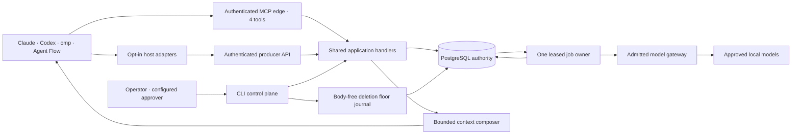

# agents-memory — 로컬 우선 설계

## 결정

**Python 3.12 + 공식 MCP SDK 2.3 + PostgreSQL 18/pgvector + 직접 소유하는 의미 엔진**을 구현한다. Agent Flow, Claude Code, Codex, omp는 같은 서비스를 쓰는 consumer다. Agent Flow를 쓰지 않아도 작동한다. 로컬과 이후 개인 cloud는 같은 schema·handler·정책 의미를 사용하되 서로 독립 배포한다.

Hindsight를 실행 엔진으로 감싸지 않는다. 입력 eligibility와 내부 writer fencing을 외부 wrapper로 강제하지 못하고 `processing=0`도 완전한 quiescence가 아니기 때문이다. 별도 vector DB, Neo4j, Redis, 두 번째 job owner, 외부 trace 서비스는 필요하지 않다. PostgreSQL 안의 edge table로 제한된 근거 graph를 구성한다. SQLite는 host의 임시 spool에만 사용한다.

이 문서는 구현 계약이다. 현재 제품의 실제 local 모델·PG·native 호출·복원 및 보장의 한계는 [검증 기록](verification.ko.md)에 있다. 설계의 실제 두 모델 토론과 제품 runtime acceptance를 서로 대체하지 않는다.

## 1. 토론 결과와 최종 수정

실제 native `gpt-6.1-sol`과 `claude-opus-5-5`를 각각 `xhigh`로 설정하여 두 번씩 호출했다. 라운드마다 양쪽에 동일 UTF-8 입력을 주었고 2라운드 입력에는 두 1라운드 원문과 추가 OSS 조사를 포함했다. 각 native 답변은 peer 의견과 자기 수정 이유를 명시한다. 입력·출력 hash는 controller가 다시 계산했다. 실제 process overlap은 1라운드 548.298초, 2라운드 434.966초다. CLI 설정·banner/modelUsage 증거이며 provider 내부 effort attestation은 아니다.

| 쟁점 | 최종 결정·이유 |
|---|---|
| Hindsight 재사용 | Opus도 2라운드에서 철회. 내부 eligibility·stale publication 제어가 검증되지 않음 |
| 추론 중 advisory lock | Codex도 철회. DB disconnect가 provider 종료를 뜻하지 않음 |
| 팀 공유=Git PR | 철회. PG 승인 ledger가 정본. Git export는 필요할 때 projection |
| 회사·개인 하나의 동기화 | 기각. 동일 계약의 독립 deployment, 회사→개인/cloud 이동 없음 |
| receipt 기록=준수 | 기각. 선택·offered·후속 model-input 관측·실제 제약 집행을 분리 |
| content+10분 중복 제거 | 기각. 명시 key+canonical digest와 영속 operation receipt |
| NFKC quote 검증 | 기각. 검색 정규화와 실제 원문 UTF-8 byte span을 분리 |
| admission 만료=drained | 기각. logical retract ack, deadline, 실제 process/buffer drain을 별도 상태로 표현 |
| OR lineage로 파생물 생존 | 독립적으로 생성된 유효 derivation이 있을 때만. 한 모델 호출의 실제 모든 입력은 dependency |

근거와 원문은 로컬 `research/local-first-native-dialogue-proof.json`, `local-first-{codex,opus}-round{1,2}.ko.md`, `local-first-{engine,host}-evidence.ko.md`, `local-first-{sie-protocol,storage-ops}-oss.ko.md`에 있다. 기존 research는 사용자 파일로 유지하고 초기 commit에 일괄 포함하지 않는다.

## 2. 구조·권위

| 경계 | 소유 |
|---|---|
| domain/config | typed command·effect/outcome·identity·policy·limit |
| store/migrations | PG schema·짧은 transaction·권한·source revision·clock·receipt |
| jobs | durable outbox·claim/heartbeat/complete fence·recovery·DLQ |
| gateway | 목적별 승인 route·immutable admission manifest·deadline·후속 publish 검사 |
| engine | extract·entity·condition/time·consolidate·index·recall·rerank·reflect·correction |
| rules/context | exact revision 승인·3 scopes·tri-state selector·한 번만 렌더링·budget |
| edge | SDK2 MCP와 producer API의 decode/auth. business policy 복제 금지 |
| hosts | 실제 lifecycle provenance·agent/context generation·전달·first-action guard·capability |
| ops/CLI | 설치·토큰·scope 선택·spool·doctor·암호화 backup·restore barrier |

## 3. identity·인증·egress

서버 credential에서 `deployment_id`, `trust_realm`, `principal_id`, role, project grant를 얻는다. 모든 배포에는 등록된 opaque `binding_id`가 있고 non-Git/unborn 프로젝트도 지원한다. workspace path·Git common-dir·branch는 등록 locator와 snapshot metadata이지 authority가 아니다. 요청 body의 human/approved/tenant 값, MCP session/request ID, clientInfo는 권한이 아니다.

Agent-plane과 producer/operator-plane의 credential을 분리한다. MCP token은 read/record/feedback만 가능하며 approval·publish·migration·backup·실제 철회 권한이 없다. producer는 인증된 adapter envelope를 capture할 수 있지만 declared speaker는 사실성 보장이 아니다. credential revoke는 다음 요청과 진행 중 publication에서도 재검사한다. Legacy MCP session도 각 호출의 현재 인증을 사용하며 session ID만으로 actor를 유지하지 않는다.

회사의 각 고객 및 개인은 독립 deployment다. 회사 profile에서 개인 provider·개인 backup·개인 cloud fallback은 없다. `company-approved-route`는 회사가 승인한 모델 처리만 허용한다. `strict-no-egress`는 승인된 내부/local weight만 허용하며 OS/network 차단은 운영 조건이다. Team Claude/Codex 계정의 no-training 약속을 외부 memory 저장 허가나 background API 승인으로 간주하지 않는다.

기본은 loopback HTTP+bearer와 exact Host/Origin allowlist다. 토큰·원문·LLM raw trace·provider reasoning은 로그나 telemetry에 남기지 않는다. HF/model artifact download는 operator의 명시 작업에서만 수행한다. runtime은 offline/no-auto-download이고 proxy 환경을 묵시적으로 상속하지 않는다. 모델 route가 없거나 무효면 `MODEL_ROUTE_BLOCKED`이지 fake embedding·source echo·cloud fallback이 아니다.

같은 OS UID의 unrestricted agent는 operator CLI와 파일에 접근할 수 있다. 개인 로컬 role 분리는 우발적 오용 방지(G0)이지 인간 현존·악성 agent 차단 보장이 아니다. 회사의 강한 공유 승인(G1)은 agent 밖 identity/approver key, 별도 OS 사용자·관리 VM 등 실제 운영 경계가 필요하다. 미구성된 회사 공유 승인은 unavailable로 표현한다.

## 4. durable write·job·철회 계약

Mutation은 `(principal, binding, command, idempotency_key)`와 정규화한 payload digest에 결합한다. 같은 key+digest는 동일 operation을 가리키고 다른 digest는 conflict다. 원문은 별도 source에만 저장하고 receipt/outbox/audit에 복제하지 않는다. replay가 철회된 과거 body를 다시 반환하지 않는다. RPC ID와 SSE ID는 business key가 아니다.

`accepted`는 source·receipt·outbox의 durable commit을 뜻한다. `semantic_ready`는 extraction/index/consolidation이 실제 완료된 상태다. `pending`, `blocked`, `failed`, `unavailable`, `partial`, `empty`를 구분한다. 지정 operation의 causal floor가 충족되지 않은 context는 `CAUSAL_NOT_READY`다.

source/index 재처리에서 새 owner를 만들면 이전 blocked/failed receipt를 retracted/성공으로 바꾸지 않으며 `successor_operation_id`로 연결한다. 명시 retry는 같은 owner의 새 attempt다. live recovery counts는 현재 durable job ownership만 반영하고 historical 집계는 전체 durable row의 현재 상태를 보존한다. related-only 입력 철회는 원문이 살아 있는 capture의 durable owner·현재 적격 claims를 유지하고 새 consolidation manifest/generation을 만든다. own-source withdrawal은 실제 retraction이며 부활시키지 않는다.

PG clock row를 짧게 잠가 권위 변경의 commit 순서를 직렬화한다. SQL sequence의 할당 순서를 commit 순서로 간주하지 않는다. job claim은 `SKIP LOCKED`를 사용할 수 있지만 claim/heartbeat/publish/retry는 모두 job ID, lease token, generation, lease deadline을 검사한다. 결과와 다음 job 등록은 한 transaction으로 commit한다. 모델 계산 동안 transaction이나 advisory lock을 유지하지 않는다.

Admission은 현재 source revision·grant·route·deletion generation·snapshot eligibility를 검사하고 **실제 전체 입력 manifest**를 영속 기록한 짧은 transaction의 commit이다. publish와 최종 delivery는 같은 검사를 다시 한다. stale worker·revoked credential·철회 입력·변경 route·deadline 실패는 결과 게시를 거절한다.

철회는 본문 없는 journal intent fsync 후 PG source tombstone·epoch·lineage eligibility 차단을 commit한다. 이것이 logical retract ack다. 이후 선형화되는 read/admission/publication은 철회 근거를 사용할 수 없다. 먼저 admitted된 provider 작업은 계속될 수 있다. 상태를 `retracted`, `local_drain_pending/local_drained`, `provider_completion_unknown`, `physically_purged`, `backup_retention_complete`로 분리한다. deadline이나 socket close를 실제 provider erasure로 보고하지 않는다.

한 모델 호출에 들어간 모든 source/claim은 파생 결과 dependency다. 인용하지 않았어도 철회 시 무효화한다. 대체 근거는 독립적으로 생성·검증된 derivation일 때만 유지한다. 숨겨진 입력을 사용한 문장을 OR edge로 살리지 않는다.

복원의 새 FK/table 정리와 구형 archive SQL은 하나의 미완료 PG transaction에서 처리한다. pinned psql은 authenticated age EOF/integrity와 SQL producer의 성공을 확인한 뒤에만 commit한다. 실패는 현재 데이터·lineage·reservation을 보존한다. marker 발행 전 파일 실패는 not_started이며 발행 후 실패만 authority fence/private recovery 대상으로 남는다. 기존 schema upgrade는 별도 명시 operator migrate이며 DDL 전에 current auth·동일 local target·exclusive authority lock을 검사하고 live service/restore fence를 거절한다.

## 5. 전체 의미 pipeline

1. **Capture**: user/assistant/tool/인용문/주입 memory를 typed envelope로 구분한다. hidden CoT를 수집하지 않는다. source identity는 안정적인 origin event와 연결되며 replay/fork export를 독립 증거로 세지 않는다. 주입 marker와 echo는 재학습하지 않는다. bounded SQLite spool은 authority가 아닌 전달 buffer다.
2. **Extract**: local/approved 모델에 schema를 지정한다. claim은 kind, subject/predicate/object, polarity, modality, conditions, exceptions, valid time, event time, code/snapshot scope, exact evidence quote/span을 가진다. 원문 span 검사는 근거 존재일 뿐 entailment 보장이 아니다.
3. **Entity·시간**: exact code identifier를 보존한다. fuzzy alias는 possible-same 후보이고 자동 병합하지 않는다. recorded time과 사실 valid time을 분리한다. dirty snapshot/branch의 finding을 현재 사실로 무조건 승격하지 않는다.
4. **Consolidate**: 호환되는 realm/binding/authority/condition/time/snapshot 집합에서 duplicate/supports/contradicts/supersedes/conditional-variant를 판정한다. 부정과 예외를 다수결이나 latest-write로 지우지 않는다. 반복 조사 signal은 확인된 독립 root-run으로만 집계한다.
5. **Index·recall**: eligible subset에서 exact vector, Hangul bigram+원문 단어+camel/snake/exact identifier lexical, entity arm을 실행하고 RRF로 결합한다. tokenizer/model manifest가 다른 벡터를 혼합하지 않는다. ANN은 필요성·scope-filter 품질을 측정하기 전 도입하지 않는다.
   Semantic extraction/route revision과 vector compatibility는 별도다. vector arm만 현재 compatible vector를 요구하고 lexical/entity/inspect 및 grounded reflection은 본문의 현행 eligibility를 사용한다. 직접 source inspect도 active snapshot-bound 원문 반환 전에 matching snapshot을 검사한다. prompt 변경으로 기존 원문을 숨기지 않으며 index 복구는 embedding만 수행한다.
   exact evidence에는 현재 canonical source의 `source_speaker`도 포함한다. extraction 입력은 이미 source metadata의 speaker를 받으며 claim hydration/recall과 consolidation/reflection 입력에서도 이를 잃지 않는다. 사람·assistant/tool/document·agent_note/memory의 선언된 출처 종류를 보존하되 인간 존재·사실 정확성·승인 증거로 승격하지 않는다. 기존 claim/spans의 source join만 필요하며 본문 재추출·schema migration은 없다.
6. **Rerank·graph**: 넓은 후보를 작은 최종 context로 줄이므로 cross-encoder를 사용한다. 최종 ≤5 item에서는 rerank한다. 반환 provenance에는 arm과 exact span을 보존한다. aggregate/all/count는 구조화된 DB 범위와 completeness를 명시하며 top-k로 전부를 찾았다고 하지 않는다.
7. **Reflect**: 명시 요청에서만 bounded manifest를 reasoning한다. 문장별 citation은 manifest 안의 유효 근거여야 하고 숫자/identifier 검증을 추가한다. 결과는 grounded candidate artifact이지 approved rule이 아니다. 전체 입력 lineage와 publish/delivery recheck를 적용한다.
   모델은 typed 응답 종류를 먼저 고른다. 원문 provenance 질문은 claim ID만 선택하고, 코드가 cited span의 speaker·event time·recorded time을 `source_provenance`로 붙인다. 모델 reflection 입력에는 source clock을 주지 않는다. assertion 응답은 문장과 limitation의 숫자·identifier·timestamp를 근거와 대조한다. 누락된 event time은 unknown이며 recorded time으로 대체하지 않는다. provenance는 validity·승인·supersession 근거가 아니다. inspect는 limitation을 문장보다 먼저 4,096 UTF-8 bytes 안에 넣고 넘치면 `partial`로 표시한다.
8. **Correction·next use**: user correction과 AI correction candidate를 구분한다. 영향받은 derived artifact를 즉시 숨기고 관련 entity group을 재처리한다. 다음 별도 host/task에서 수정 근거를 실제 선택하는 것까지 확인한다.

자료형 claim은 의미 단위를 유지하며 단순 200자 절단으로 조건/부정을 잃지 않는다. RAG skill의 prose 200자/60 overlap은 문서 검색용 기본과 provenance가 다른 규칙이다. 채택 시 문서 embedding view에만 적용하고 claim·원문·조건은 유지해야 한다. 초기 memory index는 atomic claim을 사용하므로 이를 일반 문서 chunk 최적화의 성능 증거로 포장하지 않는다. 후보 Top20, 최종 최대 3 optional은 설계 기본값이며 실측 품질·token 수가 아니다.

## 6. 규칙 활성화·범위

사용자에게 선택지는 정확히 세 개다.

1. **이 로컬 프로젝트**
2. **내 프로젝트들** — 승인 당시 동일 realm의 명시 project ID 집합+target-set revision. 새 프로젝트는 새 동의 필요.
3. **팀 또는 프로젝트 공유** — 구성된 approver와 대상 audience. 팀 전체 배포를 강제하지 않으며 project 공유도 가능.

Candidate body/selector/예외/required 여부/target set/authority/revision digest를 승인에 결합한다. cancel·미응답은 candidate만 남긴다. 범위나 body가 바뀌면 다시 승인한다. PG ledger가 유일 정본이고 Git/skill export가 필요하면 projection으로 만든다. root AGENTS.md/CLAUDE.md나 eager rulebook에 body/catalog를 설치하지 않는다.

승인자 credential 폐기는 먼저 body-free 영향 목록을 보여 주고 required rule 영향에 대한 명시 ack를 요구한다. eligible inactive proposal의 재승인은 기존 immutable 내용·frozen scope/targets를 재검증하고 새 ID/더 높은 revision을 만든다. 무관한 roster 증가가 같은 frozen target 재승인을 막지 않으며 새로운 project/범위를 자동 포함하지 않는다. 회사 공유의 fresh G1 signature 요건은 유지한다. 예전 credential·복원 전 approval receipt·철회 원문을 활성 권한으로 되살리지 않는다.

Selector는 true/false/unknown이다. 필수 FALSE는 제외하고 UNKNOWN을 false로 바꾸지 않는다. 일반 조회의 UNKNOWN은 bounded opaque ref와 미결 개수만 반환하며 규칙 본문·승인 stamp를 제공하지 않는다. protected action은 UNKNOWN/overflow를 거절한다. TRUE의 원문·revision을 제공한 receipt만으로 모델 소비·자연어 준수·보안 집행을 주장하지 않는다. 후속 provider input을 확인할 수 없는 native 경로는 strict capability gap이며 검증 가능한 규칙은 lint/validator/ACL로 집행한다.

## 7. host·context 계약

Per-agent key는 principal, binding, host thread, agent lineage/path, context generation을 분리한다. compact/resume/fork/child에서 현재 입력 보존을 확인하지 못하면 generation과 delivery 상태를 갱신한다. Codex parent session ID만으로 child를 묶지 않는다. omp는 `ctx.agent`별 상태이고 재진입/cache warming/provider retry를 새 소비 증거로 세지 않는다.

지원 adapter는 capture·optional on-demand context·first-action guard를 opt-in으로 제공한다. generic MCP는 manual 호출과 서버 invariant를 제공하지만 모델의 모든 prompt/tool 호출을 강제하지 못한다. 실제 후속 model-input 순서나 Bash/IDE/hosted tool footprint를 관측할 수 없는 경로는 capability gap이다. Claude/Codex의 지원 strict 보호 행동에서는 block하며 우회 허용을 full support로 보고하지 않는다. **OMP는 pre-request callback 예외/timeout이 dispatch를 계속하는 native 계약 때문에 새 strict 설치를 설정 쓰기 전에 거절한다.** Session.abort가 준비 중 prompt generation을 무효화하는 경로는 존재하므로 모든 cancellation이 불가능하다는 주장도 하지 않는다. 모든 dispatch 경로의 fail-closed gate로 검증한 것은 아니다. 현재 지원 OMP는 advisory/manual MCP이며 역사적 strict 설치는 owned 제거·advisory 재설치·host 재시작이 선행돼야 한다. managed wrapper의 보장도 등록된 지원 경로로 제한한다.

호스트가 `i`를 제거하거나 empty optional string을 생략하거나 `local://`를 실제 경로로 재작성할 수 있으므로 business schema는 그런 의미에 의존하지 않는다. required handle/key는 nonempty다. adapter 설치는 소유한 project entry만 변경하며 AF managed hook을 덮어쓰지 않는다. native hook trust는 별도 실제 host 승인/관측이다.

Claude의 owned MCP는 공유 프로젝트 파일이 아니라 private native local config에 둔다. recovery intent는 소유한 project MCP key만 기록하며 현재 document에 병합한다. 실제 native mkdir lease에 협조하고 heartbeat/ownership 및 publication 직전 현재 bytes를 검사한다. pinned native의 모든 writer가 협조하지 않으므로 arbitrary same-UID writer·lease 탈취에 대한 atomic CAS는 주장하지 않으며 host 변경은 quiescent maintenance에서 수행한다. Git-worktree native key는 원본 저장소 identity지만 memory receipt/binding/token은 설치 worktree에 고정한다. 잘못 상속한 CWD의 native relay는 fail closed다. 기본 prompt recall은 꺼져 있으며 opt-in context도 marker를 포함한 1,800 UTF-8 bytes 이내다. Codex token 근사치 상한은 byte 상한의 대체 증거가 아니다. private spool은 TTL/실제 DB·WAL·SHM 크기를 제한하고 손실을 gap로 반환한다.

Spool 원문 TTL은 원래 local enqueue의 durable deadline이며 pending/격리/retry/reopen으로 갱신하지 않는다. 접근과 전송 직전 expiry를 집행하고 unknown-age legacy 입력은 제거/gap로 보고한다. bounded expired receipt는 원격 non-commit 보장이 아니다. 닫힌 파일의 즉시 물리 삭제·clock rollback·media forensic erasure는 별도 경계다. stdio는 검증된 bounded HTTP code/effect만 보존하며 전송 결과 미확정은 unknown으로 보고하고 자동 mutation retry를 하지 않는다.

Worker heartbeat의 일시적 deletion barrier/DB/transport 장애는 마지막 성공 갱신의 monotonic deadline 안에서만 interval-paced 재시도한다. 성공한 renewal만 cutoff를 연장하고 terminal lease/auth/source 실패는 즉시 중단한다. admission은 동일 token/generation 및 모든 불변 lease field의 owner가 갱신한 더 최신 durable deadline만 허용한다. heartbeat/publication은 exact-current deadline/full lease를 계속 요구한다. lost renewal response를 오래된 deadline 허용으로 복구하거나 stale result를 publish하지 않는다. 삭제 journal 복구·backup/restore의 최신 exact head도 prefix 허용으로 완화하지 않는다.

Binding relocation은 operator 명령이며 `expected_revision`과 기존 locator를 함께 비교하는 CAS다. 같은 binding ID와 source history를 유지하고 revision만 올린다. 이전 locator의 snapshot은 새 위치에서 publish하지 않는다. native 설정은 이전 receipt의 owned entry를 정리한 뒤 새 위치에 다시 설치한다.

프로젝트 경로가 없으면 `host-uninstall`은 거절한다. 삭제가 확실할 때만 operator가 `--project-deleted`로 확인한다. 이때 private native 항목만 검증·제거할 수 있으므로 receipt는 `native_removed`, 결과는 `native_uninstalled`와 `project_entries: unverified_absent`다. 이동·unmount였던 root가 다시 나타나면 같은 receipt로 일반 `host-uninstall`을 실행해 project 상대 hook/MCP 항목을 제거하고 `removed`로 끝낸다. 그 전 stale hook과 재설치는 `HOST_UNINSTALL_INCOMPLETE`로 거절한다. 완료 전 hook 문서 전체에서 이 receipt를 호출하는 group이 남았는지 검사하고, 바뀐 owned hook·TOML·native key는 부재로 보지 않고 `HOST_OWNERSHIP_DRIFT`로 거절한다. 그대로 다시 생긴 owned native key는 제거한다. 이전 형식의 native-only `removing` intent는 validated plan으로 범위를 판별해 `native_removed`로 끝낸다. 재등장 root의 정리 intent는 `native_finishing`으로 기록하고 재개해도 `native_removed`로만 끝나며, 현재 파일을 다시 검사해 남은 항목이 없을 때만 `removed`를 쓴다. `host-install`과 `host-uninstall`은 ownership lock을 기다리기 전에 root 디렉터리를 descriptor로 고정하고, lock을 얻은 직후 경로가 symlink를 따르지 않고도 그 디렉터리(device/inode)를 가리키는지 확인한다. 기다리는 동안 root가 사라지거나 다른 디렉터리로 바뀌었으면 중단된 `pending`/`removing` 재개를 포함해 아무것도 바꾸지 않고 `HOST_CONFIG_DRIFT`(effect `not_started`)로 멈춘다. intent 기록·적용·재개와 uninstall 검사는 project 파일을 그 descriptor 기준으로 읽고 쓰고 지운다. 따라서 작업 중 경로가 이동·unmount·교체돼도 부재가 삭제 완료로 읽히지 않고, 비워진 경로가 다시 만들어지지 않는다. intent를 기록하기 전과 terminal receipt를 쓰기 직전(legacy receipt 정리 뒤)에도 같은 확인을 하고, terminal 기록 전에는 replay한 파일을 다시 읽는다. 어긋나면 receipt와 recovery intent를 보존한 채 `HOST_CONFIG_DRIFT`로 멈춘다. owned 항목 변경(project 파일 쓰기·삭제, native 설정 publication, rollback)을 시도했거나 intent를 기록·replay한 뒤의 거절은 코드와 메시지를 유지한 채 effect `unknown`으로 보고한다. 첫 변경 전 거절만 `not_started`다. receipt는 inode가 아니라 경로에 묶인다. 명령과 명령 사이(예: 중단 뒤)에 같은 경로의 디렉터리를 바꾸면 새 디렉터리를 그 경로의 project로 검사하므로, project를 옮기기 전에는 기존 경로에서 uninstall한다. hook 명령은 `args` 유무와 관계없이 shell 해석한 argv 토큰 안(`--receipt=PATH` 포함)과 원문·인용 경로로 receipt를 찾고, shell로 해석할 수 없는 남의 hook은 참조로 보지 않는다. 삭제 cleanup은 symlink 경로를 쓰지 않는다. 삭제 정리 intent는 receipt 상태 `native_removing`으로 범위를 durable하게 기록한다. 중단 뒤에는 root 존재 여부와 관계없이 exact native key 제거만 재개해 `native_removed`로 끝내며, root가 있으면 같은 호출이 project 항목 정리로 이어진다.

Model approval은 `model-approval.lock` 아래에서 config publication과 DB route adoption 사이의 secret-free intent를 남긴다. intent는 request·이전 config·target digest만 담는다. 같은 요청의 retry만 이를 이어받는다. credential 교체나 restore로 요청이 달라지면 operator가 `--supersede-pending-intent <intent SHA256>`로 명시 교체해야 한다. 교체 쓰기 실패는 `MODEL_APPROVAL_RECOVERY_REQUIRED`/unknown이다. 교체 뒤 adoption이 확정 실패하면 config를 되돌리고 원래 intent bytes를 복원해 이전 unknown 승인을 지우지 않는다. 같은 semantic revision에서 purpose를 줄이면 같은 transaction에서 빠진 route를 끄며, 이전 admission은 stale이 된다.

연결 시 server instructions와 corpus/규칙 body는 0이다. agent-plane tool은 네 개다.

| tool | 요청·결과 |
|---|---|
| memory_context | query, recall/reflect mode, optional known paths/causal operation/budget. bounded 근거 또는 reflect operation |
| memory_inspect | opaque item/operation ref의 현재 유효 근거/상태 |
| memory_record | agent note·rule candidate. nonempty idempotency key |
| memory_feedback | correct/reject/retract-request. agent의 irreversible approval/purge 아님 |

동일 handler를 modern/legacy SDK edge에서 호출한다. HTTP가 기본이며 필요 stdio는 인증된 HTTP thin shim으로서 같은 core를 쓰고 별도 memory engine을 만들지 않는다. actor 없는 전역/default binding은 없다. credential에 정확히 하나의 project grant가 있으면 그것을 서버가 해석할 수 있으나 ambiguity는 오류다.

MCP result body는 직접 만든 TextContent 한 plane에만 넣는다. 자동 typed return으로 body가 content와 structuredContent에 중복되지 않게 한다. control stamp는 작은 `_meta`/private API로 분리한다. 초기 optional context 3 item/2,400 UTF-8 bytes, tool 결과 기본 6KiB·최대 JSON-RPC body 16KiB를 운영 가정으로 둔다. required body는 중간 절단하지 않고 optional 제거 후 overflow 시 block한다. 실제 wire bytes, 실제 host 보고 tokens, estimated tokens를 별도 기록한다.

## 8. 채택·참고·기각 OSS

| 구성 | 선택·영향 |
|---|---|
| [공식 Python SDK2.3.0](https://github.com/modelcontextprotocol/python-sdk/tree/2118f14f8a19bc158d8a1cf90af58d85d187f849), MIT | 채택. 단일 ASGI edge·같은 handlers·명시 lifespan·현재 요청 인증 |
| [SIE](https://github.com/superlinked/sie/tree/c571e0a75d804cb6d49795a99cd03ea901307a69), Apache-2.0 | 참고만. `mcp>=1.9,<2`/v1 FastMCP라 SDK2 기반이 아님. clamp·auth ASGI·결과/측정 구분 패턴 참고; 0.0.0.0·보호 off·정적 secret OAuth 기본값 제외 |
| [PG18](https://www.postgresql.org/support/versioning/), [pgvector ≥0.8.7](https://github.com/pgvector/pgvector/tree/f37c13f68b57d2c3472b2214fbcff699d6d34876), PostgreSQL license | 채택. 실제 image/extension version과 digest를 확인해 lock. 하나의 권위+vector+lexical+graph+jobs |
| asyncpg Apache-2.0·Alembic MIT | 채택. 명시 migrator·forward migration·짧은 lock, 앱 시작 자동 migration 없음 |
| Procrastinate·PgQueuer·pgmq | SQL claim/retry 아이디어만 참고. lease-generation 완료 fence를 직접 소유 |
| Hindsight | semantic pattern 참고, runtime·MCP·내부 job 미채택 |
| SQLite stdlib, public-domain | spool만. CueFinder 앱/코드그래프 재사용과 무관 |
| Kiwi·pg_bigm | 초기 필수 아님. model license·품질·추가 native dependency 확인 후 별도 선택 |
| [llama.cpp](https://github.com/ggml-org/llama.cpp/tree/5c8854fd88319125125dc4b836c98b1b215b0f23), MIT | local generation executor. native Metal, loopback·key·offline·web UI off |
| [BGE-M3](https://huggingface.co/BAAI/bge-m3/tree/5617a9f61b028005a4858fdac845db406aefb181), MIT | 1024-d multilingual embedding. checkpoint·pooling·normalization·runtime pin |
| [BGE reranker v2 M3](https://huggingface.co/BAAI/bge-reranker-v2-m3/tree/953dc6f6f85a1b2dbfca4c34a2796e7dde08d41e), Apache-2.0 | bounded cross-encoder. runtime compatibility·Korean 품질 실측 필요 |
| [Qwen3.5-9B](https://huggingface.co/Qwen/Qwen3.5-9B/tree/c202236235762e1c871ad0ccb60c8ee5ba337b9a), Apache-2.0 | 현재 48GiB host의 local generation 후보. 실제 quantized artifact·원본/변환 pin·한국어 fixture 검증 |
| Jev·BAML | typed judgment/interface 아이디어 참고. Jev hosted proprietary route를 회사 default로 추가하지 않음. Pydantic schema가 truth/authority 보장이 아님 |
| pg_dump+age BSD-3-Clause | local encrypted backup. PG restore 밖 deletion journal 유지 |
| pgBackRest≥2.59.3·restic·Caddy·Headscale | cloud/운영 필요 발생 후 선택. 지금 새 infra나 외부 backup을 만들지 않음 |

현재 host 48GiB/18 logical CPU, 전용 Colima 2CPU/4GiB/30GiB다. PG만 VM에 두고 모델은 host에 둔다. BGE embedding/rerank의 GGUF 호환성을 추정하지 않으며 확인된 native llama.cpp 또는 원본 checkpoint Python runtime을 사용한다. weight·변환기·실제 artifact hash·license와 schema를 manifest로 남긴다. 더 작은 모델로 품질 미검증 자동 fallback하지 않는다.

## 9. 로컬 구현·검증 순서

1. 작업 소유 SPEC/계약/metadata만 bootstrap commit. 기존 research 보존.
2. 설치된 AF0.3.15 `0ffba881`의 development workflow를 실제 isolated worktree에서 시작. Python local profile gates와 두 native reviewer model/effort를 사용.
3. typed domain·config·API를 고정하고 PG schema/receipt/jobs/journal과 모델 semantic executor를 독립 slice로 구현. integration owner가 shared interface를 소유.
4. core handler·MCP/producer/CLI·rule·host adapter·ops를 연결. concurrent writer는 build/lint/tests를 돌리지 않고 integration 이후 한 owner가 실행.
5. 실제 PG·local 모델·서비스로 아래 acceptance를 수행. native reviewer는 AF review phase runner가 실행. 실패는 fix-loop로 처리.
6. 실제 service/manual·native consumer E2E와 local handoff. 원격 push/PR/merge는 하지 않음.

### 실제 acceptance

| ID | 시나리오 |
|---|---|
| A01 | 실제 PG의 concurrent duplicate/lost-response replay는 하나의 operation, changed digest는 conflict |
| A02 | lease 만료/회수 후 이전 heartbeat·publish·다음 job 생성은 거절 |
| A03 | 모델 계산 중 철회/credential revoke/route 변경 후 stale 게시 0 |
| A04 | 철회와 delivery race는 선형화 stamp 또는 stale refusal. drain/physical 삭제 상태 별도 |
| A05 | 한국어·영어 부정/조건/예외/시간/identifier를 실제 모델로 추출·검색·rerank |
| A06 | contradiction·consolidation·문장별 cited reflect와 모든 입력 lineage |
| A07 | human correction 후 다른 session/host의 다음 read에 반영 |
| A08 | 독립 surviving derivation 없이 철회 입력의 파생 body 생존 0 |
| A09 | source 철회 전 backup restore/spool/import replay로 부활 0, head 없으면 fail closed |
| A10 | exact 3 scopes·cancel·target-set 변경·agent approval denial·cross-realm denial |
| A11 | native host별 실제 MCP protocol/도구 호출과 지원 lifecycle·보호 첫 행동. 미관측은 pass 아님 |
| A12 | body 한 plane·startup corpus0·byte ceiling·estimated/actual token 구분 |
| A13 | unauthorized/Host/Origin/oversize/cross-binding 거절, secret-free 오류 |
| A14 | route 없음/egress 금지 때 full-loop blocked. 실제 local 모델 실행 경로 별도 proof |
| A15 | bounded spool/gap·DLQ·stop/drain·encrypted backup/restore·token rotate/revoke 실동작 |
| A16 | AF run 자체의 실제 explore→implement→review/fix→QA→local handoff |

## 10. 1–2주 trial·cloud 전환

처음은 public/synthetic corpus이고 회사 자료는 제외한다. 실제 시작 시각을 기록하며 기간을 이미 통과했다고 하지 않는다. memory-on/no-memory/동일 corpus·모델·예산 hybrid baseline을 같은 task에서 비교한다. 기록은 조건 누락·근거 오류·정정 재사용·false promotion·capture gap·blocked 행동·job 정체·token·wire bytes·왕복·p50/p95·비용·운영 시간을 포함한다.

즉시 중단: realm 누출, 미승인 egress, 철회 부활, agent 무승인 활성화, 지원한다고 선언한 보호 행동 우회, 숨겨진 gap/오류, root full-rule 설치, 중복 효과. false claim/관측 없는 context receipt를 정상으로 처리하지 않는다. 원문을 metric에 복제하지 않는다.

local acceptance와 실제 trial 이후 **개인 corpus만** 같은 artifact/schema/API로 cloud에 이전한다. TLS/OAuth audience·네트워크·identity·backup·삭제 head witness를 그때 구성한다. legacy transport scaling 정책과 active-job drain도 필요하다. 회사 corpus는 cloud migration 대상이 아니다. 현재 cloud provisioning은 하지 않는다.
