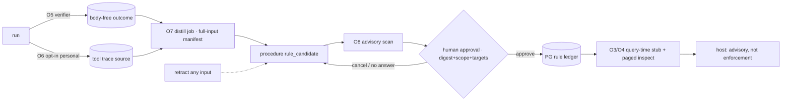

# Rafal Wilinski(Runlayer) 「자기개선 에이전트·Skills over MCP」 영상 — 1차 원문·baseline 독립 비판 (Opus)

- **작성**: 2026-10-12, Opus 5.5 xhigh 조사 전용 pane(herdr `w18:p4`)
- **기록 위치**
  - 사용자 요청에 따라 GitHub issue로 별도 기록한다.
  - 원래 지정된 worker-local 경로는 `<AF worktree>/.agent-flow/research/skills-memory-pipeline-20261012/opus-video-primary.ko.md`였다. 실행 중인 AF run의 worktree 보호 hook가 이 host session의 쓰기를 거절해서 만들지 못했다.
  - 같은 본문을 왼쪽 pane(`w18:p1`)에 전달했다.
- **baseline 기준**
  - 로컬 AF worktree `~/.agent-flow/worktrees/agent-memory-mcp-97e899f21134/feat-local-first-memory-pipeline`의 2026-10-12 working tree다. branch는 `agents-memory`, HEAD는 `e889c37c`다.
  - 아래 줄 번호는 이 working tree 기준이다. 원격 branch 상태와 다를 수 있다.
- **성격**: 조사 기록이다. 구현 branch와 frozen review의 입력이 아니다. code/config/settings/cfg, global `defaultThinkingLevel`, 기존 AF 실행·gate·결과는 바꾸지 않았고 test/build/format도 실행하지 않았다.
- **범위**: 두 영상의 실제 자동 영어자막 원문과 baseline 문서(`docs/architecture.ko.md:93–147`, `README.md`, `docs/verification.ko.md`)를 읽었다. baseline 주장을 확인하는 데 필요한 최소한의 소스도 읽었다.
- **이 문서에서 읽지 않은 것**
  - `modelcontextprotocol/ext-skills` 사양 본문, 공식 extensions/client-matrix, ai-that-works, humanlayer, boundaryml/baml.
  - 이들은 병렬 1차 source auditor가 맡고, merged packet에서 교차 확인한다.
  - 영상 속 사양 상태 발언은 발표자의 진술로만 다룬다.
- **수집 경계**: 공개 영상의 발화와 공개 메타데이터, 로컬 baseline 문서·코드만 읽었다. 회사 corpus, secret, hidden CoT는 수집하지 않았다.

### 증거 표기

| 표기 | 의미 |
|---|---|
| [원문] | 자막 파일의 cue를 직접 확인했다. 인용은 ASR 철자 그대로다 |
| [메타] | YouTube 페이지 reader 결과다. fetch budget이 소진되어 부분 결과다 |
| [baseline] | 현재 worktree의 문서·코드 줄을 직접 확인했다. 경로는 worktree 루트 기준이다 |
| [INFERENCE] | 위 근거로부터의 추론이다. 관측이 아니다 |
| [미공개] | 영상 음성에서 제시되지 않았다. 슬라이드에만 있었을 가능성은 자막으로 판별할 수 없다 |
| [병렬확인] | merged packet의 사양·OSS 원문으로 확인해야 한다 |

## 0. 결론

1. **지금 도입할 기능은 없다.**
   - 영상의 실질 제안은 「성공·실패 run trace를 frontier LLM이 skill로 자동 증류 → 자동 검사(prompt injection·PII 등) → MCP gateway로 회사의 모든 client·agent에 자동 제공」이다 [원문 C10–C15].
   - 전달 계층에 해당하는 부분은 agents-memory가 이미 더 엄격하게 갖고 있다. MCP tools, 연결 시 corpus 0, on-demand bounded context, PG 정본 ledger, candidate≠approval, 정정·철회 lineage가 그것이다.
   - 나머지 핵심인 무인 자동 승격과 조직 기본 배포는 baseline 불변식과 정면으로 충돌한다.
2. **36%→100%는 발표자의 사례 주장이다.**
   - 원문이 주는 정보는 네 가지뿐이다 [원문 C12]: Chromium fork를 AWS Lambda에서 실행하는 task, Sonnet 4.6, 36%, 그리고 「한 run이 성공 → distiller가 skill 생성 → 이후 모든 run에 포함 → 100%」.
   - run 수·분모·기간·성공 판정·holdout·로그·실험 repo는 없다 [미공개].
   - 같은 task에서 증류한 절차를 같은 task의 「future runs」에 재사용했다. in-distribution replay이므로 일반화 증거가 아니다.
   - 증류자는 executor보다 강한 「frontier LLM」이다 [원문 C10].
   - 실패 run 증류는 일반론으로만 말했고, 이 사례의 원인으로 제시되지 않았다.
   - 「같은 Sonnet 4.6」은 Tech Bridge 설명문의 표현이다. 자막은 이전 조건만 Sonnet 4.6이라고 말한다 [메타·원문].
3. **진짜 gap은 있다(코드로 확인).** 상세는 §6.2에 있다.
   - 검증된 run outcome 신호가 없다.
   - tool trace를 수집하지 않는다.
   - 긴 승인 절차를 전달할 경로가 없다. budget을 넘는 optional rule은 ref 없이 count만 남고, `memory_inspect`도 4,096B를 넘는 body를 반환하지 않는다.
   - optional rule은 query 관련성이 아니라 id 순으로 선택된다.
   - 내용 안전 gate가 없다.
   - 의존성 변경에 따른 무효화가 없다.
   - rule 제공과 실행 결과가 연결되어 있지 않다.
4. **권고**
   - **now**: 코드 0. 측정 프로토콜과 기존 `rule_candidate` 경로 사용 지침만 둔다.
   - **after trial**: ① 긴 절차의 query-time 단계적 공개와 관련성 선택 → ② 제공-결과 연결과 검증된 outcome → ③ 마지막에 bounded trace와 candidate 전용 distiller.
   - **decline**: 무인 자동 승격, 조직 기본 broadcast, 「MCP면 모든 host full support」, reject·실패 feedback 자동 학습, 회사 corpus cloud gateway, 연결 시 skill catalog 주입.

## 1. 출처와 증거 한계

### 1.1 두 영상의 관계

| 항목 | 새 영상 | 원본 |
|---|---|---|
| ID | `jDdgfTp_PXw` | `u-o0sW9nwmk` |
| 채널 [메타] | Tech Bridge | AI Engineer |
| 제목 [메타] | [한영자막] 36%에서 100%로: 자기 개선 에이전트는 어떻게 스스로 스킬을 작성할까요? — Runlayer Rafal Wilinski | From 36% to 100%: How Self-Improving Agents Write Their Own Skills — Rafal Wilinski, Runlayer |
| 업로드 [메타] | 2026-10-12 | 2026-10-07 |
| 길이 [메타] | 17:37 | 18:31 |
| 자막 txt | 432 cue, 3,314 words, 마지막 cue `[17:35]` | 440 cue, 3,400 words, 마지막 cue `[18:28] [music]` |
| json3 | `en-orig`, events 864, 마지막 event 종료 1,058,880 ms(17:38.9) | `en-orig`, events 880, 종료 1,110,947 ms(18:30.9) |

- 같은 발표가 두 번 업로드된 것이다.
  - 새 영상의 업로더는 Runlayer가 아니라 Tech Bridge이며, 한영자막 재업로드다 [메타].
  - 지시문의 「새 Runlayer 영상」은 「Runlayer 발표자 영상의 재업로드」로 읽었다.
- 두 영상은 서로 독립된 증거 2개가 아니라 **같은 발화 1개**다. 교차 확인 효과가 없다.
- 새 영상이 원본에서 잘라 낸 것은 다음 두 구간이다. 본문 발화는 동일하며, 원본 시점 ≈ 새 시점 + 13–14초다.
  - 도입 음악과 「Hi everyone, I'm Raal.」 [원본 00:12]
  - 마무리 인사 「and yeah that's pretty much it … Thank you.」 [원본 17:53–18:11]

| 앵커 발화 | 새 | 원본 | Δ |
|---|---|---|---|
| "progressive disclosure" | 02:20 | 02:34 | 14s |
| "to have 36% success rate" | 12:54 | 13:08 | 14s |
| "success ratio went to 100%" | 13:14 | 13:28 | 14s |
| "prompt injection or maybe PII" | 15:24 | 15:37 | 13s |
| "costs without ever changing a model" | 17:27 | 17:41 | 14s |

이 문서의 모든 시점은 각 파일의 cue 시작 시각이다. 서로 환산하지 않고 두 영상의 고유 시점을 함께 적는다. 새 영상 17:35, 원본 18:28을 넘는 시점은 존재하지 않는다.

### 1.2 자동 자막의 한계

- `en-orig` 트랙명과 word-level `segs` 구조는 YouTube 자동 자막 트랙 형태와 일치한다 [INFERENCE; 사용자 제공 「자동 영어자막」 정보와 일치].
- 자막에는 음성만 담긴다.
  - 슬라이드의 METR 차트, Voyager 화면, 36→100 그래프의 수치와 표본 수는 확인할 수 없다.
  - [미공개]는 음성에 없다는 뜻이다. 자료가 존재하지 않는다는 증명이 아니다.
- 주요 ASR 오인식은 아래와 같다. 인용에서는 원문 철자를 유지하고, 해석은 괄호로 표시한다.

| ASR | 추정 | 새 | 원본 |
|---|---|---|---|
| Rumlayer / rum layer / run layer / run later | Runlayer | 01:28, 06:14, 15:11 | 01:40, 06:28, 15:25 |
| SKS | skills | 05:03 | 05:17 |
| defcentric / deathcentric / defentric | dev-centric | 05:14, 09:02 | 05:28, 09:16 |
| AIPS PC's / AIP PCs | AI POCs | 04:53 | 05:07 |
| pray on | playbook으로 추정(불확실) | 06:28 | 06:42 |
| oath | OAuth | 07:23 | 07:37 |
| MCPS / MCV | MCPs / MCP | 07:39 | 07:53, 07:55 |
| roundout | run 또는 rollout으로 추정(불확실) | 11:57 | 12:11 |
| sonet 4.6 | Sonnet 4.6 | 12:45 | 12:59 |
| Frontier LM | frontier LLM | (새: "frontier LLM" 11:35) | 11:48 |
| MCB gateway | MCP gateway | 15:31 | 15:44 |
| new age edge cases | new edge cases | 15:44 | 15:57 |
| hard one lessons | hard-won lessons | 17:02 | 17:16 |
| "I'm fable" / "we all miss Fable" | 모델명으로 보이나 불확실 | 03:31, 13:59 | 03:46, 14:13 |
| "w w w … wing less tokens" | wasting, ASR 붕괴 | 정상("wast wasting" 13:39) | 13:54 |

### 1.3 혼동 방지

- 기존 `mAKUL12h1n8` 영상(Aaron/Boundary/BAML)과 그 43–53분 인용은 이 문서의 근거로 쓰지 않았다.
- CueFinder 재사용 가정은 전부 제외했다. baseline 문서도 이를 제외한다: `docs/requirements.ko.md:31` U23, `docs/verification.ko.md:142`.

## 2. 원문 주장 대장

인용은 ASR 철자 그대로이며, `…`는 생략 표시다. 시점은 인용의 첫 cue와 끝 cue다.

| ID | 주장 | 직접 인용 | 새 | 원본 | 성격 |
|---|---|---|---|---|---|
| C1 | skill=playbook, progressive disclosure | "A skill to me is a playbook that essentially agent can read um when it thinks that the knowledge is relevant … progressive disclosure … the harness or a client sees just a summary of the skill or a short description of the skill. But when it thinks that the knowledge inside the skill can be useful, it can read the whole of the skill, inject it to the main context" | 02:08–02:35 | 02:23–02:49 | 정의. 활성화는 모델이 판단("when it thinks") |
| C2 | 긴 horizon일수록 초기 궤적이 중요 | "it can spend hundreds of tool calls trying to defend a wrong thesis … so the initial trajectory matters a lot" | 03:49–04:02 | 04:03–04:17 | 정성적 주장 |
| C3 | skill 설치 생태계의 보안 위험 | "npx skills … installs just uh not just a skill but also free prompt injections. um a wild script that requires root permissions and someone else's API key all in one run. Trust me at run layer we are scanning thousands of skills every day" | 05:53–06:15 | 06:07–06:29 | vendor 일화. 수치·방법 없음 |
| C4 | 플레이북 작성 비용 | "it takes time and effort and intention and energy to reflect on a problem and leave something useful for posterity behind" | 06:34–06:42 | 06:48–06:56 | 문제 제기 |
| C5 | client마다 skill 지원이 다름 | "not every LLM client support skills … probably still using chat GPT or some other weird LM client and skills might be not supported there" | 06:47–07:09 | 07:01–07:24 | 문제 제기 |
| C6 | MCP를 배포 계층으로, 서버 정책, 6개월 내부 사용 | "We can use MCP as the distribution layer. So instead of installing skills locally, you can create a remote MCP server which can become the source of truth across your whole company. … server can enforce the policy and make sure that everyone gets the best version of the skill possible depending on a query and for instance the role that they have assigned. We've been doing that internally at run layer for the past 6 months and it's been working quite well." | 07:49–08:18 | 08:03–08:32 | 설계 주장과 내부 일화. 지표 없음 |
| C7 | WG 존재, API 미확정, resources 지원 혼재 → tools 선택 | "there's already a working group called skills over MCP and while the exact API is not final direction is clear … while the official spec is leaning towards MCP resources the support for resources is also mixed. So we are going with tools." | 08:28–08:51 | 08:42–09:05 | 발표 시점 진술 [병렬확인] |
| C8 | MCP가 거의 모든 client에서 동작하므로 비개발자 배포는 해결 | "MCP as a distribution layer fixes that because it's unified in and works in almost every single client not just developer clients. So the problem of devel of distributing skills to nontechnical people is essentially solved right plus you have now a centralized API" | 09:07–09:20 | 09:21–09:33 | 과대 일반화. C1·C7과 긴장 |
| C9 | Voyager: 탐색을 재사용 가능한 절차 지식으로 | "it saved the recipe as a code that uh that consisted of the tool calls … exploration should be turned into reusable procedural knowledge" | 10:44–11:18 | 10:58–11:32 | 선행연구 인용. 논문은 이번 패스에서 재확인하지 않음 |
| C10 | 성공 run trace를 frontier LLM으로 증류 | "when the run succeeds and when there is something interesting in this run there's multiple tool calls um we just take that trace and we ask frontier LLM to simply distill a skill" | 11:26–11:38 | 11:40–11:52 | 방법 개요. prompt·모델 미공개 |
| C11 | 실패가 가장 풍부한 신호, pass/fail 모두 distiller 입력, 사람 개입 없음 | "The real sharpening happens when the agent fails … every run or or pass or fail just feeds our distiller mechanism constantly making our skill better … it all happens completely autonomously asynchronously without human in loop" | 11:50–12:33 | 12:05–12:46 | 원리 주장. 실패 증류의 사례·지표 없음 |
| C12 | 36%→100% 사례 | "this task of trying to run some chromium fork inside AWS Lambda and we were trying to do that using sonet 4.6. So not the most intelligent model but sometimes it succeeded. Um but it was just you know it's not production ready to have 36% success rate. Um so what we did is we flipped the flag for self-improving agents. Um and once in one run the one of the agent invocations cracked the code our skill distiller create a reusable skill. It was uh then included in all the future runs and the success ratio went to 100%." | 12:38–13:14 | 12:52–13:28 | 단일 사례. 분모 미공개 |
| C13 | 탐색 공간이 줄어 tool call·token·비용 감소 | "good skill is narrowing the search space … stops doing tool calls and it's exploring less branches. it's wast wasting less tokens and and less money." | 13:24–13:42 | 13:38–13:54 | 수치 없음 |
| C14 | frontier 지능은 빌린 것이므로, 쓸 수 있을 때 절차를 영속화 | "frontier intelligence is rented or borrowed. It can disappear. … we should be using that to discover and persist those useful procedures" | 13:54–14:17 | 14:08–14:31 | 동기 주장 |
| C15 | 조직 flywheel: 유사 run 묶음 증류 → 검사 → library → gateway로 전사 제공 | "we group a bunch of similar runs and try to distill a skill. It passes through our various series of checks like whether it's not containing some kind of prompt injection or maybe PII um and bunch of other stuff. Once it's good, it's landing in our skill library and thanks to our MCB gateway, it's being served to each and every client and agent within the company. What we end up having is a constantly evolving knowledge base which is always up to date" | 15:15–15:42 | 15:27–15:55 | gate 방법, 오탐·미탐, 롤백 미공개 |
| C16 | moat, 모델을 바꾸지 않고 비용 절감 | "your own hard one lessons distilled governed of how your company uh does things … it's a great way to lowers your costs without ever changing a model" | 17:02–17:30 | 17:16–17:44 | 마케팅성 결론. 발표 장소는 expo("walking today across the expo", 새 16:45 / 원본 16:59) |

## 3. 36%→100% 사례 정밀 검토

### 3.1 원문이 말한 것 [원문 C12, C10]

- **task**: "some chromium fork inside AWS Lambda". 어떤 fork·버전인지, Lambda runtime/architecture, 성공 기준은 말하지 않았다.
- **executor**: "sonet 4.6", "not the most intelligent model but sometimes it succeeded".
- **개입 전**: "36% success rate", "not production ready".
- **개입**: "flipped the flag for self-improving agents".
- **계기**: "once in one run the one of the agent invocations cracked the code" → "our skill distiller create a reusable skill". 즉 **성공한 run 하나**에서 증류했다.
- **개입 후**: "included in all the future runs and the success ratio went to 100%".
- **증류자**: 일반 설명(C10)에서는 "frontier LLM"이다. 이 사례에서도 같은 증류자를 썼다는 명시는 없다 [INFERENCE: 같은 메커니즘으로 읽는 것이 자연스럽다].

### 3.2 「같은 Sonnet 4.6」 확인

- Tech Bridge 설명문은 「같은 Sonnet 4.6으로 AWS Lambda에서 Chromium을 실행한 테스트의 성공률 개선 사례」라고 쓴다 [메타].
- AI Engineer 설명문은 "In one test, a distilled skill took a task from 36% success to 100%."라고만 쓴다 [메타].
- 자막은 개입 전 조건으로만 Sonnet 4.6을 명시한다. 개입 후 모델·harness·prompt·도구·환경을 고정했는지는 말하지 않는다.
- 「같은 모델」이라는 해석은 자연스럽지만 [INFERENCE], 실제로 고정했는지는 [미공개]다.

### 3.3 공개되지 않은 것 [미공개]

- 개입 전후의 run 수(분모), 측정 기간, 시도 간 독립성
- 성공 판정 방법(verifier인지, 사람인지, 모델 자기보고인지)과 실패 유형 분포
- 증류 모델과 prompt, skill 본문과 크기, 주입 방식(항상 주입인지 모델이 선택해 읽는지)
- token·tool call·비용 수치. C13은 정성 주장뿐이다.
- run 사이에 환경 상태를 초기화했는지
- holdout이나 다른 task로의 전이, 회귀·부작용 사례
- 사례 이후 skill이 갱신된 횟수, 실패 run 증류의 기여도
- 이 single-agent loop에 C15의 검사 gate가 적용됐는지
- 실험 로그, repo, 재현 절차

### 3.4 해석상 문제

1. **in-distribution replay와 누수.** skill이 나온 run과 평가하는 run이 같은 task다. 평가가 증류의 출처를 포함하는 구조라서, 「같은 문제의 정답 경로를 cache했다」는 설명과 구분되지 않는다. 다른 task로의 전이는 보여 주지 않는다.
2. **더 강한 증류자.** executor는 Sonnet 4.6이고 증류는 「frontier LLM」이 했다(C10).
   - 개선분의 일부는 더 강한 모델의 지식 전이일 수 있으며 [INFERENCE], 순수한 자기개선과 구분되지 않는다.
   - C14의 「빌린 지능을 영속화하라」는 논리와는 일관된다.
   - 그러나 local Qwen3.5-9B를 생성 모델로 쓰는 baseline(`docs/architecture.ko.md:164`, `README.md:8`)에서 같은 효과를 기대할 근거는 없다.
3. **환경 상태 confound.** 성공한 run이 build artifact, Lambda layer, cache 같은 상태를 남겼다면, 이후의 성공은 skill이 아니라 남은 상태 덕분일 수 있다. 초기화 여부는 [미공개]다. 이 항목은 가능성 제기일 뿐 관측이 아니다 [INFERENCE].
4. **성공 run에서 출발한 사례다.** 실패 run 증류(C11)는 이 사례의 원인으로 말하지 않았다. 「실패에서 더 배운다」는 주장은 이 영상 안에 사례 근거가 없다.
5. **측정 시점.** 발표자는 "the initial results were great"(새 12:36 / 원본 12:50)라고 했다. 장기 유지 여부와 Chromium·Lambda 변경에 따른 drift는 [미공개]다.
6. **선택 편향.** expo 발표용으로 고른 대표 성공 사례일 수 있다 [INFERENCE]. 실패 사례나 skill로 인한 부작용은 언급하지 않았다.

### 3.5 가상 분모 예시

아래는 실제 분모가 아니다. 이번 조사 중 Python으로 계산한, 분모 민감도를 보이기 위한 가상 예시다.

| 가정 | 점추정 | Wilson 95% |
|---|---|---|
| 개입 전 4/11 | 36.4% | 15.2–64.6% |
| 개입 전 9/25 | 36.0% | 20.2–55.5% |
| 개입 전 18/50 | 36.0% | 24.1–49.9% |
| 개입 후 5/5 | 100% | 56.6–100% |
| 개입 후 10/10 | 100% | 72.2–100% |
| 개입 후 20/20 | 100% | 83.9–100% |
| 개입 후 30/30 | 100% | 88.6–100% |

양측 Fisher p는 4/11 대 5/5가 0.034, 4/11 대 10/10이 0.0039, 9/25 대 10/10이 0.0005다.

분모가 작아도 같은 task 안에서는 차이가 통계적으로 나올 수 있다. 그러나 이것은 「같은 task에서 recipe가 있으면 성공한다」를 확인할 뿐이다. §3.4의 1–3번 때문에 우리 workload의 개선 크기를 추정하는 근거가 될 수 없다.

### 3.6 판정

- 「같은 task에서 절차를 재사용하면 성공률이 오를 수 있다」는 **존재 증명**으로는 받아들일 수 있다.
- 일반화된 개선률이나 agents-memory의 개선 보장으로는 받아들일 수 없다.
- 따라서 설계 문서나 결정에 「36→100」을 기대 효과로 인용하지 않는다. trial 가설로만 둔다(§8).

## 4. 실패 run 증류·gate의 공개 수준

| 항목 | 원문 | 공개 수준 |
|---|---|---|
| 성공 run 증류 | C10 | 개요만 있다. trace 형식·길이, prompt, 모델 미공개 |
| 실패 run 반영 | C11 "every run or or pass or fail just feeds our distiller" | 원리만 있다. 실패를 판정·요약·병합하는 방식과 잘못된 교훈을 막는 방식 미공개 |
| 성공·실패 판정 주체 | — | 미공개. "run succeeds"의 판정자를 말하지 않음 |
| 사람 개입 | C11 "without human in loop" | 명시적으로 없음 |
| 유사 run 묶기 | C15 "we group a bunch of similar runs" | 유사도 기준, 최소 run 수, 독립성 미공개 |
| 검사 gate | C15 "prompt injection or maybe PII um and bunch of other stuff" | 항목 일부만 있다. 방법, 오탐·미탐, 차단 시 처리 미공개. single-agent loop(C11–C12)에 적용되는지 불명 |
| 배포 | C15 "served to each and every client and agent within the company", C6 role별 "best version" | 기본이 전사 제공. role·query별 선택 방식 미공개 |
| 버전·폐기·롤백 | — | 미공개. "always up to date"(C15) 주장뿐 |
| skill 간 충돌·중복 | — | 미공개 |
| client측 cache 무효화 | — | 미공개 |
| 비용 효과 | C13 | 수치 없음 |

## 5. 축별 비판

### 5.1 증거의 확실성

- expo의 vendor 발표다(C16 맥락).
- 정량 근거는 C12 하나뿐이다. 「6개월 내부 사용, quite well」(C6)과 「매일 수천 개 skill 스캔」(C3)은 지표도 방법도 없는 일화다.
- 두 업로드는 같은 발화이므로 독립적인 교차 확인이 되지 않는다(§1.1).
- 판단: 아이디어의 출처로는 유효하다. 효과나 보안의 근거로는 약하다.

### 5.2 성공률 재현성

- 재현에 필요한 정보가 모두 [미공개]다. task 명세, 환경, harness, 모델 버전, n, verifier, 로그, skill 본문 중 어느 것도 공개되지 않았다. 따라서 외부에서 재현할 수 없다.
- 판단: 우리 쪽 근거는 자체 trial 측정만 될 수 있다(§8).

### 5.3 보안 경계

- **trace에서 지시문으로 세탁된다.** tool 출력에는 웹 페이지, 로그, 이슈 본문 같은 비신뢰 데이터가 섞인다. 이를 증류하면 원래 data였던 것이 「회사 공식 playbook」, 즉 지시문의 지위를 얻는다.
- **broadcast가 피해를 증폭한다.** 한 run의 오염이 "each and every client and agent within the company"(C15)로 퍼진다. 발표자가 C3에서 경고한 위험(prompt injection, root 권한 스크립트, 남의 API key)을 내부 자동 생성 경로가 재현할 수 있다.
- **gate에는 한계가 있다.** injection·PII 검사는 확률적 분류이고, 미탐률은 [미공개]다. PII 검사가 secret(token·key) 검사를 포함하는지도 말하지 않았다.
- **baseline 현황 [baseline]**
  - `src/agents_memory`에는 injection·PII·secret 스캐너가 없다. grep `(?i)injection|pii|secret_scan|redact` 결과는 0건이다.
  - 대신 다음 장치가 있다.
    - 주입 marker, `speaker=memory`, `injected` capture를 거절한다(`store.py:400–403`, `hosts.py:1102–1106`).
    - context 본문에 `evidence_role: memory_candidates_not_execution_authority`를 붙인다(`context.py:179`).
    - candidate와 active rule을 분리한다(`docs/requirements.ko.md:57` I13).
    - 승인을 digest에 결합한다(`docs/architecture.ko.md:116`).
  - 이 label을 모델이 지킨다는 보장은 없다(`docs/architecture.ko.md:120`).
- **same-UID 자기 승인 위험**
  - 개인 G0 승인은 우발적 오용을 막을 뿐 악성 agent는 막지 못한다(`docs/architecture.ko.md:73`, I21).
  - 자동 증류 loop가 operator CLI에 접근할 수 있는 shell을 가지면, 자기가 만든 후보를 스스로 승인할 수 있다. 문서화된 위협 모델에서 끌어낸 추론이다 [INFERENCE].
  - 자동화가 늘수록 이 경계는 실질 위험이 된다.

### 5.4 기억 vs 스킬 vs 승인된 규칙

| 구분 | 영상의 skill | baseline memory(claim·reflection) | baseline approved rule |
|---|---|---|---|
| 성격 | 처방적 절차(playbook) | 서술적 근거·후보 | 처방적 규약 |
| 생성 | trace 자동 증류 | capture→추출, 요청 시 reflect | candidate → 사람 승인 |
| 권위 | library 등재가 곧 사용 가능 | 없음("not_execution_authority") | exact digest, scope, target set, approver |
| 선택 | query·role(방법 미공개) | hybrid recall+rerank(관련성) | tri-state selector. optional은 id 순(G5) |
| 전달 | summary 먼저, 필요 시 본문 | bounded, 최대 3 items/2,400B | required는 전체 본문(host envelope 이내), optional은 budget 이내 |
| 폐기 | 미공개 | 정정·철회·lineage closure | withdraw, 재승인, credential revoke 영향 목록 |

- 영상은 "knowledge base"(C15)와 "governed"(C16)를 말한다. 그러나 실제로 설명한 governance는 자동 검사와 중앙 API 관리다("one place to govern", 새 09:24–09:26 / 원본 09:36–09:39). 개별 skill에 대한 사람 승인은 없다.
- **판단: agents-memory에 「skill」이라는 세 번째 권위층을 만들 필요는 없다.**
  - 미승인 절차는 memory candidate다. 서술적 근거로만 쓴다.
  - 승인된 절차는 rule ledger에 들어가는 rule의 한 종류다.
  - `docs/requirements.ko.md:26`(U18: 「review·컨벤션이 skill처럼 갱신 | candidate→exact revision 승인→active rule→조건별 선택→정정·철회」)이 이미 이 방향이다.
  - 별도 권위층을 만들면 두 번째 convention이 생긴다.
- 절차형 주장을 구분하는 claim kind `procedure`는 이미 있다(`src/agents_memory/domain.py:175`). 다만 이것은 memory candidate다.

### 5.5 인간 feedback

- **영상**: 사람 개입 없이 돈다(C11). 성공·실패가 유일한 신호이고, 판정 주체는 [미공개]다.
- **baseline**
  - `memory_feedback`의 `correct`/`reject`/`retract_request`(`domain.py:118–122`)는 agent token으로 후보만 만든다(`README.md:92`).
  - 사람의 정정은 producer·trusted 경로로 들어온다(`docs/verification.ko.md:19`, `:49`).
  - 활성화는 operator·approver만 할 수 있다(`store.py:995–998`).
- **판단**
  - outcome 신호를 도입하더라도, 모델이 스스로 보고한 「성공」을 verifier나 사람이 판정한 성공과 같은 등급으로 셀 수 없다.
  - reject feedback을 자동으로 「반면교사 skill」로 증류하지 않는다. 거절 사유 텍스트 자체가 비신뢰일 수 있고, 잘못된 정정이 증폭될 수 있다.
  - reject는 숨김, 재처리, 사람 triage의 신호로만 쓴다.

### 5.6 코드 변경에 따른 무효화

- **영상**: "always up to date … continuously updated with new alpha fed with new age edge cases"(C15).
  - 설명된 메커니즘은 「새 run이 실패하면 다시 증류한다」뿐으로 보인다 [INFERENCE]. 그러면 stale skill은 실패 비용을 치른 뒤에야 발견된다.
  - 버전이나 의존성 binding은 언급하지 않았다.
- **baseline**
  - snapshot에 묶인 source는 같은 snapshot을 요청할 때만 적격이다(`README.md:96`, `docs/verification.ko.md:81`).
  - valid time을 분리한다.
  - 정정되면 파생물을 즉시 숨긴다(`docs/architecture.ko.md:104`).
  - 철회하면 lineage closure가 일어난다(`docs/architecture.ko.md:89`).
  - selector에 `snapshots`가 있다(`domain.py:324`).
- **gap(G7)**: snapshot 일치는 exact 비교뿐이다. 그래서 절차에는 너무 좁거나(commit마다 무효) 너무 넓다(global). 「의존성 X가 바뀌면 stale-suspect」 같은 의미 체계가 없다.

### 5.7 세션 컨텍스트 비용

**영상의 방식**: progressive disclosure에서는 client가 처음부터 모든 skill의 summary를 본다(C1). skill 수 N에 비례하는 상시 비용이 생긴다 [INFERENCE]. 절감 효과(C13)에는 수치가 없다.

**baseline 실측 [baseline]**

| 항목 | 값 | 근거 |
|---|---|---|
| 연결 시 instructions·corpus·규칙 본문 | 0 | `docs/verification.ko.md:85`, `:95` |
| discovery | 282B | 동일 |
| 4-tool catalog | 3,922B | 동일 |
| context UTF-8 | 699B / 749B | 동일 |
| context wire | 1,667B / 1,741B | 동일 |
| optional 기본 budget | 3 items, 2,400B | `domain.py:142–143` |
| 요청 상한 | 6,144B | `domain.py:142` |
| native opt-in | 1,800B | `docs/architecture.ko.md:130` |
| tool 결과 | 기본 6KiB, 최대 16KiB | `docs/architecture.ko.md:147` |

**충돌**: 연결 시점에 summary 목록을 주입하면 U08/U21(`docs/requirements.ko.md:16`, `:29`)과 충돌한다. 단계적 공개를 하려면 query-time stub이어야 한다.

**긴 절차의 전달 경로 없음** [baseline 코드 경로; 실행 재현은 하지 않음]

- required rule은 승인할 때 host 최소 envelope에 맞지 않으면 `REQUIRED_RULE_TOO_LARGE`로 거절된다(`store.py:1049–1057`).
- optional rule이 budget을 넘으면 ref 없이 `omitted` count만 늘어난다(`context.py:191–201`). 모델이 그 rule을 찾아갈 handle이 없다.
- `memory_inspect`는 proposal/rule 본문이 4,096B를 넘으면 body 없이 `partial=True`만 반환한다(`store.py:668–671`).
- rule body 상한은 16,384 **문자**(`domain.py:337`)라서, UTF-8 byte로는 그보다 커질 수 있다.
- 결론적으로 수 KB 분량의 Runlayer식 playbook은 승인되더라도 MCP로 전달할 수 없다.

**tool 추가 비용**: 4-tool catalog가 3,922B이므로 tool당 평균 약 980B다 [INFERENCE: 단순 평균]. 별도 `memory_skills` tool을 추가하면 모든 세션이 이 비용을 상시 부담한다. 기존 tool의 필드나 mode를 확장하는 편이 낫다.

### 5.8 local/cloud 같은 core, 분리된 authority

- **영상**: 원격 MCP server가 "source of truth across your whole company"(C6)이고, gateway가 전사에 제공한다(C15). 중앙 cloud authority 모델이다.
- **baseline**
  - local과 cloud는 같은 core·schema·API를 쓰되 독립적으로 배포한다.
  - 회사·고객·개인 deployment를 분리한다.
  - 회사에서 개인이나 cloud로 sync하지 않고, 회사 corpus는 cloud 이전 대상이 아니다(`docs/architecture.ko.md:5`, `:69`, `:207`; `README.md:44`).
- **판단**
  - 「조직 flywheel」을 도입하더라도 단일 회사 deployment 안에서만 돈다. 공유 범위는 「팀 또는 프로젝트 공유」와 G1 서명으로 제한한다(`docs/architecture.ko.md:114`, `:118`).
  - 회사 run에서 배운 절차를 개인 deployment로 옮기는 경로는 만들지 않는다.
  - deployment를 넘나들 때는 sync가 아니라, 대상 deployment에서 새 candidate를 만들고 승인을 받는 방법뿐이다.
- **증류 모델**
  - 영상은 frontier LLM을 전제한다.
  - baseline 회사 profile은 승인된 route만 쓰고, strict-no-egress에서는 내부 weight만 허용한다(`docs/architecture.ko.md:69`). 개인 profile의 기본도 local Qwen3.5-9B다(`README.md:8`).
  - 따라서 frontier 모델로 증류한다는 전제를 그대로 가져올 수 없다.

### 5.9 MCP 보장 범위와 미지원 host fallback

**영상 스스로 드러낸 한계**
- resources 지원이 제각각이어서 tools로 갔다(C7).
- skill 본문을 읽을지는 모델이 "when it thinks"(C1) 판단한다.
- 그런데도 C8은 "works in almost every single client", "essentially solved"라고 한다. MCP로 연결할 수 있다는 것과 모델이 실제로 호출하고 따르는 것을 섞었다.

**baseline 관측이 반례다 [baseline]**

| host | 관측 | 근거 |
|---|---|---|
| Codex | trusted project에서만 project 설정을 로드한다. noninteractive `approval=never`가 MCP 호출을 막을 수 있다. default never/auto와 untrusted 경로가 실제로 blocked였다 | `README.md:86`, `docs/verification.ko.md:109` |
| Claude | native MCP 승인이 필요할 수 있다 | `README.md:86` |
| OMP | pre-request callback의 예외·timeout에도 dispatch가 계속되므로, 새 strict 설치를 쓰기 전에 거절한다. 실제로 unsupported 메시지 후 provider 1회 dispatch를 관측했다 | `docs/architecture.ko.md:126`, `docs/verification.ko.md:91` |
| OMP | 요청하지 않은 자동 주입 경로를 실제로 발견해 기본값을 off로 바꿨다 | `docs/verification.ko.md:112` |

**MCP가 보장하지 않는 것**
- 임의 client의 활성화(모델이 실제로 호출하는지)
- client측 cache 폐기와 철회 반영
- 모델 준수
- 보안 집행

baseline 문서도 같은 입장이다(`docs/architecture.ko.md:120`, `:126`; `README.md:88`).

**fallback**
- MCP가 없는 host는 CLI·수동 경로뿐이며 「지원」으로 세지 않는다.
- generic MCP host는 advisory/manual이다.
- hook이 있는 host만 opt-in capture/context를 제공한다.
- strict는 Claude/Codex의 지원 행동에서만 block한다(`docs/architecture.ko.md:126`).

[병렬확인] Skills over MCP 사양의 실제 전달 primitive(resources/tools/기타)와 client matrix 지원 현황.

## 6. baseline 대조

아래 「구현」은 각 영상 요소에 대응하는 **기존 동작**을 뜻한다. 새 skill 기능이 구현되었다는 뜻이 아니다. 현재 기록상 747 tests 통과와 native Claude/Codex/OMP 3개 host 검증(`docs/verification.ko.md:12`, `:84`, `:94`)도 새 skill 기능과 같은 것이 아니다. 이 조사에서 해당 테스트를 다시 실행하지 않았다.

### 6.1 이미 구현된 대응 요소

| 영상 요소 | baseline 현행 | 근거 | 판정 |
|---|---|---|---|
| 단계적 공개(C1) | 연결 시 corpus 0, query-time bounded selection, opaque ref → `memory_inspect` | `docs/architecture.ko.md:136–147`; `docs/verification.ko.md:85`, `:95` | 부분 구현(짧은 본문만, G4) |
| MCP tools로 배포(C7) | 4 tools, resources 미사용, modern/legacy가 같은 handler | `docs/architecture.ko.md:136–145`; `README.md:10–11` | 같은 선택 |
| 중앙 정본(C6) | deployment별 PG ledger가 유일 정본, Git/skill export는 projection | `docs/architecture.ko.md:116` | 구현(배포 경계는 더 엄격) |
| 서버 정책(C6) | principal·realm·binding·grant, scope·target set, tri-state selector | `docs/architecture.ko.md:65–67`, `:110–120` | 접근 통제로 구현, 모델 준수는 아님 |
| 절차 지식 보존(C9) | claim kind `procedure`, OMP `/memory-finding`·`/memory-correction` 명시 capture | `domain.py:175`; `hosts.py:1113–1128` | 서술적 후보로 구현 |
| agent의 playbook 제안(C4) | `memory_record kind=rule_candidate` → proposal(활성 아님) | `domain.py:111–115`; `store.py:492–501` | 구현 |
| 승인 후 재사용(C15 library) | exact digest + 3 scopes 승인, required/optional 전달 | `docs/architecture.ko.md:110–120`; `docs/verification.ko.md:54`, `:59` | 구현(사람 승인 필수) |
| 다음 세션 반영 | 정정 후 다른 native host의 다음 read에서 반영 확인 | `docs/verification.ko.md:19`, `:49–50`, `:94` | 실측 |
| 폐기·unlearning | 철회 시 미인용 입력까지 포함한 lineage closure, 복원 후 부활 0 | `docs/architecture.ko.md:87–89`; `docs/verification.ko.md:37–45` | 영상보다 강함(영상은 미언급) |
| 자기강화 loop 방지 | 주입 marker·echo·`speaker=memory` capture 거절 | `docs/architecture.ko.md:95`; `store.py:400–403`; `hosts.py:1102–1106` | 구현 |
| 비용 측정 | wire/UTF-8 bytes와 token을 분리 | `docs/verification.ko.md:85`, `:95`, `:111` | 영상보다 강함(영상은 수치 없음) |
| 게시·전달 fence | 철회·credential·route·snapshot·lease 변경 시 stale 게시·전달 거절 | `docs/architecture.ko.md:85` | 증류 job에 그대로 재사용 가능한 기반 |

### 6.2 진짜 gap

| ID | gap | 근거 [baseline] | 영향 |
|---|---|---|---|
| G1 | 검증된 run outcome 신호 없음 | `CaptureCommand.kind`는 conversation/document/finding/correction/query뿐이다(`domain.py:101`). outcome·verifier 필드가 없다 | 성공과 실패 궤적을 구분할 수 없고, 절차 제공 효과를 측정할 수 없다 |
| G2 | tool trace 미수집 | capture 대상은 사람 prompt와 OMP 명시 finding/correction뿐이다(`hosts.py:1113–1128`). `PreToolUse`/`tool_call`은 first-action guard 용도다(`hosts.py:45`) | 영상식 증류에 쓸 입력 자체가 없다 |
| G3 | 반복·독립 run 집계 없음 | `root_run_id`는 저장된다(`store.py:392`; `migrations/versions/0001_authority.py:51`). 그러나 `semantic.py`에 root-run 집계가 없다(grep). `docs/architecture.ko.md:98`에 원칙만 있다 | 「유사 run 묶음」이나 반복 신호 기반 후보를 만들 수 없다 |
| G4 | 긴 승인 절차의 전달 경로 없음 | `context.py:191–201`(ref 없는 omitted), `store.py:668–671`(inspect는 4,096B 초과 body 미반환), `store.py:1049–1057`(required 크기 제한) | 수 KB 분량 절차는 승인되어도 MCP로 전달할 수 없다 |
| G5 | optional rule이 query 관련성과 무관하게 id 순 | 정렬 기준(`context.py:173–176`), 빈 selector는 항상 TRUE(`context.py:85–89`), agent `rule_candidate`의 기본값이 빈 selector(`store.py:496`; `domain.py:338`), limit 기본값 3(`domain.py:143`) | 매칭되는 optional 승인 규칙이 limit을 넘으면 관련 규칙이 임의로 빠질 수 있다 [INFERENCE: 코드 경로 분석, 미실행] |
| G6 | 내용 안전 검사 없음 | `src` grep 0건 | 승인 UX가 유일한 gate다. 사람이 긴 본문을 다 검토한다는 가정에 기댄다 |
| G7 | 의존성 변경 무효화 없음 | snapshot exact 일치뿐이다(`domain.py:324`; `README.md:96`) | 절차가 낡아도 탐지할 수 없다 |
| G8 | rule 제공과 결과의 연결 없음 | `ContextBody.rule_versions`(`context.py:23`, `:251`)로 제공 receipt는 남지만 outcome과 연결되지 않는다 | 「절차가 도움이 됐는가」를 측정할 수 없다. 36→100류 주장을 우리 쪽에서 검증할 수 없다 |

G5는 현재 계약(소수의 scoped 규약) 아래에서는 버그라기보다 규모의 한계다. 다만 agent 후보는 빈 selector로 만들어지므로, 그대로 승인하면 모든 query에 매칭된다. 그런 optional 승인이 4개 이상 쌓이면 지금도 누락이 생길 수 있다. trial에서 matching optional rule 수를 관측해 판단한다.

### 6.3 의도적 차이(gap 아님)

- 사람 승인 필수(I13), 정확히 3 scopes(U19), 조직 기본 배포 없음(U20)
- 연결 시 catalog/corpus 0, root rulebook 금지(U08, U21)
- 회사 corpus의 cloud 이전 금지(U14)
- generic MCP로는 강제할 수 없음을 명시(`docs/architecture.ko.md:126`)
- resources 미사용. 영상 C7과 같은 판단이며, 사양 현황은 [병렬확인]

## 7. 선택지·영향·권고

### 7.1 선택지

| ID | 내용 | 시점 | 장점 | 단점·위험 |
|---|---|---|---|---|
| O1 | trial 측정 프로토콜에 「절차 재사용」 arm 추가(§8) | **now**. 문서와 trial 운영만, 코드 0 | 36→100류 주장을 우리 데이터로 검증 | 1–2주 개인/synthetic이라 n이 작다. CI 보고 필수 |
| O2 | 사람 주도 절차 기록 지침: 어려운 문제를 해결한 뒤 짧은 절차를 `memory_record kind=rule_candidate`로 제안하고 local_project 범위로 승인 | **now**. 사용 지침, 코드 0 | 기존 경로를 재사용하고 새 권위층이 없다 | agent 경로의 빈 selector(G5)와 길이 제한(G4)을 그대로 안는다. 승인 비용은 사람이 진다 |
| O3 | 긴 승인 절차의 query-time 단계적 공개(stub + page inspect) | **after trial**. O1로 절차 길이·빈도를 확인한 뒤 | G4 해소, 연결 시 비용 0 유지 | schema·digest 변경, 승인 UX 증가 |
| O4 | optional rule의 관련성 기반 선택 | **after trial**. matching optional 수가 limit을 넘는지 측정한 뒤 | G5 해소 | rule index와 vector compatibility 관리 |
| O5 | 제공→결과 연결과 검증된 outcome | **after trial**. AF gate 결과부터 | G1·G8 해소, 효과 측정 가능 | verifier 출처를 typed로 구분해야 하고, 모델 자기보고는 배제해야 한다 |
| O6 | bounded tool trace capture | O5 이후. 개인 realm·opt-in만 | 증류 입력 확보 | secret·PII·크기·injection·보존·철회 비용이 크다. 회사 기본 off |
| O7 | candidate 전용 distiller job | O5+O6 이후, trial 근거가 있을 때 | C10–C11 아이디어를 승인 경계 안에서 재현 | local 9B의 품질 미검증, `MODEL_BUSY` 경합, 잘못된 교훈 생성 |
| O8 | 내용 검사 advisory 표시(injection/secret/PII) | O6·O7과 함께 | 승인자 보조 | 확률적이며, 통과가 곧 안전은 아니다. 차단 근거로 과신하면 안 된다 |
| O9 | 의존성 fingerprint 기반 stale-suspect | **after trial**. 절차가 낡은 사례를 관측했을 때 | G7 해소 | host가 fingerprint를 제공해야 한다 |

### 7.2 거절(decline)

| ID | 거절 대상 | 근거 |
|---|---|---|
| D1 | 무인 자동 승격(library 등재 = 활성) | I12·I13, `docs/architecture.ko.md:116`, U18 |
| D2 | 조직 기본 broadcast | U19·U20, `docs/architecture.ko.md:110–114` |
| D3 | 「MCP만으로 모든 host full support」 주장과 그에 기댄 설계 | `docs/architecture.ko.md:126`; `README.md:88`; `docs/verification.ko.md:91`, `:109–110` |
| D4 | reject·실패 feedback의 자동 학습 | I13, §5.5 |
| D5 | 회사 corpus를 위한 중앙 cloud gateway, 회사→개인 이동 | U14; `docs/architecture.ko.md:69`, `:207` |
| D6 | 연결 시 skill catalog·summary 주입, root `AGENTS.md`/`CLAUDE.md`에 skill 설치 | U08·U21 |
| D7 | 다섯 번째 「skill」 tool 또는 별도 skill 권위층 | 두 번째 convention이 생기고 catalog 상시 비용이 든다(§5.4, §5.7) |
| D8 | frontier cloud distiller를 기본값으로 | no-egress와 승인 route 원칙(`docs/architecture.ko.md:69`, `:71`). 개인 deployment에서 명시적으로 승인한 route로만 검토할 수 있다 |

### 7.3 영향 상세

**O3: 긴 승인 절차의 단계적 공개**

- **schema**
  - proposal에 nullable `title`(짧은 문자열)과 `summary`(작은 byte 상한)를 추가하고, 값이 있으면 승인 digest에 포함한다.
  - 기존 rule은 정규화할 때 null 필드를 빼서 digest를 유지한다 [설계 제안].
  - forward migration `0005`는 operator `migrate` 경로로 적용한다(`README.md:48`).
- **context**
  - budget을 넘는 TRUE optional rule을 `{ref, title, summary, body_bytes}` stub으로 반환한다. 지금은 count만 반환한다.
  - stub에 revision과 digest를 노출할지는 정해야 한다. UNKNOWN required stub에서는 이를 제거한 이력이 있다(`docs/verification.ko.md:54`, `:73`).
- **inspect**
  - 4,096B를 넘는 body는 byte-range page로 반환한다(`offset`/`next`).
  - 각 page는 같은 revision/digest에 묶고, 도중에 revision이 바뀌거나 철회되면 거절한다.
- **host·catalog**
  - hook 변경은 없다. native 1,800B 안에 stub 여러 개가 들어간다.
  - 새 tool은 만들지 않는다. inputSchema 필드가 늘어나면 catalog bytes가 소폭 늘어나므로 실측해서 기록한다.
- **위험**: summary가 body와 다른 지시를 담을 수 있다. 둘 다 승인 대상으로 삼고 승인 화면에 함께 보여 준다.

**O4: optional rule의 관련성 기반 선택**

- 적격한 TRUE optional rule에 대해 기존 lexical/vector arm을 rule의 title·summary·body에 적용하고, RRF와 rerank로 순서를 정한다.
- rule embedding은 vector compatibility manifest에 묶는다(`docs/architecture.ko.md:100`). 승인 시 index job을 실행한다.
- required의 의미는 바꾸지 않는다. required는 기존 경로를 유지한다.

**O5: 제공→결과 연결과 검증된 outcome**

- **schema**: body-free `am_run_outcomes`를 둔다. 필드는 binding, root_run_id, agent_path, outcome∈{pass, fail, error, unknown}, verifier_kind∈{af_gate, host_exit, human, model_self_report}, verifier_ref, recorded_at이다. context receipt의 `rule_versions`와 join한다.
- **auth**: verified kind는 producer·operator만 기록한다. agent token은 `model_self_report`만 쓸 수 있고 집계에서도 따로 센다.
- **host**: 가장 강한 verifier는 AF gate의 pass/fail이다(AF는 선택 consumer). Claude/Codex/OMP hook의 종료 상태는 task 성공을 뜻하지 않으므로 `unknown`으로 둔다.
- **해석**: 「offered ≠ consumed」(`docs/architecture.ko.md:120`)를 유지한다. 결과와의 상관은 인과가 아니다.

**O6·O7: trace capture와 distiller**

- **capture**
  - `speaker=tool` source로 넣는다.
  - 크기 상한과 24h spool TTL(`README.md:110`)을 적용한다.
  - 개인 realm opt-in만 허용하고, 회사는 기본 off다.
- **distiller**
  - 새 job type으로 둔다.
  - admission manifest에 입력 run 전체를 기록한다. 그중 하나라도 철회되면 candidate는 무효다(`docs/architecture.ko.md:89`).
  - lineage는 `RuleProposal.source_ids`(`domain.py:341`)로 남긴다.
  - 결과는 `required=false`이고, selector 제안도 후보일 뿐이다.
- **model**
  - 별도 목적의 route를 승인받아야 한다(I19).
  - local Qwen3.5-9B의 절차 증류 품질은 검증되지 않았다. 한국어 추출에서도 초기 실패를 관측했다(`docs/verification.ko.md:23`).
  - interactive recall과 경합한다(`MODEL_BUSY`, `docs/verification.ko.md:74`, `:203`). 낮은 우선순위와 별도 admission이 필요하다.
- **운영**: 저장량이 늘고, 암호화 backup에 trace가 포함되며, purge와 restore floor의 대상이 늘어난다.

### 7.4 권고 경로

순서는 O1·O2(now) → O3·O4 → O5 → O6·O7·O8이다. 각 단계는 앞 단계의 trial 근거가 있을 때만 진행한다. O6 이후는 개인 realm에 한정한다.

## 8. trial 측정 설계(O1 상세)

- **arm**: 세 arm 모두 같은 corpus·모델·예산을 쓴다(`docs/architecture.ko.md:203`).
  - (A) no-memory
  - (B) memory(claims)
  - (C) memory + 사람이 승인한 절차(O2 경로)
- **task 분할**
  - task family마다 절차를 만든 task(학습)와 형제 task(holdout)를 사전에 나눈다.
  - 같은 task를 재실행한 성공률과 holdout 성공률을 따로 보고한다.
  - 같은 task에서만 개선이 보이면 「recipe cache 효과」로만 기록한다.
- **성공 판정**: 사전에 등록한 verifier만 쓴다(테스트, 명령 exit code, AF gate). 모델 자기보고는 제외한다.
- **기록**: body-free metadata만 남긴다.
  - run 수, 성공 수, Wilson CI
  - tool call 수
  - host 보고 token, 추정 token, wire bytes를 분리해 기록(`docs/verification.ko.md:111`)
  - 소요 시간
  - 절차 제공 여부(`rule_versions`)
  - 절차가 오도한 run 수(harm), stale 절차 사례
  - 정정 재사용, false promotion
  - matching optional rule 수
- **환경**: run마다 상태를 초기화한다. 초기화하지 못하면 상태를 confound로 기록한다.
- **진행 규칙**: holdout에서 개선이 CI상 확인되지 않으면 O3 이후로 진행하지 않는다.
- **중단 조건**: 기존과 같다(`docs/architecture.ko.md:205`).

## 9. Codex 교환용 쟁점

| # | 내 입장 | 입장을 바꿀 조건 |
|---|---|---|
| P1 | 36→100은 「같은 task recipe cache 효과의 존재 증명」이다. 효과 크기의 추정이 아니다 | 공개된 n·holdout·로그가 다른 task로의 전이를 보여 줄 때 |
| P2 | 새 「skill」 권위층이나 다섯 번째 tool은 필요 없다. 승인된 절차는 rule ledger, 미승인 절차는 memory candidate로 둔다 | ext-skills 사양이 별도 primitive를 요구하고, 그것 없이는 주요 host가 활용할 수 없음이 [병렬확인]될 때. 그 경우에도 projection으로만 두고 정본은 ledger에 둔다 |
| P3 | 우선순위는 G4·G5·G8 → G1 → G2·G3이다. trace 수집이 먼저가 아니다 | O1에서 사람 주도 절차가 거의 생성되지 않고, trace 기반 후보가 필요하다는 것이 데이터로 보일 때 |
| P4 | 미승인 절차 candidate는 기본 context에 넣지 않는다. 명시적 inspect로만 준다. 처방적 텍스트는 서술적 claim보다 따르기 쉽다 [INFERENCE] | 「label을 달아 넣자」는 반론에는, label이 준수를 보장하지 않는다(`docs/architecture.ko.md:120`)고 반박한다. trial에서 label 붙은 절차의 오도 사례가 0이고 효과가 크면 재검토한다 |
| P5 | G5는 현재 계약에서 규모의 한계다. 하지만 빈 selector인 agent 후보를 승인하면 지금도 누락이 생길 수 있다 | trial 내내 matching optional 수가 limit 이하라면 O4를 보류한다 |
| P6 | MCP는 tools를 유지한다. resources 추가는 [병렬확인] 이후에 판단한다. Runlayer도 tools를 택했다(C7) | 사양과 client matrix가 주요 host 공통으로 resources를 지원할 때 |
| P7 | 자동화가 늘수록 same-UID G0의 약점(자기 승인)이 실질 위험이 된다. distiller는 operator credential에 접근할 수 없는 프로세스에서만 돌린다 | 별도 OS 사용자나 G1급 승인 경계가 있는 deployment에서는 완화할 수 있다 |

## 10. 미확인·후속

- ext-skills 사양 본문의 전달 primitive와 status, client matrix [병렬확인]
- Runlayer 공개 문서·블로그·코드에 실험 상세가 있는지. 이번 범위에서 검색하지 않았으므로 부재의 증명이 아니다.
- 슬라이드 내용(36→100 차트, n). 자막으로는 확인할 수 없다.
- Voyager 논문 세부(검증 loop 등). 이번 패스에서 원문을 다시 확인하지 않았다.
- G5의 실제 영향. 코드 경로만 분석했고 실행해서 재현하지 않았다.
- baseline 수치(747 tests, native 3 hosts). `docs/verification.ko.md`의 기록을 읽은 것이다. 지시에 따라 test/build를 실행하지 않았다.

## 11. 근거

### 영상

**새 영상**: https://www.youtube.com/watch?v=jDdgfTp_PXw

| 구간 | 링크 |
|---|---|
| 36→100 (12:38) | https://www.youtube.com/watch?v=jDdgfTp_PXw&t=758s |
| 조직 flywheel·gate (15:15) | https://www.youtube.com/watch?v=jDdgfTp_PXw&t=915s |
| resources→tools (08:43) | https://www.youtube.com/watch?v=jDdgfTp_PXw&t=523s |
| 성공 run 증류 (11:26) | https://www.youtube.com/watch?v=jDdgfTp_PXw&t=686s |
| 실패·무인 (11:50) | https://www.youtube.com/watch?v=jDdgfTp_PXw&t=710s |

**원본**: https://www.youtube.com/watch?v=u-o0sW9nwmk

| 구간 | 링크 |
|---|---|
| 36→100 (12:52) | https://www.youtube.com/watch?v=u-o0sW9nwmk&t=772s |
| 조직 flywheel·gate (15:27) | https://www.youtube.com/watch?v=u-o0sW9nwmk&t=927s |
| resources→tools (08:57) | https://www.youtube.com/watch?v=u-o0sW9nwmk&t=537s |
| 성공 run 증류 (11:40) | https://www.youtube.com/watch?v=u-o0sW9nwmk&t=700s |
| 실패·무인 (12:05) | https://www.youtube.com/watch?v=u-o0sW9nwmk&t=725s |

**자막 원문**은 로컬 비공개 runtime 디렉터리에 있고 issue에는 첨부하지 않았다: `~/.local/share/agent-memory-mcp/runtime/local-af20261011/research-skills-video-20261012/`

- `jDdgfTp_PXw.transcript.timed.en.txt`, `u-o0sW9nwmk.transcript.timed.en.txt`
- `*.en-orig.json3`

### baseline (로컬 worktree, branch `agents-memory` HEAD `e889c37c`의 working tree)

| 파일 | 참조 줄 |
|---|---|
| `docs/architecture.ko.md` | `:5`, `:65–73`, `:85–89`, `:93–104`, `:110–120`, `:126`, `:130`, `:136–147`, `:164`, `:203–207` |
| `docs/requirements.ko.md` | `:16`, `:26`, `:29`, `:31`, `:57` |
| `README.md` | `:8`, `:10–11`, `:44`, `:48`, `:86–88`, `:92`, `:96`, `:110` |
| `docs/verification.ko.md` | `:12`, `:19`, `:23`, `:49–50`, `:54`, `:59`, `:73–74`, `:81`, `:84–85`, `:91`, `:94–95`, `:109–112`, `:142`, `:203` |
| `src/agents_memory/domain.py` | `:90–101`, `:111–122`, `:132–143`, `:173–186`, `:320–341` |
| `src/agents_memory/store.py` | `:392`, `:400–403`, `:484–501`, `:668–671`, `:995–998`, `:1049–1057` |
| `src/agents_memory/context.py` | `:23`, `:61–89`, `:161–201`, `:179`, `:251` |
| `src/agents_memory/hosts.py` | `:44–46`, `:1100–1128` |
| `src/agents_memory/migrations/versions/0001_authority.py` | `:51` |
