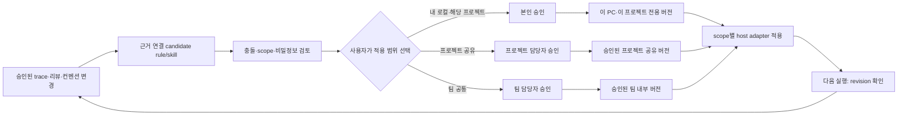

# 회사 승인 팀 계정·사내 메모리와 개인 클라우드: 보안 및 팀 스킬 수명주기

기준일: 2026-10-11. 설계 조사이며 제품 구현·계정/설정 검사·침투 시험·토큰 측정이 아니다. 실제 회사 코드·팀 컨벤션·고객 자료는 수집하지 않았다. 기존 독립 서비스+얇은 MCP, 공통 도메인+분리 배포 제안을 유지하되 사용자가 추가로 설명한 회사 계정 전제를 반영한다.

## 1. 사용자 설명과 그에 따른 결정

**사용자 설명:** 회사에서는 회사 초대로 사용하는 업무용 Claude/Codex 팀 계정을 쓴다. 회사 자료는 외부로 저장하거나 노출시키면 안 된다. 개인 프로젝트도 보안이 필요하다. 코드 리뷰·팀 컨벤션은 스킬처럼 갱신되어야 한다.

**[설계 결정]** 회사가 승인한 업무용 모델 처리는 허용된 경로로 전제하고, 새 메모리 저장소·백업·개인 계정/클라우드·별도 추출/embedding API는 그 승인에 자동 포함시키지 않는다. 이는 회사의 정확한 요금제·계약·지역·retention을 확인했다는 뜻이 아니다. 보안 문구의 no-training, no-public-disclosure, no-storage-outside-company, no-network-egress는 서로 다른 조건이다.

이전의 완전 무반출 모델은 선택 가능한 별도 배포 프로필이지 이 사용자의 회사 기본 환경에 요구할 전제가 아니다. 만약 실제 정책이 모델 제공자 처리까지 포함한 외부 전송 0을 의미한다면 클라우드 업무 계정 사용과 그 조건은 동시에 성립하지 않는다. 회사의 승인된 외부 처리 예외가 있으면 그 예외만 허용한다.

**[문서 사실]** Claude Code의 Team/Enterprise 등 commercial terms 경로와 Codex Business/Enterprise 등 업무 workspace는 기본적으로 입력·출력을 모델 학습에 사용하지 않는 정책을 설명한다. 명시적 데이터 공유 선택, 실제 보관 기간, ZDR 자격과 활성화는 각각 구분해야 하며 이 정책을 무전송 보장으로 해석하지 않는다.[S3–S4] 실제 회사 계약·설정은 검사하지 않았다. 구독/API credits/기업 automation credential/관리 계정의 제품별 경계는 `company-approved-model-boundary.ko.md`에 기록했으며 팀 구독을 새 memory worker/API의 회사 승인으로 취급하지 않는다.

## 2. 공통 제품과 분리된 데이터 경계

| 항목 | 회사 배포 제안 | 개인 배포 제안 |
|---|---|---|
| 코드·도메인/API·revision/forget 의미 | 공통 OSS 릴리스 | 같은 공통 OSS 릴리스 |
| memory 원문·index·queue·로그·backup | 회사 PC 또는 회사가 허용한 사내 서비스·저장소 | 개인 전용 self-host cloud·저장소 |
| native agent | 회사가 관리/승인한 Claude/Codex 업무 경로 | 개인 계정/승인한 개인 모델 경로 |
| 추출·요약·reflect | 별도 승인된 업무용 실행 경로 또는 승인 사내 모델; 개인/API fallback 금지 | 개인이 허용한 provider/사내형 모델 정책 |
| embedding·rerank | 승인된 로컬/사내 모델이 기본 제안; 별도 API는 별도 승인 | 로컬/cloud 중 명시적으로 선택한 경로 |
| 정책·credential·키 | 회사/고객별 독립 | 개인 전용 독립 |
| 승인 팀 규칙·skills | 회사 내부 Git/배포 저장소 | 개인 전용 Git/배포 저장소 |

**[설계 결정]** 공유하는 것은 제품 코드이지 corpus가 아니다. 같은 DB에 `company=true` label만 붙여 두 환경을 합치지 않는다. 회사 원문뿐 아니라 summaries, vectors, graph, tool results, 실행 로그, cache, skill 예시, backup, telemetry도 회사 경계에 포함한다. 회사 내용을 일반화/요약한 것만으로 개인 클라우드나 공개 OSS에 재사용할 권리가 생기지 않는다.

## 3. 회사 배포의 최소 보안 계약

아래는 구현되어 있다는 보장이 아니라 필요한 계약이다.

1. **저장 경계:** 회사 memory service/DB/index/backup을 승인된 내부 경로에 둔다. 개인 endpoint·자동 cloud backup·public upload·외부 crash payload·telemetry는 회사 profile에서 사용하지 않는다.
2. **모델 경계:** 이미 승인된 업무 agent가 memory를 읽는 것과 새 background worker가 임의 API를 호출하는 것은 별도다. 팀 구독/로그인이 API 키 권한이나 별도 worker 운용 승인을 증명하지 않는다. 추출/reflect에 필요한 승인 경로가 없으면 작업을 blocked로 표시하며, 개인 키로 대체하거나 조용히 기능을 없애지 않는다.
3. **호스트 경계:** 회사와 개인 host home/config/session/credential을 분리한다. 회사 자료를 읽은 동일 conversation을 개인 계정이나 다른 고객 모드로 전환하여 재사용하지 않는다. 강한 분리가 필요하면 회사 관리 OS 사용자/VM/VDI 등으로 데이터·로그·credential 경계를 함께 나눈다. profile 이름은 그 자체로 보안 경계가 아니다.
4. **인증·권한:** MCP service는 자기 resource에 발급된 credential과 서버 측 사용자/프로젝트 권한을 매 요청 검증한다. `tenant_id`, `clientInfo`, `account=company` 같은 client 입력을 신뢰해 권한을 부여하지 않는다. MCP access token과 Anthropic/OpenAI 모델 계정 credential은 다른 것이다.[S1]
5. **목적지 보장 한계:** MCP 인증으로 회사 사용자를 식별해도 그 사용자의 host가 어느 모델 계정에 결과를 보낼지 자동 증명되지 않는다. 회사 관리 host/config·승인된 account/provider route·망 정책·접근 경계를 함께 통제해야 한다. 일반 BYO client에 평문을 내준 뒤 server가 개인 모델 전송을 막는다고 주장하지 않는다.
6. **정책 강제:** memory service/네트워크/OS/관리 정책에서 승인되지 않은 route를 거절한다. SKILL.md나 LLM instruction의 “회사 자료를 보내지 마라”만으로 외부 반출 금지를 보장하지 않는다. 관리자/root, 이미 허용된 host가 읽은 평문, 화면 캡처 등은 별도 신뢰 경계다.
7. **로컬 접속:** stdio 또는 승인된 로컬 IPC/loopback을 선택하되 localhost를 사용자 인증으로 취급하지 않는다. loopback HTTP이면 credential/권한과 Host/Origin/DNS-rebinding 방어를 적용한다. 회사 전체가 공유하려면 사내 인증·접근 가능한 내부 서비스로 운영하며 인터넷 공개를 기본으로 하지 않는다.[S2]
8. **학습 데이터/로그:** 기억이 자동 수집되더라도 source allowlist와 project scope를 먼저 적용한다. secret·PII 포함 여부를 관리하고 운영 로그는 본문/토큰 대신 필요한 ID·행위·결과를 기록한다. redaction은 승인되지 않은 전송을 허용하는 면책이 아니다.

## 4. 개인 cloud도 무인증 또는 “암호화니까 안전”으로 운영하지 않기

**[설계 제안]** 외부 MCP는 TLS와 지원 host의 resource-bound OAuth/단기 access token, 최소 권한, rotation/revoke, project ACL을 적용한다. issuer/audience/expiry와 서버 측 scope를 검증하며 DB는 공용 인터넷에 직접 노출하지 않는다. 개인 PC의 credential은 OS secure storage 등 적절한 경로에 보관하고 plaintext repo 설정·로그·tool result로 내보내지 않는다.[S1]

CLI 전용이면 사설망/VPN도 접근면 축소 대안이다. 그러나 SaaS-hosted client가 같은 VPN 경로를 사용할 수 있다고 약속하지 않으며, tunnel은 provider에게 tool 결과가 전달되는 사실을 없애지 않는다. “어디서든”은 지원 host/auth/network 조합별 검증 대상이다.

저장·backup 암호화와 키/복구 접근 분리, retention, patch/pinned release, audit, 복구 절차를 둔다. 서버가 검색/embedding/요약하려고 평문을 처리하는 통상 구조는 암호화된 disk만으로 진정한 end-to-end encryption이 되지 않는다. self-host cloud도 운영자·cloud administrator·허용 모델 provider가 처리할 수 있는 범위를 설명해야 한다.

forget/revoke는 raw뿐 아니라 파생 index·summary·cache·queue·export·backup·skills 후보까지 추적한다. backup 보존이나 외부 provider의 잔존은 별도다. 회사 corpus나 회사-derived skill은 개인 cloud 대상이 아니다. 개인정보/회사 자료를 자동 수집하고 나서 나중에 숨기는 정책 대신 수집과 검색 이전에 scope/ACL을 적용한다.

## 5. 사실 memory, 규범 rule, 실행 skill을 나누기

**[설계 제안]** 저장 제품은 하나여도 권위와 수명주기는 분리한다.

- **Evidence/memory:** 대화, 검증된 관찰, 과거 리뷰, 결정과 실패·성공 근거. 사실/맥락을 검색한다. 과거 리뷰 의견은 자동으로 현재 팀 규칙이 아니다.
- **Rule/convention:** 해당 범위의 권한자가 승인한 현재 기준. 본인의 로컬 프로젝트 규칙, 프로젝트 공유 규칙, 팀 공통 규칙을 구분한다. 고객/프로젝트/path/버전과 적용 조건·예외가 있다. 활성 scope 안에서 작업·phase·예정/변경 경로에 적용되는 승인 규칙을 명시적으로 선택·제공하며, 필수 규칙을 semantic top-k의 우연한 검색에만 맡기지 않는다. 필수 범위의 원문을 읽지 못한 상태는 허가가 아니다. 회사 필수 정책은 본인의 로컬 규칙으로 완화할 수 없고, 확인된 보안 제약은 실제 실행 권한/CI 등 적절한 경계에서도 강제한다.
- **Skill/procedure:** 반복 수행할 검토/수정/검증 절차, 참고 자료와 필요한 도구. host가 발견할 짧은 metadata와 필요할 때 읽는 본문을 분리한다. 구체적인 회사 검토 기준은 공급되지 않았으므로 생성하지 않는다.

서로 다른 프로젝트의 반례나 일회성 취향을 보편 규칙으로 승격하지 않는다. 외부 문서/코드 comment/trace의 instruction은 비신뢰 source이며 승인 권위가 아니다. 팀 rule은 사용자/회사 현재 지침·권한을 우회하는 명령이 아니다. 근거, scope, 유효 시점, 작성·승인 주체를 보존하며 충돌은 명시적으로 처리한다.

## 6. 업데이트 수명주기

**[설계 제안]** capture/analysis는 자동화할 수 있다. 승인자와 배포 대상은 rule/skill의 적용 범위에 따라 달라진다. 본인 로컬 프로젝트 규칙을 팀 승인·사내 배포에 강제로 연결하지 않는다. 개인 적용의 기본은 본인 승인이고, 자동 적용은 본인이 명시적으로 허용한 변경 범위에 한정한다. 회사 필수 정책·권한 확대·다른 사용자에게 영향을 주는 변경에는 이 개인 자동 적용 권한을 사용하지 않는다.

**사용자 선택 계약:** 새 rule/skill을 활성화하거나 적용 범위를 바꿀 때 “어디에 적용할까요?”라는 단일 선택 질문으로 **내 로컬·해당 프로젝트 / 프로젝트 공유 / 팀 공통** 세 옵션을 제공한다. 로컬은 추천 옵션일 뿐 선택 전 자동 적용하지 않는다. 선택한 scope와 대상 프로젝트/팀을 저장하며, 공유 옵션의 선택은 해당 권한자의 승인이나 회사 반출 허가를 대신하지 않는다. 동일 rule/skill의 이후 내용 업데이트는 기존 scope를 유지하여 범위 질문을 반복하지 않되, 내용 변경 승인 정책은 그대로 적용한다. 범위를 확대할 때는 다시 선택·승인을 받는다. 취소/미응답은 후보 보존이며 활성화·배포하지 않는다.

- candidate에는 source/review locator, 제안 변경, 적용 범위/예외, 충돌·검증 근거를 남긴다. record ID/revision/approval은 별도이며 memory 작성 권한이 publish 권한을 뜻하지 않는다.
- rule/skill 원문 권위도 scope별로 정한다. 본인 프로젝트-local 버전은 로컬 전용 저장소에, 공유 프로젝트/팀 버전은 승인된 회사 내부 Git 등 해당 공유 저장소에 둔다. 로컬-only에는 Git commit/push나 사내 배포를 요구하지 않는다. memory DB에는 source revision과 활성/철회 상태를 연결하되, 오래된 요약으로 승인 원문을 덮어쓰지 않는다. 인간 승인이라는 JSON field만 받는 것으로 승인 권한을 구현했다고 주장하지 않는다.
- 승인된 변화는 manifest의 ID/version/hash/scope/상태로 추적하여 자동 배포할 수 있다. root `CLAUDE.md`/`AGENTS.md`에는 컨벤션 본문·목록·import bridge를 추가하지 않는다. 지원 host의 짧은 발견 metadata와 적용 시 선택한 rule/skill 원문을 분리한다. 모든 리뷰 원문/skill을 매 세션에 넣거나 긴 팀 공통 본문을 다른 상시 로드 파일로 옮기지 않는다. 발견 목록도 누적 비용이 있으므로 필요한 scope의 소수 entry만 노출한다.
- host adapter는 opt-in·소유권이 있는 프로젝트/관리 scope만 갱신한다. 일반 MCP 연결 자체가 native skills 설치/갱신을 보장하지 않는다. 임의 global AGENTS/CLAUDE/skills 파일을 덮어쓰거나 관리 정책을 우회하지 않는다.
- 실행은 적용한 revision을 기록한다. 다음 실행 version pin은 native host가 공통으로 보장하는 기능이 아니라 승인된 읽기 전용 bundle snapshot을 선택하는 adapter 계약이다. 활성 session의 공유 skill directory를 hot-update하며 버전 고정을 주장하지 않는다. 일반 변화는 다음 실행부터 적용한다. 긴급 권한/보안 철회는 단순 다음 실행 대기와 별개다: service 접근/작업을 중단하고 cache를 무효화하며 필요하면 회사 관리 host의 기존 실행을 종료·새 세션으로 시작한다. 이미 모델 context에 들어간 구문이 service cache 삭제로 없어지지는 않는다. rollback 대상도 승인되고 철회되지 않은 revision으로 제한한다.[S5]
- skill artifact 자체에 회사 코드·고객 식별자·secret이 들어갈 수 있으므로 회사 memory와 동일한 접근·배포 경계를 적용한다. 공개 OSS에는 generic engine/protocol/adapter만 내고 회사 skill 내용은 포함하지 않는다.
- 데이터 보안 경계, 적용 scope, 배포 범위는 별도다. 회사 프로젝트에서 본인이 만든 로컬 규칙도 회사 경계를 벗어나 개인 cloud/account로 동기화하지 않는다. 개인 선호라는 이름이 반출 권한을 만들지 않는다.
- 본인-local 규칙은 현재 사용자·승인된 PC/환경·해당 프로젝트에만 연결한다. 기본적으로 전역 skill 폴더, 다른 프로젝트, 팀 공통 bundle로 퍼뜨리지 않는다. project-shared/team 승격은 별도 검토·승인·명시 배포다.
- host adapter는 기존 tracked 지침을 덮어쓰거나 override 파일로 회사 필수 지침을 가리는 방식으로 개인 규칙을 적용하지 않는다. local artifact의 version-control 제외·account sync 제외와 실제 발견 경로를 host별로 검증한다. 충돌을 해결할 권한이 없으면 적용을 중단하고 충돌을 표시하며, native host 모두에 동일한 강제 precedence가 있다고 주장하지 않는다.

**[공식 동작과 수정된 설계]** Claude와 Codex는 native skill의 metadata를 먼저 발견하고 필요한 본문을 읽는다. root 파일 없는 발견은 Claude `.claude/skills/`, Codex `.agents/skills/` 등 host별 경로로 가능하다. Claude Code는 명시적 `paths`가 있는 `.claude/rules/`를 관련 파일 작업 시 조건부 로드하지만, 조건 없는 rule은 startup에 로드한다. Codex의 nested `AGENTS.md`는 CWD의 ancestor chain을 합치는 방식으로 일반적인 파일별 lazy rule loader가 아니다. **이 제품의 기본안은 루트 지침 파일을 수정하지 않으며**, 공통 scope·승인·선택 계약을 host별 skill/지원 hook/Agent Flow adapter로 적용한다. 일반 MCP 연결만으로 자동 선택·전달·준수가 생기지 않는다. native 변경 감지·계정 sync·context 잔류도 승인 snapshot/철회 계약과 다르다. 실제 회사 client에서 적용·준수됐다는 뜻은 아니다. 새 직접 근거와 한계는 `root-free-claude-conventions.ko.md`, `root-free-codex-conventions.ko.md`, `root-free-conventions-papers-oss.ko.md`에 기록한다.[S5–S7]

## 7. 검증과 이번 작업의 한계

이번에 확인하는 것은 공식 문서와 설계의 경계다. 실제 회사 계정 설정·retention·SSO·managed policy·MCP 접근은 검사하지 않았고, 이 제품을 설치/실행/공격하지 않았다. 회사 정책을 대신 승인하거나 안전 인증을 하지 않는다. GitHub issue·host config·native skills를 갱신하지 않는다.

출시 검증은 잘못된 endpoint/account/profile과 개인 credential의 회사 memory 접근 거절, 프로젝트 간 ACL, 승인 없는 external worker route 거절, 본문/secret 없는 운영 로그, 승인 없는 rule 승격 거절, 승인 version 적용과 rollback, 긴급 revoke와 stale worker/cache, forget/backup restore 재노출, 정상 승인된 업무/개인 흐름을 각각 실제로 관찰해야 한다. 같은 모델 경로가 없어 결과가 다른 배포를 “동일 품질”로 과장하지 않는다.

## 출처

- [S1] [MCP 2026-07-28 Authorization](https://modelcontextprotocol.io/specification/2026-07-28/basic/authorization), 2026-10-11 직접 열람. transport auth의 역할·stdio/HTTP 경계, resource indicator, issuer 검증, access token audience/각 요청 검증, model provider credential과 별도임.
- [S2] [MCP Streamable HTTP](https://modelcontextprotocol.io/specification/2026-07-28/basic/transports/streamable-http), 기존 조사 `cloud-mcp-security.ko.md` S5의 직접 문서 검토 근거. local bind/Origin 규범과 사용자 인증의 구별.
- [S3] [Claude Code Data usage](https://code.claude.com/docs/en/data-usage), 2026-10-11 직접 열람. commercial no-training의 opt-in 예외, 계정별 retention과 ZDR의 별도 자격, 로컬 CLI의 모델 전송 및 plaintext local transcript·feedback 경로 구별.
- [S4] [ChatGPT Business privacy](https://help.openai.com/en/articles/8798634-managing-data-sharing-and-privacy-in-chatgpt-business), [Codex plan FAQ](https://help.openai.com/en/articles/11369540-using-codex-with-your-chatgpt-plan), `company-approved-model-boundary.ko.md`의 공식 문서 직접 조사. 실제 회사 플랜/계약 적용 여부는 미확인.
- [S5] [Claude Code Skills](https://code.claude.com/docs/en/skills), [Codex Build skills](https://learn.chatgpt.com/docs/build-skills), `team-skill-lifecycle-security.ko.md`의 직접 문서 조사. metadata/body 점진 로딩, host별 경로와 변경/본문 수명.
- [S6] [Claude project memory/rules](https://code.claude.com/docs/en/memory), [Codex AGENTS.md](https://learn.chatgpt.com/docs/agent-configuration/agents-md), 같은 native lifecycle 조사. 모델 context와 보안상 강제 설정의 구별.
- [S7] [Agent Skills specification](https://agentskills.io/specification), 같은 조사. 버전 metadata 표기는 승인·배포·철회 강제 구현 자체가 아님.
- 기존 설계: `distribution-design-proposal.ko.md`, `distribution-local-sources.ko.md`, `cloud-mcp-security.ko.md`, `mcp-context-design.ko.md`. 기존안은 실제 사용자/설치의 보안 통과 증거가 아님.
