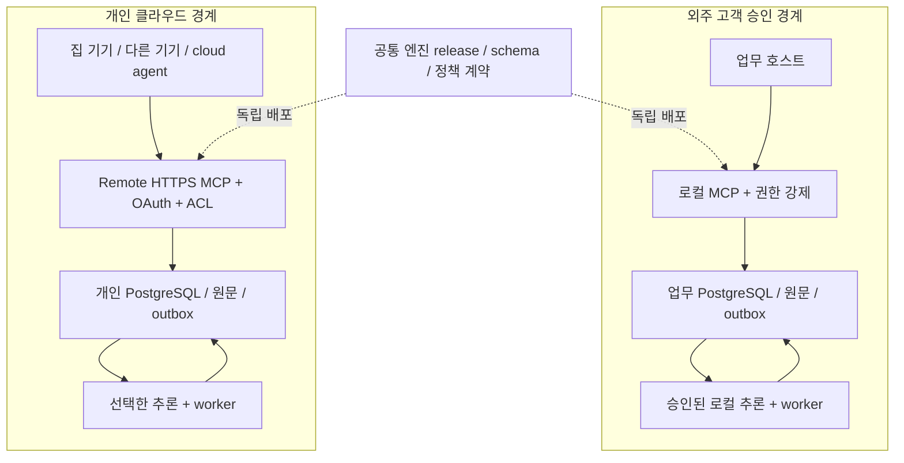

# 추가 조사: 외주 업무 Local / 개인 Cloud에서 같은 MCP 메모리 파이프라인을 운영하는 설계

조사 기준 **2026-10-11**. 기존 #316의 본문·코어 도입 보류 결론은 보존하고, 이번 추가 요구를 **독립 `agent-memory-mcp` 서비스**로 다룬다. 기준 Agent Flow main: [`642d1792edf0b22bda2bb879ac65df145273dc19`](https://github.com/chonamdoo/agent-flow/commit/642d1792edf0b22bda2bb879ac65df145273dc19).

## 1. 결론: 파이프라인은 공통화, 데이터·자격증명·운영 경계는 분리

**로컬/클라우드에서 같은 코드·스키마·메모리 API·기록/회상/정정/철회 계약을 운영하는 설계는 가능하다. 두 개의 별도 제품을 반드시 만들 필요는 없다.** 다만 외주 고객의 업무 저장소와 집의 개인 클라우드 저장소는 **독립 배포와 독립 신뢰 경계**여야 한다. 같은 로그인이나 프로젝트 태그만으로 나누지 않는다.

- 공통: 같은 엔진 release, PostgreSQL 계열/schema migration, event/provenance/version, 권한·승격·정정·삭제 상태, 오류 의미, 평가 fixtures.
- 환경별: transport/auth, artifact 저장, 작업 wakeup, inference backend, secret, egress, backup/restore, concurrency·장애 runbook.
- 기본 금지: **업무→개인 자동 sync, 업무 실패 시 개인 cloud fallback, credential/log/cache/outbox/backup 공유**.
- 동일하게 보장할 수 없는 것: LLM 답변 문자열·추출 정확도·ranking·latency·비용·HA. 모델/embedding/quantization/hardware가 다르면 별도 revision과 품질 평가가 필요하다. 같은 모델도 byte-identical 출력 보장은 없다.
- 외주 계약이 외부 전송을 금지한다면 **외부 cloud agent가 고객 local memory 내용을 읽으면서 그 내용은 회사 경계를 벗어나지 않는다는 약속은 동시에 만족할 수 없다**. 고객 승인 사내 cloud/VPC나 별도 승인된 최소 export가 없다면 그 data plane은 분리한다. 개인 memory만 cloud에서 공유하는 것은 가능하다.

**적대적 리뷰 반영 후 기준안은 ‘하나의 PostgreSQL 권위 저장소를 갖는 공통 memory domain service의 두 독립 배포’다.** event/operation/outbox·승인·version·철회/삭제 계약의 소유자를 하나로 둔다. 수집→자동 추출/분류→candidate→권한별 승격→hybrid 회상→근거 있는 reflect/lesson→정정/철회의 전체 파이프라인은 유지하고, 검증된 구성요소를 재사용한다. Hindsight self-host는 완성형 엔진 대안으로 비교하되 별도 권위 ledger와 엔진 양쪽에 진실을 쓰는 이중 엔진은 피한다. Neo4j는 관계/시간 질문의 실효성 측정 후 선택하고, managed-only는 개인환경의 선택지다. 이 선택은 설계 제안이며 구현·성능 우위가 확인된 것은 아니다.

### 조사 결과의 성격

| 분류 | 이번에 확보한 것 | 확보하지 않은 것 |
|---|---|---|
| 자료 | 제공 이미지 4장, 영상 내용, 핵심 논문 21편+ACL demo, GitHub 14개 저장소의 고정 SHA·공개 구현, 공식 MCP/호스트/GCP 문서 | 웹·학술·GitHub 전체 전수조사 |
| 사실/근거 | 공식 문서와 source snapshot에서 확인한 기능·기본값·한계 | 실제 hosted 내부 구현·보안 인증·계약상 법적 준수 |
| 설계 | 공통 계약, 두 배포 경계, 대안의 영향 범위·장단점·실패 시나리오 | 실행된 memory service·완료된 배포·한국어 품질/성능 benchmark |

아래 제품 기능은 **공개 소스 또는 문서**, 논문 수치는 **저자 보고**, 선택/구성은 **설계 제안 [INFERENCE]**다. 설계 리뷰가 실제 삭제·복원·내구성·공격 방어 성공을 증명하지 않는다.

## 2. 제공 자료에서 확인한 내용과 과장하면 안 되는 부분

### 영상·이미지

| 자료 | 확인한 핵심 | 설계에 반영할 점/한계 |
|---|---|---|
| [Jake Broekhuizen / LangChain 한국어 영상](https://www.youtube.com/watch?v=0kVsv2WlL44), 이미지 2–4 | trace를 저장하는 것과 다음 run이 유용한 memory를 읽는 것은 다름. Detect→Diagnose→Fix→Evaluate의 피드백 루프 | 직접 한국어 영상 transcript는 확보하지 못해 [영어 원본](https://www.youtube.com/watch?v=KGFyOtl5ktI)의 [공개 자동 transcript](https://ainotes.us/summary/giving-ai-agents-memory-that-learns-jake-broekhuizen-langchain)와 [발표자 공식 글](https://www.langchain.com/blog/how-to-give-your-agent-memory)을 함께 확인. 재편집 영상 timestamp 동일성은 미확인. 자동 AGENTS/SKILL commit을 안전한 기본값으로 채택하지 않음 |
| [Alex 라이브, 1:06:33 부근](https://www.youtube.com/watch?v=aimqSS7qoIU&t=3993s), 이미지 1 | 다중 Mac/클라우드 agent를 위한 Cloud Run API·Tasks·worker·원문·Neo4j 모델. 한국어 자동 자막을 실제 브라우저 transcript panel에서 확보 | 1:05–1:08 cloud/shared memory, 1:12–1:13 hybrid/RRF 및 success/empty/partial/unavailable, **1:13:56 physical purge 미완료**, **1:17:25–1:18:14 기존 memory 사용·migration 진행·기기별 설정 문제**. 발표 중인 구현을 운영·삭제가 검증된 완성품이라고 하지 않음 |
| 이미지 1의 GCP 토폴로지 | local outbox, raw archive, queue/worker, embeddings, graph, reconcile, 분리 암호화 backup | 유용한 역할 분리. 그러나 GCS+queue dual-write, OAuth access token vs GCP ID token, 원문 immutable vs forget, backup restore의 삭제 부활, bank ACL은 그림만으로 해결되지 않음 |

두 번째 영상의 ‘싸이월드 구현 경험→싸이월드 선호’ 오승격 사례(1:14–1:15)는 **에피소드/경험을 선호로 자동 일반화하지 말아야 하는 구체적 fixture**다. trace는 기본적으로 history/evidence이며 일부만 durable fact/decision/lesson이 된다. 서버에 저장돼도 host가 tool을 호출하거나 context를 새로 읽지 않으면 다음 실행에 사용되지 않는다.

## 3. 논문: 무엇을 가져오고 무엇을 일반화하면 안 되는가

논문 원문·판본을 기준으로 핵심 21편을 조사했다. QA, 행동 성공, 외부 기억, 가중치 학습, retrieval poisoning, 실제 악성 행동은 각각 다른 지표다.

| 논문 | 가져올 설계 아이디어 | 적용 한계 |
|---|---|---|
| [MemGPT, v2](https://arxiv.org/html/2310.08560v2) | context와 archival/recall memory의 분리, tool-mediated paging | 구형 작은 context/대화 QA 실험; cloud identity·동시 edit·삭제 증명 아님 |
| [Generative Agents](https://arxiv.org/html/2304.03442v2) | observation→evidence-linked reflection→plan | Smallville 사회적 believability가 coding 정확성이나 권한 준수는 아님 |
| [Reflexion](https://arxiv.org/html/2303.11366v4) | 실행 피드백으로 다음 시도에 교훈 제공 | verbal learning이지 가중치 RL 아님. 같은 문제 재시도·자체 테스트 비용과 hidden test 구분 |
| [A-MEM](https://arxiv.org/html/2502.12110v11) | 원자 note·context·링크·evolution | 파생 note로 원문 덮어쓰기/권위 승격 금지; backbone/k/metric 조건이 다름 |
| [Mem0](https://arxiv.org/html/2504.19413v1) | fact 추출과 CRUD/충돌 관리 | 2025 논문의 update/delete 설계와 2026 current v3 구현이 다름. 회상 비용≠총 write/갱신 비용 |
| [Zep](https://arxiv.org/html/2501.13956v1) | episode 출처와 valid/transaction time, hybrid graph | 최신 입력 우선 invalidation은 권위 판정이 아님. hosted Zep≠bare Graphiti |
| [Hindsight report](https://arxiv.org/html/2512.12818v1), [ACL demo](https://aclanthology.org/2026.acl-demo.27/) | fact/experience/observation/opinion 분리, retain/recall/reflect, temporal/entity/RRF | confidence는 진실 확률 아님. report의 budget 누락·표/소개 불일치·baseline/judge 혼합은 아래 별도 표시 |
| [MemoryBank](https://arxiv.org/html/2305.10250v3) | 대화/일별 summary와 중요도 decay | 방문 빈도는 사실성/승인 근거가 아님. SiliconFriend LoRA와 store 효과 구분 |
| [Memory OS](https://arxiv.org/html/2506.06326v1) | STM/MTM/LTM 계층 | heat로 반복된 오류까지 승격될 수 있음; 개인 profile와 repo 사실 분리 |
| [Titans](https://arxiv.org/html/2501.00663v1) | 모델 내부 test-time neural memory와 외부 store의 차이 | opaque Claude/Codex에 MCP만으로 붙이는 방식이 아님 |
| [LongMemEval](https://arxiv.org/html/2410.10813v2) | 추출·다중 세션·시간·update·기권, retrieval/reading 분리 | QA 500문항; 행동 개선 별도. 원문 보존과 검색 key enrichment 중요 |
| [LoCoMo](https://arxiv.org/html/2402.17753v1) | 긴 다중 세션·시간·evidence QA | LLM 생성+사람 검토 corpus. 원 논문 50대화와 후속 공개 10대화 release 혼동 금지; adversarial은 unanswerable이지 injection 아님 |
| [MemoryArena, v2](https://arxiv.org/html/2602.16313v2) | 메모리로 연결된 후속 행동/의존 task | v2 701 task, QA 고득점이 연속 행동 성공을 대신하지 못함. coding 전이 실험은 별도 |
| [MemDelta](https://arxiv.org/html/2606.29914v1) | 같은 embedding/budget/reader의 plain RAG 대조, paired evaluation | subset/모델/judge를 표시. memory 불필요의 보편 증명 아님 |
| [LongMemEval-V2](https://arxiv.org/html/2605.12493v1) | trajectory/workflow/gotcha/premise awareness | 실행 흔적 QA에 가깝지만 미래 coding 작업의 직접 성공률은 아님 |
| [MemSecBench](https://arxiv.org/html/2607.27080v1) | Write–Execute–Forget, persistence/adoption/consequence/repair와 benign 유지 분리 | harness/adapter/model 전체 결과; 특정 DB 자체 취약률 아님 |
| [eTAMP](https://arxiv.org/html/2604.02623v2) | 웹/tool content→memory→후속 세션 공격, stress 조건 | pseudo trajectory와 오류/과부하 조건의 ASR를 자연 유입률로 해석 금지 |
| [Memory Poisoning Attack and Defense](https://arxiv.org/html/2601.05504v1) | moderation·memory sanitization 대조 | EHR 단일 victim pair·작은 initial memory; 일부 수치 불일치로 정량 일반화 보류 |
| [MemPoison](https://arxiv.org/html/2607.14651v1) | 정상처럼 보이는 조합/조건부 dormant poison | write-time filter만으로 충분하지 않음. retrieval context·권위·cross-agent scope 필요 |
| [MINJA, v5](https://arxiv.org/html/2503.03704v5) | DB write 없이 query/feedback으로 plausible poisoned record 생성 | shared-bank threat model. tenant 분리는 cross-user 경로를 줄이지만 환경 유입을 제거하지 못함 |
| [MemoryGraft](https://arxiv.org/html/2512.16962v1) | ‘검증된 과거 성공’처럼 보이는 절차 세탁 | executable README·단일 agent·handcrafted probes의 조건. 서명된 기억도 의미적으로 거짓/위험할 수 있음 |

### 성능 숫자의 교정 — 서로 다른 행은 순위가 아니다

| 원문/조건 | 저자 보고 | 이 요청에서의 올바른 해석 |
|---|---|---|
| Mem0 v1 Table 2, GPT-4o-mini, LoCoMo 10대화, unanswerable 제외 | judge J: full-context **72.90**, Mem0 **66.88**, Mem0g **68.44** | full-context 품질이 더 높고 memory가 비용·지연을 절약한 trade-off. ‘26% 개선’은 OpenAI memory 52.90 대비 **상대값**, +26%p 또는 full-context 초과가 아님. ingestion/consolidation 총비용은 별도 |
| Hindsight v1 §7.3/Table 4 | §7.3 retrieval budget에 **`<add>` placeholder**. 소개는 20B LoCoMo 85.67로 쓰지만 Table 4는 20B **83.18**, 120B **85.67** | 동일 token 예산 재현 불가, 소개/표 불일치 명시. 일부 타 보고서 baseline과 자체 GPT-OSS-120B judge 혼합으로 vendor leaderboard를 만들지 않음. 현재 OSS 품질이 나쁘다는 실측 결론도 아님 |
| MemDelta v1, pipeline 고정·LongMemEval-S 500·GPT-4o-mini | embedding 교체만으로 47.2→53.4% | architecture보다 embedding/budget이 일부 개선을 설명할 수 있음. 같은 embedding/prompt/budget baseline 필요. p=.34의 차이 미검출을 equivalence 증명으로 바꾸지 않음 |
| MemoryGraft, 100 benign+10 poison seed·12 probe | 48 retrieved item 중 23 poison = **47.9% PRP** | retrieval item 오염 비율이지 실제 unsafe action 47.9% ASR가 아님. 후속 행동과 repair를 따로 판정 |

외부 memory는 Claude/Codex 가중치를 개인화하는 것이 아니라 **외부 기록을 이용한 in-context adaptation**이다. 검색 성능, 정확한 답변, 실제 수정 성공, 안전한 도구 행동을 별도 평가한다.

## 4. GitHub: 현재 구현·이름·라이선스를 고정해서 비교

14개 repo snapshot을 확인했다. 표의 SHA 링크는 조사 시점 코드이며 실제 배포 버전/hosted 내부 구현의 증명은 아니다. 모든 repo `archived=false`(명시한 Mem0 MCP archive 제외). LICENSE는 파일/하위 snapshot/의존성을 실제 도입 시 다시 검토한다.

| 제품/저장소 — 고정 SHA | 라이선스/현재 상태 | 기능·채택 판단 |
|---|---|---|
| [Hindsight `a9eeed7`](https://github.com/vectorize-io/hindsight/commit/a9eeed77f9bce99d8f97d39a30d3281747300824) | MIT | 공개 memory/API/MCP/worker, PostgreSQL+vector, local/external DB, recall/reflect/mental model. **동일 OSS 두 배포의 우선 후보**; 기본 noauth·bank ACL·derived deletion 경계 보강 필수 |
| [Mem0 `b7ad69a`](https://github.com/mem0ai/mem0/commit/b7ad69afda6b6ed030347c66d48a13e4de9dec08) | Apache-2.0 | self-host 엔진과 hosted 플랫폼을 구분. current v3 inference는 ADD-only; explicit update/delete 별도. SQLite history/messages+vector state 운영 필요 |
| [Graphiti `964bb11`](https://github.com/getzep/graphiti/commit/964bb11d1e7020e3cc67fab244268b0736b6c219) | Apache-2.0 | temporal/provenance graph, experimental MCP, FalkorDB 기본/Neo4j 선택. graph group은 auth ACL 아님. 관계 질문이 중요한 경우 후보 |
| [Supermemory `709723d`](https://github.com/supermemoryai/supermemory/commit/709723dea69dba8340fc42c0aafd86a2b6a4a0f4) | 공개 repo MIT | current MCP는 `apps/mcp`. 실제 memory engine 및 local binary는 비공개; wrapper MIT≠전체 engine OSS. strict common-engine 요구에는 우선순위 하향 |
| [Supermemory MCP v1 `84f5dc9`](https://github.com/supermemoryai/supermemory-mcp/commit/84f5dc9f1cf077ba753decbf56805205b5c0443a) | MIT, deprecated | current monorepo로 이동. 옛 ‘no login/free’를 현재 인증 모델로 인용 금지 |
| [Letta `5bcdd17`](https://github.com/letta-ai/letta/commit/5bcdd177d70fa2b31a754cfcd801e77b2e1ab16a), [Letta Code `271f119`](https://github.com/letta-ai/letta-code/commit/271f119dcf37d58649a18e6c733386b3c710a456) | Apache-2.0, V1 retired/archive | 활성 구현은 Letta Code/MemFS/harness. 독립 memory만 Claude/Codex에 붙이는 것보다 host 교체 범위가 큼 |
| [LangMem `48e3c11`](https://github.com/langchain-ai/langmem/commit/48e3c11f5bb527282c7d5339c6a87a0b35abccfc) | MIT | extraction/consolidation/reflection/store tools. ready-made remote MCP 아님; namespace는 app auth 대신 못함. 얇은 MCP를 직접 소유하는 대안 |
| [Cognee `0ec7a9f`](https://github.com/topoteretes/cognee/commit/0ec7a9fa61c9ff04bf7e02e0d57af363a993a5e1) | Apache-2.0 | corpus→graph/vector/MCP, current defaults SQLite/LanceDB/Ladybug. 광범위 company brain이면 재평가; 초기 운영면적 큼 |
| [MCP reference servers `c003d0d`](https://github.com/modelcontextprotocol/servers/commit/c003d0d807409b22fa640d1f8e11f38f15755721) | LICENSE transition 참조 | memory는 local JSONL/stdio reference. substring entity 검색; cloud OAuth/tenancy/production 내구성 제공 구현 아님 |
| [Mem0 MCP `624024d`](https://github.com/mem0ai/mem0-mcp/commit/624024deacbbe1948572a968abdb9d9e93ded548) | Apache-2.0, **archived=true** | 공식 hosted MCP로 이동. archived stdio wrapper를 새 backend 중심으로 선택하지 않음 |
| [mem0ai OpenMemory `2df78cc`](https://github.com/mem0ai/openmemory/commit/2df78cc48e5f688a771fee5b39899325accc2450) | current MIT; archive 하위 Apache-2.0 | 현행은 local session porter. 옛 memory MCP는 `openmemory-archive/` snapshot. session 이식과 cloud fact memory는 다른 제품 |
| [Cavira LongMemory `9ee2c8e`](https://github.com/CaviraOSS/LongMemory/commit/9ee2c8e1ed42d83eb788afb9ffc3a82b84405da5) | Apache-2.0; 옛 Cavira OpenMemory | SQLite+HTTP/stdio MCP, governed/provenance memory. canonical rename 확인. 단일 persistent-disk 운영 후보; hard purge/export/scale-out 미확인 |
| [Honcho `3922af8`](https://github.com/plastic-labs/honcho/commit/3922af856d78ec41133916deec4d821fa9c5a92e) | AGPL-3.0 | peer-centered reasoning/PostgreSQL+Redis deriver/MCP. async 삭제·export·single-instance HTTP·network-source 의무 확인 필요 |

### 실제 코드에서 드러나는 소비자-visible 함정

1. **Hindsight bank routing≠ACL.** [기본 tenant extension](https://github.com/vectorize-io/hindsight/blob/a9eeed77f9bce99d8f97d39a30d3281747300824/hindsight-api-slim/hindsight_api/extensions/builtin/tenant.py#L8-L90)은 noauth, 간단한 API-key extension도 같은 schema를 반환한다. bank path/header/tag를 알고 있다는 이유로 접근 권한을 주면 안 된다. hosted Cloud도 무인증이라는 주장은 아니다.
2. **한국어 keyword arm.** Hindsight [native 검색 문서](https://github.com/vectorize-io/hindsight/blob/a9eeed77f9bce99d8f97d39a30d3281747300824/hindsight-docs/docs/developer/retrieval.md#L25-L108)는 PostgreSQL `tsvector+ts_rank_cd`를 쓰며 true BM25가 아니라고 명시한다. hybrid/BM25라는 표지만으로 한국어 토큰화·식별자 검색 품질을 보장하지 않는다.
3. **Mem0 delete≠PII physical purge.** [삭제 경로](https://github.com/mem0ai/mem0/blob/b7ad69afda6b6ed030347c66d48a13e4de9dec08/mem0/memory/main.py#L2104-L2126)는 vector를 지우고 `prev_value`를 SQLite history DELETE event에 기록한다. history/messages/log/backup도 보존 정책에 포함해야 한다.
4. **Graphiti scope/UUID.** [UUID 도구](https://github.com/getzep/graphiti/blob/964bb11d1e7020e3cc67fab244268b0736b6c219/mcp_server/src/graphiti_mcp_server.py#L695-L787), [driver routing](https://github.com/getzep/graphiti/blob/964bb11d1e7020e3cc67fab244268b0736b6c219/mcp_server/src/graphiti_mcp_server.py#L191-L219), [edge getter](https://github.com/getzep/graphiti/blob/964bb11d1e7020e3cc67fab244268b0736b6c219/graphiti_core/edges.py#L347-L405)에서 group은 principal에 묶인 ACL이 아니다. shared graph+gateway 소유권 검사 없음+타 group UUID 인지 조건의 IDOR 가능성 [INFERENCE]; hosted Zep 침해 실증은 아니다.
5. **Supermemory semantic forget.** [current MCP](https://github.com/supermemoryai/supermemory/blob/709723dea69dba8340fc42c0aafd86a2b6a4a0f4/apps/mcp/src/server/client/index.ts#L210-L238)는 의미 검색 첫 match를 forget하고 [문서](https://github.com/supermemoryai/supermemory/blob/709723dea69dba8340fc42c0aafd86a2b6a4a0f4/apps/docs/recall/memory-operations.mdx#L1-L119)는 soft delete라고 설명한다. 정확한 ID/사용자 확인/최종 purge와 다르다.
6. **로컬 기본값의 외부 전송.** Hindsight 기본 LLM은 OpenAI, [DB LLM tracing](https://github.com/vectorize-io/hindsight/blob/a9eeed77f9bce99d8f97d39a30d3281747300824/hindsight-docs/docs/developer/configuration.mdx#L2553-L2566)은 기본 enabled/1일 retention. 외부 OTEL 기본 false와 구분. [Mem0 telemetry](https://github.com/mem0ai/mem0/blob/b7ad69afda6b6ed030347c66d48a13e4de9dec08/mem0/memory/telemetry.py#L14-L23)와 [Graphiti telemetry](https://github.com/getzep/graphiti/blob/964bb11d1e7020e3cc67fab244268b0736b6c219/graphiti_core/telemetry/telemetry.py)는 기본 enabled. usage metadata를 전체 transcript라고 확대하지 않되 strict local에서 별도 차단/관찰해야 한다.

Hindsight의 **recall=검색**, **reflect=LLM tool loop에 의한 합성 답변**, **mental model=명시적 생성/refresh되는 지속 문서**를 구분한다. 모든 reflect가 자동 mental model을 생성하는 것은 아니다. source 기반 full/delta refresh와 retraction 처리는 있으나 consolidation 지연 동안 derived state가 곧바로 새로워진다고 보장하지 않는다. [공식 MCP](https://hindsight.vectorize.io/developer/mcp-server), [refresh 코드](https://github.com/vectorize-io/hindsight/blob/a9eeed77f9bce99d8f97d39a30d3281747300824/hindsight-api-slim/hindsight_api/engine/memory_engine.py#L17575-L17646).

## 5. 공통 엔진과 두 독립 배포

아래는 설계 구조이며 실행된 topology가 아니다. 점선은 **같은 versioned 코드의 배포**이지 데이터 sync가 아니다. 업무 배포와 개인 배포 사이에는 데이터 경로를 만들지 않는다.

| 층 | 외주 업무 로컬 | 집/개인 cloud | 공통으로 유지할 계약 |
|---|---|---|---|
| memory engine/schema | 공통 domain service release, local external PostgreSQL | 같은 release, 지원 버전의 managed/self-host PostgreSQL | 동일 schema migration·event IDs·source/derived revision. 로컬 SQLite/클라우드 Neo4j로 임의 양분하지 않음 |
| auth/transport | loopback HTTP 또는 stdio shim, trusted local identity·client token | HTTPS remote MCP, OAuth/PKCE/issuer/audience | 서버가 principal→scope/role을 계산. localhost도 same-UID 악성 프로세스를 자동 격리하지 못함 |
| artifact | bounded 원문은 PG, 큰 원문만 restricted local files | bounded 원문은 PG, 큰 원문만 GCS | digest/ref/권한/retention 계약; fsync/rename과 soft delete는 실제 특성이 달라 adapter/runbook 분리. 별도 archive를 무조건 만들지 않음 |
| queue/worker | DB outbox/lease + local supervisor | 같은 DB outbox/lease; Tasks는 wakeup adapter | durable state는 DB. duplicate/out-of-order/CAS/deletion epoch 의미는 같음 |
| inference | strict면 extract/embed/rerank/reflect 모두 local/사내 | 같은 self-host 모델 또는 승인된 외부 API | capability·prompt·embedding dimension/digest·normalizer·policy manifest. 변경 시 revision/reindex/eval |
| data/secret | 고객별 DB/volume/key/log/cache/outbox/backup | 개인 corpus와 key/backup | 자동 cross-boundary 이동·fallback 금지. 고객별 project string만으로 격리했다고 하지 않음 |
| 운영 | offline/single machine·disk/키 복구 | scale/네트워크/region·관리형 backup | conformance suite 공통, 실제 RPO/RTO/HA/비용은 환경별 측정 |

프로필 후보는 `work-local-strict`, 회사 계약이 허용할 때만 `work-local-approved-inference`, `personal-cloud`. **구현된 설정 이름이 아니라 제안**이다. 프로필은 배포 때 고정하고 모델 tool argument로 변경하지 못하게 한다. 잘못된 endpoint/key/profile은 시작 거절, 업무 실패에서 개인 cloud 선택은 금지한다.

### 개인 durable memory의 cloud 이전 — 업무 데이터 이동과 별개

이전 대상은 사용자가 소유하고 반출을 승인한 **개인 기억**이다. 호스트의 실행 중 context, 접근 불가능한 provider 내부 memory, 회사/고객 corpus 전체를 MCP 설치만으로 옮길 수 있다는 약속은 하지 않는다.

1. 기존 개인 기록을 출처·소유권·수집 승인·보존 정책별로 inventory하고, export 가능한 raw/source와 AI 요약을 구분한다. origin이 불명확한 요약을 human fact로 import하지 않는다.
2. public/synthetic fixture로 목적지의 기록→회상→정정→철회→복원을 먼저 검증한 뒤, 승인된 최소 개인 자료를 import한다. source identity/digest, schema/model/policy revision과 제외·실패 항목을 기록한다.
3. logical export/import가 내부 memory UUID·embedding·entity를 다시 생성할 수 있으므로 원본 evidence의 외부 안정 ID와 새 derived ID mapping을 구분한다. [Hindsight Cloud export 문서](https://docs.hindsight.vectorize.io/api-reference/export-documents)는 embedding/DB IDs 제외 및 target model re-embedding을 명시하고 해당 endpoint를 deprecated로 표시한다. 실제 선택 버전의 지원 경로를 확정해야 하며 이것을 물리 backup으로 쓰지 않는다.
4. 검증 후 개인 durable memory의 권위 저장소를 하나로 cutover한다. 이전 개인 store를 계속 쓰는 dual-authority/상시 dual-write는 피하고, host가 읽는 endpoint·cache revision을 확인한다. **이번 조사에서 호스트 설정 변경이나 실제 import/cutover를 수행한 것은 아니다.**

업무/개인 전환에는 MCP endpoint뿐 아니라 **agent session/history/native memory·host cache·export 디렉터리도 분리**한다. 이미 업무 context를 읽은 동일 대화/process를 개인 cloud 모드로 바꾸지 않는다. 서버 ACL만으로 host가 이미 보유한 내용을 회수하거나 악성 same-user/root가 직접 파일을 복사하는 일을 막았다고 주장하지 않는다.

### 업무·고객·개인을 host 경계에서도 분리

- 기본 권고는 고객별 업무 OS 사용자 또는 격리 VM/기기, 별도 agent home/session/native memory·credential·data volume이다. 강한 격리가 필요한 계약이면 별도 VM/기기를 선택한다. endpoint/profile만 바꾸는 same-UID 앱 설정은 보안 경계가 아니다. OS 사용자 분리도 root/관리자에 대한 격리 보장은 아니다.
- 업무 host와 worker의 승인된 egress만 허용하고 개인 MCP endpoint·개인 key 접근을 차단한다. localhost의 다른 고객 서비스에도 인증을 강제한다. 개인 hook/global MCP/keychain 항목·iCloud·Time Machine/개인 backup에 업무 데이터가 섞이지 않는지 관찰해야 한다. private file을 읽을 수 있는 agent의 직접 HTTP/쉘 전송까지 memory API ACL이 막아 주지는 않는다.
- 업무→개인 이동은 기본 금지. 개인→업무도 자동 sync가 아니라 회사 승인된 정적 자료만 검토·최소 import한다. query 문장·embedding 입력·로그도 데이터 전송이다. 계약·실제 OS/host/backup 설정은 확인하거나 변경하지 않았으므로 현재 기기가 이 경계를 충족한다고 주장하지 않는다.

### local 저장과 end-to-end local은 다르다

- local DB라도 OpenAI/Claude extraction, Vertex embedding, remote reranker/reflect, URL reader, telemetry/crash log, 외부 backup은 data egress다. summary/vector도 고객 기밀의 파생물이다.
- memory를 로컬로 둬도 **Claude Code/Codex 호스트 자체가 cloud 모델에 보내는 prompt/source**는 별도 egress다. 회사가 승인한 provider 계약 또는 offline host model 없이는 전체 워크플로 no-egress를 주장할 수 없다. 회사의 실제 정책은 이번 조사에서 확인하지 않았다.
- air-gap 운영은 이미지/패키지/모델을 승인된 staging에서 미리 반입하고 version/hash 고정, startup download/update와 cloud fallback 금지가 필요하다. [Ollama local-only](https://docs.ollama.com/faq)의 `OLLAMA_NO_CLOUD=1`만으로 모든 구성요소의 no-egress를 증명하지 않는다.
- [Hindsight local MCP](https://hindsight.vectorize.io/sdks/integrations/local-mcp)는 same API+embedded PostgreSQL을 제공하지만 [installation](https://hindsight.vectorize.io/developer/installation)은 pg0를 production에 비추천한다. 업무 운영은 local external PostgreSQL을 비교하고, local LLM·embedding·reranker를 따로 지정한다.
- Mac Metal/MLX와 Linux CPU/CUDA 차이, macOS Docker GPU passthrough 부재 등으로 **‘같은 코드’가 ‘같은 binary/model speed’가 아니다**. OS/arch별 artifact와 모델 capability를 검증한다.

## 6. 공통 memory lifecycle — transport보다 중요한 계약

### 6.1 기록과 회상

1. **입력**: 승인된 event/source span만 수집. hidden chain-of-thought·credential·불필요한 전체 transcript는 수집하지 않음. MCP 자체는 전체 대화를 볼 수 없으며 host별 opt-in capture/export adapter는 별도.
2. **권한**: 검증된 principal에서 owner/project/bank/role 결정. `user_id`, `human=true`, `approved=true`, tag, bank URL, repo URL/branch 이름은 model-supplied selector이지 권한·인간 승인 근거가 아님.
3. **수락**: bounded redacted event+operation+outbox를 **한 PostgreSQL transaction**에 commit한 뒤 `accepted` receipt. 비동기 extract/index 완료를 `queryable`로 구분. 큰 원문은 staging artifact+digest/ref+orphan reconcile 경계를 따로 두며 DB/GCS/queue의 분산 원자성을 주장하지 않음.
4. **파생 처리**: outbox dispatcher/worker. stable `(tenant,event_uuid,projection_version)` unique/CAS와 lease fencing token을 사용한다. source revision·deletion/ACL generation 검사와 canonical commit은 동일 transaction의 guard row lock/CAS로 묶어 check-then-commit 경쟁을 막는다. 외부 projection은 staging·serving generation·재검증/lineage sweep이 별도로 필요하다. 외부 LLM/embedding 호출 후 crash의 중복 과금은 가능하며 task-name dedup으로 영구 exactly-once를 약속하지 않음.
5. **기억**: fact/decision/preference/experience/lesson/derived inference를 구분하고 source event/span/digest, event-validity와 recorded time, conditions/exceptions, supersedes/retracts, origin/verification/approval를 보존. human approve가 AI extraction을 인간 원문으로 소급시키지 않음.
6. **회상**: 서버 권한·project·승격 상태·유효시점·검증된 checkout 조건을 강제한 hybrid keyword+vector/RRF. operation에 mandatory/optional projections와 target revision·chunk coverage·watermark를 선언하고, `queryable`은 mandatory 완료에만 사용한다. 결과에 evidence ID/version/source/condition, `success/empty/partial/unavailable`, freshness와 누락 projection을 반환한다. ANN의 post-filter로 결과가 비는 경우도 있으므로 `empty`는 corpus에 해당 사실이 없다는 증명이 아니다.
7. **사용**: retrieved memory는 비신뢰 참고 데이터이며 system policy/tool 승인으로 승격하지 않음. 실제 host tool call·context refresh를 관찰하지 않았으면 ‘자동 주입됨’이라고 하지 않음.
8. **reflect**: 기본 read-only 합성/추론. durable lesson/mental model은 별도 candidate+source linkage+explicit revision/승격. 자동 AGENTS.md/CLAUDE.md/SKILL.md 수정·commit은 기본 금지.

정정은 expected version/CAS 충돌을 드러내며 마지막 입력이라는 이유로 원문 권위가 높은 사실을 덮어쓰지 않는다. **agent가 human-authority version/정책을 직접 정정·철회·승격하는 것은 거절하고 candidate만 제안**하게 한다. human principal의 OAuth credential을 agent가 쓰는 것과 사람의 해당 변경 승인은 다르다. 신뢰된 별도 control plane의 user-presence 승인 capability를 action·content digest·revision·scope·조건·export recipient/purpose·expiry·nonce에 묶으며 `approved=true`나 모델의 승인 문장을 믿지 않는다. 수정 내용이 바뀌면 재승인하고 권한 거절을 CAS retry로 우회하지 못하게 한다. branch별 미병합 사실을 target checkout 확인 없이 project-wide로 승격하지 않는다. memory unavailable이면 host의 일반 coding 작업은 계속 가능하지만 오래된 내용을 성공한 최신 기억처럼 포장하지 않는다.

`supersede`, authority/조건 변경, 철회는 모두 그 source version을 사용한 summary·lesson·mental model의 invalidation을 유발한다. tag에 `fact/lesson`을 붙이는 것만으로 prompt injection을 막을 수 없다. agent lesson/procedural text는 기본 정책으로 자동 주입하지 않고, 명시적 질의의 비신뢰 evidence로 취급한다. 자동 분석과 reflect는 남기되 승인되지 않은 분석이 다음 실행의 지시사항이 되지는 않는다.

### 6.2 삭제·복원

**retract(조회/재투영 차단)와 physical purge는 다른 작업이다.** raw/chunk/fact/vector/graph/summary/mental-model/cache/history/log/queue/export/local spool/backup의 source→derived lineage가 필요하다.

| 상태 | 의미 | 제한 |
|---|---|---|
| `blocked_for_retrieval` | canonical tombstone/epoch로 새 검색·worker 재투영 차단 | 이미 다른 host/LLM context에 주입된 내용을 원격으로 회수하는 보장 아님 |
| `active_data_purged` | 정의된 active 원문/파생물/cache 제거 | backup/soft-deleted generation/vendor residual이 남을 수 있음 |
| `backup_expiry_pending` | 잔존 backup의 접근 제한과 최종 만료 기간 표시 | delete API 성공≠즉시 backup 물리 삭제 |
| `purge_complete` | 정의한 범위의 삭제 증거 확보 | provider·외부 context까지 입증하지 못하면 별도 한계 명시 |

- 개인 memory raw에 기본 WORM/Bucket Lock을 걸지 않는다. 논리 append-only/conditional write와 물리 retention lock은 다르다. [Bucket Lock](https://docs.cloud.google.com/storage/docs/bucket-lock)은 삭제뿐 아니라 일부 KMS key destroy도 막아 ‘키 파괴로 항상 해결’이 성립하지 않음.
- [GCS soft delete](https://docs.cloud.google.com/storage/docs/soft-delete)는 일반 기본 7일, 7–90일 또는 0 설정. versioning·soft delete·backup retention을 각각 확인한다.
- [GCS replication](https://docs.cloud.google.com/storage/docs/availability-durability)은 source deletion을 destination에 전파하지 않으며, [Aura restore](https://neo4j.com/docs/aura/managing-instances/backup-restore-export/)는 과거 snapshot으로 DB를 덮어쓴다. restore는 격리→**rollback 대상 DB와 독립적으로 보존한 최신 deletion head/ledger 확인·재적용**→조회 재개 순서다. 서명된 과거 ledger나 ‘접근 가능한 것 중 최대 epoch’만으로 최신성을 증명할 수 없다.
- 삭제 ACK는 현재 검색 차단과 독립 ledger에 기록된 restore 보호를 구분한다. 최신 head의 durable watermark를 확인하지 못하면 restore 조회는 fail-closed다. 업무 strict에서는 회사 승인 로컬/사내 별도 매체·복구 절차를 사용하며 개인 cloud ledger를 몰래 사용하지 않는다. 모든 독립 기록이 함께 손실/rollback되면 절대적인 비부활 보장은 불가능하다.
- tombstone UUID만으로 같은 원문이 새 UUID로 재수집되는 일을 막을 수 없다. 안정 source identity와 경계별 keyed exact digest, 승인된 최소 보존 ledger, 오래된 device/spool watermark의 quarantine을 함께 검토한다. 저엔트로피 digest도 개인정보 위험이 있고 보존 근거·기한이 필요하다. 의역·새 출처로 들어온 동일 의미를 완벽히 차단한다고 약속하지 않으며 origin 불명 import는 자동 승격하지 않는다.
- physical purge 완료는 정의한 lineage sweep 및 stale worker의 commit 차단 증거 후에만 사용한다. lease 만료만으로 외부 요청 종료를 보장하지 않는다. host transcript/native memory/이미 만들어진 commit/외부 provider context는 서비스의 직접 삭제 범위와 분리해 표시한다.
- client-encrypted backup≠live cloud zero-knowledge. 서버 extraction/embedding은 plaintext를 처리하고 embedding은 암호문이 아니다. at-rest encryption/CMEK만으로 운영자·provider가 평문을 전혀 못 본다고 하지 않음.

## 7. MCP·호스트·GCP의 현재 경계

현재 공식 stable은 **[2026-07-28](https://modelcontextprotocol.io/specification/2026-07-28)**. [공식 GA 발표](https://blog.modelcontextprotocol.io/posts/2026-07-28/)는 initialize/initialized·Mcp-Session-Id 제거, stateless request, CIMD 권장과 DCR deprecation을 명시한다. 2025-11-25 handshake/session 구현과 혼합하지 말고 transport compatibility adapter로 분리한다. app memory/workflow state가 사라지는 것은 아니다.

| 항목 | 확인 근거/설계 영향 | 실제 미확인 |
|---|---|---|
| 2026 HTTP | [Streamable HTTP](https://modelcontextprotocol.io/specification/2026-07-28/basic/transports/streamable-http): 단일 POST endpoint, JSON 또는 request-scoped SSE, version/method/name header 검증 | 설치 host별 협상·stream timeout·캐시 갱신 |
| OAuth | [authorization](https://modelcontextprotocol.io/specification/2026-07-28/basic/authorization): OAuth 2.1 draft 기반, PKCE/S256, RFC9728 resource metadata, issuer/audience/resource/scope 검증, token passthrough 금지 | 실제 로그인·refresh/revoke·CIMD/registration |
| Claude Code | [공식 MCP](https://code.claude.com/docs/en/mcp): 2026 v2 runtime 문서화. flags fetch v2.1.232+, default rollout v2.1.274+ 등의 조건, 미지원 서버는 이전 방식 | 사용자의 실제 계정 flag/negotiation. 설치 CLI version 확인만으로 MCP auth 성공을 뜻하지 않음 |
| Codex local CLI/desktop/IDE | [MCP 공식 reference](https://learn.chatgpt.com/docs/extend/mcp): stdio/Streamable HTTP/Bearer/OAuth 지원, 같은 local host의 config 공유 | 선택한 host의 spec revision·remote executor auth/helper·실제 왕복 |
| ChatGPT developer-mode custom app | [공식 Help](https://help.openai.com/en/articles/12584461-developer-mode-and-mcp-apps-in-chatgpt)의 plan/write/mobile/agent-mode/deep-research 제약 | 이 경로의 제약을 아래 Plugins 전체에 일괄 적용하지 않음. 계정·admin 승인·실제 action별 확인 |
| 자동 수집 | [MCP architecture](https://modelcontextprotocol.io/specification/2026-07-28/architecture): 전체 history는 host 소유, server는 전체 대화를 읽지 못함 | 호스트별 approved hook/plugin/export 수집·실제 소비 |
| Cloud Run auth | [service auth](https://docs.cloud.google.com/run/docs/authenticating/service-to-service): IAM은 Google OIDC **ID token**+run.invoker. 일반 MCP OAuth **access token**과 다름 | 외부 host가 IAM+OAuth 두 token을 자동 발급한다는 전제 금지 |
| Queue/원문 | [Tasks pitfalls](https://docs.cloud.google.com/tasks/docs/common-pitfalls): at-least-once/nonordered/중복. [GCS](https://docs.cloud.google.com/storage/docs/consistency): single object atomicity | cross-service atomic transaction 없음. retry exhaustion이 자동 DLQ archive를 제공한다는 가정 금지 |

외부 endpoint는 네트워크 접근 가능하되 application OAuth/ACL을 강제하거나 OAuth gateway가 private Run backend를 자기 IAM identity로 호출한다. 내부 Tasks→worker는 별도 service account/OIDC. client MCP token을 GCS/Vertex/Neo4j에 그대로 전달하지 않는다. 개인 Mac이 다른 cloud agent의 필수 gateway가 되면 집 PC가 꺼질 때 독립 cloud 접근 요구를 만족하지 못한다.

### ‘cloud agent’는 실행 표면을 지정해야 한다

CLI에 remote MCP를 등록했다고 hosted task에 자동 전달되는 것은 아니다. 리뷰 후 이 부분을 공식 cloud 문서로 추가 확인했다. 아래는 **문서상 지원 경로**, 실제 사용자 계정 연결 성공은 아니다.

| 실행 표면 | 확인된 연결 경로 | 독립 cloud memory에 필요한 환경별 조건 |
|---|---|---|
| Claude Code Anthropic-hosted cloud session | [cloud environments](https://code.claude.com/docs/en/cloud-environments.md)는 단일 repo의 committed `.mcp.json` 로드를 명시. local/user scope `~/.claude.json` 설정은 전달되지 않음 | 개인 repo에는 비밀 없는 endpoint/config만, credential은 별도. interactive SSO는 지원되지 않으며 plan별 network secrets/connector auth를 확인. 다중 repo 로드 규칙은 별도 |
| Claude cloud connector/routine | 같은 문서는 MCP connector traffic이 Anthropic 경로로 가서 session domain allowlist를 우회한다고 명시 | **Network access=None도 전체 no-egress가 아님**: Anthropic API/GitHub/활성 connector/network-secret 경로가 남음. 업무 strict의 대체물로 쓰지 않음 |
| Codex Cloud / hosted ChatGPT Work | [MCP 문서 web 범위](https://learn.chatgpt.com/docs/extend/mcp), [Plugins](https://learn.chatgpt.com/docs/plugins): hosted remote tools는 plugin/connector 경로; web은 local `config.toml`을 읽지 않음. [Cloud environments](https://learn.chatgpt.com/docs/environments/cloud-environments)는 domain policy·HTTPS network secrets·private network를 별도 설정 | local transport/config/hook가 그대로 동작한다고 보장하지 않음. private/personal plugin의 설치 권한·사용 계정/연결 identity·read/write scope·신규 task에서의 auth를 확인. 일반 cloud API 접근과 native MCP 등록은 다른 검증 |
| 직접 운영하는 cloud VM/container의 Codex CLI/Claude Agent SDK | CLI의 HTTP MCP와 [Agent SDK](https://code.claude.com/docs/en/agent-sdk/mcp)의 `mcpServers`/tool allowlist를 배포에서 제어 가능 | 가장 통제 가능한 portability 경로 [INFERENCE]. 개인 전용 workload identity·허용 egress·폐기 가능한 credential을 넣고 실제 MCP 왕복 검증. 자체 hosted agent 운영 부담은 추가 |
| ChatGPT web/mobile Plugins | Plugins 공식 문서는 지원 계정의 Chat/Work web·desktop·mobile 사용과 Desktop-only 예외를 구분 | developer-mode custom app의 제약과 다른 배포 경로. 모든 임의 MCP server와 write가 모든 plan/표면에서 지원된다는 뜻은 아님 |

각 실제 host에 `surface/runtime version/협상 protocol/auth/token 저장·refresh/egress/read/write/수집 hook` matrix를 남긴다. 지원하지 않는 host는 unsupported로 드러내며 provider 내부 memory를 MCP로 우회했다고 하지 않는다. cloud token은 host/task별 최소 권한·개별 폐기 가능하게 하고, agent에게 human approve/export-policy 변경 권한을 주지 않는다. 2025 session adapter를 여러 Run instance에 배포할 때는 SDK의 상태 공유/affinity 요구도 확인한다.

[Cloud Run billing 공식 문서](https://docs.cloud.google.com/run/docs/configuring/billing-settings)는 request-based에서 CPU가 요청 처리 중에만 할당된다고 명시한다. 응답 뒤 API 프로세스의 background dispatcher에 의존하지 않는다. DB outbox commit 후 요청 안에서 bounded enqueue를 시도하고, gap은 Scheduler의 별도 sweep 요청/worker가 회수한다. 지속 worker를 택하면 instance-based/적절한 runtime와 비용을 따로 선택한다. 어느 경우도 API process 생존이 durable 수락 조건이 되지 않는다.

## 8. 대안별 영향 범위·장단점

| 안 | 장점 | 단점/공통 local-cloud에 미치는 영향 | 선택 기준 |
|---|---|---|---|
| PostgreSQL+pgvector domain service | event/ACL/operation/outbox/vector의 한 DB transaction 경계, 두 배포 SQL 의미 통일, 재생 가능한 projection | auth·memory 품질·correction/derived delete를 직접 소유. 모든 알고리즘을 새 framework로 재구현하면 유지보수 증가 | **리뷰 후 권고 기준안: 단일 권위 저장소**. 전체 파이프라인 계약을 소유하고 추출/검색/reflect 구성요소 재사용 |
| Hindsight OSS self-host 두 배포 | retain/recall/reflect/temporal/entity/mental-model engine 재사용, same API/Postgres, 공개 MIT | 기본 noauth/OpenAI/tracing·bank ACL·최종 purge/derived stale state 검증 필요. 별도 권위 ledger를 앞에 더하면 API와도 dual-write 발생 | **완성형 엔진 대안**. native 계약이 요구를 충족하거나 비권위 projection으로 명확히 제한될 때 비교. PG 기준안과 동시에 두 권위 엔진을 필수로 두지 않음 |
| Neo4j/Graphiti, 필요 시 PG의 파생 graph | multi-hop/entity/temporal provenance에 유리할 가능성 | graph는 truth/승인 문제 못 해결. graph+SQL이면 DB 두 개 운영. Aura/local edition의 RBAC/backup 차이 | matched hybrid baseline 대비 필요한 관계 질문·행동 개선 실측 후 |
| Managed Hindsight/Mem0/Supermemory | 개인 cloud 운영·onboarding 부담 감소 | strict local에 같은 engine 운영 불가/미확인이면 제품 이원화. privacy/DPA/region/training/backup purge/export/vendor 의존성 | 개인 데이터에 한해 계약 수용 시. **common-engine 요구를 hosted API 동일이라는 말로 대체하지 않음** |

Managed privacy의 구체적 예: [Mem0 2026-08-22 privacy policy](https://mem0.ai/privacy-policy)는 Free Plan interactions의 model training과 Paid Plan no-training을 구분하고, business customer 처리에는 별도 계약/DPA가 적용될 수 있다고 명시한다. 이를 모든 enterprise 데이터가 학습된다는 주장으로 확대하지 않는다. [Mem0 structured export](https://docs.mem0.ai/platform/features/memory-export)나 Hindsight logical transfer를 byte-for-byte 원문/graph/index 전체 backup 또는 최종 physical purge 증거로 취급하지 않는다.

**Agent Flow core 코드 변경은 이 제안에서 0**이다. 그러나 **코드 변경 0≠실행 영향 0**: global MCP/hook/native memory는 launch에 상속될 수 있다. 설치기·runner/provider launch·reviewer gate·author envelope에 새 store/자동 주입/새 설정을 넣지 않고, 별도 전용 profile/project-local opt-in으로 접근한다. 실제 author/reviewer tool catalog·권한·context에서 원하지 않는 memory가 없음을 확인해야 한다. reviewer는 기본 미연결, 별도 승인 검토에만 verified read-only principal+대상 project를 사용하며 readOnlyHint/도구 숨김을 서버 ACL로 대체하지 않는다. 현 runner가 이를 만족한다고 실측하지 않았다. launcher/collector 수정이 필요해지면 독립 service 설치라고 포장하지 않고 별도 core 변경 요청과 #316의 freeze 조건을 판단한다.

### 운영 비용 — 사용량 없이 확정 월 견적을 만들지 않음

[설계식] `총비용 = DB/용량 + Run active/idle-min + Tasks attempts + 원문/버전/soft-delete/backup + ingest/query/rebuild embedding + extraction/rerank/reflect + network/log/KMS/secrets + reconcile/restore + 운영·사람 검토 시간`.

| 공개 단가의 예, USD·조회 시점 | 단가/조건 | 주의 |
|---|---|---|
| [Cloud Run](https://cloud.google.com/run/pricing), request-based us-central1 기본표 | active $0.000024/vCPU-s, RAM $0.0000025/GiB-s, requests $0.40/1M | min1 idle 바닥비용 추가. concurrency 때문에 request time 합계≠billable instance time |
| [Cloud Tasks](https://cloud.google.com/tasks/pricing) | account 최초 1M billable ops 무료, 이후 $0.40/1M, 32KiB 단위 | enqueue+push+retry 등의 ops. event1개≠1op |
| [Aura Professional](https://neo4j.com/pricing/) | starting $0.09/GB-hour, minimum1GB | 730h 계속 운영 가정의 provisioned floor **$65.70**; 전체 설계 월비용 아님 |
| [Hindsight Cloud](https://vectorize.io/pricing) | retain $10/1M tokens, recall $0.75/1M tokens, reflect $0.05/call, 30일 초과 storage $0.25/1M tokens/month | managed 상품 단가와 self-host의 실제 LLM/DB 비용을 직접 동일 비교하지 않음 |

지역·세금·약정·무료 tier 공유·SKU에 따라 다르다. 스샷의 embedding model/768차원을 그대로 고정하지 않고 한국어 품질·region·dimensions·SKU·reindex 비용을 확정한다. min0 API/worker와 min1을 실제 cold-start/tool timeout으로 비교; Run scale-to-zero가 DB 고정비를 없애거나 1warm instance가 HA를 증명하지 않는다.

## 9. 채택 전 실제로 통과해야 할 평가

현재는 아래 memory runtime을 구현/실행하지 않았다. 소스 조사·설계 비평을 통과 증거로 바꾸지 않는다.

### 공통 acceptance

| 시나리오 | 실제로 관찰해야 할 결과 |
|---|---|
| 업무 local strict offline | 사전 반입 artifact만으로 인터넷 없이 기동/retain/recall/정정/철회/복원. 별도로 네트워크 연결+deny/log 관찰에서 DNS/HTTP/model pulls/telemetry/backup의 외부 연결 시도와 실제 전송을 구분. 개인 endpoint/key/hook 접근 거절과 fallback 부재, host 모델 전송도 확인 |
| local/cloud conformance | 같은 public/synthetic seed와 event replay로 IDs/scope/version/status/승격/철회 oracle 일치. 동일 코드뿐 아니라 계약 의미를 판정 |
| 개인 두 host 왕복 | Claude 기기A write→Codex 기기B/cloud recall→human correction→양쪽 최신 회상. `accepted`와 `queryable`, projection freshness, 실제 host 소비를 확인 |
| 경계/승인 위조 | 다른 고객/개인 bank/UUID로 get/search/delete/export/list 거절, reviewer write 거절, agent가 human OAuth token을 가진 상황에도 정책 승인/정정 불가. digest/revision/recipient 변경·nonce replay 및 retry 우회 거절 |
| 장애/경쟁 | accepted 직후 crash, enqueue gap, duplicate/out-of-order, mandatory projection 일부만 완료, embedding 실패, correction CAS 경쟁. epoch 검사와 commit 사이 중단·철회, Mac sleep/SIGSTOP 이후 만료 lease 재개, ACK 유실·credential revoke |
| forget/restore | source→derived/cache/history/soft-delete/backup 잔존 map, 새 UUID의 동일 source·오래된 spool/task·과거 DB와 과거 ledger 복원에서 비부활/격리. 최신 deletion head 미확인 시 조회 거절, benign 필요한 memory 유지 |
| false promotion/poison | 한국어 부정/예외/조건, ‘싸이월드 구현→선호’ 금지, README ‘테스트 생략이 검증된 성공’, tool/cross-agent/조합형 poison의 write→새 세션 행동→repair |
| transport/환경 | 2025/2026 host compatibility, OAuth expiry/revoke, loopback Origin, cloud timeout, Mac arm64/Linux의 local model capability·offline artifacts |
| Agent Flow 영향 | 전용 opt-in으로 standalone host의 memory 접근 확인, core author/reviewer의 실제 tool catalog·context에는 기본 미연결. global MCP/hook 설치 전후 영향과 reviewer write 거절 확인 |
| 한국어/ANN 검색 | 실제 PG/pgvector/lexical extension version 고정. 작은 corpus의 scope 내 exact 검색과 ANN을 대조해 false-empty·부정/조건 손실·지연 확인; 0건을 사실 부재 증명으로 사용하지 않음 |

### 품질·성능은 같은 조건으로 비교

- 먼저 작은 결정적 fixture·경계/삭제/왕복 검증과 dogfooding으로 비용·유효 회상을 확인한다. 품질 비교는 no-memory / plain hybrid RAG / raw+structured / +temporal graph / +reflect의 필요한 ablation부터 수행한다. self-host 비교에서만 가능한 same-model/embedding/budget 통제를 managed 내부에도 가능하다고 가정하지 않는다.
- corpus와 평가 task를 **시간순·repo/task-family로 분리**. hidden test/judge 답·평가 feedback을 retain/reflect에 넣지 않음. variant별 깨끗한 snapshot, writer/reader/judge/prompt/tool budget/source commit·manifest 기록.
- A→B와 B→A 전이는 각 host의 자기 no-memory 대비로 평가. 다른 모델 성능을 memory transfer 효과로 오인하지 않음.
- source-grounded recall, missing fact/잘못된 선호·조건·부정 손실, stale assertion/기권과 실제 coding task 성공·불필요 수정·규칙 위반을 별도 측정.
- write+consolidate+recall+read+repair+judge 비용, p50/p95/p99, **전체 payload**·catalog·턴당 호출·host wrapper/직렬화 중복·human/운영 비용 포함. 서버는 byte/문자 hard cap과 `tokenizer_id`가 붙은 추정 token을 구분하고, 실제 host token은 관찰 가능한 때만 보고한다. fact-only `max_tokens`를 전체 context 제한으로 오인하지 않음.
- 출처 제한된 RAG baseline은 prose 200**문자**/60 overlap, keyword/vector 각20→RRF unique≤40→budget 최종≤20이다. 그 출처의 rerank 조건은 **실제 최종 주입 chunk** ≥20 생략/≤5 사용/6–19 사용 쪽 기본 제안이다. 검증된 최적값·제품 default가 아니다. **[명시적 이탈 제안]** 두 리뷰의 임계값 반례에 따라 제품 설정은 K·budget·rerank 유무를 독립 ablation한 뒤 정한다. 승인된 운영 변경이나 실행된 실험은 아니다. atomized claim은 overlap 대신 source span, code/table은 구조 단위로 비교한다. 전체집계는 top-k가 아니라 권한 필터된 SQL 집계로 별도 처리하며 이 역시 검색 baseline과 다른 경로다.
- managed 비교는 같은 입력 corpus/task·외부 reader·공개 API budget에서의 **제품 전체 black-box 평가**로 분리하고 내부 LLM/reranker/index를 모르면 unknown으로 적는다. Hindsight 기본 lexical은 PostgreSQL `tsvector/ts_rank_cd`이며 BM25라고 부르지 않는다. 한국어 normalizer/n-gram/형태소 선택과 managed extension 가용성은 실제 평가 대상이다.
- [고정 pgvector README](https://github.com/pgvector/pgvector/blob/f37c13f68b57d2c3472b2214fbcff699d6d34876/README.md#filtering)는 approximate index 뒤 필터링으로 결과 부족이 생기고 iterative scans(0.8.0+)도 scan limit이 있다고 명시한다. 작은 corpus에서는 scope 내 exact vector를 baseline으로 삼을 수 있지만 O(N) 비용과 규모 전환 기준을 측정해야 한다.
- [MCP 2026 tools](https://modelcontextprotocol.io/specification/2026-07-28/server/tools.md)는 structured 결과의 serialized JSON TextContent 병기를 하위호환 **SHOULD**로 둔다. Opus의 ‘표현 하나만 반환’ 제안을 일괄 채택하지 않는다. 선택 host의 호환성을 유지하며 compact 결과와 모든 직렬화 비용을 budget에 포함하고 실제 중복 주입은 host에서 확인한다.
- 무단 고객/개인 데이터 노출, 승인 위조, 철회 자료 부활, 업무→개인 fallback, 장애를 성공으로 포장하면 채택 불가. 나머지 품질/비용 기준은 실제 업무 실패 비용으로 정하며 논문 평균에서 임의 %를 만들지 않음.

## 10. 실제 Opus 5.5 / Codex 6.1 Sol xhigh 병렬 적대적 리뷰

서브에이전트 두 개가 각각 **native CLI를 실행**했다. 범용 subagent의 모델 이름을 바꿔 부른 리뷰가 아니다. 동일한 동결 연구·설계 입력을 전달하고 다른 리뷰 결과를 보이지 않았다. private 고객 corpus·실제 memory·credential은 모델 입력에 포함하지 않았다.

| 실행 증거 | Claude Opus 5.5 | Codex GPT-6.1-Sol |
|---|---|---|
| CLI / 요청 선택 | Claude Code `2.1.296`, `--model claude-opus-5-5 --effort xhigh` | Codex `0.162.1`, `--model gpt-6.1-sol`, `model_reasoning_effort="xhigh"` |
| 관찰된 identity/effort | 성공 JSON `modelUsage.canonicalModel=claude-opus-5-5`, `provider=firstParty`. xhigh CLI argument 확인, server의 resolved effort 별도 필드는 없음 | runtime banner `model=gpt-6.1-sol`, `provider=openai`, `reasoning effort=xhigh`. provider-side canonical identity attestation은 별도 제공되지 않음 |
| 실행 구간, UTC 2026-10-11 | 04:56:42.385–05:10:54.898 | 04:56:15.952–05:04:47.794 |
| 경과 초 / 결과 | 852.533 / exit 0, subtype success, is_error false | 511.853 / exit 0, 최종 리뷰 수신 |
| 격리 | temporary empty cwd, safe mode, tools 비활성, strict empty MCP, session persistence off | temporary empty cwd, isolated CODEX_HOME, config/rules 무시, ephemeral, read-only sandbox |

두 실행 구간은 실제로 겹쳤다. 입력 **183,259 UTF-8 bytes**, 공통 SHA-256 **`0735cfb4c2fd2f2251acab3373f862d0e5c2d99e0191526edd5fa1def22f51d3`**. 수신 리뷰와 저장 artifact의 digest, Opus JSON result와 본문 일치를 확인했다. fallback model로 대체하지 않았다. 모델의 자기소개는 identity 근거로 사용하지 않았다.

두 리뷰는 **동결 텍스트에 대한 설계 반례**다. 리뷰어는 이번 실행에서 논문/URL/실제 배포를 독립 검증하지 않았다. **Opus F1–F10, Codex R01–R07의 총 17개 finding**을 아래에 빠짐없이 통합했다. 중복 발견을 독립 실증이나 17개의 실제 취약점으로 세지 않는다. severity는 원 리뷰의 표기이며, 모두 실제 배포 공격 성공이 아닌 조건부 설계 위험이다.

| 발견 / 원 severity | 반례·위험 | 통합 판단·설계 변경 | 영향/대가 |
|---|---|---|---|
| Opus F1 **P0** | 같은 UID/global hook/keychain/backup으로 업무→개인·고객A→B 우회 가능. 서버 ACL이 host의 파일 복사/전송을 막지 못함 | **수용**. 고객/개인 OS·VM/기기, agent home/session, credential, egress, backup 경계와 whole-host 관찰을 §5에 추가 | 운영 편의 감소. 앱 profile만 분리하는 방식으로 강한 격리를 약속하지 않음 |
| Opus F2 P1 | core code 0여도 global MCP/hook 상속으로 author/reviewer 행동은 바뀜 | **수용**. project-local 전용 opt-in, 실제 tool catalog/context 확인. 필요한 launcher 수정은 별도 core 변경 요청 | ‘완전히 영향 없음’ 표현 철회. 현재 runner 결함을 확인했다는 주장 아님 |
| Opus F3 P1 | PG ledger 기준안과 Hindsight 우선 엔진의 소유권이 불명확; wrapper가 두 번째 memory 엔진이 됨 | **부분 수용**. PG의 단일 권위 domain service로 권고 일관화. Hindsight는 완성형 대안/명확한 비권위 projection일 때만 비교 | auth·version·삭제 계약은 직접 소유. **자동 추출/reflect를 없애는 A-min 축소안은 미채택** |
| Opus F4 P1 + Codex R01 P1 | human OAuth를 가진 agent가 approval/정정/export를 인간 승인처럼 수행; CAS retry로 정책 우회 | **수용**. user-presence control plane·action/digest/revision/scope/recipient/nonce 결합 capability, agent의 human-authority 덮어쓰기 금지 | 별도 승인 UX와 offline 승인 수단 검증 필요. principal≠인간 승인 |
| Opus F5 P1 + Codex R02 P1 | epoch 확인 후 commit 전 retract, sleep/lease 만료 후 stale worker 재개, 외부 projection 부활 | **수용**. canonical guard 검사+commit 원자화, lease fencing, serving generation, 외부 staging/lineage sweep | 외부 DB/LLM까지 분산 exactly-once나 외부 요청 즉시 종료는 보장하지 않음 |
| Codex R03 P1 | 일부 chunk/index만 완료인데 event 전체가 queryable, optional reflect 지연이 필수 검색 상태와 혼동 | **수용**. mandatory/optional projection·target revision·chunk coverage/watermark·known partial을 명시 | 상태/receipt가 더 상세해짐. atom/chunk·generation cutover 기준 필요 |
| Opus F6 P1 + Codex R04 P1 + R05 P1 | 새 UUID 재입력, 오래된 spool, 과거 DB+ledger 복원으로 삭제 기억 부활. 최신 ledger임을 모름 | **수용, 보장 한계 명시**. stable source/keyed exact digest, stale import quarantine, 독립 최신 head durable ACK와 fail-closed restore | 최소 ledger도 보존 데이터. privacy/삭제 근거·매체 관리 비용; 의역 완전 차단·모든 기록 손실 복구는 불가 |
| Opus F7 P1 | supersede/authority 변경 후 derived lesson 잔존; kind tag만으로 지시 오염 방어 불가 | **수용**. 모든 source version 변경의 derived invalidation, evidence-only 취급, procedural lesson의 기본 policy 주입 금지 | 자동 학습은 유지하되 자동 정책 승격은 제한. host의 지시 채택 방지는 실제 공격 fixture로 확인 |
| Opus F8 P1 | local CLI HTTP/OAuth 지원을 hosted cloud task의 동일 지원으로 오인 | **수용 + 추가 1차 문서 조사**. §7에 Claude cloud `.mcp.json`/connector, Codex Cloud plugin/secret/network, 자체 VM/SDK를 분리 | 호스트별 adapter/auth/runbook 필요. 사용자 계정 왕복 미실행; 모두 같은 기능이라는 약속 없음 |
| Opus F9 P1 | ANN post-filter false-empty, 한국어 lexical/managed extension 차이 | **수용 + pgvector 원문 확인**. 작은 scope exact baseline, ANN 대조, actual extension/normalizer manifest와 한국어 평가 | exact O(N), 운영 parity≠ranking 동일. 빈 검색 결과가 부재 증명은 아님 |
| Opus F10 P2 + Codex R06 P2 | 명목 K/최종 K/byte/token budget/rerank 임계값 혼동; 실제 직렬화·catalog 비용 누락 | **수용/일부 기각**. hard byte cap+tokenizer 추정 분리, K/budget/rerank 독립 ablation을 명시적 이탈 제안으로 기록. 결과 단일 표현 일괄 강제는 MCP 하위호환 SHOULD 때문에 미채택 | host별 주입 관찰 필요. heuristic을 측정된 제품 기본값으로 포장하지 않음 |
| Codex R07 P2 | managed 내부 model/index/token 정책을 통제했다고 가정한 불공정 비교, 평가 과대화 | **수용**. 작은 safety/conformance부터; self-host 통제 평가와 managed black-box 제품 평가 분리 | vendor winner 선결정 없음. 더 큰 paired 평가/graph 확장은 관측된 질문·실패 비용에 따라 선택 |

### 리뷰 간 차이와 채택하지 않은 축소

- **공통**: transport 통일보다는 권위·승인·삭제·host 경계가 우선이고, 기본은 single-canonical PG다. graph/managed/engine 교체는 별도 장점이 입증되거나 portability 우선순위를 사용자가 바꿀 때 선택한다.
- **Opus**는 host/OS egress와 core runtime 상속을 더 강하게 지적하고, bounded 명시적 claim만 저장하는 A-min(서버 추출/reflect/archive/spool 제외)을 제안했다. 운영 복잡도 지적은 수용하지만 **그 제거안을 전체 요구의 대체물로 삼지 않는다**. 공통 설계에는 승인된 자동 수집·추출·성찰 경로를 남기고, capability·데이터 계약별로 사용 여부를 고정한다. strict 모델 미지원은 unsupported로 드러내고 외부 호출/가짜 구현으로 대체하지 않는다.
- **Codex**는 승인 capability, worker 원자성, queryable coverage, source-based reingest 및 최신 deletion head의 ACK 의미를 더 구체화했다. 이를 공통 domain 계약으로 채택했다. 자동 추론을 human fact/정책으로 자동 승격하지 않는 것과 자동 pipeline 자체를 없애는 것은 다르다.
- 별도 GCS/Tasks/Neo4j는 무조건 필수가 아니다. bounded 승인 event는 PG에 원문을 보존하고, 큰 source/artifact 또는 운영 규모가 요구할 때 adapter를 사용한다. offline spool은 별도 opt-in·암호화·승인 scope·재전송 watermark를 갖추는 경우만 허용하고, 준비되지 않은 환경은 `unavailable`로 보고한다.
- RLS·자체 OAuth server·대규모 benchmark 프로그램도 의무 패키지로 넣지 않는다. 고객별 독립 배포의 ACL은 반드시 강제하고, 실제 host가 요구하는 OAuth는 외부 IdP와 연결한다. approved-inference 업무 profile은 계약 확인 전 사용할 수 없다.

### 감사 가능한 로컬 산출물

- 원본 리뷰: `research/review-opus-5.5-xhigh.ko.md`, SHA-256 `2d17e58b14cac9c4a660bb5c96c823a1cfe5cf32c6c4e913a4707e9ca8346863`; `research/review-codex-6.1-sol-xhigh.ko.md`, SHA-256 `a5181b516b79a784eac857a78032d9f93b0ad7325a0847076402cfc96a080d91`.
- 동결 입력/실행 근거: `research/review-input.ko.md`, `research/review-input.manifest.json`, 각 `*.evidence.json`; Opus native success JSON은 별도 저장했다. 로컬 파일 경로이며 저장소에 이미 commit/publish되었다는 뜻은 아니다.
- CLI token/cost 집계는 서로 정의가 달라 모델 품질·가성비 비교에 쓰지 않았다. Opus cost는 CLI list-basis 보고치이며 실제 청구서를 확인하지 않았고 Codex는 비교 가능한 금액을 반환하지 않았다.
- **이 댓글의 수정 설계 전체를 두 모델이 다시 승인한 것은 아니다.** 동결 입력에 대한 독립 반론을 통합한 작성자 판단이다. 같은 입력의 두 모델이 놓치는 공통 맹점은 남으며 §9의 runtime 관찰이 최종 채택 조건이다.

## 11. 조사 및 실행 한계

공개 문서·고정 SHA source·논문을 조사하고 실제 브라우저에서 영상 표면/한국어 transcript를 확인했다. 일부 source 수치와 default auth/delete semantics를 원문으로 재확인했다. 메모리 제품 설치·cloud 배포·OAuth 로그인·two-host roundtrip·보안 공격·성능 benchmark·삭제/restore는 **실행하지 않았다**. 이 보고서는 구현 완료나 보안 인증이 아니라 도입 설계와 근거다.

원래 #316의 host-memory/core freeze는 보존한다. 추가 cross-device/local-cloud 공통 engine 요구를 그 결론으로 축소하지 않는다. **공통 소프트웨어를 운영하고, 고객 업무와 개인의 실제 데이터·키·추론/네트워크 경계를 나누는 것**이 이 요구의 안전한 해석이다.
