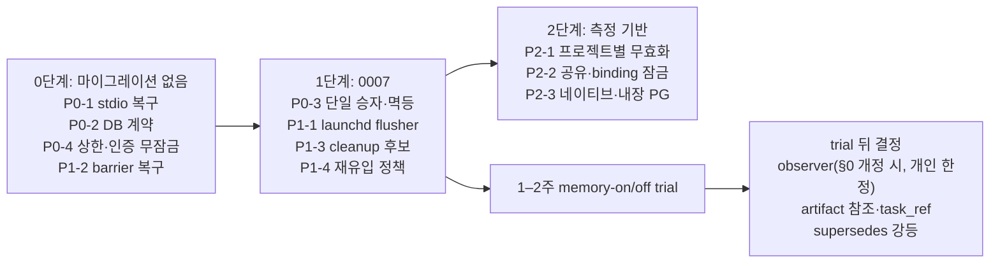
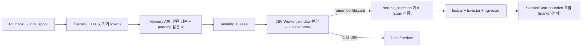

# 로컬 멀티 프로젝트·다중 세션 개선 설계 — Opus 5.5 · Codex 6.1 Sol 적대적 리뷰 종합

작성 2026-10-15. 대상 코드는 main `d49ec13`과 같은 트리입니다. 실제 CLI를 읽기 전용으로 두 차례 실행했습니다.

| 차수 | 모델(요청 설정) | 입력 | 결과 |
|---|---|---|---|
| 1차 독립 | `claude-opus-5-5 --effort xhigh`(응답 `modelUsage`에서 모델 확인), `gpt-6.1-sol` `model_reasoning_effort="xhigh"` | 같은 고정 입력(코드베이스 + `research/ai-memory-oss-code-survey.ko.md`) | 둘 다 exit 0, 690s / 646s |
| 2차 교차 반박 | 같음 | 상대 1차 결과 + GitHub 이슈 #5 본문·댓글 32개 전체 + 오픈소스 조사 | 둘 다 exit 0, 562s / 576s |

Claude는 Read·Grep·Glob 도구만, Codex는 read-only sandbox만 허용했습니다. 리뷰어는 테스트·서비스를 실행하지 않았으므로 아래 성능·경합 주장은 **코드 근거의 구조적 위험이며 측정값이 아닙니다.** effort는 전달한 CLI 설정이며 서버가 실제 적용한 값은 응답에서 확인되지 않습니다. 원문 4개는 부록 A~D에 그대로 실었습니다.

## 1. 결론

1. **현재 코드에서 가장 먼저 고칠 것은 세 가지입니다(두 모델 합의).**
   - 오래 켜 둔 MCP 세션이 서비스 재시작·유휴 만료 뒤 복구되지 않습니다(`stdio.py`, `edge.py`).
   - 서비스는 PostgreSQL 18.x를 허용하는데 backup·restore는 18.6·pgvector 0.8.7만 받습니다(`store.py:146`, `ops.py:468`).
   - 같은 원문을 두 세션이 동시에 `remember`하면 claim이 둘 생기고, 응답 유실 뒤 새 key로 재시도해도 중복됩니다(`store.py:822`, `:859`).
2. **멀티 프로젝트는 권한만 격리되고 실행은 격리되지 않습니다.** 모든 트랜잭션이 전역 `am_clock` 행을 `FOR UPDATE`로 잠그고, 삭제 generation·cleanup page·receipt 공간도 배포 전역입니다. 그래서 큰 프로젝트나 다른 프로젝트의 삭제가 다른 프로젝트의 지연과 판단 무효화로 번질 수 있습니다.
3. **observer LLM을 별도 CLI로 부르는 안은 두 모델 모두 "지금은 채택하지 않음"으로 결론냈습니다.** 1차에서는 둘 다 조건부 채택이었지만, 2차에서 이슈 #5 §0(회사 B 폐기, 현재 사용 중인 LLM이 판단)과 §7-2(정리 판단도 다음 agent 호출 때)와 충돌한다는 점을 확인하고 철회했습니다. 바꾸려면 사용자가 §0을 명시적으로 개정해야 합니다.
4. **새 기억 블록(task·artifact·entity·event)과 observer보다 이미 정의한 1–2주 memory-on/off trial이 먼저입니다.**

## 2. 제안 비교

합의도: ●는 두 모델 합의, ◐는 방향은 같고 방법이 엇갈림, ○는 한쪽만 제안했거나 반대가 있음.

| 순위 | 제안 | 해결 문제 | 영향 범위 | 마이그레이션 | 장점 | 단점·위험 | 합의 |
|---|---|---|---|---|---|---|---|
| P0-1 | stdio 세션 복구: 서버가 "세션 만료"와 "credential 불일치"를 다른 코드로 반환, relay는 만료일 때만 재초기화 후 1회 재전송 | 재시작·유휴(SDK 300s, edge 600s)·세션 64개 초과 뒤 `SESSION_CREDENTIAL_DENIED` 고착 | `edge.py`, `stdio.py` | 없음 | 장기 세션의 조용한 장애 제거 | 재전송을 "handler 실행 전 거절"로 좁히지 않으면 mutation 중복 | ● |
| P0-2 | DB 지원 계약 통일: serve·migrate·backup·restore가 하나의 허용 범위 사용, archive에 실제 버전 기록 | 서비스는 도는데 백업이 안 되는 조합 | `store.py`, `ops.py`, restore 검증 | 없음 | 네이티브·내장 PG로 가는 선행 조건 | 18.x patch 간 pg_dump 호환은 실측 필요 | ● |
| P0-3 | source 판단 단일 승자 + 재시도 멱등 | 동시 `remember` 중복 claim, 응답 유실 후 중복 | `store.py:820-886`, `selection.py`, admission migration, 도구 설명 | 0007 | 중복 echo 차단, 재시도 안전 | 부분 window 겹침 규칙, 기존 receipt 호환 | ◐ 방법 엇갈림(4장) |
| P0-4 | 요청 수·풀 대기 상한 + 인증 트랜잭션의 전역 잠금 제거 | 무한 대기·적체, 인증마다 전역 잠금 | `edge.py`, `store.py:141,172`, `cli.py:219`, `config.py` | 없음 | 프로젝트 간 지연 전파 제한 | 정상 burst 거절 가능, timeout 뒤 commit 여부 보존 필요 | ◐ 순서 엇갈림 |
| P1-1 | hook은 enqueue만, launchd flusher가 spool 전달 | hook 동기 flush 지연, 세션 종료 뒤 미전송, flush 중복 | `hosts.py:1622-1651`, `spool.py`, CLI, launchd plist | spool version | 프롬프트 지연 감소, 서비스 복구 후 자동 전달 | 프로세스 추가, 과부하 무손실 보장 아님 | ● |
| P1-2 | 삭제 barrier 자동 복구(검증 가능한 journal–DB 지연만) | 삭제 후 DB 반영 실패 시 계속 503 | `store.py` `_tx`, `jobs.py` | 없음 | floor는 더 지우는 방향이라 안전 | 손상·restore fence와 섞으면 위험 | ● |
| P1-3 | cleanup을 binding별로 끊고 다른 bucket 후보 포함, 판단 시 기존 기억을 최근 9개 대신 관련 상위 k개로 | 20개 bucket 밖 중복·모순 미비교, 판단 시 중복 미노출 | `store.py:561-704`, `:1599-1607`, `jobs.py` | 선택 | 중복이 판단 시점에 보임 | 후보 누락·응답 크기 | ● |
| P1-4 | 재유입 정책 명문화: 거절은 재제안 차단, 철회·삭제는 identity floor. 같은 본문이 새 origin으로 오면 막지 않고 "이전 철회와 같은 본문" 신호 | 철회한 사실이 새 origin으로 조용히 부활 | 문서·도구 설명·inspect | content floor 선택 시만 | 거절과 삭제 효과를 정확히 설명 | 영구 fingerprint는 민감 정보 잔존 | ● |
| P2-1 | 무효화 범위를 프로젝트별로: deletion generation·review lineage·cleanup page·receipt kind 분리 | 다른 프로젝트 삭제가 내 판단·review를 무효화 | `_reconcile_locked`, admission, `schedule_cleanup` | 필요 | 프로젝트 간 간섭 제거 | 교차 lineage(공유 rule·feedback·artifact) 누락 시 철회 근거 유출 | ◐ |
| P2-2 | 읽기 트랜잭션 공유 잠금, 이후 binding별 잠금 | 전역 직렬화 | `store.py:167-186,290-299` | 2단계에서 | 읽기 병렬화 | inspect는 admission을 쓰므로 순수 읽기 아님, MultiXact 비용 | ◐ 측정 후 |
| P2-3 | 네이티브 PG → 내장 PG(`pg0`류) 평가, SQLite는 보류 | colima Docker 의존 | `ops.py`, 설치 문서 | 없음 | 설치 단순화 | 바이너리·extension 업데이트 운영. Docker 제거가 잠금 문제를 풀지는 않음 | ● |
| P2-4 | 1–2주 memory-on/off paired trial 실행 | 투자 우선순위 근거 부재 | 평가·운영 | 없음 | 실제 효익 기준 결정 | native memory 잔류 통제 어려움 | ● |
| 보류 | journal 증분 검증 | 요청마다 저널 전체 HMAC 검증 | `journal.py` | 없음 | 요청 비용 일정 | stat 캐시는 prefix 불변을 증명 못 해 Sol 반대 | ○ |
| 보류 | `QUEUE_FULL` 시 source 저장 후 판단 지연 | backlog 초과 시 capture 거절 | `store.py`, `spool.py` | 필요 | 원문 확보 | backlog가 저장량으로 이동, Sol 반대 | ○ |
| trial 후 | `supersedes` 판단 시 옛 claim 순위 강등(삭제 아님) | 낡은 claim이 recall 자리 차지 | migration, `search_lexical` | 필요 | recall 품질 | 잘못된 판단이 맞는 claim을 묻음 | ○ |
| trial 후 | artifact 참조(path·symbol·commit·digest), 외부 `task_ref` label | 파일 작업 시 기억, 작업 재개 | domain·store·schema·backup | 필요 | 검색 힌트 | 상태 기계·낡은 경로. task 상태 테이블은 둘 다 반대 | ◐ |

## 3. observer LLM(별도 CLI) 판정

**판정: 지금은 채택하지 않음.** 회사 realm은 기각을 유지합니다.

근거:
- **결정 충돌:** 이슈 #5 §0은 "기억 판단은 지금 쓰는 coding agent LLM"으로 정하고 회사 B(native 소형 모델 배치 선별)를 폐기했습니다. §7-2는 주기 정리도 "다음 agent 호출 때 사용 중 LLM이 판단"으로 정했습니다. observer CLI는 사실상 회사 B의 부활입니다.
- **증거 부재:** 에이전트가 스스로 판단을 제출하는 비율, 미판단 source 추이가 아직 측정되지 않았습니다.
- **새 위험:**
  - 자기 capture 루프: binding 디렉터리에서 `codex exec`/`claude -p`를 띄우면 그 프롬프트(원문 포함)가 다시 human source로 capture되고, `claude -p`는 repo hook을 실행합니다. headless 세션의 host auto memory로 원문이 샐 수 있습니다[추론].
  - 대화 맥락 없는 판단은 원문에 심어진 지시(PMPA)를 거를 단서가 더 적습니다[추론].
  - 팀 계정 사용 허가가 자동 배치 실행 허가를 뜻하지 않습니다.

재검토 조건(모두 충족): trial에서 미판단 비율이 높고 증가, P0-3·P1-1 완료, 사용자의 §0 개정(개인 realm 한정).

채택한다면 필요한 구조(두 모델 공통):
- hook·`serve`가 아니라 사용자 launchd supervisor가 실행합니다. binding별 공정성과 실행 수·토큰·시간 예산을 둡니다. 회사 realm에서는 명령 자체를 거절합니다.
- 기존 pending에 lease(owner instance·generation·deadline)와 fence를 추가합니다. credential만으로 실행 소유자를 구분하지 않습니다.
- 입력은 서버가 준 정확한 source window·span inventory·revision·관련 claim·거절 정보뿐입니다. transcript나 다른 파일은 읽지 않습니다.
- binding 밖의 빈 cwd에서 hook·plugin·auto memory·추가 MCP를 끈 상태로 실행합니다. 확인되지 않으면 시작하지 않습니다.
- 제출은 기존 `source_selection` 계약을 그대로 통과합니다. 실패·timeout·잘못된 JSON은 `discard`가 아니라 `held`로 남기고, 다른 provider로 fallback하지 않습니다.
- 감사에 CLI·모델·프롬프트 버전, 입력·제출 digest를 남기고 본문은 복제하지 않습니다.

## 4. 끝까지 엇갈린 지점

| 쟁점 | Opus 5.5 | Codex 6.1 Sol | 권장 |
|---|---|---|---|
| 판단 단일 승자 방식 | 같은 window에 active remember/discard가 있으면 겹침 거절. admission을 지우지 않고 `consumed_operation_id`로 표시해 key가 달라도 같은 판단이면 기존 operation 반환 | window별 판단 revision CAS. 원 command·key 보존과 receipt 조회로 복구. 현 digest에 key가 포함되므로 "key가 달라도 같은 digest" 조건은 성립하지 않음 | 겹침 거절 + **key를 뺀 business digest**를 새로 정의(두 주장의 교집합). receipt 조회는 보조 |
| 잠금 1단계 | 인증 무잠금 + 읽기 `FOR SHARE`를 바로 | 요청·대기 상한과 측정 먼저 | 상한 + 인증 무잠금을 먼저, `FOR SHARE`는 부하 측정 뒤 |
| journal 증분 검증 | stat 캐시로 새 줄만 검증 | prefix 불변을 증명 못 해 반대 | 보류. 삭제 수에 따른 실제 비용부터 측정 |
| backlog 초과 | source를 저장하고 판단만 지연 | bounded 수락 유지, 지연이 해결은 아님 | 현행 유지 + backlog·만료 위험 가시화 |
| observer 도구 접근 | MCP `inspect`·`record`만 허용 | 도구 없는 typed 초안을 runner가 검증·제출 | 재검토 시 Sol 방식(도구 없음)이 더 보수적 |
| task | opaque label만 | 외부 참조 가능, 상태 기계는 효익 확인 후 | trial 뒤 결정 |

## 5. 단계별 설계

0단계는 서로 독립이라 한 묶음으로 진행할 수 있고, 모두 현행 저장 형식을 바꾸지 않습니다. 1단계부터 스키마 변경이 있어 backup·restore allowlist와 삭제 lineage에 새 필드를 포함해야 합니다.

## 6. 이슈 #5 기록과 현재 코드의 차이

두 리뷰가 확인한 사항입니다. 이슈 본문 §6의 일부 공백은 이미 구현되어 갱신이 필요합니다.
- secret 저장 전 거절: 구현됨(`domain.py:74`, `selection.py:88`, `capture_guard.py`).
- `agent_note` 자기 선택: remember 거절·판단 admission 미부여로 구현됨(`selection.py:285`, `store.py:1764`).
- 거절 이력 비교: 구현됨(`store.py:1549-1587`).
- PMPA·native memory 시나리오: 정의됨, 실제 native 합격 증거는 없음.

---

## 부록 A. Opus 5.5 1차 원문

읽기 전용으로 리뷰했어요. 파일 수정, 테스트, 서비스, 네트워크 실행은 하지 않았어요.

# agents-memory 적대적 설계 리뷰 — 1차(독립)

## 1. 핵심 결론
1. **가장 큰 위험은 `_tx`의 전역 `am_clock ... FOR UPDATE`예요.** 인증과 읽기까지 모든 프로젝트·세션이 한 줄로 섭니다. 요청마다 삭제 저널 전체를 HMAC 검증하는 비용도 붙어요.
2. **오래 켜 둔 세션에서 MCP가 조용히 죽어요.** 서비스 재시작, 10분 유휴, 세션 64개 초과 뒤에 `host-stdio`가 다시 초기화하지 않아요. 그래서 `SESSION_CREDENTIAL_DENIED`가 계속 납니다.
3. **판단 제출 경로에 동시성 방어가 없어요.** pending lease(작업 찜)가 없고, 이미 판단된 source인지 검사하지 않아요. 두 세션이 같은 source를 판단하거나, 응답 유실 뒤 새 key로 재시도하면 claim이 중복돼요.
4. **백프레셔(밀려드는 양 조절)가 결국 유실로 끝나요.** `QUEUE_FULL`이나 spool lock 경합이 생기면 다음 hook 때만 재시도하고, 24시간 뒤 만료돼요. 대화 중 에이전트만 판단하니 backlog를 비울 주체가 없어요.
5. **observer CLI는 조건부 채택이에요.** hook이나 서버가 아니라 별도 opt-in drainer로만 둡니다. lease, admission 기반 멱등성, 전용 credential, 도구 allowlist가 먼저 있어야 해요.

## 2. 발견 사항 표

| ID | 주제 | 문제 | 근거 | 심각도 | 확인 방법 |
|---|---|---|---|---|---|
| A1 | A,B | 모든 `_tx`가 singleton clock 행을 `FOR UPDATE`로 잠가요. 인증, inspect, stats 같은 읽기도 포함이에요. 그래서 모든 binding이 직렬화돼요. MCP 호출 1번에 인증 tx 2번(edge, tool)과 본 작업 tx 1~3번이 이 잠금을 거쳐요. 첫 `memory_context`는 tx 5번이에요 | `store.py:167-186`, `store.py:290-299`, `edge.py:190`, `edge.py:135-139`, `edge.py:333`, `application.py:62-77` | High | binding 3개에서 `memory_context`를 N개 병렬로 보내 p95와 N의 관계를 측정해요. `pg_locks`에서 am_clock 대기 수를 봐요. `docs/verification.ko.md:386`도 아직 미실측이라고 적고 있어요 |
| A2 | A,B | barrier가 있는 tx마다 `journal.verify`가 entries 파일 전체를 읽고 줄마다 HMAC을 검증해요. 비용이 삭제 수에 비례해요. `threading.RLock`와 `flock`으로 직렬이에요. tx 안에서도 `source_token`/`origin_token`이 key와 metadata를 다시 읽고 검증해요 | `store.py:170`, `store.py:451-454`, `store.py:501`, `journal.py:205-215`, `journal.py:226-270`, `journal.py:298-301` | Medium (삭제가 쌓이면 High) | entry 1만 개 저널을 합성한 뒤 `capture` p50/p95를 측정해요 |
| A3 | A,B | 전역 잠금을 쥔 채 긴 tx가 돌아요. `search_lexical`은 binding 전체를 MATERIALIZED로 스캔해요. `delivery`→`_stats`는 `range_agg` 포함 집계를 10여 개 돌려요. `schedule_cleanup`은 여러 binding을 스캔하고 `more`면 바로 반복해요. `architecture.ko.md:65`의 "짧게 잠가"와 맞지 않아요. hook 쪽 timeout은 context 4s, capture 1s예요 | `store.py:2033-2057`, `store.py:3092`, `store.py:1912-1986`, `store.py:613-762`, `jobs.py:61-63`, `hosts.py:1553`, `hosts.py:1629` | High | claim 5천 개 binding에서 cleanup을 돌리는 동안 다른 binding의 capture timeout 비율을 측정해요 |
| A4 | A,C | pending에 lease도 소유자도 없어요. 여러 세션이 `ref=pending`에서 같은 항목을 보고 각자 admission을 받아 둘 다 commit할 수 있어요. `_record_selection`은 같은 source revision에 이미 active인 완전 선택이 있는지 보지 않아요 | `store.py:1249-1269`, `store.py:1780-1784`, `store.py:820-886`, `0006_agent_judged.py:43` | High | 두 세션이 같은 source를 inspect한 뒤 서로 다른 key로 remember를 보내요. claim이 두 벌 생기는지 회귀 테스트해요 |
| A5 | A,C | `deletion_generation`이 전역이에요. 한 프로젝트의 retract/correct/purge가 다른 모든 프로젝트의 진행 중 admission을 `ADMISSION_STALE`/`CONTEXT_STALE`로 만들어요 | `store.py:2841`, `store.py:2093-2096`, `store.py:3073-3076` | Medium | binding X에서 inspect하고, binding Y에서 retract한 뒤, X에서 record가 실패하는지 확인해요 |
| A6 | A,B | 삭제는 저널 append를 먼저 하고 DB tx를 나중에 해요. 그 사이에는 모든 barrier tx가 `DELETION_BARRIER`예요. DB tx가 실패하면 `_tx`에 자동 reconcile이 없어요. 재시작하거나 다음 삭제 명령이 올 때까지 전 프로젝트가 503이에요. scheduler는 로그만 남겨요 | `store.py:170-182`, `store.py:2890-2894`, `store.py:2904-2911`, `jobs.py:46-51` | Medium (드물지만 영향 큼) | append 직후 PG를 끊었다가 복구해요. 그 뒤에도 capture가 `DELETION_BARRIER`인지 확인해요 |
| B1 | A,B | relay가 세션이 사라져도 다시 초기화하지 않아요. edge는 600s 유휴 세션을 지우고 64개 LRU로 밀어내요. SDK는 300s idle, 최대 64개예요. 재시작하면 메모리 세션이 다 사라져요. relay는 옛 `Mcp-Session-Id`를 계속 보내요 | `edge.py:195-200`, `edge.py:257-258`, `edge.py:428-431`, `stdio.py:81-82`, `stdio.py:104-105` | High | legacy session host로 initialize한 뒤 11분 기다리거나 `serve`를 재시작해요. 이후 `tools/call`이 계속 실패하는지 봐요. `tests/test_stdio_boundaries.py`에 재초기화 케이스가 없어요 |
| B2 | B | hook 동기 경로가 무거워요. 이벤트마다 Python 프로세스를 새로 띄워요. capture 1번에 housekeep가 약 7번 돌아요. 각각 `BEGIN IMMEDIATE`, `wal_checkpoint(TRUNCATE)`, fullfsync를 해요. 여기에 flush 최대 4×1s, recall 4s가 더해져요 | `omp.ts:40-46`, `hosts.py:661-667`, `hosts.py:1622-1630`, `spool.py:71-81`, `spool.py:195-200`, `spool.py:290`, `spool.py:317`, `spool.py:323`, `spool.py:341`, `spool.py:458`, `spool.py:534` | Medium | `UserPromptSubmit` hook 실행 시간을 서비스 정상, 부하, 중단 세 조건에서 측정해요 |
| B3 | A,B | 같은 프로젝트, 같은 host의 세션들이 spool 파일 하나를 같이 써요. 1초 busy 뒤 `sqlite3.Error`가 나면 `HOST_SPOOL_UNAVAILABLE` gap으로 끝나요. enqueue 자체가 안 돼서 유실이에요 | `hosts.py:277-282`, `hosts.py:1622`, `hosts.py:1638-1639`, `spool.py:71`, `spool.py:77` | Medium | Codex 세션 2개에서 동시에 prompt를 반복 제출하고 gap 카운터가 느는지 봐요 |
| B4 | B | backpressure가 유실로 끝나요. binding당 pending이 1024를 넘으면 429 `QUEUE_FULL`이에요. transient로 분류돼 spool에 남지만 flush는 다음 hook 때만 해요. payload TTL은 24h예요. 비울 주체는 대화 중 에이전트뿐이에요 | `store.py:434-450`, `config.py:22`, `spool.py:28`, `spool.py:39`, `spool.py:461-464`, `hosts.py:1629`, `hosts.py:1651` | High (제품 관점) | `queue_limit=4`로 두고 판단 없이 capture 10번을 보내요. 시계를 24h 넘기면 `SPOOL_PAYLOAD_EXPIRED`가 나는지 봐요 |
| B5 | B | relay가 요청을 한 번에 하나만 처리해요(timeout 120s). 앞 요청이 느리면 취소 알림이 뒤에서 막혀요 | `stdio.py:193-208`, `stdio.py:96` | Low | 느린 inspect 도중 `notifications/cancelled`가 언제 전달되는지 측정해요 |
| C1 | C | receipt 범위가 `(principal_id, binding_id, kind, request_key)`예요. 그런데 principal은 모든 credential에서 owner 하나예요. 그래서 모든 host와 세션이 LLM이 지은 key를 한 공간에서 써요. 만료도 없어요. 도구 설명은 "Use an explicit retry key"뿐이에요 | `store.py:301-310`, `store.py:379`, `0001_authority.py:35-38`, `edge.py:71` | Medium | Claude와 Codex 세션이 같은 key `remember-1`로 서로 다른 record를 보내면 `IDEMPOTENCY_CONFLICT`가 나는지 재현해요 |
| C2 | C | 응답이 유실된 뒤 에이전트가 새 key로 재시도하면, admission은 이미 DELETE된 상태예요. 그래서 `ADMISSION_STALE`→재-inspect→두 번째 commit으로 이어져요(A4와 합쳐 중복). 소비된 admission을 operation에 연결하는 기록이 없어요 | `store.py:817`, `store.py:885`, `store.py:822-827`, `stdio.py:117-118` | High | relay에서 record 응답을 끊고 새 key로 재시도하는 시나리오를 테스트해요 |
| C3 | C | 같은 원문이 다른 host나 세션에서 들어오면 origin이 달라 source가 따로 생겨요. 판단하는 쪽에 "같은 본문이 이미 있음" 힌트가 없어요 | `hosts.py:1617-1619`, `hosts.py:117` | Low-Medium | 같은 문장을 Codex와 OMP에 입력해 source와 pending이 2개씩 생기는지 봐요 |
| C4 | C | 동시에 flush하면 같은 outbox 행을 두 프로세스가 POST해요. 서버 receipt 덕분에 해는 없고 부하만 늘어요 | `spool.py:461-497` | Low | B3 시나리오에서 서버 receipt hit 수를 세요 |
| D1 | D | Claude는 자동 capture가 없어요. observer를 붙여도 Claude만 쓰는 프로젝트에는 판단할 입력이 없어요 | `hosts.py:1584-1590`, `hosts.py:108-110` | Info | - |
| E1 | E | 후보 인덱스는 lexical뿐인데 pgvector ≥0.8.7을 시작 조건으로 강제해요. Docker 없이 PG를 설치하기가 어려워져요 | `store.py:145-147`, `store.py:1915`, `edge.py:413` | Low | pgvector 없는 PG18로 `serve`를 띄워 `DATABASE_VERSION_UNSUPPORTED`가 나는지 봐요 |
| F1 | F | `ContextCommand.paths`가 claim 검색에 안 쓰여요(규칙 조립에만 써요). 파일·커밋 같은 artifact 앵커가 없어서 PreToolUse path recall은 규칙만 돌려줘요 | `application.py:66-72`, `domain.py:227`, `hosts.py:1863` | Medium | 특정 파일에 관한 claim을 저장한 뒤 그 파일을 Edit할 때 context에 안 나오는지 확인해요 |
| F2 | F | entity는 claim마다 붙은 이름 문자열이에요. canonical id도 alias도 없어요. NFKC casefold 정확 일치만 돼요 | `0001_authority.py:80`, `store.py:92-93`, `store.py:869-870`, `store.py:2049` | Low-Medium | "PG"와 "PostgreSQL" claim이 entity arm에서 안 묶이는지 봐요 |
| F3 | F | task 블록이 없어요. 열림/완료 같은 바뀌는 상태는 불변 claim과 supersedes 구조에 안 맞아요 [추론] | `domain.py:289-294` | Low | - |

## 3. 개선 제안

### P1. relay 세션 복구, 또는 stateless MCP — 우선순위 1
- **내용:**
  - 안 (a): `stateless_http=True`로 서버 세션을 아예 없애요. 인증은 이미 요청마다 bearer로 하고 있어요.
  - 안 (b): relay가 edge의 `SESSION_CREDENTIAL_DENIED`나 SDK 404를 받으면 `session_id`를 지워요. 저장해 둔 host의 `initialize` 파라미터로 다시 초기화하고 같은 요청을 1번 다시 보내요.
  - 재전송이 안전한 이유: edge 거절은 inner 앱을 부르기 전에 일어나요(`edge.py:196-199`, `edge.py:238-240`). 그래서 effect가 확정 `not_started`예요.
- **해결:** B1
- **영향 범위:** `edge.py`(세션 dict, SDK 옵션), `stdio.py`, stdio 테스트. 마이그레이션과 호스트 설정 변경은 없어요.
- **장점:** 작은 변경으로 가장 흔한 장애를 없애요.
- **위험:**
  - (a)는 SDK의 stateless + `json_response` 조합이 실제로 동작하는지 확인해야 해요 [추론].
  - (b)는 재전송 조건을 "edge 사전 거절"로 좁히지 않으면 mutation 자동 재시도 금지(`docs/architecture.ko.md:137`)를 깨요.
- **비용:** 낮음.

### P2. 읽기 경로의 전역 배타 잠금 제거 — 우선순위 2
- **내용:**
  - `_tx(mode=...)`를 도입해요.
  - 인증은 clock 잠금 없이 읽어요.
  - epoch를 올리지 않는 tx(inspect, context, stats, admission 생성)는 `FOR SHARE`로 잠가요.
  - `_tick`이나 reconcile이 있는 tx만 `FOR UPDATE`로 잠가요.
  - 삭제 commit은 공유 잠금이 풀릴 때까지 기다려요. 그래서 "삭제 뒤 읽기 차단" 선형화가 유지돼요.
- **해결:** A1, A3 일부
- **영향 범위:** `store.py`의 `_tx`와 호출부, edge 인증 경로. 마이그레이션은 없어요.
- **장점:** 프롬프트마다 도는 읽기들이 병렬이 돼요. 불변식은 유지돼요.
- **위험:** 공유 잠금이 많으면 쓰기가 계속 밀릴 수 있어요(writer starvation) [추론]. reader tx를 짧게 유지해야 해요.
- **비용:** 중간.
- **측정 뒤 다음 단계:** binding별 clock 행(`am_binding_clock`)으로 쓰기도 나눠요. 전역 이벤트(삭제, grant, shared rule)만 전역 잠금을 써요. 이건 마이그레이션 0007과 epoch 의미 변경이 필요해서 비용이 커요.

### P3. 저널 검증 증분화 — 우선순위 2
- **내용:**
  - 마지막 검증 상태를 메모리에 저장해요: `(st_ino, st_size, st_mtime_ns, head, sequence, offset)`.
  - 그대로면 head만 비교해요.
  - 파일이 append로만 커졌으면 새 줄만 검증해요.
  - 그 밖의 변화면 전체를 다시 검증해요.
  - key와 metadata도 캐시해요.
- **해결:** A2
- **영향 범위:** `journal.py`만.
- **장점:** 요청당 비용이 일정해져요. barrier 의미는 그대로예요.
- **위험:** 같은 UID가 크기와 mtime을 맞춰 앞부분을 바꾸면 늦게 발견해요. 시작, restore, reconcile, 주기 시점에 전체 검증을 유지해서 줄여요.
- **비용:** 낮음.

### P4. pending lease + 이미 판단된 source 거절 — 우선순위 3
- **내용:**
  - `am_pending_judgments`에 `lease_credential_id`, `lease_until`을 추가해요.
  - `inspect source`가 admission deadline만큼 lease를 잡아요.
  - `ref=pending`은 lease 없는 항목부터 보여줘요.
  - `_record_selection`은 같은 source revision, policy, request_snapshot에 다른 admission의 active `remember/discard` `complete_window` 선택이 있으면 거절해요. 이때 `SELECTION_ALREADY_RECORDED`(not_committed)와 기존 selection·operation id를 돌려줘요.
- **해결:** A4, C2 일부, D의 선행 조건
- **영향 범위:** 마이그레이션 0007, `store.py`의 inspect·`_record_selection`·`_pending_page`, 도구 설명.
- **장점:** 중복 claim을 막고 LLM 작업 낭비를 줄여요.
- **위험:**
  - 죽은 세션이 lease를 쥐고 있을 수 있어요. 짧게 만료시키고 만료되면 자동 해제해요.
  - `review` 라벨은 거절 대상에서 빼요.
  - 부분 window끼리 겹칠 때 규칙을 정해야 해요.
- **비용:** 중간.

### P5. admission을 멱등 기준으로 사용 — 우선순위 3
- **내용:**
  - record 뒤 admission을 DELETE하지 않아요(`store.py:817`, `store.py:885`). 대신 `consumed_operation_id`와 `consumed_digest`로 표시해요.
  - 같은 admission으로 다시 오면, key가 달라도 digest가 같을 때 기존 operation을 돌려줘요. digest가 다르면 `ADMISSION_CONSUMED`를 돌려줘요.
  - source_selection과 claim_judgment는 key를 생략하면 `admission_id`에서 만들어요.
- **해결:** C2, C1(판단 경로)
- **영향 범위:** 마이그레이션(컬럼), `store.py:1093-1094`(만료 청소), `selection.py`(Key 선택화), 도구 스키마.
- **장점:** LLM이 key를 기억할 필요가 없어요. 응답 유실 뒤 재시도가 자연스럽게 안전해져요.
- **위험:** 소비된 admission이 쌓여요. 보존 기간 뒤 청소하고, 청소 뒤 재시도는 P4가 막아요. 기존 receipt 의미는 그대로라 호환돼요.
- **비용:** 낮음~중간.

### P6. 삭제 barrier 자동 복구 — 우선순위 4
- **내용:** `_tx`에서 head가 다르면 single-flight로 `_sync_deletion_journal()`을 1번 시도하고 다시 실행해요. scheduler도 `DELETION_BARRIER`를 받으면 reconcile을 시도해요.
- **해결:** A6
- **영향 범위:** `store.py`의 `_tx`, `jobs.py`.
- **장점:** floor는 더 지우는 방향으로만 바뀌어요(단조). 그래서 자동으로 적용해도 안전해요.
- **위험:** 실패가 반복되면 backoff가 필요해요. `restore-barrier.json`이 있을 때는 자동 복구를 금지해요.
- **비용:** 낮음.

### P7. hook 경로 다이어트 + 백그라운드 flush — 우선순위 4
- **내용:**
  - hook 1번에 housekeep 1번만 해요. checkpoint는 `PASSIVE`로 하고, 주기적으로만 `TRUNCATE`해요.
  - `SQLITE_BUSY`는 hook 예산 안에서 jitter를 두고 재시도해요. 그래도 실패하면 세션별 보조 spool에 써요.
  - flush는 hook에서 빼요. launchd `StartInterval` 사용자 flusher가 모든 `runtime_dir`를 돌며 flock single-flight로 처리해요.
- **해결:** B2, B3, B4 일부, C4
- **영향 범위:** `spool.py`, `hosts.py`, 새 CLI 명령, 설치 절차(launchd plist 1개 추가).
- **장점:** 프롬프트 지연이 줄고, lock 경합으로 인한 유실이 없어지고, 서비스가 복구되면 자동으로 비워져요.
- **위험:** 보조 파일이 늘어요. flusher도 같은 UID 경계 안에 있어야 해요.
- **비용:** 중간.

### P8. `QUEUE_FULL`을 "판단 지연"으로 바꾸기 — 우선순위 5
- **내용:** backlog를 넘으면 source는 저장하고 pending을 `deferred`로 둬요. stats에 노출해요. 상한은 건수 대신 binding별 미판단 바이트로 잡아요.
- **해결:** B4
- **영향 범위:** 마이그레이션(state 값), `store.py:434-450`, `_stats`, spool의 `TRANSIENT_CODES`.
- **장점:** 원문을 잃는 대신 판단이 늦어질 뿐이에요. 미분류 source는 이미 셀 수 있어요(`store.py:1965-1967`).
- **위험:** 저장량이 늘어요. 회사 보존 정책과 맞는지는 확실하지 않음, 확인이 필요해요.
- **비용:** 중간.

### P9. `deletion_generation` 범위 축소 — 우선순위 6
- **내용:** `_reconcile_locked`는 이미 영향받는 binding을 계산해요(`store.py:2821-2831`). 그 binding과 shared rule target binding만 generation을 올려요. admission은 자기 binding 값만 비교해요.
- **해결:** A5
- **영향 범위:** 마이그레이션, reconcile, admission, recheck.
- **장점:** 다른 프로젝트의 삭제가 내 판단을 깨지 않아요.
- **위험:** 교차 lineage를 빠뜨리면 철회된 근거가 새어 나가요. recheck가 source state와 revision을 개별 확인하는 2차 방어는 있어요(`store.py:996-1003`, `store.py:2106-2109`). 하지만 artifact floor 전부를 덮는지는 확인하지 못했어요 [추론].
- **비용:** 중간.

### P10. artifact-lite 앵커 — 우선순위 7
- **내용:** `ClaimDraft.anchors`를 선택 필드로 추가해요(path/symbol/commit, 상대경로 정규화). `am_claim_anchors` 테이블을 두고, `memory_context`에 `paths`를 쓰는 anchor arm을 더해요. 새 권위 블록은 만들지 않아요.
- **해결:** F1
- **영향 범위:** 마이그레이션, `domain.py`, `selection.py`, `search_lexical`, `Application.context`, PreToolUse recall.
- **장점:** "이 파일을 만질 때 떠올릴 기억" 사용 사례가 풀려요.
- **위험:** 파일이 옮겨지면 앵커가 낡아요. 앵커는 검색 힌트일 뿐 권위가 아니에요. 서버가 파일시스템을 보지 않으니 존재 검증도 없어요.
- **비용:** 중간.
- **나머지 블록:** entity alias는 실제 중복 데이터가 보일 때 추가해요. task는 host나 agent-flow 같은 작업 도구가 맡아야 해요. event는 지금 있는 `event_time`, `valid_from/until` 필드로 충분해요. context 검색에 시간 필터를 붙일지는 나중에 봐요.

### P11. 저장소: 네이티브 PG를 1급 지원하고 SQLite 이전은 보류 — 우선순위 8
- **내용:** ops는 이미 `mode="local"`을 지원해요(`ops.py:68-92`). Homebrew나 Postgres.app의 PG18을 검증된 배포로 문서화해요. lexical 모드에서는 pgvector를 선택 사항으로 바꿔요.
- **해결:** E1. colima VM이 멈춰서 생기는 `DATABASE_UNAVAILABLE`(`store.py:184-186`)도 줄어요 [추론].
- **A~C 영향:**
  - **SQLite로 가면:** 쓰기는 원래도 한 줄이라 A1이 구조상 확정돼요. 대신 WAL 덕분에 읽기는 병렬이 돼요.
  - **SQLite의 비용:** `range_agg`/`int8multirange`, GIN `text[]`, `FOR UPDATE`, jsonb 연산 때문에 `store.py` 전반을 다시 써야 해요. 클라우드 단계에서는 다시 PG로 돌아와야 해요.
  - **내장 PG를 쓰면:** SQL은 그대로 두고 프로세스 수명 관리만 추가하면 돼요.
- **비용:** 네이티브 PG는 낮음, SQLite는 매우 큼.

## 4. observer CLI 안에 대한 판정: **조건부 채택**

### 근거
- **필요성:** B4 때문이에요. 대화 중 에이전트는 바쁘면 판단하지 않아요. 그러면 backlog가 쌓이고, `QUEUE_FULL`이 나고, 24h 뒤 원문을 잃어요. 비울 주체가 필요해요.
- **서버 계약을 안 바꿔도 돼요:** observer도 MCP로 inspect→record를 하는 "또 하나의 코딩 에이전트"예요. 서버는 지금처럼 span, revision, 권한만 검증하면 돼요. selection에 `credential_id`가 남으니(`store.py:847`) 감사도 분리할 수 있어요.
- **조건이 붙는 이유:**
  - **회사 정책:** 같은 원문을 같은 provider에 두 번째로 보내게 돼요. 사람이 없는 시간에 팀 계정으로 자동 실행하는 게 허용되는지는 확실하지 않음, 확인이 필요해요.
  - **품질:** observer는 대화 맥락 없이 원문 window만 봐요. 그래서 판단 근거가 약해요 [추론].
  - **주입 위험:** source 본문은 사람 입력이라 "이걸 기억해" 같은 지시가 섞일 수 있어요. 도구를 가진 헤드리스 에이전트라면 피해 범위가 커져요.
  - **비용:** source마다 왕복이 여러 번 생기고 구독 quota를 써요.
  - **입력 부재:** Claude는 자동 capture가 없어요(D1).

### 유사 사례 비교
- **claude-mem:** 모든 tool 입출력을 Haiku observer로 보내요. 기본 설정에서 데이터가 밖으로 나가요(`research/ai-memory-oss-code-survey.ko.md:55-80`).
- **memU:** 스케줄된 `claude -p`가 markdown을 직접 써요. 검증이 없어요(`research/ai-memory-oss-code-survey.ko.md:782-787`).
- **Codex memories:** 2단계 통합을 no network, no approval 샌드박스에서 실행해요(`research/ai-memory-oss-code-survey.ko.md:277`).
- **우리 안:** memU의 "호스트 CLI 재사용" + Codex의 "샌드박스" + 우리 서버 검증의 조합이에요.

### 채택할 때 구조

**누가 띄우나**
- `agents-memory observe --binding <id> --max-items N` CLI예요.
- 사용자 launchd timer나 수동으로 실행해요.
- hook이나 `serve`에서는 절대 띄우지 않아요.
- 회사 mode에서는 기본 off이고, binding별로 opt-in해요.

**무엇을 입력으로 받나**
- 서버가 가진 pending만 써요.
- `inspect ref=pending`에서 일정 시간 이상 지났고 lease가 없는 항목을 골라요. 그다음 `inspect source`로 원문을 봐요.
- transcript나 host 파일은 읽지 않아요.

**어떻게 실행하나**
- `claude -p` 또는 `codex exec`를 써요.
- MCP는 `host-stdio` + observer 전용 agent credential이에요. 해당 binding grant만 줘요.
- 허용 도구는 `memory_inspect`, `memory_record`뿐이에요. shell, file, web은 막아요.
- turn 수와 실행 시간에 상한을 둬요.

**무엇을 서버에 제출하나**
- `memory_record` source_selection을 보내요.
- key는 결정적으로 `observer:{pending_id}:{source_revision}:{policy_revision}`을 써요. P5를 적용하면 admission에서 만들어요.
- 회사 mode는 처음엔 `discard`/`review`만 허용하는 정책 옵션을 둬요.

**실패하면 어떻게 되나**
- timeout이나 비정상 종료면 lease가 만료되고 pending으로 돌아가요.
- 다음 실행에서 같은 key로 재시도해요. receipt가 중복을 막아요.
- 3번 실패하면 `held`로 바꾸고 reason을 `OBSERVER_FAILED`로 남겨요.
- 다른 provider로 fallback하지 않아요.

**감사**
- 본문 없는 실행 로그를 남겨요: pending id, operation id, exit code, 소요 시간.
- recall 결과에 판단한 credential을 표시해서, 대화 중 에이전트가 다시 판단할 수 있게 해요.

**선행 조건**
- P4, P5, credential label이 먼저예요. 이것 없이 붙이면 A4, C2 중복이 오히려 늘어요.

## 5. 하지 말아야 할 것
- **`serve`나 서버 코드에서 LLM·CLI 호출:** `/readyz`의 `server_inference: absent`(`edge.py:411`)와 제품 결정을 깨요.
- **hook에서 observer 실행:** hook timeout이 15s/3s예요(`hosts.py:661-667`). 프롬프트를 막거나 고아 프로세스를 남겨요.
- **observer의 transcript 읽기, assistant/tool 출력 capture:** hook은 transcript를 읽지 않는다는 계약이 있어요(`hosts.py:1798`).
- **같은 본문 source를 body hash로 자동 병합:** origin_token 기반 삭제 lineage(`store.py:2821-2827`)가 섞여요. 힌트만 주세요.
- **clock 잠금을 아예 없애거나 SQL sequence를 epoch로 쓰기:** `docs/architecture.ko.md:65`가 금지해요.
- **transport 실패(effect unknown) 뒤 mutation 자동 재전송:** edge 사전 거절만 재전송하세요(`docs/architecture.ko.md:137`).
- **stale admission ID 재사용으로 deadline 늘리기:** `docs/architecture.ko.md:143`이 금지해요. 늘리려면 `read_admission_timeout_seconds`(`config.py:24`)를 바꾸세요.
- **"observer는 믿을 수 있다"며 span·revision 검증 생략.**
- **속도를 위해 저널 검증 끄기:** 증분 검증만 허용해요.
- **`queue_limit`만 크게 올리기:** 지연만 늘고 유실 구조는 그대로예요.
- **task를 claim으로 저장하기:** 바뀌는 상태가 rejection index와 supersedes 체인을 더럽혀요 [추론].
- **지금 SQLite로 이식:** 클라우드 단계와 충돌하고 `store.py` 전반을 다시 써야 해요.

---
다음 할 일: P1(relay 세션 복구)부터 하길 권해요. 변경이 가장 작고, 오래 켜 둔 세션 장애를 바로 없애요.

## 부록 B. Codex 6.1 Sol 1차 원문

## 1. 핵심 결론

- 최우선 문제는 **전역 DB 잠금**, **같은 원문에 대한 중복 판단**, **서비스 재시작 뒤 stdio 세션 복구 부재**다. `src/agents_memory/store.py:174`, `src/agents_memory/store.py:859`, `src/agents_memory/stdio.py:109`
- **observer CLI는 조건부 채택**이다. hook 밖에서 실행하고, 기존 pending·admission·판단 제출 경계를 그대로 통과해야 한다. 회사용 기본 활성화는 반대한다. `src/agents_memory/hosts.py:1629`, `src/agents_memory/store.py:829`, `README.md:55`
- 배포 단순화는 **네이티브 PG부터** 검토한다. SQLite 전환보다 먼저, 실행 가능한 DB와 backup 가능한 DB의 버전 불일치를 고쳐야 한다. `src/agents_memory/store.py:146`, `src/agents_memory/ops.py:468`
- 블록 유형은 task와 artifact 참조를 우선 검토한다. entity·event를 모두 독립 테이블로 만드는 근거는 아직 부족하다. `src/agents_memory/domain.py:122`, `src/agents_memory/migrations/versions/0001_authority.py:78`

## 2. 발견 사항 표

파일 변경·테스트·서비스·네트워크 실행 없이 검토했다. 아래 확인 방법은 **실행하지 않은 재현 계획**이다. 외부 프로젝트 비교는 제공된 조사 문서에 한정하며, 원격 소스를 재검증하지 않았다. 해당 문서도 종합 과정에서 링크를 다시 대조하지 않았다고 명시한다. `research/ai-memory-oss-code-survey.ko.md:3`

| ID | 주제 | 문제 | 근거 `파일:줄` | 심각도 | 확인 방법 |
|---|---|---|---|---|---|
| R01 | A·B | **모든 authority 트랜잭션이 하나의 행에 직렬화된다.** 인증·조회도 같은 잠금을 잡는다. 프로젝트별 격리는 권한에만 있고 실행 경합에는 없다. 전체 통계 집계도 이 잠금 안에 들어간다. [추론] 큰 프로젝트가 작은 프로젝트의 응답 시간을 끌어올린다. | `src/agents_memory/store.py:167`, `src/agents_memory/store.py:174`, `src/agents_memory/store.py:290`, `src/agents_memory/store.py:1964` | High | A 프로젝트의 통계·cleanup 처리를 지연시키면서 B 프로젝트 인증·inspect 지연을 측정한다. |
| R02 | A | **무관한 프로젝트의 삭제도 진행 중 판단을 무효화한다.** 삭제 generation은 배포 전역이며 admission은 이를 정확히 비교한다. [추론] 삭제·수정이 잦은 프로젝트가 다른 프로젝트의 비싼 LLM 판단을 반복 폐기시킬 수 있다. | `src/agents_memory/store.py:2841`, `src/agents_memory/store.py:2093` | Medium | B에서 inspect → A에서 원문 retract → B에서 변경 없는 판단 제출. `ADMISSION_STALE`을 확인한다. |
| R03 | A·C | **같은 source window의 서로 다른 admission에는 단일 승자가 없다.** 두 `remember`가 각각 새 claim을 만든다. `remember → discard`는 양쪽 selection과 기존 claim이 남지만, `discard → remember`는 거절될 수 있다. 문제는 discard의 삭제 권한이 아니라, 동시 판단 충돌을 표현할 계약이 없다는 점이다. | `src/agents_memory/store.py:1780`, `src/agents_memory/store.py:842`, `src/agents_memory/store.py:859`, `src/agents_memory/store.py:1569`, `src/agents_memory/store.py:1031` | High | A·B가 같은 window를 먼저 inspect한 뒤 각각 다른 key로 동일 extraction을 제출한다. 이어 label 순서를 바꿔 결과를 비교한다. |
| R04 | A | **자동 cleanup의 비교 범위가 삽입 순서의 20개 bucket에 갇힌다.** 서로 다른 bucket의 claim을 함께 비교하는 자동 manifest가 없다. [추론] bucket 사이 중복·모순 정리는 수동 claim 선택에 의존한다. | `src/agents_memory/store.py:683`, `src/agents_memory/store.py:704`, `src/agents_memory/store.py:720` | Medium | 같은 binding/snapshot에서 첫 claim과 21번째 claim을 중복으로 만든다. 반복 cleanup의 manifest에 둘이 함께 등장하는지 확인한다. |
| R05 | A·B | **PG pool 크기와 HTTP 작업 수의 상한이 연결되지 않는다.** pool은 8개지만 acquire 대기 전체의 deadline·요청 수 제한은 없다. `queue_limit`은 프로젝트별 source pending만 제한한다. [추론] 요청 적체가 메모리와 지연으로 옮겨간다. | `src/agents_memory/store.py:141`, `src/agents_memory/store.py:172`, `src/agents_memory/store.py:434`, `src/agents_memory/edge.py:302`, `src/agents_memory/cli.py:219` | High | PG 응답을 지연시키고 여러 프로젝트에서 API 요청을 늘린다. pool 대기 수·메모리·거절 시점을 확인한다. |
| R06 | A·B | **일반 트랜잭션마다 삭제 저널 전체를 다시 읽고 검증한다.** 검증은 스레드로 넘기지만, 저널의 mutex와 파일 exclusive lock으로 직렬화된다. [추론] 삭제 이력이 커질수록 정상 조회 비용도 증가한다. | `src/agents_memory/store.py:170`, `src/agents_memory/journal.py:44`, `src/agents_memory/journal.py:65`, `src/agents_memory/journal.py:244`, `src/agents_memory/journal.py:298` | Medium | 저널 크기만 늘리면서 같은 inspect의 지연과 executor 대기를 비교한다. |
| R07 | A·B·C | **동시 hook이 같은 spool 앞부분을 중복 전송한다.** flush 소유권 없이 행을 읽고 전송한다. hook은 세션 파일 잠금을 잡은 상태에서 최대 4건을 동기 전송한다. 첫 transient 오류에서는 뒤 항목도 멈춘다. [추론] 재시도 증폭과 앞 항목에 의한 정체가 생긴다. | `src/agents_memory/hosts.py:1847`, `src/agents_memory/hosts.py:1629`, `src/agents_memory/spool.py:461`, `src/agents_memory/spool.py:497`, `src/agents_memory/spool.py:504` | Medium | backlog가 있는 같은 프로젝트·host에서 여러 세션 hook을 동시에 호출한다. 서버 수신 횟수와 hook 반환 시간을 비교한다. |
| R08 | B·C | **서비스 복구만으로 spool이 재전송되지 않는다.** lifecycle은 capture pointer를 지우며 flush하지 않는다. 다음 capture나 수동 flush가 없으면 원문은 24시간 뒤 만료 대상이다. | `src/agents_memory/hosts.py:1852`, `src/agents_memory/hosts.py:1918`, `src/agents_memory/hosts.py:1651`, `src/agents_memory/spool.py:39`, `src/agents_memory/spool.py:173` | Medium | 서비스 중단 중 capture → 호스트 종료 → 서비스 복구 → 새 입력 없이 세션 재개. 자동 drain 여부와 만료 후 disposition을 확인한다. |
| R09 | A·B | **legacy stdio 세션이 서버 재시작·만료 뒤 복구되지 않는다.** 서버 세션은 메모리 상태이고 relay는 저장한 ID를 계속 전송한다. 오류 후 초기화 경로가 없다. 전체 MCP 세션 상한도 64개다. | `src/agents_memory/edge.py:158`, `src/agents_memory/edge.py:198`, `src/agents_memory/edge.py:430`, `src/agents_memory/stdio.py:81`, `src/agents_memory/stdio.py:109` | High | legacy initialize → 서비스 재시작 → 같은 stdio에서 tools/list를 반복한다. idle 만료도 별도로 확인한다. |
| R10 | B | **stdio의 느린 요청 하나가 다음 요청과 취소 메시지까지 막는다.** 다음 줄은 현재 HTTP 호출이 끝난 뒤 읽는다. 스레드 사용은 입력 처리의 직렬화를 풀지 않는다. | `src/agents_memory/stdio.py:96`, `src/agents_memory/stdio.py:193`, `src/agents_memory/stdio.py:204` | Medium | 지연되는 tools/call 직후 두 번째 호출과 cancellation notification을 보낸다. 전달 시점을 확인한다. |
| R11 | C | **재inspect 후 같은 business key로 복구하면 conflict가 난다.** digest에 새 `admission_id`가 포함된다. 또한 여러 credential은 같은 principal을 공유하고, note·source selection·claim judgment는 모두 receipt kind `record`를 사용한다. 원 command 그대로 재전송하는 경로는 정상이다. | `src/agents_memory/store.py:304`, `src/agents_memory/store.py:379`, `src/agents_memory/store.py:821`, `src/agents_memory/store.py:822`, `src/agents_memory/store.py:1095`, `src/agents_memory/store.py:897` | Medium | commit 응답 유실 → 재inspect → 같은 key 제출을 비교한다. 같은 프로젝트의 두 host가 짧은 동일 key를 쓰는 경우도 확인한다. |
| R12 | C | **capture 멱등성은 같은 이벤트의 재전송만 막는다.** host·session·event가 달라지면 같은 본문도 별도 source와 pending이 된다. [추론] 여러 세션에 복사한 문서가 저장량·판단량·후보 수를 증폭시킨다. | `src/agents_memory/hosts.py:1618`, `src/agents_memory/store.py:503`, `src/agents_memory/store.py:515`, `src/agents_memory/store.py:524`, `src/agents_memory/store.py:468` | Medium | 같은 본문을 두 세션 및 서로 다른 host에서 capture한다. source·pending·후속 claim 수를 비교한다. |
| R13 | D | **현재 pending은 observer 실행 계약이 아니다.** lease 소유자·만료·실행 generation이 없고, 판단 이력에는 credential과 contract는 있지만 CLI/model/prompt 버전이 없다. [추론] 그대로 observer를 붙이면 중복 실행·늦은 결과·감사 공백이 생긴다. 별도 CLI 실행 허가도 기존 코딩 세션 허가에서 도출할 수 없다. | `src/agents_memory/migrations/versions/0006_agent_judged.py:37`, `src/agents_memory/migrations/versions/0006_agent_judged.py:100`, `src/agents_memory/store.py:842`, `README.md:55` | High | 두 worker가 같은 pending을 읽고 하나를 중단·재시작한다. 늦은 제출을 막을 식별자와 실행 이력을 확인한다. |
| R14 | E | **서비스가 허용하는 DB에서 backup은 실패할 수 있다.** `Store.open()`은 PG 18 전체와 pgvector 최소 버전을 허용하지만 operations는 PG 18.6·vector 0.8.7을 정확히 요구한다. | `src/agents_memory/store.py:146`, `src/agents_memory/ops.py:221`, `src/agents_memory/ops.py:468` | High | PG 18의 다른 patch 또는 더 높은 vector 버전에서 serve 성공 후 backup을 시도한다. |
| R15 | E | **현재 판단·검색에서 쓰지 않는 vector가 실행 필수 의존성이다.** 새 agent-judged claim은 embedding이 NULL이어야 하지만 시작·migration은 extension을 요구한다. 호환성 의존과 실행 기능 의존이 묶여 있다. | `src/agents_memory/migrations/versions/0006_agent_judged.py:15`, `src/agents_memory/store.py:145`, `src/agents_memory/migrations/__init__.py:42`, `docs/architecture.ko.md:170` | Medium | 신규 빈 배포에서 vector 없이 현재 lexical/entity 경로를 준비할 수 있는지 확인한다. 구형 archive 복원은 별도 검사한다. |
| R16 | F | **task가 없어 프로젝트 안의 작업 경계를 구조적으로 찾을 수 없다.** capture에는 run/path/snapshot만 있고 recall에는 task 선택자가 없다. [추론] 같은 프로젝트의 병렬 작업을 재개할 때 작업 상태·남은 일·관련 기억을 자연어로 다시 구분해야 한다. | `src/agents_memory/domain.py:122`, `src/agents_memory/domain.py:221`, `src/agents_memory/store.py:2035` | Medium | 같은 snapshot에서 서로 다른 두 작업을 수행한 뒤 한 작업만 재개한다. task 단위 조회·완료·인계 가능 여부를 확인한다. |
| R17 | F | **`artifact_id`는 파일 산출물 블록이 아니다.** selection·judgment·proposal을 가리키는 다형 참조다. entity도 claim별 이름이고 event는 시간 필드 중심이다. [추론] 파일 버전·동명이인·작업 사건의 인과관계를 안정된 ID로 연결하기 어렵다. | `src/agents_memory/migrations/versions/0001_authority.py:43`, `src/agents_memory/store.py:811`, `src/agents_memory/store.py:872`, `src/agents_memory/store.py:907`, `src/agents_memory/migrations/versions/0001_authority.py:78`, `src/agents_memory/domain.py:130` | Medium | 같은 경로의 산출물이 바뀌거나 같은 이름의 entity가 둘 있을 때, 이전 기억이 가리키는 정확한 대상을 구분해 본다. |

범위를 좁혀야 할 부분도 있다.

- **SQL 교착이나 영구 기아는 확인하지 못했다.** 확인한 핵심은 전역 직렬화와 긴 대기 위험이다. authority 파일 lock은 일반 접근 시 shared, 유지보수 시 exclusive이며 nonblocking이다. migration advisory lock은 별도다. `src/agents_memory/ops.py:161`, `src/agents_memory/ops.py:176`, `src/agents_memory/migrations/__init__.py:36`
- **claim judgment의 관계 경합을 R03과 동일하게 보면 안 된다.** 제출 시 전체 relation ID 목록을 재검사한다. `src/agents_memory/store.py:2115`
- **동시 spool flush의 중복 저장·원문 유실은 입증하지 못했다.** 성공·격리 경로는 payload 교체와 committed receipt를 검사한다. R07은 전송 경합 문제다. `src/agents_memory/spool.py:506`, `src/agents_memory/spool.py:523`

## 3. 개선 제안

아래 장점은 구현 후 검증해야 할 기대 효과다.

### P1. 전역 잠금을 단계적으로 줄이고 요청 대기를 제한한다

- **내용:** 먼저 요청 수·pool 대기·전체 작업 deadline을 제한한다. 통계 집계와 cleanup의 잠금 점유를 줄인다. 이후 binding별 변경 generation과 잠금을 도입한다. 여러 binding을 건드리는 작업은 정렬된 순서로 잠근다. 전역 유지보수·삭제 복구 경계는 유지한다.
- **해결:** R01·R02·R05·R06.
- **영향 범위:** `store.py`, `edge.py`, `config.py`, `jobs.py`, `journal.py`, generation/checkpoint migration, 부하 관측 절차.
- **장점:** 프로젝트 간 지연 전파와 무관한 admission 폐기를 줄인다.
- **단점·위험:** 현재 전역 잠금이 대신 보장하던 권한·삭제·receipt 원자성을 다시 증명해야 한다. 저널 검증을 단순 TTL cache로 바꾸면 안 된다.
- **호환·이전 비용:** 높음. 우선 제한·측정부터 넣고, 잠금 분리는 별도 단계로 진행한다.
- **우선순위:** **P0 — 대기 제한**, **P1 — 잠금 분리**. 현재 경계는 `src/agents_memory/store.py:167`, `src/agents_memory/store.py:2093`, `src/agents_memory/journal.py:298`.

### P2. source 판단에 명시적 충돌·재판단 계약을 만든다

- **내용:** source revision·snapshot·contract·window별 현재 판단 revision을 둔다. 제출 시 compare-and-swap으로 검사한다. 같은 판단의 재전송은 기존 결과를 반환하고, 다른 판단은 `JUDGMENT_CONFLICT`로 드러낸다. 기존 판단을 바꾸려면 예상 revision을 명시한다. `discard`를 묵시적 철회로 바꾸지는 않는다.
- **해결:** R03·R12·R13.
- **영향 범위:** `selection.py`, `store.py`, selection/pending migration, MCP schema, 호스트의 충돌 안내.
- **장점:** 동시 세션·observer의 중복 claim 게시와 늦은 덮어쓰기를 막는다.
- **단점·위험:** 겹치는 window의 충돌 범위를 정해야 한다. source 전체 revision으로 시작하면 서로 다른 window도 불필요하게 충돌할 수 있다.
- **호환·이전 비용:** 중간 이상. 기존 중복 이력은 자동 삭제하지 않고 보존한다. 새 계약부터 적용하고 기존 충돌은 명시적으로 정리한다.
- **우선순위:** **P0**. 현재 무조건 새 claim을 만드는 지점은 `src/agents_memory/store.py:859`.

### P3. 재시도용 command 보존과 receipt 조회를 제공한다

- **내용:** 클라이언트는 첫 제출의 key와 정확한 command를 보존한다. 응답이 `unknown`이면 재inspect보다 먼저 원 command를 재전송하거나 권한 있는 receipt 조회로 확인한다. key에는 caller/run과 논리 작업 종류를 포함한다. 이후 필요하면 business digest와 일시적 admission 증명을 분리한 버전 계약을 만든다.
- **해결:** R11·R13.
- **영향 범위:** MCP/로컬 client, worker 상태 저장, `store.py`, receipt 조회 계약. digest를 바꿀 경우 version migration.
- **장점:** committed인지 모르는 요청에 새 key를 만들어 중복 게시하는 일을 줄인다.
- **단점·위험:** command 보관에도 원문 삭제·보존 기간을 적용해야 한다. `admission_id`만 무조건 digest에서 빼는 변경은 충돌 의미를 흐릴 수 있다.
- **호환·이전 비용:** 원 command 보존은 낮음. digest 변경은 중간 이상이다. 기존 receipt 검증 방식을 유지해야 한다.
- **우선순위:** **P0**. 현재 exact replay가 가능한 순서는 `src/agents_memory/store.py:822`, 새 admission 생성은 `src/agents_memory/store.py:1095`.

### P4. hook은 enqueue하고, 별도 flusher가 spool을 비운다

- **내용:** hook의 동기 flush를 짧은 시간 예산으로 제한한다. 프로젝트·host spool마다 한 flusher가 전송을 맡고, 서비스 복구 후에도 실행되게 한다. backoff·jitter·재시도 시각을 둔다. 네트워크 대기 중 SQLite write transaction은 잡지 않는다. 만료 전 미전송량을 알린다.
- **해결:** R07·R08.
- **영향 범위:** `hosts.py`, `spool.py`, CLI, launchd 운영 설정, 필요 시 spool lease/version 필드. OMP의 외부 timeout과 함께 조정한다.
- **장점:** hook 지연과 동시 재전송을 줄이고, 세션 종료 뒤에도 전달을 이어간다.
- **단점·위험:** flusher 재시작·중복 실행을 다뤄야 한다. 전송 결과가 불명확한 항목은 같은 key로 재시도해야 한다.
- **호환·이전 비용:** 중간. 기존 spool·receipt·24시간 보존 정책을 읽을 수 있어야 한다. 보존 기간을 몰래 늘리지 않는다.
- **우선순위:** **P1**. 현재 hook 전송은 `src/agents_memory/hosts.py:1629`, OMP 강제 종료는 `src/agents_memory/host_templates/omp.ts:43`.

### P5. stdio에 세션 복구와 제한된 병렬 처리를 넣는다

- **내용:** 입력 reader를 HTTP 실행과 분리하고 동시 호출 수를 제한한다. initialize/session 변경은 별도로 직렬화한다. 서버는 만료와 credential 불일치를 구분하고, relay는 **전송 전 거절이 확실한 만료**에만 재initialize한다. mutation의 `unknown`은 P3로 복구한다.
- **해결:** R09·R10.
- **영향 범위:** `stdio.py`, `edge.py`, 호스트 연결 검증. DB migration은 필요 없다.
- **장점:** 재시작 후 호스트 전체를 다시 띄우는 일을 줄이고 취소 메시지를 읽을 수 있다.
- **단점·위험:** 무조건 자동 재전송하면 mutation이 중복될 수 있다. 병렬화 시 session 상태 경합도 생긴다.
- **호환·이전 비용:** 중간. legacy와 현재 stateless 호출을 각각 검증해야 한다.
- **우선순위:** **P0 — 세션 복구**, **P1 — 병렬 처리**. 현재 직렬 루프는 `src/agents_memory/stdio.py:193`.

### P6. DB 지원 범위를 통일하고 네이티브 PG를 먼저 검증한다

- **내용:** serve·migration·backup·restore가 같은 버전 정책을 사용하게 한다. 이어 Docker 밖의 PG 배포를 검증한다. vector 제거는 신규 schema와 구형 archive 호환을 나눠 설계한다.
- **해결:** R14·R15.
- **영향 범위:** `store.py`, `ops.py`, migrations, 설치·업데이트·backup/restore 절차. host 어댑터 계약은 유지할 수 있다.
- **장점:** 서비스는 되는데 backup은 안 되는 상태를 없앤다. Docker 제거와 DB 엔진 교체를 분리한다.
- **단점·위험:** 네이티브 PG도 프로세스 관리·바이너리 배포·업데이트가 필요하다. 내장 PG 후보가 현재 버전과 extension을 지원하는지는 별도 확인해야 한다.
- **호환·이전 비용:** 버전 정책 통일은 낮음∼중간. vector 제거와 archive 변경은 높음.
- **우선순위:** **P0 — 버전 불일치**, **P1 — 네이티브 PG**, **P2 — vector 정리**. 이미 local operations 경로는 존재한다. `src/agents_memory/ops.py:78`, `src/agents_memory/ops.py:225`

대안의 A~C 영향은 다음과 같다. 대안 부분은 **[추론] 설계 평가**다.

| 선택 | 동시성·비동기·멱등성 영향 | 판정 |
|---|---|---|
| Docker PG 유지 | 현재 전역 행 잠금과 relay/spool 복구 문제는 그대로다. 컨테이너 교체만으로 해결되지 않는다. `src/agents_memory/store.py:174`, `src/agents_memory/stdio.py:109` | 당장 유지 가능. P1∼P5를 먼저 적용한다. |
| 네이티브·내장 PG | 같은 SQL·receipt transaction을 보존할 수 있다. 설치 의존은 줄지만 프로세스·데이터 디렉터리·복구 운영은 새로 검증해야 한다. 현재 local operations 기반은 있다. `src/agents_memory/ops.py:69` | **우선 검증할 대안.** |
| SQLite authority | 단일 서비스의 제한된 writer 큐와 WAL reader 분리가 후보가 된다. 그러나 PG 배열·range 집계·SQL·권한·archive를 다시 구현해야 한다. spool의 SQLite 사용이 authority 대체 가능성의 증거는 아니다. `src/agents_memory/store.py:874`, `src/agents_memory/store.py:1970`, `src/agents_memory/ops.py:46` | 별도 backend 프로젝트로 평가. 연결 드라이버 교체로 처리하지 않는다. |

### P7. cleanup 후보를 삽입 bucket 밖에서도 구성한다

- **내용:** bucket 순회는 진행 관리에만 쓰고, 실제 비교 manifest에는 제한된 lexical/entity 후보를 다른 bucket에서도 넣는다. 후보 선정은 의미 판단이 아니며, LLM이 관계를 제출한다. 비교한 입력 revision과 진행 cursor를 남긴다.
- **해결:** R04·R12.
- **영향 범위:** `store.py`, `jobs.py`, cleanup 진행 상태 migration 또는 버전 변경.
- **장점:** 전체 쌍 비교 없이 bucket 경계의 중복·모순을 발견할 기회를 만든다.
- **단점·위험:** 후보 누락은 남는다. 비용 상한과 프로젝트 간 공정성을 함께 정해야 한다.
- **호환·이전 비용:** 중간. 기존 judgment와 pending ID를 보존한다.
- **우선순위:** **P1**. 현재 bucket 결정은 `src/agents_memory/store.py:683`, 명시적 claim manifest 계약은 `src/agents_memory/store.py:1138`.

### P8. 블록은 task와 artifact 참조부터 추가한다

- **내용:** task ID·상태·연결 source/claim을 선택적으로 추가한다. artifact는 우선 경로/URI·digest·revision·source 연결을 가진 참조로 둔다. entity·event의 독립 그래프화는 실제 조회 요구가 생길 때 진행한다.
- **해결:** R16·R17.
- **영향 범위:** domain·store·MCP schema·migration, 호스트의 선택적 task metadata, backup allowlist·restore·삭제 lineage.
- **장점:** 작업 재개와 산출물의 정확한 버전 연결이 가능해진다.
- **단점·위험:** task 자동 추정은 잘못된 묶음을 만들 수 있다. artifact 내용 복제는 삭제 범위를 늘린다.
- **호환·이전 비용:** 중간 이상. 기존 데이터는 task 미지정으로 남긴다. 새 테이블은 archive·삭제 경계에 반드시 포함한다.
- **우선순위:** **P1 — task**, **P2 — artifact 참조**, **entity/event 독립화는 보류**. 현재 archive 목록과 삭제 전파 경계는 `src/agents_memory/ops.py:46`, `src/agents_memory/store.py:2418`.

| 블록 | 추가 여부 |
|---|---|
| 프로젝트 | 현재 binding·grant를 권한 경계로 유지한다. `src/agents_memory/migrations/versions/0001_authority.py:26` |
| 태스크 | 선택적 정식 ID와 상태를 추가한다. 현재 run ID를 task ID로 재해석하지 않는다. `src/agents_memory/domain.py:128` |
| 클레임·소스 | 현재 revision·span 연결을 중심으로 유지한다. `src/agents_memory/migrations/versions/0001_authority.py:68`, `src/agents_memory/migrations/versions/0001_authority.py:72` |
| 아티팩트 | 기존 `artifact_id`와 구분되는 산출물 참조를 추가한다. `src/agents_memory/store.py:872` |
| 이벤트 | 우선 observer 실행·재시도·상태 전이 감사에 한정한다. 모든 사건을 기억 그래프로 만들지는 않는다. 현재 operation이 출발점이다. `src/agents_memory/migrations/versions/0001_authority.py:40` |
| 엔티티 | 이름 index를 유지한다. alias·동명이인 구분 요구가 확인되면 안정된 entity ID를 추가한다. `src/agents_memory/migrations/versions/0001_authority.py:78` |

## 4. observer CLI 안에 대한 판정

**조건부 채택. 현재 대화 중인 에이전트를 전면 대체하는 기본 경로로는 채택하지 않는다.**

별도 observer의 근거는 처리 지속성이다. 현재 scheduler는 pending을 만들 뿐 판단하지 않으며, hook 종료 후 spool 전달도 자동으로 이어지지 않는다. 반면 별도 실행을 붙일 lease·제출 복구·실행 감사 계약은 없다. `src/agents_memory/jobs.py:43`, `src/agents_memory/hosts.py:1852`, `src/agents_memory/migrations/versions/0006_agent_judged.py:37`

### P9. 기존 pending을 소비하는 외부 worker로 붙인다

- **내용:** hook·HTTP 서비스 밖의 worker가 기존 pending을 소비한다. 새 독립 판단 queue를 정본으로 만들지 않는다.
- **해결:** R03·R08·R11·R13.
- **영향 범위:** pending lease/fence·실행 감사 migration, worker 실행기, 인증된 claim/renew 경계, `memory_record`의 선택적 work fence, launchd 운영·회사 정책 설정. hook은 enqueue만 담당한다.
- **장점:** [추론] 세션 종료 뒤에도 판단을 이어가며 모델·prompt를 고정할 수 있다.
- **단점·위험:** [추론] 추가 모델 처리 비용과 지연, 대화 맥락 손실, 계정 경합, 주입 공격의 자동 반복 위험이 생긴다.
- **호환·이전 비용:** 높음. 기존 대화형 제출은 유지하고 worker 실행은 opt-in으로 추가한다.
- **우선순위:** **P2. P2·P3의 충돌·복구 계약을 먼저 구현한다.**

채택 시 구조는 다음과 같다.

1. **실행 주체:** 별도 로컬 supervisor/launchd worker. 프로젝트별 공정한 순회와 전체 실행 수·입력량·재시도 예산을 둔다. hook 안에서 CLI 종료를 기다리지 않는다. 현재 hook에도 동기 전송이 들어 있다. `src/agents_memory/hosts.py:1629`

2. **작업 확보:** 기존 pending에 owner·lease deadline·generation을 추가한다. worker가 죽으면 lease 만료 후 재개한다. 늦은 worker는 제출 시 fence 검사로 거절한다. 현재 pending의 상태만으로는 이를 표현할 수 없다. `src/agents_memory/migrations/versions/0006_agent_judged.py:37`

3. **입력:** worker가 자기 binding 전용 agent credential로 inspect한다. 원문 window, byte span inventory, revision, snapshot, contract, 필요한 rejection/claim 정보를 CLI에 데이터로 전달한다. CLI가 임의 transcript·다른 프로젝트·operator token을 탐색하게 하지 않는다. 현재 inspect 결과가 입력 계약의 출발점이다. `src/agents_memory/selection.py:221`, `src/agents_memory/store.py:1780`

4. **출력·제출:** CLI는 typed 판단 초안만 반환한다. worker가 `memory_record(kind="source_selection")` 또는 별도 cleanup의 `claim_judgment`로 제출한다. DB·기억 파일을 직접 쓰지 않는다. 서버의 현재 span·revision·권한 검증을 통과해야 한다. `src/agents_memory/store.py:764`, `src/agents_memory/store.py:820`, `src/agents_memory/selection.py:263`

5. **실패:** timeout·비정상 종료·잘못된 JSON은 기억 게시로 바꾸지 않는다. `ADMISSION_STALE`은 새 입력을 읽어 재판단한다. 제출 결과 `unknown`이면 **보존한 동일 command/key부터 확인**한다. stale과 unknown을 같은 재시도로 처리하지 않는다. `src/agents_memory/store.py:184`, `src/agents_memory/store.py:822`, `src/agents_memory/store.py:2085`

6. **감사:** work/attempt ID, CLI·model·prompt 버전, 입력 manifest digest, 판단 digest, key, operation ID, effect를 연결한다. raw provider trace를 영구 로그로 남기지 않는다. 현재 감사는 credential·입력·contract 중심이므로 확장이 필요하다. `src/agents_memory/store.py:787`, `src/agents_memory/store.py:842`, `docs/architecture.ko.md:53`

주요 장단점은 다음과 같다.

| 관점 | 판정 |
|---|---|
| 비용·지연 | [추론] 별도 모델 처리와 재시도 비용이 늘어난다. 대화형 에이전트의 판단 부담은 줄일 수 있다. 금액·속도 우위는 확인하지 않았다. |
| 회사 egress·계정 | 로컬 subprocess라는 사실은 로컬 추론의 증거가 아니다. **별도 실행·계정 사용·실제 추론 목적지 허가가 확인되지 않으면 회사용은 끈다.** 기존 구독을 background 실행 허가로 간주하지 않는 현재 경계를 유지한다. `README.md:55` |
| 일관성 | [추론] 모델·prompt 고정은 변동을 줄이지만, 대화의 의도·작업 맥락을 놓칠 수 있다. 불확실한 경우 `review`로 남겨야 한다. 현재 label 계약에 이 상태가 있다. `src/agents_memory/selection.py:68` |
| 주입·포이즈닝 | [추론] 원문에 있는 지시를 worker 실행 지시로 따르면 자동 오염이 반복된다. CLI 도구·파일 권한을 제한하고 원문을 데이터로 취급해야 한다. span 검증은 출처 일치의 증거이며 내용의 진실성 보증은 아니다. `src/agents_memory/store.py:2408`, `src/agents_memory/selection.py:263` |
| 실패·멱등성 | lease로 실행 중복을 줄이고, 판단 CAS와 receipt로 게시 중복을 막는다. lease만으로 unknown commit은 해결되지 않는다. `src/agents_memory/store.py:304`, `src/agents_memory/store.py:822` |

유사 사례는 구조 선택의 참고다. 아래는 **제공된 고정 커밋 조사 기준**이며 현재 제품 상태를 뜻하지 않는다.

| 사례 | 비교와 적용 판단 |
|---|---|
| claude-mem | 별도 observer가 tool I/O를 받고 Agent SDK로 판단한다. 추출을 별도 실행기로 분리한 점은 참고할 수 있다. 기본 외부 추론과 자동 주입 경로를 회사용에 그대로 가져오면 안 된다. `research/ai-memory-oss-code-survey.ko.md:55`, `research/ai-memory-oss-code-survey.ko.md:59`, `research/ai-memory-oss-code-survey.ko.md:70` |
| memU | OS scheduler가 `claude -p`를 실행하고 에이전트가 recall 파일을 쓴다. 실행 주체 분리는 가장 가깝다. 같은 key의 last-write-wins 파일 갱신은 현재 revision·receipt 계약 대신 쓸 수 없다. `research/ai-memory-oss-code-survey.ko.md:781`, `research/ai-memory-oss-code-survey.ko.md:786` |
| Codex Memories | rollout 추출과 통합을 2단계로 나눈다. 여기서는 source selection과 claim judgment 분리의 참고가 된다. 통합 도구의 no-network sandbox가 모델 처리까지 로컬임을 뜻하지 않는다. `research/ai-memory-oss-code-survey.ko.md:276`, `research/ai-memory-oss-code-survey.ko.md:277`, `research/ai-memory-oss-code-survey.ko.md:280` |

## 5. 하지 말아야 할 것

- **전역 잠금만 삭제하거나 pool만 늘리지 않는다.** 현재 권한·receipt·삭제 검사가 같은 transaction 경계에 기대고 있다. 대체 경계 없이 병렬화하면 안 된다. `src/agents_memory/store.py:167`, `src/agents_memory/store.py:203`, `src/agents_memory/store.py:304`
- **`unknown`을 실패 확정으로 바꾸고 새 key를 만들지 않는다.** 이미 commit됐을 수 있다. `src/agents_memory/store.py:184`, `src/agents_memory/client.py:94`
- **본문 hash로 여러 source 발생을 하나로 지우지 않는다.** 같은 문장도 speaker·시간·session·snapshot·삭제 이력이 다를 수 있다. 저장 최적화를 하더라도 발생 기록은 보존해야 한다. `src/agents_memory/domain.py:122`, `src/agents_memory/store.py:457`
- **`discard`를 기존 claim 전체 철회로 승격하지 않는다.** 현재 source 판단과 operator 철회는 권한·효과가 다른 경로다. 충돌을 드러내고 명시적 정정을 제공해야 한다. `src/agents_memory/store.py:853`, `src/agents_memory/store.py:2917`
- **observer가 DB나 기억 파일을 직접 쓰게 하지 않는다.** span·admission·revision 검사를 우회하게 된다. `src/agents_memory/store.py:829`, `src/agents_memory/selection.py:283`
- **회사용에서 CLI 호출이나 provider fallback을 몰래 켜지 않는다.** 현재 허가 경계를 바꾸는 제품 결정이다. `README.md:55`
- **SQLite 전환에서 receipt·tombstone·독립 저널을 부가 기능으로 취급하지 않는다.** 재시도와 복원 후 삭제 유지의 핵심이다. `src/agents_memory/migrations/versions/0001_authority.py:35`, `src/agents_memory/store.py:2816`, `src/agents_memory/ops.py:724`
- **task·artifact를 새 권한 증명으로 쓰지 않는다.** 권한은 credential과 binding grant에서 확인한다. `src/agents_memory/store.py:203`, `docs/architecture.ko.md:47`

## 부록 C. Opus 5.5 2차 원문

세 입력과 코드 대조를 모두 마쳤어요. 결과 문서예요.

# agents-memory 적대적 설계 리뷰 — 2차(Opus 5.5, 교차 반박 + 조사 통합)

읽기 전용으로 검토했어요. 파일 수정, 테스트, 서비스, 네트워크 실행은 하지 않았어요. 코드 줄 번호는 현재 worktree `feat/agents-memory-resume-local` 기준이에요. 이슈 문서는 `issue5-research.md:줄`, 오픈소스 조사는 `survey:줄`로 적었어요.

## 0. 핵심 결론
1. **1차 두 리뷰 모두 이슈 #5 §0의 "회사 B 폐기" 결정을 놓쳤어요.** observer CLI는 사실상 회사 B(native 소형 모델로 배치 선별)를 되살리는 안이에요(`issue5-research.md:17`, `:10577`). 그래서 제 판정을 "조건부 채택"에서 **"지금은 보류, 회사는 기각 유지"**로 바꿔요.
2. 상대의 R03, R04, R07, R08, R14는 코드와 맞아요. 특히 **R14(백업이 PG 18.6을 정확히 요구)** 때문에 제 1차 P11(네이티브 PG)은 그대로 두면 `brew upgrade` 한 번에 백업이 깨져요 [추론]. 그래서 R14를 P11의 선행 조건으로 올려요.
3. 제 1차 주장 중 **C3는 과장이었어요.** 거절된 본문을 복사하면 이미 `body_digest`로 막아요. **B4 심각도도 High에서 Medium으로** 낮춰요.
4. 새 발견이 있어요. 프로젝트 사이에 **권한 격리는 있지만, 실행 격리와 무효화 격리는 없어요.** 전역 clock, 전역 `deletion_generation`, 전역 cleanup page, 공유 principal receipt 때문이에요.
5. 최우선은 세 가지예요: ① stdio 세션 복구 ② DB 버전 정책 통일 ③ source 판단에 승자 하나만 두기 + admission 기반 멱등성.

---

## 1. 상대(Sol) 발견 판정

| ID | 판정 | 근거·보강·반박 |
|---|---|---|
| R01 | **동의 + 보강** | 인증 tx의 `FOR UPDATE`는 순수 비용이에요. 본 작업 tx마다 `_actor`가 credential, generation, grant를 다시 확인하기 때문이에요(`store.py:203-215`, capture `:539`, record `:891`). 그래서 인증은 잠금 없이 읽어도 안전해요. |
| R02 | **동의 + 보강** | 피해가 admission만이 아니에요. review lineage 검증의 `expected` 튜플에도 `deletion_generation`이 들어가요(`store.py:1472-1478`, `:1497-1508`). 그래서 다른 프로젝트에서 삭제가 한 번만 일어나도 review receipt 체인 전체가 `REJECTION_REVIEW_STALE`이 돼요. |
| R03 | **동의(제 A4보다 정확)** | discard가 먼저 오면 이미 승자가 정해져 있어요. 뒤에 오는 remember를 `_refuse_rejected_identity`가 겹치는 범위로 거절해요(`store.py:1569-1573`, `:3485-3493`). 두 tx는 전역 잠금 아래에서 순서대로 실행되니 결과가 결정적이에요. 고칠 곳은 remember가 먼저인 두 경우뿐이에요: remember+remember(claim 중복), remember→discard(둘 다 남음). 보강: 중복 claim은 #1 리뷰가 지적한 "memory echo를 독립 지지로 집계"와 같은 결과를 낳아요(`issue5-research.md:41`). |
| R04 | **동의 + 보강** | page는 전역 `cleanup_sequence`를 20칸씩 끊어요(`store.py:683-691`). 그 안에서 binding별로 그룹을 나눠요(`:695-704`). 그래서 여러 프로젝트가 섞이면 그룹이 더 작아져요. 또 binding·snapshot마다 열린 cleanup pending은 1개이고, 간격은 3600s예요(`store.py:568-586`, `config.py:23`). 그래서 binding당 시간당 최대 1그룹만 처리돼요. 반례도 있어요: R03 같은 동시 중복은 sequence가 붙어 있어서 같은 page에 들어갈 가능성이 높아요 [추론]. 그래서 cleanup이 돌면 일부는 회수돼요. |
| R05 | **부분 동의** | 사실은 맞아요. `pool.acquire()`에 timeout이 없고(`store.py:141`, `:172`), uvicorn에 동시성 상한이 없고(`cli.py:219`), `inflight`는 세기만 해요(`edge.py:302`). 하지만 근본 원인은 R01이에요. 전역 잠금 때문에 연결 8개 중 7개는 잠금을 기다리며 연결만 쥐고 있어요. 대기 상한은 증상 완화예요. loopback이고 클라이언트도 적어서 High보다는 Medium이에요 [추론]. |
| R06 | 동의 | 제 A2와 같아요. |
| R07 | 동의 | 세션 lock(`hosts.py:1847`) 안에서 동기 flush를 해요(`:1629`). lock이 세션 단위라, 다른 세션과는 spool SQLite에서 부딪혀요(제 B3). |
| R08 | 동의 | lifecycle 이벤트는 state만 초기화하고 flush는 하지 않아요(`hosts.py:1852-1855`). OMP만 다음 prompt에서 replay해요(`:1918-1922`). |
| R09 | 동의 | 제 B1과 같아요. "만료"와 "credential 불일치"를 구분하자는 보강은 받아들여요. 지금은 둘 다 같은 `SESSION_CREDENTIAL_DENIED` 코드예요(`edge.py:198`). |
| R10 | 부분 동의 | 사실은 맞아요. 다만 host는 보통 tool call을 한 번에 하나씩 보내요 [추론]. 그래서 Low~Medium이에요. |
| R11 | **동의(제 C1·C2를 보완)** | 같은 key + 새 admission이면 conflict가 나요. digest에 `admission_id`가 들어가기 때문이에요(`store.py:821`). 새 key면 `ADMISSION_STALE` → 재inspect → 중복 commit으로 이어져요(`:817`, `:885`). note, selection, judgment가 모두 receipt kind `record`를 같이 써요(`:766`, `:822`, `:897`). |
| R12 | **부분 동의** | 거절된 본문의 복사는 이미 막아요(`store.py:3447-3484`, `EVIDENCE_REJECTED`). 막지 못하는 건 **remember된 본문의 복사**뿐이에요. |
| R13 | 부분 동의 | observer를 붙일 때만 High예요. CLI·model 버전이 기록되지 않는 건 대화 중 에이전트도 같아요. 서버는 이 정보를 알 수 없어요. |
| R14 | **강하게 동의** | 서비스는 `180000 <= v < 190000`을 허용해요(`store.py:146`). 그런데 백업은 `180006`과 vector `0.8.7`을 정확히 요구해요(`ops.py:88-89`, `:221-222`, `:468`). 네이티브 PG에서는 minor 업데이트가 자주 일어나서 바로 터져요 [추론]. |
| R15 | 동의 | 내장 PG(pg0류, `survey:25`, `:1487`)를 쓰려면 extension을 같이 묶어야 해요. 그래서 R15가 그 선행 조건이기도 해요. |
| R16 | **부분 동의** | 사용 사례는 실제로 있어요. 하지만 열림/완료 같은 상태 전이는 불변 claim과 맞지 않아요. 새 mutation 표면이 필요한데, 이는 §3의 "다섯 번째 도구 기각"과 충돌해요(`issue5-research.md:51`). task를 정식 블록으로 둔 OSS도 없어요(`survey:1576`). |
| R17 | 동의 | 제 F1과 같아요. digest·revision을 추가하자는 보강은 받아들여요. 현재 저장소 상태로 유효성을 검사하는 MemTrace가 근거예요(`issue5-research.md:440`). |

### 상대 제안 판정

| 제안 | 판정 | 이유 |
|---|---|---|
| P1 잠금·대기 제한 | 부분 동의 | 순서가 반대예요. 대기 상한만으로는 직렬화가 안 풀려요. 1단계는 "인증 무잠금 + 읽기 `FOR SHARE`"예요(마이그레이션 없음). 2단계가 binding별 잠금이에요. |
| P2 판단 CAS | 부분 동의 | 승자 하나만 두는 건 동의해요. 하지만 "예상 revision을 주고 기존 판단을 바꾸는" 계약은 필요 없어요. discard→remember는 이미 reopen 절차가 있어요(`prior_rejection_ids` + 독립된 새 증거, `store.py:1418-1424`, `:1546-1567`). remember 철회는 operator retract 경로가 맡아요. 겹치면 거절하는 것으로 충분해요. |
| P3 command 보존·receipt 조회 | 부분 동의 | receipt 조회는 좋아요(`memory_inspect` ref로). 하지만 "클라이언트가 command를 보존"하는 건 LLM 행동에 기대는 거예요. 규격상 host는 응답이 끊기면 새 request id로 다시 보내요(SEP-2575). 그래서 중복을 막는 건 key 하나뿐이에요(`issue5-research.md:448`). 서버 쪽에 admission 소비를 기록하는 편이 더 견고해요. |
| P4 flusher | 동의 | 제 P7과 같아요. lifecycle 이벤트에서도 짧게 flush하는 걸 더해요. |
| P5 stdio | 동의 | |
| P6 DB 버전 통일 | 동의, P0 | |
| P7 cleanup 교차 후보 | 동의 | page를 binding별로 나누는 것도 더해요. |
| P8 블록 | 부분 동의 | artifact 참조는 찬성, task 정식 블록은 반대예요(label만). |
| P9 observer worker | **현 단계 반대** | §0 결정과 충돌해요(6장). |

---

## 2. 내 1차 결과 자기 검증

| 내 주장 | 처분 | 근거 |
|---|---|---|
| A4 "같은 source 판단 중복" | **수정** | discard가 먼저면 이미 막혀요(`store.py:1569-1573`). 남는 건 remember가 먼저인 경우뿐이에요. 상대 R03의 표현이 정확해요. |
| B4 High | **Medium으로 낮춤** | binding당 미판단 1024개(`config.py:22`)가 쌓이고, 다시 24h가 지나야 유실돼요(`spool.py:39`). 비울 주체는 §7-2가 이미 "다음 agent 호출"로 정했어요(`issue5-research.md:117`). trial 지표로 먼저 재야 해요(`:484`). |
| C3 "같은 본문 힌트 없음" | **부분 철회** | 거절된 본문의 복사는 막혀요(`store.py:3447-3484`). 맞는 부분은 이거예요: 판단할 때 보여 주는 `accepted_memories`가 **관련성이 아니라 최근 9개**뿐이에요(`store.py:1599-1607`). 그래서 remember 중복이 판단 시점에 안 보여요(N3). |
| P2 `FOR SHARE` | **조건 추가** | ① 잠금 모드는 tx를 시작할 때 정해야 해요. 공유 잠금을 배타로 올리면 교착이 생겨요. 읽기 경로가 `_tick`을 부르지 않는 건 확인했어요. `_tick`은 mutation 경로에서만 불려요(`store.py:188-189` 정의, 호출 `:329`~`:3116`). ② hot row 하나에 `FOR SHARE`가 몰리면 MultiXact 비용이 생겨요 [추론]. |
| P11 네이티브 PG | **수정** | R14를 먼저 고쳐야 해요. "lexical 모드에서 pgvector 선택"도 0006 migration·archive 호환 때문에 비용이 낮지 않아요. 상대 평가를 받아들여요. |
| observer "조건부 채택" | **철회** | §0이 회사 B를 폐기했어요(`issue5-research.md:15-17`, `:10577`). §7-2는 정리 판단도 "다음 agent 호출 때 사용 중 LLM"이 한다고 정했어요(`:117`). |
| F3 "task는 host가" | 표현 수정 | 정식 블록 대신 선택 label로 둬요(F15). |
| 이슈 §6 표 | 갱신 필요(제 주장은 아님) | secret 거절은 이미 구현돼 있어요(`domain.py:74`, `hosts.py:1587`, `edge.py:50`, `selection.py:36`, `spool.py:401`). agent_note remember도 거절돼요(`selection.py:285-286`). 그래서 `issue5-research.md:99-100`, `:382`는 낡았어요. |

---

## 3. 조사 반영 누락 — 새 발견

| ID | 문제 | 근거 | 심각도 |
|---|---|---|---|
| N1 | **observer CLI = 폐기된 회사 B의 부활이에요.** 두 리뷰 모두 §0 결정을 확인하지 않고 조건부 채택했어요. "팀 계정 허가가 자동 배치 실행 허가는 아니다"라는 경계도 이미 기록돼 있어요. | `issue5-research.md:17`, `:10577`, `:4960`, `:4986` | High(결정 충돌) |
| N2 | **프로젝트 사이에 실행·무효화 격리가 없어요.** 권한은 `am_grants`로 서버가 강제해요(`survey:34`). 하지만 잠금(`store.py:174`), 삭제 generation(`:2841`), cleanup page(`:683`), receipt namespace(principal 하나, `:304`)가 모두 전역이에요. 조사 문서는 권한 격리만 비교했어요. | 위 코드, `survey:34-36` | Medium-High |
| N3 | **판단할 때 보는 기존 기억이 최근 9개뿐이에요.** 그래서 remember 중복을 판단 시점에 알아챌 수 없어요. cleanup도 20칸 bucket에 갇혀 있어요(R04). 둘이 겹치면 중복이 오래 남아요. | `store.py:1599-1607`, `:683` | Medium |
| N4 | **agent의 `supersedes` 판단이 검색에서 빠지지 않아요.** `superseded_by`는 migration 0003에서만 설정돼요(`migrations/versions/0003_origin_and_vector_compat.py:25`). claim_judgment는 relation만 넣어요(`store.py:792-810`). 검색은 `superseded_by IS NULL`만 걸러요(`:2035`). 그래서 낡은 claim이 20칸을 차지해요. 관계가 쌓이면 recall이 통째로 실패할 수 있어요: `RELATION_CONTEXT_OVERFLOW`(`:2019-2020`), `MANIFEST_TOO_LARGE`(`:2072-2073`) [추론: 실제 규모는 확인 못 함]. Graphiti의 `invalid_at`과 대비돼요(`survey:29`). | 위 | Medium |
| N5 | **재유입 처리가 비대칭이에요.** 거절은 본문 digest로 막아요. 철회는 identity floor만 있어서, 같은 내용이 새 origin으로 들어오면 새 증거로 받아요. 그래서 철회한 사실이 다시 살아나요. 이 정책은 문서에도 없어요. | `store.py:3447-3484`, `issue5-research.md:63`, `:344-346` | Medium |
| N6 | **observer가 자기 입력을 다시 capture하는 루프가 생겨요.** binding 디렉터리에서 `codex exec`를 돌리면 부모 `UserPromptSubmit`이 capture돼요. child만 gap이에요(`hosts.py:1591`). 그러면 원문이 담긴 observer 프롬프트가 새 human source가 되고, 새 pending이 생겨요. `claude -p`는 trust 확인 없이 repo hook을 실행해요(`issue5-research.md:375`). headless 세션에서 Claude auto memory가 켜져 있으면 원문이 host 메모리로 새요 [추론]. | 위 | High(observer 채택 시) |
| N7 | **효과 측정 없이 observer·블록에 투자하는 순서예요.** agent가 직접 시작한 `source_selection` 비율, `unclassified_sources` 추이, memory-off A/B 계획은 이미 있어요. 하지만 두 리뷰 모두 이것과 연결하지 않았어요. | `issue5-research.md:481-484`, `:65` | Medium(우선순위) |
| N8 | **거절 이력이 쌓일수록 판단 1건의 비용이 커져요.** remember마다 관련 거절을 전부 비교해야 해요(`store.py:1574-1587`). 최대 128개예요(`:1461`). observer를 붙이면 이 비용이 그대로 곱해져요. | 위 | Low-Medium |

---

## 4. 최종 제안 목록(우선순위 순)

> 게이트: F11 이후 항목과 observer 재검토는 1–2주 trial과 memory-off 지표(`issue5-research.md:481-484`)를 본 뒤에 결정해요.

### F1. stdio 세션 복구 — P0
- **내용:** 서버가 "세션 만료"와 "credential 불일치"를 다른 코드로 돌려줘요. relay는 만료일 때만 `session_id`를 지우고, 저장해 둔 `initialize`로 다시 초기화한 뒤 원 요청을 1번만 다시 보내요. edge가 거절했다면 inner 앱은 호출되지 않았으니(`edge.py:196-199`, `:238-240`) 효과가 없었다(`not_started`)는 게 확실해요.
- **해결:** B1/R09.
- **영향 범위:** `edge.py`, `stdio.py`, stdio 테스트. 마이그레이션과 호스트 설정은 그대로예요.
- **장점:** 오래 켜 둔 세션이 조용히 죽는 장애를 없애요.
- **위험:** 재전송 조건을 "edge의 사전 거절"로 좁히지 않으면 mutation 자동 재시도 금지를 깨요.
- **이전 비용:** 낮음.
- **검증:** initialize → `serve` 재시작 → `tools/call`. 11분 유휴 뒤 호출. 세션 65개를 열어 LRU 밀어내기. 세 경우 모두 자동 복구되는지 봐요.

### F2. DB 버전 정책 통일 — P0
- **내용:** serve, migration, backup, restore가 하나의 허용 범위를 같이 써요. 예: PG 18.x, pgvector ≥0.8.7. archive에는 실제 버전을 기록해요.
- **해결:** R14. F13의 선행 조건이에요.
- **영향 범위:** `store.py:146`, `ops.py:88-89`, `:221`, `:468`, restore 검증.
- **장점:** "서비스는 도는데 백업은 안 되는" 상태가 없어져요.
- **위험:** pg_dump/pg_restore의 minor 버전 호환은 실측해야 해요 [추론].
- **이전 비용:** 낮음.
- **검증:** 18.x 다른 patch에서 serve → backup → restore 왕복.

### F3. source 판단 단일 승자 + admission 소비 멱등 — P0
- **내용:**
  - (a) `_record_selection`이 겹침을 검사해요. 같은 source revision·policy·`request_snapshot`에서 겹치는 범위에 active `remember`/`discard` `complete_window` 선택이 이미 있으면 `SELECTION_ALREADY_RECORDED`(`not_committed`)와 기존 operation id를 돌려줘요. `review`는 예외예요. discard 이후의 remember는 지금처럼 reopen 절차를 따라요.
  - (b) record 뒤 admission을 DELETE하지 않아요(`store.py:817`, `:885`). 대신 `consumed_operation_id`를 표시해요. 같은 admission으로 다시 오면, key가 달라도 판단 digest가 같으면 기존 operation을 돌려줘요.
  - (c) `memory_inspect`에 receipt/operation 조회 ref를 둬요(상대 P3 일부).
  - lease는 넣지 않아요(효율 문제일 뿐이에요).
- **해결:** A4/R03, C2/R11, C1 일부.
- **영향 범위:** 마이그레이션 0007(admission 컬럼), `store.py:820-886`, 만료 청소, `selection.py`, 도구 설명.
- **장점:** 중복 claim(echo)이 원천 차단돼요. LLM이 key를 기억하지 않아도 재시도가 안전해져요.
- **위험:** 부분 window끼리 겹칠 때 규칙을 정해야 해요. 소비된 admission이 쌓이니 보존 기간을 정해야 해요.
- **이전 비용:** 중간. 기존에 중복된 이력은 보존하고 F9 cleanup으로 정리해요.
- **검증:** 두 세션이 inspect한 뒤 서로 다른 key로 remember하면 두 번째가 거절되는지. record 응답을 끊고 새 key로 재시도하면 같은 operation이 돌아오는지.

### F4. 잠금 경로 1단계 + 대기 상한 — P1
- **내용:**
  - `authenticate`는 clock 잠금 없이 읽어요(`_actor`가 다시 검증해요).
  - `_tx(mode)`를 둬요. 읽기(inspect, search, delivery, stats)는 `FOR SHARE`, `_tick`이나 reconcile이 있는 tx는 `FOR UPDATE`예요. 모드는 시작할 때 고정해요.
  - `pool.acquire(timeout=)`을 hook 예산에 맞추고, uvicorn에 동시성 상한을 둬요(상대 P1).
  - 2단계(binding별 clock)는 측정한 뒤에 정해요.
- **해결:** A1, A3 일부, R01, R05.
- **영향 범위:** `store.py:167-186`, `:290-299`, 호출부, `cli.py:219`.
- **장점:** 마이그레이션 없이 프롬프트마다 도는 읽기가 병렬이 돼요.
- **위험:** writer starvation과 MultiXact 비용이 생길 수 있어요 [추론]. 긴 읽기 tx(`search_lexical`의 MATERIALIZED 스캔)는 여전히 삭제를 막아요.
- **이전 비용:** 중간.
- **검증:** binding 3개에서 `memory_context`를 N개 병렬로 보내 p95를 재요. `pg_locks` 대기 수와 삭제 commit 지연을 함께 봐요.

### F5. 저널 증분 검증 — P1
- **내용:** `(ino, size, mtime_ns, head, offset)`를 캐시해요. append로만 늘었으면 새 줄만 검증해요. 시작, restore, reconcile 때는 전체 검증해요.
- **해결:** A2/R06.
- **영향 범위:** `journal.py`만.
- **장점:** 요청당 비용이 일정해져요.
- **위험:** 같은 UID가 크기와 mtime을 맞춰 파일을 바꾸면 늦게 발견해요.
- **이전 비용:** 낮음.
- **검증:** entry 1만 개를 합성한 뒤 capture p95를 재요.

### F6. hook 다이어트 + launchd flusher — P1
- **내용:** hook은 enqueue만 하고, 최대 1건만 짧게 flush해요. 사용자 launchd flusher가 모든 `runtime_dir`를 돌며 flock single-flight로 비워요. lifecycle 이벤트에서도 짧게 flush해요. 네트워크를 기다리는 동안 SQLite 쓰기 tx는 잡지 않아요. `SQLITE_BUSY`는 jitter를 두고 재시도해요.
- **해결:** B2, B3, R07, R08, C4.
- **영향 범위:** `spool.py`, `hosts.py:1622-1651`, CLI, launchd plist 1개.
- **장점:** 프롬프트 지연이 줄어요. 서비스가 복구되면 자동으로 비워져요.
- **위험:** flusher가 중복 실행될 수 있어요(flock으로 막아요). 24h 보존 정책은 몰래 늘리지 않아요.
- **이전 비용:** 중간.
- **검증:** 서비스를 끈 채 capture → 세션 종료 → 서비스 복구. 새 입력 없이 drain되는지 봐요.

### F7. 삭제 barrier 자동 복구 — P1
- **내용:** head가 다르면 single-flight로 `_sync_deletion_journal()`을 1번 시도해요. `restore-barrier.json`이 있으면 시도하지 않아요.
- **해결:** A6.
- **영향 범위:** `store.py` `_tx`, `jobs.py`.
- **장점:** floor는 더 지우는 쪽으로만 움직여서 안전해요.
- **위험:** 실패가 반복되면 backoff가 필요해요.
- **이전 비용:** 낮음.
- **검증:** append 직후 PG를 끊었다가 복구한 뒤 capture가 통과하는지 봐요.

### F8. 무효화 범위를 프로젝트별로 — P2
- **내용:**
  - `deletion_generation`을 영향받는 binding과 shared rule target에만 올려요. reconcile은 이미 영향 binding을 계산해요.
  - review lineage와 admission은 자기 binding 값만 비교해요.
  - cleanup page를 binding별 sequence로 끊어요.
  - receipt kind를 note, selection, judgment로 나눠요.
- **해결:** A5/R02, N2, R11 일부.
- **영향 범위:** 마이그레이션, `_reconcile_locked`, admission, `_selection_comparisons`, `schedule_cleanup`.
- **장점:** 다른 프로젝트의 삭제가 내 판단과 review를 깨지 않아요.
- **위험:** 교차 lineage를 빠뜨리면 철회된 근거가 새요. recheck라는 2차 방어는 있어요(`store.py:2106-2109`).
- **이전 비용:** 중간~높음.
- **검증:** X에서 inspect → Y에서 retract → X에서 record가 성공하는지. X↔Y 교차 lineage 삭제는 여전히 차단되는지.

### F9. 판단 context 관련성 + cleanup 교차 후보 — P2
- **내용:** `accepted_memories`를 최근 9개 대신 lexical/entity 상위 k개로 바꿔요(source 본문 토큰 기준). cleanup manifest에는 다른 bucket의 lexical 후보도 넣어요(상대 P7).
- **해결:** N3, R04, R12, F3이 남긴 기존 중복.
- **영향 범위:** `store.py:1599-1607`, `:561-611`, `:683-704`.
- **장점:** 판단할 때 중복이 보이고, bucket 경계를 넘어 정리돼요.
- **위험:** 후보를 누락할 수 있어요. 응답 크기 상한을 지켜야 해요.
- **이전 비용:** 중간.
- **검증:** 같은 사실을 21번째 claim 뒤에 다시 넣었을 때 inspect와 cleanup 양쪽에 보이는지.

### F10. 재유입·host 메모리 정책 — P2
- **내용:** 철회된 본문 digest가 다시 들어오면 막지 말고 inspect에 "이전 철회와 같은 본문" 신호를 줘요. "막지 말고 알리기"(`issue5-research.md:329`)를 따라요. 정책은 문서로 남겨요. Claude auto memory와 Codex memories는 켜져 있는지 탐지해서 경고만 해요(`:101`).
- **해결:** N5, §6 공백 2개.
- **영향 범위:** `store.py` capture/inspect, docs.
- **장점:** 철회한 사실이 조용히 부활하는 걸 드러내요.
- **위험:** 정당하게 다시 확인한 입력에도 경고가 떠서 소음이 될 수 있어요.
- **이전 비용:** 낮음~중간.
- **검증:** X를 철회한 뒤 새 turn에서 같은 문장을 넣어요. 신호가 나오는지, 판단이 기록되는지 봐요.

### F11. supersedes 시스템 시간 강등 — P3
- **내용:** server가 검증한 `supersedes` 관계가 생기면 옛 claim에 `invalidated_at`과 judgment id를 기록해요. 검색에서는 순위만 낮추거나 개수로만 표시해요. 삭제나 철회가 아니라, judgment를 철회하면 복귀해요. 관계 상한을 넘으면 실패 대신 잘라서 돌려줘요.
- **해결:** N4.
- **영향 범위:** 마이그레이션, `_record_claim_judgment`, `search_lexical`, context.
- **장점:** recall 칸을 낭비하지 않고 recall 실패도 막아요.
- **위험:** 잘못된 판단이 맞는 claim을 묻어요. 그래서 필터가 아니라 강등이에요.
- **이전 비용:** 중간.
- **검증:** supersedes를 제출한 뒤 새 claim이 먼저 나오는지. 관계 130개에서 recall이 성공하는지.

### F12. artifact anchor — P3
- **내용:** `ClaimDraft.anchors`(path, symbol, commit, digest)를 선택 필드로 둬요. `am_claim_anchors`를 만들고, `paths` arm에서 써요. 권위는 없는 검색 힌트예요.
- **해결:** F1, R17.
- **영향 범위:** 마이그레이션, `domain.py`, `selection.py`, `search_lexical`, PreToolUse recall, backup allowlist.
- **장점:** "이 파일을 만질 때 떠올릴 기억"이 가능해져요.
- **위험:** 파일이 옮겨지면 낡아요. 서버는 파일을 보지 않아요.
- **이전 비용:** 중간.
- **검증:** 파일 claim을 저장한 뒤 그 파일을 Edit할 때 recall에 나오는지.

### F13. 네이티브 PG → 내장 PG 검토 — P3
- **내용:** F2를 끝낸 뒤 Homebrew/Postgres.app PG18을 검증된 배포로 문서화해요. 내장 PG(pg0류)는 pgvector 번들 또는 R15가 해결된 뒤에 봐요. SQLite는 보류해요.
- **해결:** E1, R15.
- **영향 범위:** `ops.py`(local 모드는 이미 있음), 설치 문서.
- **장점:** colima 의존과 VM 정지 장애가 줄어요 [추론].
- **위험:** 바이너리 업데이트를 운영해야 해요.
- **이전 비용:** 네이티브는 낮음, 내장 PG는 중간.
- **검증:** brew minor 업그레이드 뒤 serve·backup·restore.

### F14. `QUEUE_FULL` → 판단 지연 — trial 결과에 따라
- **내용:** backlog를 넘으면 source는 저장하고 pending을 `deferred`로 둬요. stats에 경고를 띄워요.
- **해결:** B4.
- **이전 비용:** 중간.
- **위험:** 저장량이 늘어요. 보존 정책과 맞는지 확인이 필요해요.
- **검증:** `queue_limit=4`에서 capture 10번을 보내도 원문이 유실되지 않는지.

### F15. `task_ref` label — 보류
- **내용:** capture와 record에 opaque `task_ref`를 선택 필드로 둬요(예: agent-flow run id). 필터로만 쓰고, 상태 전이는 없어요.
- **해결:** R16 일부.
- **이전 비용:** 낮음.
- **위험:** label이 권한 증명처럼 오용될 수 있어요.

---

## 5. observer CLI 최종 판정: **지금은 보류. 회사는 기각 유지.**

### 근거
- **결정 충돌:** §0이 회사 B를 폐기했어요(`issue5-research.md:17`, `:10577`). §7-2는 backlog 정리도 "다음 agent 호출 때 사용 중 LLM"이 한다고 정했어요(`:117`). 이를 뒤집을 근거가 아직 없어요. 제가 1차 근거로 쓴 B4는 Medium으로 낮아졌어요.
- **증거 부재:** agent가 직접 시작한 판단 비율과 `unclassified_sources` 추이가 아직 측정되지 않았어요(`:484`).
- **새 위험:**
  - N6: 자기 capture 루프와 host 메모리 누수.
  - PMPA: 원문에 공격 문구가 그대로 있으면 grounding을 통과해요(`:60`). 대화 맥락이 없는 observer는 이를 걸러 낼 단서가 더 적어요 [추론].
  - N8: 판단 비용이 곱해져요.
- **회사 경계:** 팀 계정 사용 허가가 자동 배치 실행까지 허가한다는 뜻은 아니에요(`:4960`).

### 재검토 조건(모두 충족해야 해요)
1. trial에서 미판단 비율이 높고 증가 추세예요.
2. F3, F6이 끝났어요.
3. 사용자가 §0을 명시적으로 개정해요(개인 realm 한정).

### 채택한다면 구조
- **누가 띄우나:**
  - 사용자 launchd agent에서 `agents-memory observe --binding <id> --max-items N`을 실행해요. flock single-flight예요.
  - `serve`나 hook에서는 절대 띄우지 않아요.
  - 회사 realm에서는 명령 자체를 설정으로 거절해요.
- **실행 환경(N6 대책):**
  - binding locator 밖의 빈 cwd에서 실행해요.
  - hook, plugin, auto memory는 꺼져 있는지 확인하고, 안 꺼져 있으면 시작을 거절해요.
  - MCP는 우리 서버만 등록한 설정 파일을 명시해요. `--tools ""`는 MCP를 막지 않으니 주의해요(`:4996`). sandbox도 no-egress 보장이 아니에요(`:5006`).
  - observer 전용 agent credential을 쓰고, 그 binding grant만 줘요.
- **입력:**
  - 서버 pending만 써요.
  - 원문은 `BOUNDED_CONTEXT_MARKER`로 감싼 데이터로 전달해요. 혹시 capture되더라도 서버가 ignored로 처리해요(`store.py:495`).
  - transcript와 host 파일은 읽지 않아요.
- **허용 도구:** `memory_inspect`, `memory_record(kind=source_selection)`만이에요. note와 rule_candidate는 금지해요(PMPA, 자기 선택 차단).
- **제출:** key는 F3 admission에서 파생해요. 중복은 F3 겹침 거절이 막아요. 그래서 lease는 observer가 여러 개일 때만 필요해요.
- **실패하면:**
  - timeout이나 비정상 종료면 아무것도 쓰지 않아요. pending은 그대로 남아요.
  - `unknown`이면 같은 admission으로 재확인해요.
  - 3번 실패하면 `held` + `OBSERVER_FAILED`로 바꿔요.
  - 다른 provider로 fallback하지 않아요.
- **감사:** 본문 없는 실행 로그를 남겨요. 판단 주체는 `am_source_selections.credential_id`로 구분해요(`store.py:847`). recall에도 표시해요.

---

## 6. 두 리뷰가 끝까지 엇갈리는 지점

| 쟁점 | Sol | Opus(나) |
|---|---|---|
| observer | 조건부 채택(P9, 우선순위 P2) | §0 위반이라 보류, 회사는 기각. trial 증거와 사용자 개정이 있어야 재검토 |
| 멱등 복구 위치 | 클라이언트가 command·key 보존 + receipt 조회 | 서버가 admission 소비 기록(LLM 기억에 기대지 않음). receipt 조회는 보조 |
| 판단 변경 계약 | window별 판단 revision CAS + 예상 revision 명시 | 겹침 거절만. 변경은 기존 reopen·retract 경로 |
| lease | observer에 필수(owner·deadline·fence) | F3이 정확성을 보장하니, lease는 observer가 여러 개일 때의 효율 문제 |
| 잠금 1단계 | 대기 제한·측정 먼저, 그다음 binding 잠금 | 인증 무잠금 + 읽기 `FOR SHARE`를 바로(마이그레이션 없음) |
| task 블록 | P1로 정식 ID·상태 추가 | 상태 전이는 불변 claim, 4-tool 결정과 충돌. opaque label만 |
| vector 정리 | P2, archive 호환 때문에 고비용 | 이번에 Sol 평가 쪽으로 이동. 단, 내장 PG의 선행 조건으로 우선순위는 F13과 묶음 |

---
다음 할 일: F1(stdio 세션 복구)과 F2(DB 버전 통일)를 한 slice로 먼저 하길 권해요. 둘 다 마이그레이션이 없고, 실제 장애를 바로 막아요.

## 부록 D. Codex 6.1 Sol 2차 원문

# agents-memory 적대적 설계 리뷰 — 2차

**판정: 설계 수정 필요.** 동시 판단 충돌, 재시도 복구, legacy 세션 복구가 우선이다. 두 리뷰의 observer 조건부 채택은 이슈의 확정 결정과 충돌하므로 철회한다. 근거: `src/agents_memory/store.py:822`, `src/agents_memory/store.py:859`, `src/agents_memory/stdio.py:109`, 이슈 #5 본문 §0·§7.

읽기 전용 정적 검토다. 파일을 변경하거나 테스트·서비스·네트워크를 실행하지 않았다. 아래 검증 방법은 모두 **미실행 계획**이다. 외부 프로젝트에 관한 근거는 제공된 조사 문서이며, 원격 코드를 재검증하지 않았다.

이하 **이슈**는 제공된 `issue5-research.md`, **OSS 조사**는 `research/ai-memory-oss-code-survey.ko.md`다. 새 설계, 기대 효과, 비용 평가는 **[추론]**이다.

## 1. Opus 발견별 판정

| ID | 판정 | 보강·반박과 근거 |
|---|---|---|
| A1 | 동의 | 인증을 포함한 `_tx`가 singleton 행을 배타 잠근다. 다만 “첫 context는 5회”는 추가 causal 조회 등이 없는 기본 경로의 계산이다. 지연·처리량은 미실측이다. `src/agents_memory/store.py:174`, `src/agents_memory/application.py:58`, `docs/verification.ko.md:386` |
| A2 | 동의 | barrier transaction마다 저널 전체 검증이 실행된다. 파일 lock도 exclusive다. 삭제 이력에 따른 실제 병목 크기는 미확인이다. `src/agents_memory/store.py:170`, `src/agents_memory/journal.py:65`, `src/agents_memory/journal.py:244` |
| A3 | 부분 동의 | 검색·통계가 전역 잠금 안에 있다는 지적은 맞다. cleanup **한 transaction은 최대 4페이지·32개 binding으로 제한**된다. 무제한 transaction처럼 읽히면 과장이다. 즉시 다음 batch를 도는 공정성 문제는 남는다. `src/agents_memory/store.py:671`, `src/agents_memory/store.py:2033`, `src/agents_memory/store.py:3092`, `src/agents_memory/jobs.py:61` |
| A4 | 동의 | 서로 다른 admission의 `remember`는 각각 claim을 만든다. 다만 `discard` 선행 시 거절 검사에 걸리므로 모든 판단 조합이 대칭적으로 중복 commit되는 것은 아니다. `src/agents_memory/store.py:859`, `src/agents_memory/store.py:1569` |
| A5 | 동의 | 삭제 generation은 전역이고 admission은 정확히 비교한다. 무관한 프로젝트의 삭제도 판단을 무효화한다. `src/agents_memory/store.py:2841`, `src/agents_memory/store.py:2093` |
| A6 | 부분 동의 | **삭제 오류 직후 reconcile 시도는 이미 있다.** 그것까지 실패한 뒤 일반 요청·scheduler가 복구하지 않는 문제가 정확하다. 인증처럼 `barrier=False`인 경로까지 모두 503인 것은 아니다. `src/agents_memory/store.py:2904`, `src/agents_memory/store.py:292`, `src/agents_memory/jobs.py:46` |
| B1 | 동의 | legacy relay의 세션 복구가 없다. SDK idle은 300초, edge는 600초여서 11분보다 일찍 실패할 수 있다. per-message protocol version이 있으면 relay가 session header를 보내지 않으므로 영향 범위를 legacy 호출로 한정해야 한다. `src/agents_memory/edge.py:430`, `src/agents_memory/stdio.py:81`, `src/agents_memory/stdio.py:109` |
| B2 | 부분 동의 | 동기 flush와 반복 housekeeping은 확인된다. “항상 약 7회·정해진 시간 합산”은 정상·오류·replay 분기에 따라 달라진다. 실제 hook 지연으로 판정해야 한다. `src/agents_memory/hosts.py:1629`, `src/agents_memory/spool.py:195`, `src/agents_memory/spool.py:534` |
| B3 | 부분 동의 | enqueue **전에** busy/error가 나면 원문을 확보하지 못할 수 있다. enqueue **뒤** 오류까지 같은 gap으로 반환할 수 있으므로 `HOST_SPOOL_UNAVAILABLE`만으로 원문 유실을 확정할 수 없다. `src/agents_memory/hosts.py:1625`, `src/agents_memory/hosts.py:1638`, `src/agents_memory/spool.py:314` |
| B4 | 부분 동의 | backlog가 한도 **이상**이면 capture를 거절하고 spool이 막힐 수 있다. 24시간 TTL은 미전송 spool 본문에 적용되며, 서버에 저장된 source가 24시간 뒤 사라지는 것은 아니다. 만료 삭제도 접근 시 집행된다. `src/agents_memory/store.py:446`, `src/agents_memory/spool.py:173`, `src/agents_memory/spool.py:315` |
| B5 | 동의 | 요청 완료까지 다음 입력을 읽지 않아 취소 알림도 지연된다. 실제 취소 효과와 우선순위는 지연 측정이 필요하다. `src/agents_memory/stdio.py:193`, `src/agents_memory/stdio.py:204` |
| C1 | 동의 | 발급 credential은 operator의 principal을 공유한다. receipt key 충돌 공간도 공유한다. note·selection·judgment가 모두 receipt kind `record`라는 점까지 포함해야 한다. `src/agents_memory/store.py:379`, `src/agents_memory/store.py:304`, `src/agents_memory/store.py:897` |
| C2 | 부분 동의 | **원 command·원 key 재전송은 정상 복구**된다. receipt 확인이 admission 조회보다 먼저다. 새 key나 재inspect로 command를 바꿀 때 stale/conflict 또는 중복 게시 문제가 생긴다. `src/agents_memory/store.py:822`, `src/agents_memory/store.py:825`, `src/agents_memory/store.py:885` |
| C3 | 부분 동의 | 다른 origin의 동일 본문은 별도 발생 기록으로 보존하는 것이 맞다. 결함은 발생 기록 자체보다 중복 판단 비용과 독립 지지로 오인할 위험이다. 거절된 동일 본문에는 이미 별도 차단이 있다. `src/agents_memory/hosts.py:1618`, `src/agents_memory/store.py:524`, `src/agents_memory/store.py:3480` |
| C4 | 동의 | flush 소유권이 없어 중복 전송할 수 있다. 현재 receipt·payload 조건 검사는 보존해야 한다. 이 발견만으로 중복 저장이나 유실을 주장하면 안 된다. `src/agents_memory/spool.py:461`, `src/agents_memory/spool.py:497`, `src/agents_memory/spool.py:523` |
| D1 | 부분 동의 | Claude **자동 prompt capture** 부재는 맞다. 명시 capture와 이미 저장된 source까지 없다는 뜻은 아니다. observer 추가로 capture 범위가 넓어지지도 않는다. `src/agents_memory/hosts.py:1584`, `src/agents_memory/hosts.py:1609` |
| E1 | 부분 동의 | vector 실행은 없지만 기존 schema/archive 호환 의존성은 남는다. 단순히 시작 검사만 제거할 문제는 아니다. `src/agents_memory/store.py:145`, `src/agents_memory/migrations/versions/0006_agent_judged.py:15`, `docs/architecture.ko.md:170` |
| F1 | 부분 동의 | optional claim 검색에 `paths`가 쓰이지 않는 것은 맞다. 그러나 PreToolUse는 원래 **required rule 전용** 경로다. 여기에 claim을 섞는 것을 기존 보호 경로의 버그 수정으로 취급하면 안 된다. `src/agents_memory/application.py:67`, `src/agents_memory/application.py:161`, `src/agents_memory/hosts.py:1863` |
| F2 | 동의 | entity는 claim별 문자열이며 안정된 entity ID가 없다. alias 그래프 추가의 효익은 별도 확인이 필요하다. `src/agents_memory/migrations/versions/0001_authority.py:78`, `src/agents_memory/store.py:869` |
| F3 | 부분 동의 | task 전용 구조는 없다. 하지만 상태 변화를 시간과 출처가 있는 claim 이력으로 표현할 수 없다는 주장은 과하다. 전용 task 상태와 기억 이력 중 무엇이 필요한지 먼저 정해야 한다. `src/agents_memory/domain.py:289`, `src/agents_memory/domain.py:299` |

## 2. Opus 제안별 판정

| 제안 | 판정 | 필요한 수정·반례 |
|---|---|---|
| P1 세션 복구/stateless | 부분 동의 | 만료·서버 재시작과 credential 불일치를 구분해야 한다. 현재 같은 오류 분기다. 임의 403·404를 재전송 근거로 쓰면 안 된다. `stateless_http=True` 전환도 legacy 호환 검증 전에는 확정할 수 없다. `src/agents_memory/edge.py:198`, `src/agents_memory/edge.py:428` |
| P2 공유 잠금 | 부분 동의 | 단계적 후보로 적절하다. 그러나 inspect는 admission 생성·만료 청소를 수행하므로 단순 read-only transaction이 아니다. 잠금 분리 후 receipt·source 판단 경쟁을 별도로 원자화해야 한다. writer starvation은 현재 확인된 사실이 아니다. `src/agents_memory/store.py:1093`, `src/agents_memory/store.py:1095`, `src/agents_memory/store.py:310` |
| P3 저널 stat 캐시 | **현 제안 반대** | inode·size·mtime 일치는 검증된 prefix의 불변성을 증명하지 않는다. prefix 변조 후 append도 놓칠 수 있다. 주기 전체 검증은 탐지 지연을 허용하는 새 계약이지 “barrier 의미 그대로”가 아니다. 위험을 명시했어도 동일 보장을 주장할 수 없다. `src/agents_memory/journal.py:258`, `src/agents_memory/journal.py:272`, `docs/architecture.ko.md:143` |
| P4 lease+기판단 거절 | 부분 동의 | **source 단위 거절은 정상 다중 window 판단을 막는다.** `complete_window`는 source 전체 완료가 아니다. lease owner도 credential만으로 부족하다. 여러 세션이 같은 host credential을 쓴다. window 충돌·명시 재판단 revision과 실행 fence가 필요하다. `src/agents_memory/selection.py:63`, `src/agents_memory/store.py:878`, `src/agents_memory/hosts.py:1553` |
| P5 admission 멱등성 | **현 제안 반대** | 현재 digest에는 `idempotency_key`도 포함된다. 따라서 **key가 달라도 digest가 같으면 반환**이라는 조건은 그대로 구현하면 성립하지 않는다. business digest를 새로 정의해야 하며, actor·binding 검사와 기존 receipt 호환도 필요하다. `src/agents_memory/store.py:821`, `src/agents_memory/domain.py:517`, `src/agents_memory/selection.py:57` |
| P6 barrier 자동 복구 | 부분 동의 | 검증 가능한 journal append와 DB 반영 지연만 복구한다. 손상·freshness 불명·restore/migration fence를 일반 오류와 섞지 않는다. 복구 후 일반 mutation을 무조건 다시 실행해서도 안 된다. 기존 삭제 직후 복구와 중복 구현하지 않는다. `src/agents_memory/store.py:2904`, `src/agents_memory/ops.py:179`, `src/agents_memory/store.py:2858` |
| P7 hook·flusher | 부분 동의 | 별도 flusher는 유효하다. 세션별 보조 spool은 파일 수·전체 바이트·TTL·삭제 범위를 새로 늘린다. checkpoint 축소도 현재 secure-delete·WAL 경계를 검증해야 한다. “경합 유실 제거”는 미입증이다. `src/agents_memory/spool.py:68`, `src/agents_memory/spool.py:78`, `src/agents_memory/spool.py:200` |
| P8 deferred 저장 | **현 제안 반대** | pending 상한을 우회해 source를 계속 받으면 backlog가 저장량으로 옮겨간다. byte 상한·TTL을 다시 두면 유실 가능성도 남는다. “원문을 잃지 않고 늦어질 뿐”이라는 보장은 성립하지 않는다. 현재 bounded queue 결정을 바꾸는 별도 설계다. `src/agents_memory/store.py:434`, `src/agents_memory/config.py:22` |
| P9 generation 분리 | 부분 동의 | 방향은 맞다. source descendants뿐 아니라 artifact-only floor, 관계·feedback·공유 rule target을 포함한 영향 closure가 필요하다. 현재 계산한 binding 목록만 재사용하면 충분하다는 증명은 없다. `src/agents_memory/store.py:2496`, `src/agents_memory/store.py:2819`, `src/agents_memory/store.py:3084` |
| P10 artifact 앵커 | 부분 동의 | 검색 힌트로는 타당하다. 존재·현재성·승인을 증명하지 않는다. 코드 의존성 색인은 이슈 §3에서 유보했다. 단순 참조와 의존성 추적을 나누고, protected-action 경로 확장은 별도로 판단한다. `src/agents_memory/application.py:161`, 이슈 본문 §3 |
| P11 네이티브 PG | 부분 동의 | 우선 평가할 배포 대안이다. “내장 PG는 수명 관리만 추가”는 backup binary·extension·업데이트·복구 비용을 빠뜨린다. SQLite가 클라우드에서 반드시 PG로 돌아와야 한다는 기술적 필연도 없다. 현재 단일 PG 결정과 대규모 이식 비용이 보류 근거다. `src/agents_memory/ops.py:219`, `src/agents_memory/ops.py:468`, 이슈 본문 §2 |

**observer 제안의 추가 반례:** Opus의 `observer:{pending_id}:{source_revision}:{policy_revision}` key에는 window와 새 admission이 반영되지 않는다. 다른 window나 재inspect 뒤 같은 key를 쓰면 digest conflict가 난다. 또한 `discard`는 약한 권한의 안전한 기본값이 아니다. rejection index를 만들고 향후 remember를 막는다. `src/agents_memory/store.py:821`, `src/agents_memory/store.py:854`, `src/agents_memory/store.py:1569`.

## 3. 내 1차 결과 자기 수정

| 대상 | 수정 |
|---|---|
| observer P9·R13 | **현재 옵션으로 조건부 채택한 판단을 철회한다.** 현재 결함과 “observer를 추가할 경우 필요한 계약”을 분리한다. scheduler는 pending만 만들고 다음 사용 중 agent가 판단한다는 확정 결정을 우선한다. 이슈 본문 §0·§7-2, `src/agents_memory/jobs.py:43` |
| 회사 실행 허가 설명 | 현재 공통 판단 경로에 별도 회사 B·추가 승인 절차를 제안하지 않는다. 향후 별도 무인 CLI는 현재 세션 허가와 동일하다고 단정할 수 없다는 조건만 남긴다. 이슈 본문 §0, `README.md:55` |
| P2가 R12 해결 | **해결 범위를 축소한다.** 같은 source/window CAS는 다른 origin으로 복사된 source의 중복을 막지 못한다. 발생 기록은 보존하고 비교 후보·독립성 판단을 개선해야 한다. `src/agents_memory/store.py:524`, `src/agents_memory/store.py:859` |
| task P1 우선순위 | **보류로 낮춘다.** task 부재는 사실이지만 새 상태 기계의 필요성과 효익은 미실측이다. 우선 선택적 외부 task 참조를 평가한다. `src/agents_memory/domain.py:122`, OSS 조사 §5 「기억 블록 유형별 존재 여부」 |
| R01·R05·R06 심각도 | 구조적 위험은 유지한다. 다만 처리량 붕괴·timeout 비율·영구 기아를 관측한 것처럼 표현하지 않는다. command timeout 30초와 전체 acquire/요청 대기 제한은 구분한다. `src/agents_memory/store.py:141`, `src/agents_memory/store.py:172`, `src/agents_memory/cli.py:219` |
| R14 DB 불일치 | 발견은 유지하되 **지원 범위·운영 계약 결함**으로 한정한다. 고정된 PG18.6/vector0.8.7 배포에서 backup 실패를 입증한 것은 아니다. `src/agents_memory/store.py:146`, `src/agents_memory/ops.py:468` |

R02·R03·R04·R07~R11·R15~R17의 코드상 발견은 유지한다. 특히 cleanup은 **전역 삽입 sequence의 20개 bucket을 나눈 뒤** binding/snapshot으로 묶는다. 프로젝트별로 연관된 claim이 자동 비교되지 않을 수 있다는 문제가 남는다. `src/agents_memory/store.py:683`, `src/agents_memory/store.py:699`, 1차 Sol §2·§3.

## 4. 기존 조사 통합에서 놓친 것

### 4.1 이슈의 열린 공백을 현재 코드로 다시 판정

두 1차 리뷰는 이슈 §6의 각 항목을 현재 코드와 대조한 상태표를 제공하지 않았다. 다음은 그 보완이다.

| 항목 | 현재 확인 결과 | 추가 판단·검증 |
|---|---|---|
| secret 저장 전 처리 | **없다는 과거 진단은 대체됐다.** 공통 guard가 capture field를 거절하며 judgment도 검사한다. `src/agents_memory/domain.py:74`, `src/agents_memory/domain.py:136`, `src/agents_memory/selection.py:88` | 새 redaction 파이프라인을 만들지 않는다. 인식 범위는 제한된 credential/private-key 패턴이며 모든 비밀 검출을 보장하지 않는다. `src/agents_memory/capture_guard.py:5`, `docs/architecture.ko.md:53` |
| `agent_note` 자기 선택 | remember는 명시 거절된다. source inspect에서도 판단 admission을 주지 않는다. `src/agents_memory/selection.py:285`, `src/agents_memory/store.py:1764` | 이슈의 과거 “자기 선택 가능”을 현재 결함으로 재등록하면 안 된다. 출처를 속인 unmarked echo는 별도 문제다. `src/agents_memory/hosts.py:112` |
| PMPA acceptance | 시나리오는 이미 정의됐다. **정의 없음과 실제 native 합격 증거 없음은 다르다.** `docs/architecture.ko.md:216`, `docs/verification.ko.md:99` | exact quote 통과와 의미적 안전을 구분하고 실제 caller 품질을 평가한다. `docs/architecture.ko.md:218` |
| native memory 공존 | 사용자 설정을 바꾸지 않는 정책과 H01~H04가 있다. `docs/architecture.ko.md:237` | 모든 native 유입을 탐지했다는 보장은 없다. 자동 비활성화 없이 관측 가능 범위와 중복 오염을 기록한다. `src/agents_memory/hosts.py:112`, 이슈 본문 §6 |
| 거절·삭제 이력 | rejection index·필수 비교·독립 새 근거 검사가 이미 있다. **새로 만들 기능이 아니다.** `src/agents_memory/store.py:1549`, `src/agents_memory/store.py:1574`, `src/agents_memory/store.py:3424` | 거절과 retract/purge를 같은 content 차단으로 설명하면 안 된다. 아래 N1 참조. |
| G0 자기 승인 | 같은 UID의 인간 존재를 증명하지 못한다는 제한을 이미 공개한다. `src/agents_memory/hosts.py:119`, `README.md:55` | MCP 밖 operator 명령이라는 사실만으로 악성 same-UID agent 차단을 주장하지 않는다. |
| 도구 정의 digest | selection policy digest는 **버전 문자열**의 digest다. 도구 설명·실제 schema 전체의 공개 digest와 다르다. `src/agents_memory/selection.py:139`, `src/agents_memory/edge.py:324` | **N2 / Low:** catalog 변경 식별용 digest를 P2 후보로 추가한다. 보안 서명이나 인간 승인으로 취급하지 않는다. |
| memory-off 효과 | paired trial과 합격선은 정의됐지만 시작하지 않았다. `docs/architecture.ko.md:250`, `docs/architecture.ko.md:265` | **N3 / 제품 판단 공백:** 기능 추가의 근거로 합성 성공 사례를 일반화하지 않는다. 실제 효익 검증을 우선한다. |

### 4.2 새 발견과 조사 해석의 한계

**N1 / Medium — 삭제 후 새 origin 재입력 정책이 거절 정책과 분리되어 있지 않다.** active rejection의 같은 source overlap·동일 본문 재입력은 차단된다. 그러나 rejection index는 근거가 inactive가 되면 제거되며 삭제 floor 자체는 identity 중심이다. 따라서 “한 번 지운 내용은 새 origin에서도 영원히 금지”라는 보장은 없다. 정책을 별도로 명시해야 한다. `src/agents_memory/store.py:519`, `src/agents_memory/store.py:2667`, `src/agents_memory/store.py:3452`, 이슈 본문 §4-5.

**N4 / Low — 시간 필드와 시간 기반 조회·무효화 계약은 다르다.** 현재 유효기간 필터는 있지만 `ContextCommand`에 과거 시점 선택자는 없다. `supersedes` 제출은 relation을 만들며 기존 claim의 유효기간을 자동 종료하지 않는다. 이는 현재의 보존 결정과 일치한다. 향후 필요한 것은 명시적 방향·시점 조회 계약이지 latest-write 자동 삭제가 아니다. `src/agents_memory/domain.py:221`, `src/agents_memory/store.py:795`, `src/agents_memory/store.py:2038`, 이슈 본문 §7-2.

OSS 조사는 다음 한계까지 반영해야 한다.

- **Graphiti의 무효화가 자동 최신 검색을 보장하지는 않는다.** 조사 원문은 `invalid_at/expired_at` 기록과 함께 기본 검색이 만료 edge를 거르지 않는다고 적는다. 필드만 복제해서 해결됐다고 하면 안 된다. OSS 조사 §3 「Graphiti」의 갱신·검색 절.
- **“agent가 관계를 제출하는 곳은 우리뿐”은 조사 내부 반례가 있다.** reference MCP memory도 agent가 `create_relations`를 호출한다. 차별점은 관계 제출 자체보다 revision·span·삭제 계약의 결합으로 좁혀야 한다. `research/ai-memory-oss-code-survey.ko.md:30`, `research/ai-memory-oss-code-survey.ko.md:139`.
- **내장 PG는 현실적인 배포 후보다.** Hindsight의 `pg0` 사례가 있다. 다만 우리 PG18·extension·archive 조합의 호환성은 확실하지 않음이다. MIRIX의 PGlite/SQLite 지원도 우리 SQL 호환성 증거는 아니다. OSS 조사 §3 「Hindsight」·「MIRIX」.
- **memU 기본 저장소 서술은 서로 충돌한다.** §3은 SQLite 기본, §4는 inmemory 기본이라고 한다. 기본값은 미확인으로 남기고, OS scheduler가 headless CLI를 실행한다는 구조만 참고한다. OSS 조사 §3 「memU」·§4 「추가 발견」.
- **로컬 DB와 모델 목적지는 별개다.** memU·Hindsight·claude-mem의 모델/provider 경로를 저장소 배포와 분리해 평가한다. Codex Memories의 no-network sandbox도 모델 추론까지 로컬이라는 뜻은 아니다. OSS 조사 §2 「claude-mem」·「Codex 내장 Memories」, §3 「Hindsight」·「memU」.

## 5. 최종 개선 제안 — 우선순위순

다음은 모두 **[추론] 설계 제안**이다. 기존 원문·발생 기록·receipt·삭제 lineage를 보존하고, 서버에 의미 판단을 추가하지 않는 것을 전제로 한다. 이슈 본문 §0·§2·§7.

### U1. P0 — 판단 충돌과 제출 복구를 함께 고친다

- **내용·문제:** source revision·snapshot·contract·window의 판단 revision을 두고 CAS로 제출한다. 겹치는 window, `review` 누적, 명시 재판단을 구분한다. 최초 command/key를 보존하고 unknown은 receipt 확인 또는 exact replay로 복구한다. A4·C1·C2 해결.
- **영향 범위:** `store.py`, `selection.py`, selection/admission migration, 기존 MCP schema, caller 안내·복구 저장 상태. 새 테이블·필드는 archive/restore/삭제 처리에도 포함한다.
- **장점:** 중복 claim과 조용한 판단 충돌을 막는다. **단점·위험:** window 중첩 규칙과 기존 receipt 호환이 복잡하다. 서로 다른 origin의 중복까지 해결하지는 않는다.
- **이전 비용:** 중간~높음. 기존 중복을 자동 삭제하지 않고 새 계약부터 적용한다.
- **검증:** 두 admission의 동일·상충 제출, remember/discard 양방향, 4KB 초과 다중 window, review 누적, commit ACK 유실, deadline 이후 exact replay, changed payload conflict.

현재 무조건 claim을 만드는 지점과 복구 순서가 변경 근거다. `src/agents_memory/store.py:822`, `src/agents_memory/store.py:859`, `src/agents_memory/store.py:878`.

### U2. P0 — legacy 세션 복구를 좁게 추가한다

- **내용·문제:** 세션 부재·만료를 credential 불일치와 분리한다. 동일 credential이며 **handler 실행 전 거절이 확실한 경우**만 재initialize 후 한 번 재전송한다. B1 해결.
- **영향 범위:** `edge.py`, `stdio.py`, legacy/modern host 연결 검증. DB migration 없음.
- **장점:** 서버 재시작 뒤 연결을 복구한다. **단점·위험:** 일반 오류·unknown mutation까지 재시도하면 중복 효과가 생긴다.
- **이전 비용:** 낮음~중간. stateless 전면 전환은 별도 호환 평가다.
- **검증:** SDK 300초 만료, edge 만료, LRU eviction, 서버 재시작, credential 교체·철회, modern per-message 호출.

근거: `src/agents_memory/edge.py:198`, `src/agents_memory/edge.py:430`, `src/agents_memory/stdio.py:81`.

### U3. P0 — 요청 수와 전체 대기를 제한한다

- **내용·문제:** pool 앞 요청 상한, acquire deadline, 전체 작업 예산을 둔다. stats·cleanup의 잠금 점유도 측정한다. A1·A3와 Sol R05 대응.
- **영향 범위:** `edge.py`, `store.py`, `config.py`, 운영 부하 검증. 초기에는 migration 없음.
- **장점:** 적체와 프로젝트 간 지연 전파를 제한한다. **단점·위험:** 정상 burst도 거절할 수 있다. timeout 뒤 commit 여부는 별도로 보존해야 한다.
- **이전 비용:** 낮음~중간. 기본 한도는 측정으로 정한다.
- **검증:** 큰/작은 binding 혼합 부하, PG 지연, acquire 포화, client disconnect. 거절 시점·메모리·p95·effect를 함께 확인한다.

근거: `src/agents_memory/store.py:141`, `src/agents_memory/store.py:172`, `src/agents_memory/cli.py:219`.

### U4. P0 — serve와 backup의 DB 지원 계약을 통일한다

- **내용·문제:** 지원 DB·extension·운영 binary 조합을 하나의 호환 계약으로 사용한다. serve 허용 뒤 backup 거절되는 조합을 없앤다. Sol R14·E1 대응.
- **영향 범위:** `store.py`, `ops.py`, migration preflight, archive metadata·설치 manifest·업데이트 절차.
- **장점:** 실행 가능한 배포의 복구 가능성을 예측할 수 있다. **단점·위험:** 지원 범위를 좁히면 기존 배포를 거절할 수 있고, 넓히면 복원 검증 비용이 늘어난다.
- **이전 비용:** 정책 통일은 낮음~중간. vector 제거는 별도 높은 비용이다.
- **검증:** 허용한 각 조합의 serve→backup→restore→최신 deletion head 재적용. 미지원 조합은 변경 전에 거절한다.

근거: `src/agents_memory/store.py:146`, `src/agents_memory/ops.py:221`, `src/agents_memory/ops.py:468`.

### U5. P0 — 이미 정의된 안전 acceptance를 실제 경로의 증거로 닫는다

- **내용·문제:** secret·PMPA·native 중복·same-UID 한계를 새 기능으로 재구축하지 않는다. executor별 실제 결과와 미관측 범위를 구분한다. §4의 조사 반영 누락 대응.
- **영향 범위:** 검증 corpus·증거·출시 판정, host adapter의 기존 gap 표현. 결함이 확인된 모듈만 수정하며 기본 schema 변경 없음.
- **장점:** 오래된 공백 진단과 실제 미검증을 구분한다. **단점·위험:** 합성·SDK 성공을 native 모델 소비나 효익 증거로 오인하기 쉽다.
- **이전 비용:** 낮음~중간. 회사 B·추가 회사 판단 승인 단계를 넣지 않는다.
- **검증:** architecture P01~P04·R01~R05·H01~H04를 지원 경로별 수행하고 source-only/SDK/native를 따로 기록한다.

근거: `docs/architecture.ko.md:216`, `docs/architecture.ko.md:227`, `docs/architecture.ko.md:237`, 이슈 본문 §0.

### U6. P1 — 삭제 복구와 잠금 축소를 단계적으로 진행한다

- **내용·문제:** 검증된 journal/DB 불일치에만 single-flight 복구를 추가한다. 이후 공유 잠금·binding generation을 나누되 artifact·공유 rule 영향까지 포함한다. 검증 prefix의 불변성을 증명하지 못하는 stat 캐시는 채택하지 않는다. A1·A2·A5·A6 대응.
- **영향 범위:** `store.py`, `journal.py`, `jobs.py`, generation migration·복구 운영.
- **장점:** 장애 지속과 무관한 admission 폐기를 줄인다. **단점·위험:** 권한·삭제·receipt 원자성을 다시 증명해야 한다.
- **이전 비용:** 복구는 중간, 잠금/generation 분리는 높음.
- **검증:** append 직후 DB 장애·프로세스 중단, journal 변조·truncate·교체, restore/migration fence, 교차 binding rule 철회, 동시 receipt 경쟁.

근거: `src/agents_memory/store.py:181`, `src/agents_memory/store.py:2496`, `src/agents_memory/store.py:2904`, `src/agents_memory/journal.py:264`.

### U7. P1 — spool 전달을 세션 수명과 분리한다

- **내용·문제:** hook의 동기 flush 예산을 줄이고 spool별 한 flusher가 서비스 복구 후에도 전달한다. 원 key/payload·원래 TTL·전체 저장 상한을 보존한다. deferred 무제한 수락 대신 backlog·가장 오래된 항목·만료 위험을 드러낸다. B2~B4·C4 대응.
- **영향 범위:** `hosts.py`, `spool.py`, CLI·launchd 운영 asset. 필요하면 spool version 변경.
- **장점:** hook 지연·중복 전송·종료 후 방치를 줄인다. **단점·위험:** 추가 프로세스와 복구 운영이 필요하며, 과부하에서 무손실을 보장하지 않는다.
- **이전 비용:** 중간. 보조 spool을 추가한다면 모든 파일을 합친 상한부터 정의한다.
- **검증:** 동시 hook, 장시간 서비스 중단, host 종료, 늦은 ACK·거절·replacement, TTL 경계, WAL/SHM 크기와 secret 잔존 범위.

근거: `src/agents_memory/hosts.py:1629`, `src/agents_memory/spool.py:39`, `src/agents_memory/spool.py:523`, `docs/architecture.ko.md:137`.

### U8. P1 — cleanup 후보를 bucket 밖에서도 연결한다

- **내용·문제:** bucket은 순회 cursor로만 사용하고 실제 비교 manifest에는 제한된 lexical/entity 후보를 다른 bucket에서도 넣는다. 동일 본문 발생 기록은 합치지 않고 관련 기억·거절 비교 힌트를 제공한다. Sol R04·C3 대응.
- **영향 범위:** `store.py`, `jobs.py`, cleanup cursor/manifest version, MCP inspection 안내.
- **장점:** 삽입 순서에 따른 비교 누락을 줄인다. **단점·위험:** 후보 누락은 남고 비교 비용이 늘어난다. 서버가 의미적 중복을 확정해서는 안 된다.
- **이전 비용:** 중간. 기존 judgment·dependency를 보존한다.
- **검증:** 첫/21번째 claim, 프로젝트가 교차 삽입된 corpus, snapshot 차이, 동일 본문·다른 speaker·다른 origin, no-relation 판단 뒤 새 근거 추가.

근거: `src/agents_memory/store.py:683`, `src/agents_memory/store.py:704`, `src/agents_memory/store.py:1599`, 이슈 본문 §7-2.

### U9. P1 — content 재유입 정책을 두 갈래로 명시한다

- **내용·문제:** `discard/reject`의 재제안 방지와 `retract/purge`의 identity floor를 구분한다. 기본적으로 삭제된 identity를 부활시키지 않으며, 새 origin의 같은 내용까지 금지하는지는 별도 제품 정책으로 정한다. N1 대응.
- **영향 범위:** 정책·도구 설명·acceptance. content floor를 선택할 경우에만 journal·migration·archive·운영 보존 정책 확대.
- **장점:** “거절”과 “잊어 달라”의 효과를 정확히 설명한다. **단점·위험:** 영구 content fingerprint도 민감 정보 잔존·오탐·정당한 새 관측 차단 문제를 만든다.
- **이전 비용:** 명문화는 낮음, content floor 추가는 높음. 현재 기본값을 몰래 바꾸지 않는다.
- **검증:** rejected copy, 번역·재배열, 독립 새 관측, rejection 근거 삭제 후 재입력, purge 후 새 origin, 옛 archive 복원.

근거: `src/agents_memory/store.py:1549`, `src/agents_memory/store.py:2667`, `src/agents_memory/store.py:3480`, 이슈 본문 §4·§6.

### U10. P1 — 새 블록·observer보다 기존 paired trial을 먼저 수행한다

- **내용·문제:** 정의된 holdout·memory-on/off 기준을 고정해 효익·지연·비용을 측정한다. native memory 잔류로 비교가 안 되는 pair는 효익 표본에 넣지 않는다. N3 대응.
- **영향 범위:** 평가·운영 기록. 제품 telemetry나 health dashboard 추가 없음.
- **장점:** 실제 사용 문제를 기준으로 다음 투자를 고른다. **단점·위험:** 표본 독립성과 native 잔류 통제가 어렵다.
- **이전 비용:** 코드 이전은 낮음, 실제 운영·평가 비용은 중간 이상.
- **검증:** 정의된 1–2주·180쌍·안전 사건 0·성공률 차이 CI·paired 자원 비용을 판정한다. 사후에 합격선을 바꾸지 않는다.

근거: `docs/architecture.ko.md:250`, `docs/architecture.ko.md:256`, `docs/architecture.ko.md:265`.

### U11. P2 — 필요한 참조·시간 조회·투명성만 선택적으로 추가한다

- **내용·문제:** trial에서 필요가 확인되면 외부 `task_ref`, artifact의 path/URI·digest·revision 참조, 명시적 시간 조회를 추가한다. entity alias/event 독립화는 보류한다. 도구 catalog digest와 사람이 읽는 ledger projection도 후보로 둔다. F1~F3·N2·N4 대응.
- **영향 범위:** domain·store·MCP schema, 선택적 host metadata, 추가 구조의 migration·backup/restore·삭제 lineage. 출력물도 복제·보존 정책 대상이다.
- **장점:** 재개·버전 연결·검토를 돕는다. **단점·위험:** task 상태 동기화, 낡은 경로, 과거 시점과 현재 삭제 권한의 충돌, export 유출 범위가 늘어난다.
- **이전 비용:** 중간~높음. 기존 데이터는 참조 미지정으로 유지하고 네 독립 store를 만들지 않는다.
- **검증:** 병렬 task 재개, 파일 이동·같은 경로 다른 digest, 과거 조회 중 현재 철회, alias 동명이인, schema 변경 digest, export 후 삭제 경계.

근거: `src/agents_memory/domain.py:122`, `src/agents_memory/domain.py:221`, `src/agents_memory/migrations/versions/0001_authority.py:78`, `src/agents_memory/ops.py:46`, 이슈 본문 §2·§3, 이슈 조사 보고서 §5.12.

**배포 선택:** 단일 PG 결정을 유지하면서 네이티브 PG·`pg0`를 먼저 평가한다. SQLite authority는 별도 backend 검토다. Docker 제거만으로 전역 잠금·재시도 문제가 해결되지는 않는다. 새 배포는 offline 설치, extension, backup binary, reboot·sleep·업데이트·복구까지 검증해야 한다. `[추론]` 근거: 이슈 본문 §2·§5, OSS 조사 §3 「Hindsight」, `src/agents_memory/ops.py:68`, `src/agents_memory/store.py:174`.

## 6. observer CLI 최종 판정과 구조

**최종 판정: 현재 제품에는 미채택.** backlog는 실제 설계 문제지만, 이를 근거로 확정된 판단 주체를 바꿀 만큼 효익이 입증되지는 않았다. 자동 flusher는 전달만 맡고, scheduler는 pending을 만들며, 의미 판단은 다음 사용 중 agent 호출에서 수행한다. 이슈 본문 §0·§7-2, `src/agents_memory/jobs.py:43`, `docs/architecture.ko.md:250`.

향후 제품 결정을 바꿔 제한 실험한다면 아래 구조가 필요하다. 전부 **[추론]**이며 현재 구현·승인 상태를 뜻하지 않는다.

| 경계 | 필요한 계약 |
|---|---|
| 실행 주체 | hook·`serve` 밖의 사용자 supervisor가 띄운다. binding별 공정성, 전체 실행 수·token·시간 예산을 제한한다. hook 안 실행은 현재 동기 경로를 더 무겁게 만든다. `src/agents_memory/hosts.py:1629` |
| 작업 확보 | 기존 pending에 명시적 claim/renew와 `worker_instance_id`·lease generation을 둔다. credential만으로 실행 소유자를 구분하지 않는다. 일반 inspect가 자동으로 lease를 잡지 않게 한다. 현재 pending에는 이 계약이 없다. `src/agents_memory/migrations/versions/0006_agent_judged.py:37` |
| 입력 | 서버에서 받은 정확한 source window·byte inventory·revision·snapshot·contract·관련 claim·거절 fingerprint만 전달한다. transcript·다른 프로젝트 파일·operator token을 탐색하지 않는다. `src/agents_memory/store.py:1767`, `src/agents_memory/store.py:1780` |
| 모델 실행 | 자식 CLI는 도구 없는 typed 초안을 반환하고 runner가 검증·제출하는 구조를 우선한다. 실제 pinned CLI에서 repo hook·추가 MCP·파일·shell·web 접근 차단을 확인해야 한다. 도구 allowlist만으로 안전을 확정하지 않는다. 이슈 조사 보고서 §5.10, `src/agents_memory/selection.py:54` |
| 제출 | runner가 현재 `source_selection`/`claim_judgment` 계약으로 제출한다. work fence·판단 CAS·현재 권한 검사를 통과해야 한다. DB·Markdown 직접 쓰기는 허용하지 않는다. `src/agents_memory/store.py:764`, `src/agents_memory/store.py:829` |
| 재시도 | 최초 command/key를 보존한다. unknown은 먼저 receipt/exact replay로 확인한다. 확정 미실행·stale이면 새 inspect·새 attempt로 재판단한다. lease 만료 후 늦은 제출은 fence로 거절한다. pending/revision만 조합한 고정 key는 쓰지 않는다. `src/agents_memory/store.py:822`, `src/agents_memory/store.py:2085` |
| 실패 | timeout·비정상 종료·잘못된 JSON을 discard로 바꾸지 않는다. bounded retry 뒤 held로 남기고 원인을 표시한다. `review`는 미결이고 `discard`는 향후 게시에 영향을 준다. `src/agents_memory/store.py:854`, `src/agents_memory/store.py:873` |
| 감사·삭제 | attempt·CLI/model/prompt/config 버전·입력 digest·제출 digest·key·operation·effect를 연결한다. source 본문·provider trace를 영구 로그에 복제하지 않는다. 실행 저장 상태도 삭제·TTL 경계에 포함한다. `src/agents_memory/store.py:787`, `docs/architecture.ko.md:53` |
| 회사 정책 | 현재 공통 경로에 회사 B·추가 판단 승인 단계를 넣지 않는다. 별도 무인 실행을 도입한다면 실제 계정·자동화·추론 목적지가 기존 허가 범위 안인지 확인되어야 한다. 로컬 subprocess나 기존 구독만으로 허가를 추정하지 않는다. 이슈 본문 §0, `README.md:55` |

claude-mem은 별도 observer, memU는 OS scheduler 실행, Codex Memories는 추출·통합 분리의 참고다. 어느 사례도 우리 회사 정책·grounding·receipt·삭제 계약의 적합성을 대신 증명하지 않는다. OSS 조사 §2 「claude-mem」·「Codex 내장 Memories」, §3 「memU」.

## 7. 끝까지 남는 의견 차이

상대의 2차 응답을 받은 것은 아니므로, 아래는 **Opus 1차와 이번 최종 판정 사이에 남은 차이**다.

| 쟁점 | Opus 1차 | 이번 판정 |
|---|---|---|
| observer | 조건 충족 시 opt-in drainer 채택 | **현재 미채택.** 사용자 확정 결정과 trial 전 상태를 우선한다. 이슈 본문 §0·§7, `docs/architecture.ko.md:250` |
| journal 캐시 | stat 기반 증분화로 barrier 의미 유지 | **동일 보장 주장은 반대.** prefix 불변성 증명 또는 보장 변경이 필요하다. `src/agents_memory/journal.py:264` |
| admission 멱등성 | 다른 key도 같은 digest면 기존 operation 반환 | **현 형태 반대.** digest가 key를 포함한다. business identity·증명·receipt 호환을 새로 정의해야 한다. `src/agents_memory/store.py:821`, `src/agents_memory/domain.py:517` |
| backlog | source를 수락하고 deferred로 넘김 | **현 형태 반대.** bounded 수락·보존·가시적 gap을 유지한다. 지연만으로 해결된다고 보지 않는다. `src/agents_memory/store.py:446`, `src/agents_memory/spool.py:39` |
| task | 외부 작업 도구가 맡아야 함 | **조건부 유보.** 상태 소유는 외부에 둘 수 있지만 기억과 연결하는 선택적 참조까지 배제할 근거는 없다. 정식 task 상태 기계는 효익 확인 후 판단한다. `src/agents_memory/domain.py:128`, OSS 조사 §5 |
| 시간 모델 | 기존 필드로 충분 | **현재 운영에는 유지하되 충분성은 미입증.** 과거 시점 조회와 명시적 변경 방향은 별도 요구다. `src/agents_memory/domain.py:221`, `src/agents_memory/store.py:795` |

다음 구현 단위는 **U1의 window 충돌·exact replay 계약**이다. 정상 다중 window 판단을 보존하면서 중복 게시와 ACK 유실을 함께 검증할 수 있어야 한다. `[추론]` 근거: `src/agents_memory/store.py:822`, `src/agents_memory/store.py:859`, `src/agents_memory/store.py:878`.

## 7. 3차: 제안 구조 "사내 메모리 시스템(JEV 판단)" 검토

같은 잣대로 실제 Opus 5.5·Codex 6.1 Sol(xhigh)을 독립 실행했습니다(둘 다 exit 0, 298s / 362s). 두 모델 판정이 같습니다: **일부 채택, 핵심은 기각.**

| 요소 | 판정 |
|---|---|
| 외부 JEV API 판단, 판단 Worker | 기각(회사). 원문이 `api.typesafe.ai`로 나가고 이슈 #5 §0과 충돌 |
| 아니오 → 큐 삭제·미저장 | 기각. 재판단·거절 비교·감사가 불가능. timeout은 discard가 아님 |
| observations만 저장 | 수정 채택. 기존 claim + byte span 근거 위의 분류로만 |
| Memory API, 대기 큐 | 이미 있음(`am_pending_judgments`, spool). 큐는 원문 정본이 아님 |
| 훅 수집 확대(도구 결과·응답) | 수정 채택. opt-in, speaker 구분, 포이즈닝 방어 유지. Claude prompt 수집 공백은 실제 문제 |
| 세션 시작 자동 주입 | 수정 채택. 본문 없이 pending 수 같은 구조 신호만 |
| tsvector | 측정 후 보조 검색 후보 |
| pgvector 의미 검색 | 회사 현 단계 기각(로컬 ML 또는 외부 임베딩 필요). trial 뒤 개인 opt-in |

1·2차 결론은 바뀌지 않고, observer 미채택은 더 강해집니다. 이 구조의 유용한 부분(비동기 큐, 검색 UX)은 P1-1·P1-3과 합칩니다. 사내 중앙 공유 서버라면 다중 사용자 인증·TLS가 필요한 별도 설계입니다.

### 부록 E. Opus 5.5 3차 원문

읽기 전용으로 검토했어요. 파일 수정, 테스트, 서비스 실행, 네트워크 호출은 하지 않았어요.

# agents-memory 적대적 설계 리뷰 — 3차: "사내 메모리 시스템" 구조안

## 0. 판정 요약

**일부만 받아들여요(수정 채택). 핵심인 "외부 JEV가 판단하고, 아니라고 하면 원문을 버리는" 부분은 기각해요.**

- **기각할 것:**
  - 외부 JEV API 판단. 회사 데이터가 밖으로 나가고(egress), 이슈 #5 §0과 충돌해요.
  - "아니오면 큐에서 지우고 저장 안 함". 되돌릴 수 없어요.
  - 원문 대신 observation(요약)만 저장하기. byte span 출처가 사라져요.
- **고쳐서 받을 것:**
  - 도구 결과·응답 수집. speaker 라벨과 opt-in을 붙여요.
  - 세션 시작 주입. 본문은 빼고 구조 신호만 넣어요.
  - observation 단위와 tsvector. 둘 다 보조로만 써요.
- **이미 있는 것:** Memory API와 대기 큐는 `am_pending_judgments`로 이미 구현돼 있어요.
- **보류할 것:** pgvector 의미 검색. 회사판에서는 임베딩을 만들 방법이 로컬 ML(금지)이나 외부 API(egress)뿐이에요.
- **1·2차 결론은 바뀌지 않아요.** 오히려 "observer 미채택"(`local-concurrency-observer-design.ko.md:19`)이 더 강해져요. JEV는 observer보다 한 단계 더 나가요. 제3자에게 데이터를 보내기 때문이에요.

전제가 불확실한 점이 세 가지 있어요.
- (a) "사내 메모리 서버"가 개발자 PC의 로컬 서비스인지, 여러 사람이 쓰는 공유 서버인지 다이어그램만으로는 알 수 없어요. 현재 설계는 개발자 PC의 독립 설치형 서비스예요(`issue5-research.md:32`). 공유 서버에 대한 결정은 이슈에 없어요.
- (b) "JEV 예 → 관찰 생성"에서 관찰 본문을 누가 쓰는지 정해져 있지 않아요. Jev는 분류기이고 자유형 writer가 아니에요(`issue5-research.md:5020`). 그래서 writer LLM이 하나 더 필요할 가능성이 커요 [추론].
- (c) Claude `UserPromptSubmit`를 일부러 gap으로 처리하는 이유가 코드에 적혀 있지 않아요(`hosts.py:1584-1590`, 문서화만 `docs/verification.ko.md:409`). 확인하지 못했어요.

## 1. 구조 요소별 판정표

| 요소 | 판정 | 현재 코드 | 근거 |
|---|---|---|---|
| 훅: 프롬프트 수집 | **수정 채택** | 부분 구현. Codex 부모 prompt·OMP input만 수집해요. Claude는 항상 `HOST_PROMPT_ORIGIN_UNOBSERVABLE` gap이에요(`hosts.py:1584-1590`, `:1595`) | Claude 수집 공백은 진짜 문제예요(1차 D1, `local-concurrency-observer-design.ko.md:132`). gap으로 둔 이유를 먼저 확인해야 풀 수 있어요 |
| 훅: 도구 결과 수집 | **수정 채택(개인 opt-in 먼저)** | 없음. 등록된 이벤트에 PostToolUse가 없어요(`hosts.py:655`). `speaker="tool"`은 도메인에 이미 있어요(`domain.py:127`) | PostToolUse는 PMPA(자료 속 지시가 기억으로 들어가는 공격) 경로예요(`issue5-research.md:306`). 볼륨이 커지면 `QUEUE_FULL`(`store.py:434-450`)로 바로 이어져요. secret guard도 정규식뿐이에요(`capture_guard.py:5`, `:14`) |
| 훅: 응답 수집 | **기본 기각, 개인 opt-in만** | 없음 | assistant 텍스트는 "agent 요약" laundering(출처 세탁) 경로예요(`issue5-research.md:308`). 같은 agent가 고르면 순환 검사가 돼요(`selection.py:285`, `issue5-research.md:60`) |
| 세션 시작 자동 주입 | **수정 채택: 구조 신호만** | SessionStart는 generation만 올려요(`hosts.py:1852-1855`). prompt recall은 기본 off예요(`hosts.py:83`, `:1886-1888`) | OMP에서 다른 subject 기억이 자동 주입된 사례를 보고 일부러 껐어요(`docs/verification.ko.md:222`). 연결 시 preload 금지(`issue5-research.md:38`), 자연어 nudge 금지(`:413`)도 있어요 |
| Memory API | **채택(이미 있음)** | MCP 4도구와 capture HTTP, `instructions=""`(`edge.py:421`) | 공유 서버로 바꾸면 다중 사용자 인증이 새로 필요해요. 127.0.0.1은 인증 경계가 아니에요(`issue5-research.md:318`) |
| 대기 큐 | **채택(이미 있음)** | `am_pending_judgments` pending/held/resolved(`0006_agent_judged.py:37-46`), source마다 enqueue(`store.py:468-474`), host spool | 차이가 하나 있어요. 우리 큐는 포인터만 들고, 원문 정본은 `am_sources`에 있어요. 제안안은 큐가 원문을 "임시" 보관해요 |
| 판단 Worker | **회사 기각, 개인은 2차 observer 조건과 같음** | 없음. `server_inference: absent`(`edge.py:411`) | §7-2 "서버 쪽 백그라운드 LLM 호출은 없다"(`issue5-research.md:117`). 2차 재검토 조건(`local-concurrency-observer-design.ko.md:57`) |
| 외부 JEV API 판단 | **회사 기각, 개인은 실험만** | 없음 | 팀 계정 승인과 Jev 승인은 별개예요(`issue5-research.md:4929`). Jev는 hosted-only, 미국 처리, ZDR(데이터 미보존)은 별도 요청이에요(`:5022`). 회사→Jev fallback도 금지예요(`:39`, `:5241`) |
| 예 → observations 저장 | **수정 채택: observation = 기존 claim + span 근거** | `_record_selection`이 claim을 만들고(`store.py:820-886`), 원문 window grounding을 검사해요(`selection.py:282-310`) | Jev는 writer가 아니에요(`issue5-research.md:5020`). 원문 없는 요약 저장은 우리 차별점을 잃어요(`ai-memory-oss-code-survey.ko.md:10`) |
| 아니오 → 큐 삭제·미저장 | **기각** | discard는 selection 기록과 rejection index로 남고 source도 남아요(`store.py:853-854`, `0006_agent_judged.py:110-140`) | "exclude는 purge가 아니다", "timeout은 exclude가 아니다"(`issue5-research.md:36`). 거부 피드백은 다음 판단의 입력이에요(`:118`) |
| observations 단위(요약·결정·버그 수정, 세션·프로젝트) | **수정 채택** | kind는 fact/preference/procedure/finding/rule_candidate예요(`domain.py:291`). 세션은 `root_run_id`·`agent_path`(`store.py:457-466`), 프로젝트는 binding이에요 | 새 kind 대신 기존 kind와 trial 뒤 artifact 앵커(1차 P10)로 표현해요. "요약"은 원문을 대체하지 못해요 |
| tsvector | **수정 채택: 보조 순위로만, 측정 뒤** | 없음. `lexical_tokens text[]`와 한글 bigram·코드 식별자 분해를 써요(`lexical.py:12-35`, `store.py:2043-2046`) | PG 기본 text search 설정은 한국어 형태소와 `camelCase` 분해를 지원하지 않아요 [추론]. 그대로 바꾸면 recall이 떨어져요 |
| pgvector | **보류(회사 기각)** | 확장은 있지만 `agent_judged` claim은 `embedding IS NULL`이 강제돼요(`0006_agent_judged.py:15`). `candidate_index: lexical_entity`(`edge.py:412`) | 회사는 embedding·rerank까지 무로컬ML이어야 해요(`issue5-research.md:5240`). 2차는 오히려 pgvector를 선택 사항으로 바꾸는 쪽이에요(`local-concurrency-observer-design.ko.md:133`, `:593`) |

## 2. 치명 위험

| ID | 위험 | 근거 | 심각도 |
|---|---|---|---|
| C1 | **회사 데이터 외부 반출.** 프롬프트·도구 결과(파일 내용 포함)·응답 원문을 전부 제3자 JEV로 보내요. claude-mem 기본값(tool I/O를 Anthropic으로 전송)이나 Memori BYODB(DB는 로컬인데 원문이 벤더로 나감)와 같은 패턴이에요. "작업용 Claude로 이미 나가니 괜찮다"는 논리는 성립하지 않아요. no-training은 no-egress와 다르고, 팀 계정 허가가 다른 provider까지 허가하지는 않아요 | `ai-memory-oss-code-survey.ko.md:80`, `:909`, `:1433`; `issue5-research.md:39`, `:4929`, `:5012`, `:5238` | Critical |
| C2 | **§0 결정과 정면 충돌.** §0은 "판단은 지금 쓰는 coding agent LLM", "회사 B 폐기", "Jev는 필수 core가 아님"으로 정했어요. 회사 B는 팀 계정 native 소형 모델이었는데, JEV는 그보다 더 바깥의 제3자예요. 2차는 observer CLI도 같은 이유로 철회했어요 | `issue5-research.md:15`, `:17`, `:35`, `:110`; `local-concurrency-observer-design.ko.md:50` | Critical |
| C3 | **원문·출처(byte span) 손실.** "임시 보관 → 판단 → 삭제" 흐름이면 observation만 남아요. 그러면 grounding, `am_claim_sources` 연결, 검색 때의 source revision 재검사(`store.py:2039-2042`)가 모두 불가능해져요. 요약 observation은 laundering 경로이기도 해요 | `selection.py:282-310`; `issue5-research.md:308`; `ai-memory-oss-code-survey.ko.md:10` | Critical |
| C4 | **"아니오" 폐기는 되돌릴 수 없어요.** 잘못 버린 것(false negative)을 복구할 수 없어요. 정책이나 모델이 바뀌어도 다시 판단할 수 없어요. rejection 비교 입력이 사라져 같은 잡음을 매번 다시 판단하게 돼요 | `issue5-research.md:36`, `:118`; `0006_agent_judged.py:110-140` | High |
| C5 | **판단 실패·timeout 경로가 없어요.** 다이어그램에는 예/아니오만 있어요. 실패를 "아니오"로 섞으면 §2를 어겨요. Jevbridge `auto`처럼 "Jev → 다른 LLM key → heuristic" 순으로 넘어가는 구조는 "키가 있으면 egress" 스위치가 돼요. 기준은 이래요: 실패·invalid는 `held`로 두고, discard하지 않고, 다른 provider로 넘어가지 않아요 | `issue5-research.md:62`, `:3548`, `:5249-5250`, `:5350`; `local-concurrency-observer-design.ko.md:64` | High |
| C6 | **큐 멱등성(같은 요청이 두 번 와도 한 번만 반영)과 중복.** origin digest(`hosts.py:1617-1619`)와 receipt가 있어도 판단 단일 승자는 아직 없어요(P0-3). lease·fence 없이 worker를 붙이면 같은 source가 두 번 판단돼 observation이 두 벌 생겨요. 외부 호출의 응답이 유실되면 effect unknown이 돼요 | 1차 A4·C2(`local-concurrency-observer-design.ko.md:120`, `:129`) | High |
| C7 | **멀티 프로젝트 격리.** 권한은 binding으로 격리되지만, 실행은 worker 하나와 외부 key 하나가 모든 프로젝트를 섞어 처리해요. 큰 프로젝트가 큐를 차지하는 공정성 문제가 생겨요. 전역 `am_clock` 직렬화(2차 결론 2)에 worker 쓰기까지 더해져요 [추론] | `local-concurrency-observer-design.ko.md:18`, `:36` | Medium-High |
| C8 | **삭제·철회 전파.** 외부로 보낸 원문은 우리가 철회할 수 없어요(provider 보존 정책에 달려요). 원문 없는 observation은 origin/source token 기반 floor(`store.py:2816-2843`)가 닿지 않아 부활할 수 있어요 [추론]. tsvector·embedding 파생물도 retract 때 함께 지워야 해요(현재 `store.py:2576`처럼) | `issue5-research.md:63` | High |
| C9 | **포이즈닝(기억 오염).** 도구 결과는 PMPA 입력이에요. 대화 맥락이 없는 외부 판단기는 주입 문구를 걸러낼 단서가 적어요. 세션 시작 자동 주입은 오염된 기억을 다음 세션 첫 턴 전에 넣어 오래 남게 만들어요. Jev의 confidence/Score는 승인 근거가 아니에요 | `issue5-research.md:306`, `:746`, `:5018`; `local-concurrency-observer-design.ko.md:54` | High |

## 3. 받아들일 장점

1. **Claude 수집 공백을 정면으로 짚었어요.**
   - 주 사용 host가 Claude Code인데, 지금 Claude는 자동 capture가 0이에요(`hosts.py:1584-1590`).
   - 받을 것: gap으로 둔 이유를 확인한 뒤 Claude 수집 경로를 다시 설계해요(N1).
2. **자동 주입 UX.**
   - instructions 0에 recall도 꺼져 있으면, agent가 판단을 시작할 계기가 없어요. 그래서 판단률이 낮을 수 있어요(`issue5-research.md:292`, [추론] R2).
   - 받을 것: SessionStart `command` hook으로 **본문 없는 구조 신호**만 넣어요. 예: pending 수, required rule 존재 여부. 형식은 이미 있는 `RELEVANCE_HANDOFF` JSON 패턴(`hosts.py:59`)을 써요.
   - compact 뒤 재주입은 opt-in으로만 해요(`issue5-research.md:412`).
3. **비동기 큐.**
   - "hook은 넣기만, 전달은 따로"는 2차 P1-1과 같아요. 현재 hook이 동기로 flush하는 것(`hosts.py:1629`)을 빼는 근거가 하나 더 생겨요.
4. **의미 검색의 필요성.**
   - lexical은 동의어를 놓쳐요("PG"/"PostgreSQL", 1차 F2 `local-concurrency-observer-design.ko.md:135`).
   - 회사 대안: recall 때 agent가 질의를 넓혀요(`issue5-research.md:119`). 모델 없이 가능해요.
   - pgvector는 개인 opt-in에서만 시험해요.
5. **"잡음은 쌓지 않는다"는 의도.**
   - 받는 방식: 원문을 바로 지우지 않고 **discard source의 보존 기한 정책**을 새로 정해요(N3).
   - rejection index는 digest만 들고 있어요(`0006_agent_judged.py:110-140`). 그래서 기한이 지나 body를 purge해도 재제안 비교는 일부 유지될 수 있어요 [추론].
   - 현재 discard source에 보존 기한이 있는지는 확인하지 못했어요.

## 4. 1·2차 P0~P2와의 관계

| 1·2차 항목 | 이번 구조와의 관계 |
|---|---|
| 결론 3 observer 미채택 | **강화.** JEV는 observer에 제3자 egress까지 더한 안이에요 |
| P0-3 단일 승자·멱등 | 어떤 worker든 붙이기 전에 먼저 해야 해요(C6) |
| P0-4 요청·대기 상한 | 수집 범위를 넓히기(도구 결과) 전에 필요해요. 볼륨이 늘어요 |
| P1-1 hook enqueue + launchd flusher | **"대기 큐 비동기"와 합쳐요.** 단, flusher는 전달만 하고 판단은 하지 않아요 |
| P1-3 관련 상위 k | "관련 기억 검색"과 합쳐요. tsvector `ts_rank` 보조 arm은 여기서 측정해요 |
| P1-4 재유입 정책 | "아니오 폐기"를 기각하는 근거예요. N3 보존 기한과 함께 정해요 |
| P2-1 프로젝트별 무효화 | 멀티 프로젝트 공정성(C7)과 연결돼요 |
| P2-3 네이티브·내장 PG | pgvector를 선택 사항으로 두는 방향을 유지해요. 이번 안의 pgvector 확대와 반대예요 |
| P2-4 trial | 수집 확장·주입·의미 검색을 모두 trial 지표로 결정해요 |
| 보류 `QUEUE_FULL`→source 저장 | 도구 결과를 수집하게 되면 다시 검토해요 |
| **신규** | N1 Claude 수집 재설계 / N2 SessionStart 구조 신호 / N3 discard 원문 보존 기한 / N4 `tool`·`assistant` speaker 정책(규칙 후보의 단독 근거 금지) |

## 5. 최종 권고 — 로컬 회사판 통합 아키텍처

원칙:
- 판단은 **현재 세션 LLM만** 해요.
- 서버는 **원문 정본과 검증**만 맡아요.
- **외부 판단 API, 외부 임베딩, hosted observer는 없어요.**
- 이걸 바꾸려면 두 가지가 모두 필요해요: §0 개정, 그리고 회사 보안 승인(provider·tenant·지역·보존 기간을 묶어서).

1. **0단계(마이그레이션 없음):** P0-1 stdio 복구, P0-2 DB 계약, P0-4 상한·인증 무잠금, P1-2 barrier 복구. 회사 realm에서는 외부 판단·임베딩 route 등록 자체를 거절하는 정책을 문서로 정해요(`server_inference: absent` 유지).
2. **1단계(0007):** P0-3 단일 승자, P1-1 큐 비동기(flusher), P1-3, P1-4. 여기에 N3 discard 보존 기한을 정해요.
3. **2단계(개인 realm 먼저):**
   - N1: Claude gap의 원인을 확인한 뒤 수집 경로를 만들어요.
   - N4: PostToolUse 수집은 opt-in으로 해요. `speaker=tool`, 크기 상한, secret guard는 한 지점에서 한 번만 적용해요.
   - N2: SessionStart 구조 신호를 넣어요.
4. **trial(1–2주):** memory-on/off에 더해 판단률, 미판단 backlog, false negative를 측정해요.
5. **trial 뒤:**
   - tsvector 보조 arm을 측정해요.
   - 개인 pgvector는 opt-in으로 시험해요.
   - observer는 §0이 개정되면 개인 realm에서만 검토해요.
   - **JEV는 개인 realm의 typed 분류 실험으로만 써요.** 결과는 `review`/`held` 후보일 뿐 저장 승인이 아니에요. 원문은 유지하고, 회사 데이터는 절대 들어가지 않아요(`issue5-research.md:5247-5250`).

---
다음 할 일은 "사내 메모리 서버"가 개발자 PC 로컬인지 공유 서버인지 제안자에게 확인하는 거예요. 공유 서버라면 다중 사용자 인증과 보존 승인이 필요해서 검토 범위가 크게 달라져요.

### 부록 F. Codex 6.1 Sol 3차 원문

**판정: 일부 채택. 제안 그대로는 기각합니다.**

수집·API·비동기 전달·검색 UX는 받아들일 수 있습니다. **외부 JEV 판단과 “아니오면 원본 폐기”는 회사판에서 기각**합니다. 1·2차의 P0 우선순위와 observer 미채택 결론은 유지합니다.

읽기 전용으로 검토했습니다. 파일 변경, 테스트·서비스·네트워크 실행은 하지 않았습니다. 성능·품질은 미측정입니다.

근거 약칭은 다음과 같습니다. `:숫자`는 줄 번호이며, 코드 파일은 모두 `src/agents_memory/` 아래입니다.

- **제안**: [jev-architecture.md](/Users/namdoo/Developer/Aiproject/agent-memory-mcp/.git/agent-flow/worktrees/feat-agents-memory-resume/.agent-flow/runs/20261014-154435/runtime-proof/design-review/jev-architecture.md)
- **이슈**: [issue5-research.md](/Users/namdoo/Developer/Aiproject/agent-memory-mcp/.git/agent-flow/worktrees/feat-agents-memory-resume/.agent-flow/runs/20261014-154435/runtime-proof/design-review/issue5-research.md)
- **종합**: [local-concurrency-observer-design.ko.md](/Users/namdoo/.agent-flow/worktrees/agent-memory-mcp-97e899f21134/feat-agents-memory-resume/research/local-concurrency-observer-design.ko.md)
- **조사**: [ai-memory-oss-code-survey.ko.md](/Users/namdoo/.agent-flow/worktrees/agent-memory-mcp-97e899f21134/feat-agents-memory-resume/research/ai-memory-oss-code-survey.ko.md)

제안은 12줄 개요입니다. 아래에서 계약이 “없다”는 말은 **제안에 명시되지 않았다**는 뜻입니다. 구현되지 않은 구성요소의 위험·보완안은 **[추론]**으로 구분했습니다.

## 1. 구조 요소별 판정

| 요소 | 판정 | 현재 코드에 있는가 | 채택 조건·근거 |
|---|---|---|---|
| 훅: 프롬프트·도구 결과·응답 수집 | **수정 채택** | **일부만 있음.** Codex 부모 prompt·OMP input·명시 capture 중심. Claude prompt는 gap이며, 도구 결과·응답 전체 수집은 없음 | 사건별 origin·speaker·coverage·크기 제한을 유지한 확장만 검토. 전체 transcript 수집을 기존 기능처럼 설명하면 안 됨. `hosts.py:655`, `hosts.py:1584`, `hosts.py:1593`, 이슈 §4:64 |
| 세션 시작 자동 주입 | **수정 채택** | **없음.** lifecycle은 상태 초기화. prompt 시점 opt-in recall은 있음 | 시작에는 bounded 안내·참조를 제공하고, 기억 본문은 작업 질의와 caller 관련성 판단 후 제공. 상시 Profile·corpus preload는 기존 결정과 충돌. `hosts.py:1852`, `hosts.py:1903`, `hosts.py:1563`, 이슈 §2:37 |
| Memory API | **채택** | **있음.** capture·context·inspect·record·feedback 경계 | 기존 서비스 권위를 재사용. 다만 **사내 중앙 서버 배포는 별도 범위**. 현재 서버·client·relay는 loopback 전용. `edge.py:62`, `edge.py:369`, `cli.py:219`, `client.py:29`, `stdio.py:26` |
| 원본 이벤트 대기 큐 | **수정 채택** | **있음.** 전송용 SQLite spool과 판단 대기용 `am_pending_judgments` | 큐를 유일 원본 저장소로 쓰지 않음. source와 pending을 같은 DB transaction에 저장하고, 전송 큐는 수신 확인 후 정리. `store.py:457`, `store.py:469`, `spool.py:455` |
| 판단 Worker | **기각** | **없음.** background task는 cleanup 후보를 만드는 scheduler | 별도 의미 판단을 하지 않는 flusher·scheduler는 유지. 판단은 다음 작업 agent 호출에서 수행. `jobs.py:43`, `edge.py:410`, 이슈 §7-2:117 |
| 외부 JEV API 판단 | **기각** | **없음.** 설정은 `agent_judged`만 허용 | 외부 송신 금지와 §0의 판단 주체 결정에 직접 충돌. Jev는 TypeSafe hosted API. `config.py:16`, 제안:9, 이슈 §0:15, 이슈 「Jev」:8633 |
| “예” → observations 저장 | **수정 채택** | **대응 기능 있음.** grounded claim과 출처 저장 | `observations`는 기존 claim의 분류·조회 view로 검토. 별도 정본을 만들지 않음. “예”는 후보 저장 판단이며 규칙 승인·실행 허가가 아님. `store.py:842`, `store.py:860`, `store.py:867`, `context.py:180` |
| “아니오” → 큐 삭제·DB 미저장 | **기각** | **현재는 반대.** discard 판단·이유·거절 색인을 저장하고 source 유지 | 비선별·거절·철회·물리 삭제를 분리. 큐 정리는 판단 기록 commit 뒤 가능하지만, 원본 삭제는 별도 보존·purge 계약을 따라야 함. `store.py:853`, `store.py:873`, `store.py:3021`, 이슈 §2:36 |
| observations 단위: 요약·결정·버그 수정, 세션·프로젝트 | **수정 채택** | **일부 있음.** source·claim·관계·project binding·`root_run_id` | 요약·결정·버그 수정은 분류로 활용. 근거 검증 단위는 claim/source/span 유지. session은 발생 맥락이며 project 권한을 대신하지 않음. `domain.py:122`, `store.py:458`, `store.py:865`, 조사 §5:1509 |
| `tsvector` | **수정 채택: 검색 평가 후보** | **없음.** 현재는 `lexical_tokens text[]`·entity 검색 | 후보 검색용으로만 평가. 기존 한글 bigram·코드 식별자 검색과 품질을 비교한 뒤 전환 여부 결정 **[추론]**. `lexical.py:12`, `store.py:2043` |
| `pgvector` 임베딩 검색 | **기각: 현 단계 활성화** | extension·컬럼은 있으나 **현행 검색에는 안 씀** | `agent_judged` claim은 `embedding IS NULL`, `vector_revision IS NULL` 제약. backend 유지와 의미 검색 도입은 별개. 새 임베딩 경로는 trial 뒤 별도 검토. `migrations/versions/0006_agent_judged.py:15`, `store.py:2036`, 종합 §2:38 |

## 2. 치명 위험과 필수 수정

### P0 — 외부 JEV 송신은 “사내 메모리” 조건을 깨뜨림

제안은 원본 이벤트를 외부 JEV로 보냅니다. 이슈에 기록된 실제 endpoint도 `POST https://api.typesafe.ai/v1/systemone`입니다. **DB가 사내에 있어도 판단 입력은 외부로 나갑니다.** 제안:8·9, 이슈 「Jev」:8633·8637.

기존 회사 Claude 작업 경로가 있다는 사실은 추가 Jev 송신을 허가하지 않습니다. 이슈는 회사→개인 cloud/Jev fallback을 금지하고, 회사 default의 Jev/Boundary cloud 호출도 이미 기각했습니다. “고객 데이터로 학습하지 않는다”는 설명 역시 송신 허가나 모든 plan의 무보관 보장이 아닙니다. 이슈 §2:39, 이슈 「Jev」:8640·8642, 이슈 「기각 또는 별도 승인 전 보류」:8714.

현재 secret guard는 특정 토큰·private key 패턴을 거절합니다. 회사 기밀·개인정보 전체를 걸러 주는 장치는 아닙니다 **[추론]**. 이를 Jev 전송의 근거로 삼을 수 없습니다. `capture_guard.py:5`, `domain.py:74`.

### P0 — 확정된 판단 주체를 다시 바꿈

이슈 §0은 기억·제외·검토·근거 연결을 **현재 세션의 coding agent LLM**이 제출하도록 정했습니다. 회사 B와 추가 회사 판단 승인 절차도 폐기했습니다. 정리 역시 다음 agent 호출에서 판단하며 서버 background LLM 호출은 없습니다. 이슈 §0:15·17, §7:110·117.

JEV는 회사 B와 같은 모델은 아니지만, **폐기한 별도 판단 경로를 다시 도입하는 구조**입니다 **[추론]**. Worker라는 비동기 실행 방식 자체가 문제인 것은 아닙니다. 전달·후보 생성과 의미 판단을 나눠야 합니다.

현재 코드는 이미 `agent_judged`만 허용하며 readiness도 `server_inference="absent"`를 반환합니다. 이슈의 과거 “전환 예정” 서술보다 현재 코드가 앞서 있습니다. `config.py:16`, `edge.py:410`.

### P0 — observations만 남기면 원문·byte span 검증을 잃음

현재 저장 계약은 source revision과 UTF-8 byte window를 고정하고, 인용문이 실제 원문 bytes와 일치하는지 검사합니다. `selection.py:54`, `selection.py:274`, `store.py:2392`.

제안에는 observation→source revision→byte span 연결과 원문 보존 계약이 없습니다. 임시 큐가 유일 원본이고 처리 뒤 지워진다면, 요약의 조건·예외·부정 표현을 다시 확인하거나 파생물을 정확히 철회하기 어렵습니다 **[추론]**.

또 **“저장 가치 있음”과 “요약 생성”은 다른 작업**입니다. 조사된 Jev API는 typed 판단이며 자유문서 생성을 다른 모델에 맡기도록 설명합니다. 새 요약을 쓸 계획이라면 생성 주체가 빠져 있습니다 **[추론]**. 선택한 원문 자체를 observation으로 저장한다면 이 생성 단계는 필요하지 않습니다. 이슈 「Jev」:8634·8638, `selection.py:287`.

### P0 — “아니오”의 비가역 폐기와 실행 실패를 구별하지 못함

현재 `discard`는 판단 이유와 거절 색인을 남깁니다. 다음 판단에서 이전 거절을 비교하고, 독립된 새 근거로 재제안할 수 있는 계약도 있습니다. `store.py:842`, `store.py:853`, `store.py:1549`, 이슈 §7-2:118.

제안대로 원본과 부정 판단을 모두 없애면 오판 재검토, 반복 후보 차단, 판단 이유 감사가 불가능해집니다 **[추론]**.

필요한 분리는 다음과 같습니다 **[추론]**.

- 정상 판단: `remember/discard/review`와 이유·입력 revision 기록.
- timeout·잘못된 응답·판단 미실행: `pending/held` 유지.
- 삭제: 별도 권한·보존 정책에 따른 retract/purge.

**timeout은 discard가 아닙니다.** 원문 영구 보존도 요구하지 않습니다. 보존 기간 만료와 가치 판단을 분리해야 합니다. 이슈 §2:36·41, 종합 §3:64.

### P0 — 큐가 있어도 판단 중복·응답 유실은 해결되지 않음

현재 capture는 request receipt와 origin digest로 중복·충돌을 검사합니다. 이 부분은 재사용할 수 있습니다. `store.py:486`, `store.py:501`.

하지만 서로 다른 admission을 받은 두 세션은 같은 source/window에 각각 claim을 만들 수 있습니다. `_record_selection`은 request별 receipt를 확인한 뒤 새 claim ID를 만듭니다. 전역 잠금으로 순서대로 실행돼도 두 번째 판단 자체를 막지는 않습니다. `store.py:822`, `store.py:825`, `store.py:859`.

같은 key·원 command 재전송은 receipt로 복구할 수 있습니다. 응답 유실 뒤 새 admission·새 key를 만들면 중복 위험이 남습니다. 이것이 기존 **P0-3**입니다. 종합 §2:30, §4:71.

따라서 **단일 승자·window 겹침 규칙·admission 소비 기록·원 command 보존**이 먼저입니다. key를 제외한 business digest는 기존 request digest와 별도로 정의해야 합니다 **[추론]**.

### P1 — 프로젝트 권한 격리와 실행 격리는 다름

현재 credential은 realm·binding grant와 묶이고 요청 때 다시 검사합니다. session/project 문자열을 observation에 붙이는 것으로 이를 대체할 수 없습니다. `config.py:143`, `store.py:203`.

반면 모든 `_tx()`는 전역 `am_clock`을 `FOR UPDATE`로 잠급니다. API·큐를 여러 개 두어도 이 실행 병목은 남습니다. 외부 판단 대기를 이 transaction 안에 넣으면 다른 프로젝트까지 기다리게 됩니다 **[추론]**. `store.py:174`.

프로젝트별 backlog·공정한 전달·실행 수 제한과 잠금 축소가 필요합니다 **[추론]**. 임의 Worker에 operator 권한을 주는 방식도 피해야 합니다. operator는 purge 권한까지 가집니다. `store.py:434`, `store.py:3025`, 종합 §2:31·36·37.

사내 중앙 서버는 가능성 자체를 기각하지 않습니다. 다만 현재 loopback 제한을 넘어서는 transport·TLS·인증 배포 계약이 필요하므로 **설정만 바꾸는 이전은 아닙니다** **[추론]**. `cli.py:219`, `client.py:29`, `edge.py:432`.

### P1 — 삭제·철회가 큐·색인·주입본까지 이어지지 않음

현재 코드는 source 철회를 파생 claim·관계·판단으로 전파하고, purge 때 본문·인용·embedding·lexical tokens·이유를 비웁니다. 독립 deletion journal도 사용합니다. `store.py:2744`, `store.py:2575`, `store.py:2872`, `store.py:3037`.

제안의 새 큐·Worker·재시도·DLQ·캐시·색인에도 같은 계보와 삭제 검사가 필요합니다. 삭제 전에 읽은 결과가 뒤늦게 저장·주입되는 일을 막아야 합니다 **[추론]**. 기존 admission과 delivery의 revision·권한·deletion generation 재검사를 유지해야 합니다. `store.py:2085`, `store.py:3061`.

현재도 전달된 context 복사본·provider 처리 완료·backup 삭제는 `unknown`으로 보고합니다. 따라서 외부 Jev까지 추가하면서 “삭제 완료”를 DB 삭제 하나로 보고할 수 없습니다. `store.py:2865`, `store.py:3051`.

판정 감사 자료는 있지만 전체 접근 감사나 변경 불가 감사 로그가 증명된 것은 아닙니다. 새 감사 정보도 본문을 불필요하게 복제하지 않고, purge 대상과 보존 범위를 정해야 합니다 **[추론]**. `store.py:842`, `store.py:2594`.

### P1 — 포이즈닝과 memory echo

도구 결과·assistant 응답 수집은 범위를 넓히지만, 악성 문서 지시나 모델의 추측도 함께 들어옵니다. 그 내용이 원문에 정확히 존재한다는 사실만으로 진실성·안전성이 증명되지는 않습니다. 이슈 §4:60.

현재는 injected memory를 capture에서 제외하고, `agent_note`를 독립 근거로 쓰지 못하게 합니다. 이 방어를 유지해야 합니다. `store.py:495`, `selection.py:268`, `selection.py:285`.

사건·speaker·원 origin을 보존하고, 주입된 기억과 그 기억을 반복한 응답을 독립 지지로 세지 않아야 합니다 **[추론]**. JEV의 “예”, 반복 횟수, 높은 confidence는 규칙 승인이나 실행 허가가 아닙니다. 이슈 §2:38, `context.py:180`.

### P1 — 비동기화가 무손실을 보장하지 않음

현재 spool에도 24시간 보존·용량 상한이 있고, DB 판단 backlog도 제한됩니다. hook은 enqueue 뒤 동기 flush까지 수행합니다. 현재 설계 역시 언제나 무손실인 것은 아닙니다. `spool.py:39`, `spool.py:166`, `store.py:446`, `hosts.py:1629`.

독립 flusher를 붙이되 적체·만료·격리·coverage gap을 보여 줘야 합니다 **[추론]**. 기존에 합의되지 않은 “QUEUE_FULL이면 원본을 계속 저장”을 이번 안으로 몰래 확정하면 안 됩니다. 종합 §4:74.

## 3. 받아들일 장점과 OSS 비교

**훅 수집 범위 확대는 실제 증분 후보입니다.** 현재 prompt 중심 수집에는 도구로 확인한 사실과 최종 결과가 빠집니다. 사건별 opt-in 수집은 이 공백을 줄일 수 있습니다 **[추론]**. 다만 전달 개선과 별도 범위로 다뤄야 합니다. `hosts.py:1584`, 조사 §2 「claude-mem」:56·57.

**세션 진입 UX는 개선할 가치가 있습니다.** 시작 때 pending 수·최근 작업 참조·검색 안내를 bounded하게 제공하고, 첫 작업 질의에서 관련 기억을 찾는 흐름을 권합니다 **[추론]**. claude-mem의 SessionStart 주입은 참고할 수 있지만 전량 preload와 미판단 후보 주입까지 받아들일 이유는 없습니다. 조사 §2 「claude-mem」:70, `hosts.py:1563`, 이슈 §2:37.

**큐 비동기화는 기존 P1-1과 바로 합쳐집니다.** hook enqueue와 독립 flusher는 받아들입니다. 이것이 별도 판단 LLM을 요구하지는 않습니다. 종합 §2:32.

**의미 검색은 장기 평가 후보입니다.** 현재 표현과 다른 말로 기록된 기억을 찾는 데 도움을 줄 가능성이 있습니다 **[추론]**. 우선 판단 context의 “최근 9개”를 관련 후보로 바꾸는 기존 P1-3부터 진행합니다. 그 뒤 로컬 임베딩의 품질·운영 비용을 비교합니다. 검색기는 후보를 찾고, 관련성 판단은 현재 작업 LLM이 계속 맡습니다. `store.py:1599`, `application.py:112`, 종합 §2:34.

OSS는 다음처럼 읽어야 합니다.

| 비교 대상 | 조사에서 확인한 것 | 우리에게 주는 결론 |
|---|---|---|
| claude-mem | hook→spool→별도 observer. observation과 skip을 반환하며 원문 source·facts·세션 요약을 구분. 로컬 SQLite/Chroma여도 기본 추론은 Anthropic | 수집·UX·저장 단위는 참고. 회사 판단 경로의 근거는 아님. `skip_summary`가 원문 전부 삭제의 선례도 아님. 조사 §2:56·62·80, §5:1510 |
| mem0 | 조사 커밋은 서버/라이브러리 LLM의 **ADD 전용 추출**. 기본 외부 LLM·embedding·telemetry. vector 삭제 뒤 history 원문 잔존 | self-host와 no-egress, 검색 제거와 purge를 각각 구분해야 함. 조사 §3 「mem0」:383·394·416·430 |
| Memori | BYODB에서도 대화·요약·system prompt를 cloud augmentation에 보내고 facts를 로컬 DB에 기록 | 제안의 “사내 DB+외부 판단”이 로컬 전용이 아님을 보여 주는 직접 비교. 조사 §3 「Memori」:881·906·916 |

조사의 claude-mem은 `fef3402`, 이슈의 fallback 설명은 `a2150b2` 기준입니다. **대체 provider 지원과 자동 fallback을 같은 사실로 합치지 않습니다.** 다만 외부 추론 목적지를 따로 확인해야 한다는 결론은 같습니다. 조사:54·61·79, 이슈:3501.

## 4. 1·2차 P0~P2와의 관계

| 기존 제안 | 3차 통합 판정 |
|---|---|
| **P0-1 세션 복구, P0-2 DB 지원 계약 통일** | **유지.** 시작 자동 주입·큐 추가가 해결하지 않음. 현재도 serve는 PG18.x, 운영 검사는 18.6 pin을 요구. `store.py:146`, `ops.py:468`, 종합 §2:28·29 |
| **P0-3 판단 단일 승자·재시도 멱등** | **선행 조건 유지.** 수집 확대 전에 해결. 큐 전송 중복과 의미 판단 중복은 별개. 종합 §2:30, §4:71 |
| **P0-4 요청·대기 상한, 인증 전역 잠금 제거** | **유지.** 중앙 서버·다중 PC라면 더 중요해짐 **[추론]**. 종합 §2:31 |
| **P1-1~4 flusher·삭제 복구·관련 후보·재유입 정책** | **직접 결합.** 3차안의 유용한 부분 대부분이 여기에 들어감. 종합 §2:32·35 |
| **P2-1~3 프로젝트별 무효화·잠금 분리·배포 단순화** | **유지.** API/큐 추가나 Docker 제거로 해결되지 않음. 종합 §2:36·38 |
| **P2-4 memory-on/off trial** | **새 블록·의미 검색 확대·별도 observer보다 먼저.** 표의 P2 분류를 이유로 모든 확장 뒤로 미루지 않음. 종합 §1:20, §5:82·85 |

**observer 미채택은 최종 합의입니다.** 1차의 조건부 채택은 두 리뷰 모두 2차에서 철회했습니다. 일부 교차 비교표에 남은 상대의 1차 의견을 최종 불일치로 읽으면 안 됩니다. 종합 §1:19, 부록 C §0:539, 부록 D §6:1034.

이슈의 오래된 공백도 그대로 반복하면 안 됩니다. secret 저장 전 거절과 `agent_note` 독립 근거 차단은 현재 구현돼 있습니다. PMPA·native memory 시나리오의 실제 합격 증거는 별도입니다. 종합 §6:93·96.

## 5. 최종 권고: 회사 로컬판 통합 구조

다음 순서의 **수정안**을 권합니다 **[추론]**.

1. **판단·데이터 경계 고정**  
   현재 회사 작업 agent만 의미 판단을 맡습니다. 메모리 서비스의 Jev·외부 embedding·telemetry·provider fallback은 두지 않습니다. 회사와 개인의 DB·credential·backup 경계를 유지합니다. 이슈 §0, §2:39.

2. **기존 P0부터 수정**  
   세션 복구, DB 지원 계약, 판단 단일 승자·재시도 복구, 요청·대기 상한을 먼저 닫습니다. 종합 §2:28·31.

3. **수집과 전달 분리**  
   bounded hook→로컬 spool→독립 flusher→Memory API로 연결합니다. API는 source와 pending을 같은 transaction에 저장합니다. 추가 도구·응답 수집은 별도 opt-in 범위로 검토합니다. `store.py:457`, 종합 §2:32.

4. **현재 작업 LLM이 pending 판단**  
   `memory_inspect`로 원문 window·관련 기억·거절 이력을 읽고 `memory_record`로 제출합니다. 서버는 span·revision·권한·현재 삭제 상태를 검증합니다. 실패는 pending/held로 남깁니다. 이슈 §0:15, §7-2:117·118.

5. **하나의 정본과 삭제 계보 유지**  
   source→selection→claim→관계·승인 view를 유지합니다. observations·세션 요약은 그 위의 표현으로 둡니다. discard와 purge를 분리하고, 색인·큐·캐시·backup 복구에도 철회 상태를 전파합니다. `store.py:842`, `store.py:2575`, 이슈 §2:37.

6. **관련 검색·시작 UX 개선 후 trial**  
   최근순 판단 context를 관련 후보로 바꾸고 bounded 진입 UX를 평가합니다. 1–2주 paired trial 뒤 `tsvector`, 로컬 의미 검색, 추가 참조 블록을 선택합니다. **사내 중앙 서버는 별도 배포 설계로 남깁니다.** 종합 §2:34·39, §5:84·85.

## 8. 4차(정정 전제): 개인 클라우드판 B(JEV 판단) 대 현재 A — 동일 잣대 대칭 비교

사용자 정정: 첨부 구조도는 회사 서버가 아니라 **개인 클라우드 서버**용이며 JEV 사용은 확정 사항입니다. 회사 데이터 반출·§0 결정은 기각 근거에서 제외하고, 같은 11개 기준으로 양쪽을 채점했습니다(실제 Opus 5.5·Codex 6.1 Sol xhigh, 둘 다 exit 0, 418s / 394s). 3차의 "회사 전제" 실행은 정정 전이라 중단했습니다.

**두 모델 결론: 혼합.** 개인 클라우드는 B의 뼈대(PC spool → 클라우드 API → 큐 → Worker → JEV, 다중 기기, 세션 시작 주입)를 쓰고, A의 저장 계약(원문 정본, byte span 검증, discard 기록, 철회·삭제 계보, 주입 echo 제외, 권한)을 결합합니다.

- 점수: Opus A 29 / B 31, Sol A 32 / B 35 (55점 만점, 구조 평가이며 측정값 아님).
- B가 확실히 나은 점: 운영 자동성(세션 없이 Worker가 판단), 다중 기기, 수집 범위, 클라이언트 설치.
- A가 확실히 나은 점: 근거·출처 검증, 삭제·정정·재판단, 주입 echo·포이즈닝 방어.
- B 필수 수정: "아니오"도 판단 기록 보존(원문은 보존 기한 뒤 purge), timeout·오류는 `held`(discard 금지, 자동 fallback 금지), JEV는 글을 못 쓰므로 observation = 원문 발췌 + 분류, 수신 1회·게시 1회 멱등(lease·fence·unique), 오프라인 spool·flusher, 기기별 token·TLS·프로젝트 권한, 삭제 전파, 한국어 검색 토큰.
- 공통 선행: A의 4개 결함(세션 복구, DB 계약, 판단 중복, 잠금·상한)은 클라우드판도 같은 core를 쓰므로 먼저 고칩니다.
- 결론이 뒤집히는 조건: JEV 한국어 판단이 세션 에이전트보다 분명히 나쁨, 실제 기기 1대, 클라우드 운영을 맡지 않기로 함 → A 중심.

### 부록 G. Opus 5.5 4차 원문

읽기 전용으로 비교했어요. B 문서, A 코드(`src/agents_memory/`), 이슈 문서의 Jev 항목, OSS 조사 문서, 1–3차 리뷰를 읽었어요. 파일 수정이나 실행, 네트워크 호출은 하지 않았어요. 품질·성능 수치는 측정값이 아니에요.

# 개인 클라우드판 B 대 현재 A — 대칭 비교

## 0. B를 가장 유리하게 본 가정
그림에 없는 부분은 아래처럼 가정했어요.
- **G1** — PC hook은 로컬 spool(PC에 잠깐 쌓아 두는 곳)에 넣기만 해요. 전송은 비동기로 해요.
- **G2** — Memory API는 원문을 PG에 먼저 커밋해요. 큐는 그 원문을 가리키는 포인터예요. 원문은 "아니오"일 때만 지워요.
- **G3** — observation 본문은 새로 쓴 요약이 아니에요. Worker가 원문을 정해진 규칙(결정적)으로 잘라요. JEV는 조각마다 `Choice`로 판단해요. 그래서 저장되는 건 원문 발췌예요. JEV는 자유 텍스트를 만들지 못하기 때문이에요(`issue5-research.md:8636`, `:8638`).
- **G4** — 임베딩은 클라우드 서버 안의 다국어 모델이 만들어요. 외부 API를 쓰지 않아요.
- **G5** — TLS를 쓰고, 기기마다 token이 따로 있어요.
- **G6** — JEV의 `state`에는 같은 세션의 직전 이벤트 몇 개와 프로젝트 이름이 들어가요.

## 1. 한 줄 결론
**혼합이에요. 뼈대는 B, 저장 계약은 A로 가요.** 뼈대는 PC spool → 클라우드 API → 큐 → Worker → JEV, 다중 기기, 세션 시작 주입이에요. 저장 계약은 원문 정본, byte span(원문의 바이트 위치) 검증, discard 기록, retract/purge(철회·물리 삭제) 계보, 주입 echo 제외예요. JEV는 판단을 "제출"할 뿐 "승인"하지 않아요.

## 2. 기준별 점수표 (1–5)

| # | 기준 | A | B | A 근거 | B 근거 |
|---|---|---|---|---|---|
| 1 | 기억 품질 | 2 | 3 | 정밀도는 높아요. 대화 맥락을 아는 agent가 고르고, span을 검증해요(`selection.py:263-312`). 그런데 Claude에서는 recall이 거의 0이에요. prompt는 항상 gap이에요(`hosts.py:1584-1590`). PostToolUse·Stop hook도 등록돼 있지 않아요(`hosts.py:655`). 실측에서 예외 조건이 statement에 섞였어요(`installed-leader-integration-r30.proof.json:273`) | 도구 결과·응답까지 받아서 recall이 올라가요. 발췌 저장이면(G3) 부정·조건이 보존돼요. 그런데 JEV는 영어가 주 언어예요. CJK가 약할 수 있어요(`issue5-research.md:8638`). 이벤트 하나만 보고 판단해서 "이번만"과 "항상"을 구분할 단서가 적어요 [추론]. "아니오" 오판은 영구 손실이에요 |
| 2 | 일관성·재현성 | 2 | 3 | 판단자가 그때그때의 세션 모델이에요. selection 행에 판단 모델 식별자가 없어요(`0005_company_selection.py:22-30`, 0006 추가 컬럼에도 없음). 같은 원문도 세션마다 다르게 판단될 수 있어요 [추론] | 질문과 모델이 고정이라 더 일정해요 [추론]. 하지만 기본값이 `jev-latest`예요(`issue5-research.md:8637`). 분포 합이 1이 아니어도 그대로 반환돼요(`:6895`). `Choice`는 one-hot이라 confidence 1이 확실하다는 뜻이 아니에요(`:7599`). "아니오"는 기록이 없어서 감사할 수 없어요 |
| 3 | 출처 추적·검증 | 5 | 2 | source revision, byte window(4096B 이하, `0005_company_selection.py:27`), window digest, quote 일치를 서버가 검증해요(`selection.py:274-311`, `store.py:866-868`). 조사 대상 중 유일해요(`ai-memory-oss-code-survey.ko.md:10`) | 그림대로면 큐 원문은 임시예요. 처리 뒤에는 observation만 남아서 다시 검증할 수 없어요. G2·G3을 지키면 3–4점이에요 |
| 4 | 운영 자동성 | 1 | 4 | agent가 스스로 `memory_inspect`→`memory_record`를 불러야 해요. 그런데 `instructions=""`예요(`edge.py:421`). prompt recall도 기본 off예요(`hosts.py:83`). 판단률은 측정된 적이 없어요. backlog가 1024를 넘으면 capture 자체를 429로 거절해요(`store.py:434-450`, `config.py:22`) | Worker가 세션과 상관없이 큐를 비워요. JEV 장애 때 backlog를 지켜봐야 해서 1점 뺐어요 |
| 5 | 세션 지연·비용 | 2 | 4 | hook이 prompt마다 동기 flush를 해요(timeout 1s, `hosts.py:1629`). 판단은 지금 일하는 가장 비싼 모델의 context를 써요(inspect 응답 상한 16KB, `config.py:27`). 서버 비용은 0이에요 | JEV 입력은 $0.042/M token, 출력은 무료예요(`issue5-research.md:5020`). 500건/일×4k token이면 약 $0.08/일이에요 [추론 계산]. 주 비용은 VM·PG·임베딩을 상시 돌리는 비용이에요 [추론]. 시작 주입은 RTT(네트워크 왕복 시간)만큼 지연을 더해요 |
| 6 | 멀티 프로젝트·세션·기기 | 2 | 3 | 다중 기기는 안 돼요. 서버·client·relay가 모두 loopback(내 PC 안 주소)으로 고정이에요(`cli.py:219`, `client.py:32`, `stdio.py:29`). 모든 트랜잭션이 전역 `am_clock FOR UPDATE`를 잡아요(`store.py:174`). 트랜잭션마다 journal도 검증해요(`:170`). MCP 세션은 64개, 유휴 300s가 한계예요(`edge.py:430-431`). 같은 window를 동시에 remember하면 중복이 생겨요(`store.py:822-859`) | 다중 기기가 전제예요. 그런데 lease(작업 임대), `SKIP LOCKED`, 기기 간 순서, 프로젝트별 공정성, JEV rate limit이 그림에 없어요 |
| 7 | 멱등성·장애 복구 | 3 | 2 | capture는 origin digest로 멱등이에요(`hosts.py:1617-1619`, `store.py:501-518`). DB 실패는 `EffectState.UNKNOWN`으로 알려요(`store.py:184-186`). 약점: spool은 24h 뒤 만료돼요(`spool.py:39`). `DELETION_BARRIER`(삭제 저널 불일치 잠금) 503에 갇힐 수 있어요(`store.py:181-182`). 새 key로 재시도하면 중복돼요. live 통계에 failed6/DLQ6이 있어요(`docs/verification.ko.md:411`) | 그림에는 예/아니오만 있어요. timeout·5xx·잘못된 응답 경로가 없어요. JEV 응답이 유실된 뒤 재시도하면 observation이 두 벌 생겨요. PC 네트워크가 끊겼을 때 동작도 정해져 있지 않아요 |
| 8 | 삭제·정정·재판단 | 4 | 2 | discard도 기록하고 rejection index에 넣어요(`store.py:853-854`). retract→purge 2단계에 독립 journal이 있어요(`store.py:3021-3059`). 파생 embedding·token도 비워요(`:2576`). 모르는 건 `unknown`으로 보고해요(`:2866-2870`, `:3052`). 운영은 복잡해요 | observation 삭제 자체는 쉬워요. 하지만 원문이 없으면 다시 판단할 수 없어요. "아니오"는 되돌릴 수 없어요. JEV 쪽 사본은 hosted·미국 처리이고 ZDR은 별도 요청이라 삭제를 확인할 수 없어요(`issue5-research.md:5022`) |
| 9 | 보안 | 4 | 2 | 주입된 기억은 capture에서 빼요(`hosts.py:1579-1583`, `store.py:495`). `agent_note`는 remember의 근거가 될 수 없어요(`selection.py:285`). secret 정규식이 있지만 범위가 좁아요(`capture_guard.py:5-21`). 네트워크 노출은 없어요. 약점: 판단하는 agent가 이미 주입당한 그 세션일 수 있어요 [추론] | 도구 결과는 포이즈닝(기억 오염)의 가장 큰 입구예요. JEV는 적대적 `state`에 답이 움직일 수 있다고 문서에 나와요(`issue5-research.md:8638`). 시작 주입은 오염을 다음 세션 첫 턴 전에 넣어요. 인터넷에 열린 API의 token 하나로 기억 전체를 볼 수 있어요. 비슷한 서버형인 Honcho도 self-host 기본값은 인증 off예요(`ai-memory-oss-code-survey.ko.md:1256`) |
| 10 | 구현·운영·설치 | 2 | 3 | PG 18.6·pgvector pin, Docker/colima가 필요해요(`local-concurrency-observer-design.ko.md:16`). journal·HMAC·admission이 복잡하고, 기기마다 설치해요 | client는 hook plugin 하나라 마켓플레이스 배포가 쉬워요(claude-mem `ai-memory-oss-code-survey.ko.md:86`, Supermemory `:1233`). 서버 운영(TLS·백업·worker·임베딩·key)은 한 곳에서만 하면 돼요 |
| 11 | OSS 선례 | 2 | 3 | agent가 판단하는 방식은 소수예요(`ai-memory-oss-code-survey.ko.md:9`). span 검증은 우리뿐이라 효과를 보여 준 선례가 없어요 | hook→비동기→서버 판단→자동 주입은 주류예요(claude-mem `:56-70`, Honcho `:1241-1242`, Hindsight `:716-728`, mem0 plugin `:425-427`). 다만 선례의 판단기는 모두 생성형 LLM이에요. typed 분류기가 혼자 판단하는 선례는 keep/drop compaction 정도예요(`issue5-research.md:3510`). 선례의 실패도 같이 따라와요. mem0는 삭제 뒤에도 원문이 남아요(`:430`). Supermemory는 의미가 가장 가까운 항목을 지워요(`:1230`). claude-mem에는 supersede(새 기억이 옛 기억을 대체)가 없어요(`:66`) |
| | **합계** | **29** | **31** | | |

**점수 차이보다 결함의 성질이 더 중요해요.**
- A의 약한 점 4·5·6은 구조에서 나와요. 판단자가 세션 agent이고, loopback 전용이기 때문이에요. 1·2차 P0를 다 고쳐도 거의 오르지 않아요 [추론].
- B의 약한 점 3·7·8·9는 대부분 계약이 빠져서 생겨요. A에 이미 있는 장치로 메울 수 있어요. 메우면 약 40/55가 될 거예요 [추정].

## 3. B를 그대로 두면 생기는 결함과 최소 수정

| ID | 결함 | 최소 수정 |
|---|---|---|
| D1 P0 | "아니오 → 큐 삭제, DB 미저장" 때문에 오판을 복구할 수 없어요. 재판단·감사·반복 잡음 차단도 안 돼요 | 판단 기록은 항상 남겨요. 남길 것: label, JEV model·질문 버전, 분포, input digest. 원문은 보존 기한 뒤 purge해요. digest는 rejection index에 남겨요 |
| D2 P0 | 실패 경로가 없어요. timeout이 "아니오"로 섞일 수 있어요 | timeout·5xx·schema 위반·분포 이상은 `held`로 두고 backoff 재시도해요. discard 금지예요. 다른 provider로 자동 fallback하지 않게 코드로 막아요 |
| D3 P0 | observation 본문을 누가 쓰는지 없어요. JEV는 글을 못 써요 | observation = 원문 발췌 + JEV 분류 label로 정해요(G3). 요약 writer LLM은 넣지 않아요 |
| D4 P0 | 원문·출처가 끊겨요 | "예" 원문을 보존해요. observation→source revision→byte range로 연결해요. 검색할 때 source 상태를 다시 검사해요 |
| D5 P0 | 멱등·중복 | `event_id` = device+session+hook seq digest로 만들어요(A의 origin digest 방식). observation은 `(source, byte range, judge_version)`로 unique하게 해요. Worker에는 lease, `FOR UPDATE SKIP LOCKED`, fence를 둬요 |
| D6 P0 | PC 쪽 단절 동작이 없어요 | hook은 spool에 넣기만 하고, 별도 flusher가 보내요. SessionStart 주입은 짧은 timeout 뒤 빈 주입으로 넘어가요. spool 만료·초과는 gap으로 보여 줘요 |
| D7 P1 | 주입 echo·포이즈닝 | 주입 블록에 marker를 달고 capture에서 빼요(A 방식). `speaker`(human/tool/assistant)를 저장해요. tool·assistant 하나만으로는 `decision`이 되지 않게 해요. JEV 확률을 자동 승인 임계값으로 쓰지 않아요 |
| D8 P1 | secret이 클라우드와 JEV로 나가요 | PC에서 보내기 전에 거절·redact해요. A의 정규식보다 넓게 잡아요. mem0·Supermemory도 plugin 쪽에서 redact해요(`ai-memory-oss-code-survey.ko.md:432`, `:1231`). `.env`·key 경로의 도구 결과는 수집하지 않아요. BAML `capture_wire=true`(`issue5-research.md:8637`)와 SDK debug 원문 보존(`:6854`)은 꺼요 |
| D9 P1 | 클라우드 인증 | TLS를 쓰고, 기기·역할별 token을 둬요(producer=쓰기, reader=검색·주입, operator=삭제). token은 폐기할 수 있어야 해요. 주입 API는 project scope를 강제해요 |
| D10 P1 | 삭제 전파 | retract가 embedding·tsvector·큐 잔여·캐시까지 퍼지게 해요. JEV 사본·주입된 사본·백업은 `unknown`으로 보고해요 |
| D11 P2 | 한국어 검색 | PG 기본 tsvector는 조사와 `camelCase`를 못 나눌 가능성이 커요 [추론]. A `lexical.py:12-35` 토큰(한글 bigram, 식별자 분해)으로 색인해요. 임베딩은 다국어 모델을 써요 |
| D12 P2 | 프로젝트 격리·공정성 | project는 서버에 등록된 binding으로 정하고 token grant로 묶어요. cwd는 힌트로만 써요. 프로젝트별 큐 몫과 JEV 예산을 둬요 |

## 4. 서로 가져올 것

**A → B (개인 클라우드)**
1. `source_selection` 계약(`selection.py:263-312`)을 가져와요. Worker가 4096B window로 자르고, JEV는 window마다 remember/discard/review만 내요. 그러면 span은 구조상 저절로 맞아요.
2. discard 기록과 rejection index(`store.py:853-854`).
3. 주입 marker 제외(`hosts.py:1579-1583`, `store.py:495`)와 `agent_note` 근거 제한(`selection.py:285`).
4. origin digest 멱등 capture와 `ProducerSpool`.
5. retract→purge 2단계, 독립 journal, `unknown` 보고(`store.py:3021-3059`).
6. `lexical.tokens`, 그리고 producer/operator 역할 분리.

**B → A (로컬 회사판, 회사 정책은 그대로)**
1. hook은 enqueue만 하고, 독립 flusher가 보내요. `hosts.py:1629`의 동기 flush를 없애요.
2. Claude 수집 공백을 다시 봐요(`hosts.py:1584-1590`). 지금은 문서화된 gap이에요(`docs/verification.ko.md:409`). 그래서 coverage gap 표시를 단 채로 수집하는 opt-in을 검토해요.
3. SessionStart에 본문 없는 구조 신호를 넣어요. 예: pending 수.
4. selection에 판단자(host·model·prompt version)를 기록해요. A의 재현성 약점을 고쳐요.
5. 판단 context를 "최근 9개"(`store.py:1607`)에서 "관련 상위 k개"로 바꿔요.

## 5. 권고 개인 클라우드 구조

1. **1단계 전송.** A core를 개인 realm의 별도 deployment로 올려요.
   - client·relay가 HTTPS 원격과 기기 token을 받게 바꿔요. 지금은 loopback만 허용해요(`client.py:32`, `edge.py:434`). 그래서 설정만 바꿔서는 안 되고 코드를 고쳐야 해요.
   - hook은 spool에 넣고, flusher가 보내요.
2. **2단계 JEV Worker.** `am_pending_judgments`를 lease로 가져가요.
   - 결과는 새 capability `jev_judged`(verbatim window claim)로 기록해요.
   - 이 단계는 migration이 필요해요. `0006_agent_judged.py:12-16`이 capability 2종만 허용하고, `agent_judged`에는 embedding NULL을 강제하기 때문이에요.
   - JEV는 `jev-1.13.0`처럼 버전을 고정해요. 실패는 `held`로 둬요. `review`는 세션 agent가 A의 MCP로 처리해요(선택).
3. **3단계 수집 확대.**
   - Claude prompt: gap 표시를 단 채로 받아요.
   - PostToolUse: 크기 상한, 경로 제외, redact를 걸어요.
   - Stop 응답: `speaker=assistant`로 받고, 이것만으로는 근거가 되지 않아요.
4. **4단계 검색·주입.**
   - 검색: A lexical에 tsvector(A 토큰 색인)와 서버 내 다국어 pgvector를 더해요.
   - 주입: project scope, 상위 k개, 출처·marker를 붙이고, timeout을 둬요.
5. **5단계 2주 측정.**
   - 한국어 샘플로 JEV와 세션 agent 판단이 얼마나 일치하는지 봐요.
   - discard 샘플을 직접 검토해서 false negative를 세요.
   - backlog, 주입 사용률, 월 비용도 봐요.

**결론이 뒤집히는 조건**
- **A 유지로:**
  - 측정에서 JEV 한국어 판단이 세션 agent보다 분명히 나빠요(예: remember 정밀도 70% 미만, 임계값은 [추론]).
  - 실제로 쓰는 기기가 1대예요.
  - 클라우드 운영(백업·TLS·패치)을 맡지 않기로 해요.
  - 도구 결과를 통한 오염 사례가 나와요.
- **원문 미보존 B 쪽으로:** 민감한 개인 원문을 보관하는 위험이 재판단 가치보다 크다고 정하면 그래요. 그때도 판단 기록과 digest는 남기고, 원문은 짧게 보존한 뒤 purge해요.
- **판단기 교체 검토:** JEV가 장애·가격 변경·모델 폐기로 쓸 수 없게 되면 그래요. 계약이 provider와 무관하니 Worker만 바꾸면 돼요.

---
다음 할 일: G2·G3(원문 보존, 발췌형 observation)을 사용자가 받아들일지 정해요. 이게 정해져야 D1–D5 설계를 시작할 수 있어요.

### 부록 H. Codex 6.1 Sol 4차 원문

**결론: 혼합 채택 — 개인 클라우드는 B의 비동기 Worker·JEV 판단을 쓰고, A의 근거 검증·권한·삭제 계약을 결합합니다.**

회사 데이터 반출과 이슈 #5의 과거 결정은 기각 근거에서 제외했습니다. 파일 수정과 프로젝트·테스트 실행은 하지 않았습니다. 점수는 구조 평가이며, 실제 품질·지연·비용 측정값은 아닙니다.

**1. 평가 범위와 B의 유리한 가정**

근거는 [B 구조도](</Users/namdoo/Developer/Aiproject/agent-memory-mcp/.git/agent-flow/worktrees/feat-agents-memory-resume/.agent-flow/runs/20261015-043508/runtime-proof/design-review/jev-architecture.md:1>), [JEV 사실 문서](</Users/namdoo/Developer/Aiproject/agent-memory-mcp/.git/agent-flow/worktrees/feat-agents-memory-resume/.agent-flow/runs/20261015-043508/runtime-proof/design-review/issue5-research.md:5016>), [기존 리뷰](research/local-concurrency-observer-design.ko.md), [OSS 조사](research/ai-memory-oss-code-survey.ko.md)입니다. 아래 코드 파일명은 `src/agents_memory/` 기준입니다.

B에는 다음 구현을 **[가정]**했습니다. 그림에 없다는 이유만으로 없다고 판정하지 않았습니다.

- PC에는 영속 spool과 독립 flusher가 있습니다. 네트워크가 끊겨도 작업은 계속하고, 전송은 나중에 재시도합니다.
- PG에 원문과 판단 대기 항목을 함께 저장합니다. “아니오 → DB 미저장”은 **observation만 만들지 않는다**는 뜻으로 해석합니다. 원문과 discard 판정은 정해진 기간 보존합니다.
- 인증된 사용자·프로젝트 범위를 서버가 강제하고, 프로젝트별로 Worker 실행 기회를 나눕니다. 큐는 PG 테이블로 구현해 별도 Redis를 요구하지 않습니다.
- JEV에는 관련 이벤트 묶음과 기존 기억 상태를 줍니다. 입력·상태·모델·정책 버전을 기록합니다.
- **JEV는 요약문을 생성하지 않습니다.** 코드가 만든 문맥 window 중 JEV가 고른 내용을 Worker가 발췌·템플릿 형태로 저장합니다. 자유형 요약은 별도 생성기가 필요한 확장입니다.
- 임베딩은 클라우드의 별도 모듈이 생성합니다. `pgvector`는 생성된 벡터를 저장·검색합니다.

이 가정은 B의 구현 증거가 아닙니다. 특히 lease·게시 멱등성·삭제 전파는 아래 필수 계약으로 남습니다.

**2. 기준별 점수**

1점은 큰 공백, 3점은 사용 가능하나 주요 조건 존재, 5점은 강한 구조적 보장입니다. B 점수는 위 가정이 충족될 때의 잠정 점수입니다.

| 기준 | A | B |
|---|---|---|
| **① 기억 품질** | **3/5.** 작업 중인 에이전트가 의도와 결과를 함께 볼 수 있습니다. 조건·예외 필드도 보존합니다. 하지만 lexical/entity 최대 20개 후보에서 빠진 기억은 후속 관련성 판단으로 찾을 수 없습니다. byte span 검사도 부정·조건 누락의 의미를 증명하지 않습니다. `application.py:66`, `store.py:2043`, `semantic.py:232` | **3/5.** 도구 결과·응답까지 모으고 의미 검색을 더해 후보 범위를 넓힐 수 있습니다. 반면 중간 실패·최종 성공, 인용·명령, 조건을 묶는 방식이 품질을 좌우합니다. **[추론]** 벡터 검색이나 JEV 확률만으로 precision 우위를 보장할 수 없습니다. `jev-architecture.md:5`, `jev-architecture.md:12` |
| **② 판단 일관성·재현성** | **3/5.** manifest·revision·정책 검사는 강합니다. 다만 호출 에이전트의 모델과 숨은 대화 맥락이 바뀌면 같은 원문에도 판단이 달라질 수 있습니다. **[추론]** `store.py:825`, `store.py:2085` | **3/5.** 입력과 상태를 표준화하고 모델·정책 버전을 남기기 쉽습니다. 하지만 기록 가능성과 반복 판단의 일관성은 별개입니다. JEV의 반복 평가와 threshold 보정 근거는 없습니다. `issue5-research.md` 「Jev / System One」 |
| **③ 근거·출처 추적과 검증** | **4/5.** source revision, 원문 byte span, quote, 판단 기록을 연결하고 재검증합니다. 다만 인용문이 claim의 의미를 실제로 뒷받침하는지는 판단기에 의존합니다. `store.py:842`, `store.py:865`, `store.py:2392`, `semantic.py:232` | **3/5.** 원문 보존 가정으로 재검토는 가능합니다. 구조도에는 observation별 span 검증, 입력 revision 고정, 파생 관계 검증 계약이 없습니다. **[추론]** 이벤트 링크만으로 요약의 모든 문장을 검증하기는 어렵습니다. `jev-architecture.md:10` |
| **④ 운영 자동성·backlog** | **2/5.** capture와 pending은 자동이지만 판단은 활성 에이전트의 제출에 달렸습니다. scheduler도 판단하지 않고 정리 후보만 만듭니다. Claude hook의 prompt 수집은 현재 `gap`이며 전체 도구 결과·응답 수집도 구현돼 있지 않습니다. `jobs.py:43`, `hosts.py:1584`, `hosts.py:1595` | **4/5.** 활성 작업 세션이 없어도 Worker가 처리합니다. 이 점은 명확한 구조적 장점입니다. 다만 처리량보다 입력이 많으면 backlog가 계속 늘므로 예산·대기시간·보존 상한이 필요합니다. **[추론]** `jev-architecture.md:8` |
| **⑤ 세션 지연·비용** | **3/5.** 추가 서버 판단 API는 없지만, 원문 inspection·판단·2단계 recall이 작업 모델의 토큰과 시간을 씁니다. hook도 최대 4건을 동기 flush합니다. `application.py:66`, `application.py:107`, `hosts.py:1629` | **3/5.** 판단을 세션 밖으로 옮깁니다. 대신 전체 도구 이벤트 입력, JEV 재시도, 임베딩·질의 임베딩, 클라우드 고정비가 생깁니다. 시작 주입은 작업 모델의 입력 토큰도 사용합니다. **[추론]** 총비용 우위는 미확인입니다. |
| **⑥ 멀티 프로젝트·세션·기기** | **2/5.** 서버 권한 격리는 있습니다. 그러나 일반 DB transaction이 전역 `am_clock FOR UPDATE`를 거치고 삭제 generation도 전역입니다. **[추론]** 프로젝트 사이 대기·무효화가 전파될 수 있습니다. 현재 연결은 loopback입니다. `store.py:174`, `store.py:2841`, `config.py:44` | **3/5.** 중앙 원장과 독립 Worker는 여러 기기에 적합합니다. 다만 프로젝트별 공정 실행 가정만으로 같은 source의 동시 판단·순서 역전까지 해결되지는 않습니다. session ID도 프로젝트 권한을 대신할 수 없습니다. **[추론]** |
| **⑦ 멱등성·장애 복구** | **2/5.** capture origin과 동일 key 재시도는 방어합니다. 그러나 별도 admission/key로 같은 window를 제출하면 중복 claim이 생길 수 있습니다. 만료된 stdio 세션의 재초기화도 없습니다. spool 본문은 24시간 만료됩니다. `store.py:501`, `store.py:820`, `store.py:859`, `stdio.py:112`, `spool.py:39` | **3/5.** 영속 spool·큐 가정으로 PC·Worker 재시작을 견딜 기반은 있습니다. 그러나 API 응답 유실, JEV timeout, 늦은 응답의 게시에는 별도 receipt·lease·fence·unique 계약이 필요합니다. **[추론]** 큐 하나로 완료되는 항목은 아닙니다. |
| **⑧ 삭제·정정·재판단** | **4/5.** 철회·purge·정정, 파생물 추적, 독립 삭제 journal이 있습니다. 다만 새 origin의 같은 내용까지 영구 금지하지는 않습니다. 삭제 재동기화까지 실패하면 실행 중 자동 복구도 부족합니다. `store.py:2496`, `store.py:2575`, `store.py:2904`, `store.py:3010` | **3/5.** 원문·discard 보존 가정으로 재판단할 수 있습니다. 하지만 큐·판단·observation·벡터·캐시·backup을 잇는 삭제 규칙은 명시되지 않았습니다. 이미 세션에 전달한 내용은 회수할 수 없습니다. **[추론]** |
| **⑨ 보안** | **3/5.** 주입 marker·`memory`·`agent_note` 방어, 역할 검사, secret 검사가 있습니다. secret 검사는 일부 형식의 regex이며 speaker도 producer가 제출합니다. **[추론]** 현재 에이전트가 이미 악성 입력에 영향받았을 가능성도 있습니다. `selection.py:267`, `selection.py:285`, `capture_guard.py:5`, `domain.py:127` | **3/5.** 도구 없는 typed 판단은 공격자가 만들 수 있는 출력 범위를 줄입니다. 그래도 악성 내용을 keep하도록 유도할 수 있습니다. 넓은 수집 범위의 secret 처리, 클라우드 인증·호출 예산 방어가 추가로 필요합니다. **[추론]** JEV 점수는 보안 경계가 아닙니다. |
| **⑩ 구현·운영·설치** | **2/5.** 서버 판단기 운영은 없지만 PG·pgvector·역할·token·독립 journal 설정이 필요합니다. 서비스와 backup의 DB 버전 허용 범위도 다릅니다. Docker는 필수가 아닙니다. `store.py:146`, `ops.py:468`, `README.md:22`, `README.md:155` | **3/5.** 사용자 기기는 플러그인·인증·endpoint로 단순해질 수 있습니다. 대신 개인 서버 운영자는 TLS·backup·Worker·JEV key·임베딩·관측을 관리합니다. **[추론]** 마켓플레이스 배포는 클라이언트 설치를 줄여주지만 서버 운영을 없애지는 않습니다. |
| **⑪ OSS 선례** | **4/5.** basic-memory·Engram 등 호출 에이전트 판단 선례가 있습니다. A 방식이 비현실적이라는 근거는 없습니다. 조사 §2의 basic-memory·Engram 항목 | **4/5.** claude-mem observer, mem0·Memori의 서버 추출, Honcho의 큐·Worker, Supermemory 클라우드가 선례입니다. 다만 생성 LLM의 자리를 JEV만으로 대체해 자유형 요약까지 만드는 선례는 아닙니다. 조사 §2 「claude-mem」「claude-supermemory」, §3 「mem0」「Memori」「Honcho」「Hindsight」 |

두 가지는 A에도 같은 강도로 적용해야 합니다.

- **근거가 정확하다고 의미도 정확한 것은 아닙니다.** A의 byte 검증과 B의 원문 발췌 모두 조건·부정의 올바른 해석을 별도로 평가해야 합니다.
- **비동기 큐가 있다고 자동 복구되는 것은 아닙니다.** A의 pending과 B의 Worker 큐 모두 처리 소유권·게시 멱등성·삭제 충돌 규칙이 필요합니다.

OSS 비교는 제공된 조사 문서의 고정 커밋 범위입니다. 제품의 최신 상태나 성능 우위를 뜻하지 않습니다.

**3. B가 그림 그대로라면 생기는 결함과 최소 수정**

아래에서 미명시 항목은 “없음이 확인된 결함”이 아니라 **구현 전에 확정할 필수 계약**입니다.

1. **요약 작성 주체를 정해야 합니다.**  
   JEV의 “예” 다음에 자연어 요약이 저절로 생기지는 않습니다. 최소안은 **문맥을 포함한 원문 발췌 + 분류·세션·프로젝트 메타데이터**입니다. 부정·조건을 문장 중간에서 잘라내지 않도록 window를 만들고, 불완전한 사건은 보류합니다. 자유형 요약을 추가하면 생성 비용과 근거 검증도 별도 항목이 됩니다. `jev-architecture.md:10`, `issue5-research.md:5020`

2. **discard와 실행 실패를 나눠야 합니다.**  
   `remember/discard/review`는 판단 결과입니다. timeout·429·잘못된 응답은 처리 오류입니다. 오류를 discard로 바꾸면 기억이 조용히 사라집니다. 원문·판정·정책 버전은 보존 기간 동안 남기고, 큐는 결과 commit 뒤 정리합니다. 원문을 실제로 없애면 그 이후 재판단 불가능 범위를 표시해야 합니다. `jev-architecture.md:11`

3. **수신 1회와 기억 게시 1회를 각각 보장해야 합니다.**  
   PC의 안정된 event ID, 서버 receipt, 원문·pending의 원자적 저장이 필요합니다. 판단에는 source/window revision과 정책을 묶은 업무 식별자, lease와 generation fence를 둡니다. 외부 JEV 요청을 DB transaction 안에서 기다리지 않습니다.  
   **[추론]** 이 구조로 DB 게시 중복은 막을 수 있지만, 응답 유실 때 외부 JEV 호출·과금까지 정확히 한 번이라고 보장할 수는 없습니다. A도 판단 게시 중복을 먼저 고쳐야 합니다. `store.py:820`

4. **오프라인·과부하 계약을 정해야 합니다.**  
   hook은 로컬 저장까지만 기다리고 독립 flusher가 전달합니다. 서버 ACK는 “원문 수신 완료”이며 “판단·검색 준비 완료”와 구분합니다. spool·backlog의 용량·최고 대기시간·만료·gap을 드러내고, 프로젝트별 실행량과 API 대기 상한을 둡니다. A의 24시간 TTL을 그대로 복사하면 장기 단절에서 같은 손실이 납니다. `spool.py:39`, `hosts.py:1629`

5. **근거·정정·삭제를 하나의 연결로 관리해야 합니다.**  
   observation마다 source revision·digest·span과 판단 입력/결과를 연결합니다. 삭제 시 대기 작업과 진행 중 Worker를 무효화하고 원문·파생물·색인·캐시를 함께 처리합니다. 복원 뒤에도 최신 삭제 기록을 먼저 적용합니다. JEV 측 보관·삭제 범위와 이미 전달된 세션 내용은 별도 한계로 기록합니다. A의 구현 참고: `store.py:2496`, `store.py:2681`

6. **검색과 시작 주입을 나눠야 합니다.**  
   세션 시작에는 아직 작업 질의가 없습니다. 시작 시에는 작은 프로젝트 재개 문맥을 주고, 첫 프롬프트에서 관련 후보를 다시 고르는 방식이 합리적입니다. **[추론]** `tsvector`는 A의 한글 bigram·코드 식별자 검색과 비교하고, 벡터는 모델 버전·재색인·lexical fallback을 갖춥니다. 의미 유사도는 참/거짓·최신성 판정이 아닙니다. `jev-architecture.md:12`, `lexical.py:12`

7. **신뢰 경계와 스키마 변경을 명시해야 합니다.**  
   `human/tool/assistant/memory` 출처를 유지하고, 주입된 기억을 독립 증거로 재집계하지 않습니다. secret 처리는 PC 저장·전송 전과 서버에서 적용합니다. 기기별 제한 token, 서버의 프로젝트 권한 검사, TLS, 호출 예산을 둡니다. JEV key는 서버가 보관합니다.  
   현재 설정은 `agent_judged`만 허용하고 해당 claim에는 `embedding IS NULL` 제약이 있습니다. JEV 판단 주체·벡터 revision을 표현하는 migration과 backup/restore 변경이 필요합니다. `config.py:16`, `migrations/versions/0006_agent_judged.py:15`

**4. 서로 가져올 것**

| 방향 | 가져올 것 |
|---|---|
| **A → B** | source·revision·byte span·coverage, 서버의 권한 검사, 판단 당시 입력 고정과 게시 시 재검증, 거절 이력, 정정·철회·purge와 독립 삭제 기록, 기억 후보와 실행 권한의 분리 |
| **B → A 회사 로컬판** | hook과 전송을 분리한 상주 flusher, 프로젝트별 공정 처리, backlog·gap·수신/검색 준비 상태, 도구 결과·응답의 출처 있는 수집, 작은 세션 재개 문맥, hybrid 검색의 비교 평가 |

A의 전역 잠금, 판단 중복, stdio 복구 부재, DB 버전 계약 불일치는 **공통 기반을 재사용하기 전에 고칠 대상**입니다. 회사 로컬판의 판단은 기존 작업 에이전트가 담당하도록 유지할 수 있습니다.

**5. 권고 개인 클라우드 구조와 결론이 뒤집히는 조건**

권고 흐름은 다음과 같습니다. 모두 **[추론·제안]**입니다.

1. **PC:** 출처·event ID·사건 순서·coverage 기록 → secret 처리 → 영속 spool. hook은 여기서 반환합니다.
2. **수신 API:** 기기·프로젝트 권한 확인 → 원문·pending·receipt를 한 transaction으로 저장 → 수신 ACK.
3. **Worker:** 프로젝트별 제한 실행 → lease 취득 → 관련 원문·기존 기억·거절 이력을 묶어 JEV에 요청. 오류·불확실성은 보류합니다.
4. **기억 게시:** 발췌형 observation 생성 → 근거·revision·삭제 상태·fence 검증 → 동일 업무 1회 게시. observations는 근거 원장에 연결된 분류·조회 계층으로 둡니다.
5. **검색·전달:** lexical과 vector 후보 결합 → 질의별 관련성 판단 → 조건·예외·출처를 포함해 제한된 양만 전달. 임베딩 장애 때는 lexical 경로를 유지합니다.
6. **운영:** 원문·discard 보존 정책, 파생물 삭제, 복원 전 삭제 기록 반영, backlog와 호출 예산을 같은 상태 모델로 관리합니다.

총비용은 **작업 모델의 inspection·주입 토큰 + JEV 입력·재시도 + 임베딩·재색인 + 서버·저장·backup**으로 비교해야 합니다. A에서 줄어든 작업 토큰과 B에 새로 생긴 비용을 함께 셉니다.

결론은 다음 조건에서 바뀝니다.

- **B 단독 채택으로 변경:** B가 A 수준의 근거·삭제 계약을 자체 구현하고, 중복 제출·응답 유실·Worker 재시작·삭제 중 판단·오래된 backup 복원에서 같은 안전성을 입증할 때입니다.
- **A 중심의 저장·전달 구조 유지로 변경:** 같은 입력의 비교에서 B가 recall 개선 없이 부정·조건 오류와 무관한 주입만 늘리거나, 비용·오프라인 복구 목표를 넘길 때입니다. 이때도 정해진 JEV는 후보 판단에 유지하고 자동 게시 범위를 줄일 수 있습니다.

다음 단계는 모델을 더 붙이는 일이 아니라, **공통 게시 멱등성·삭제 계약을 먼저 확정하는 것**입니다.
